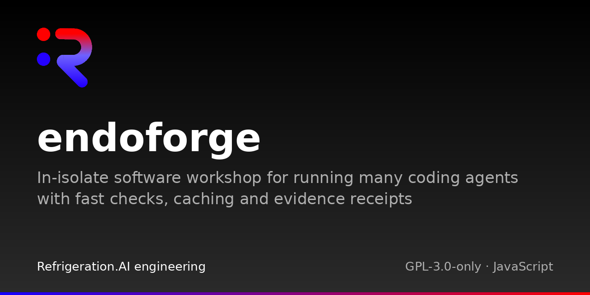

# EndoForge

In-isolate software workshop for running many coding agents with fast checks, caching and evidence receipts


## Status

Research software. The core contains the lifecycle model, evidence ledger, engine evaluator and gates, and local agent execution pools. The lifecycle model validates proposals, evidence, and decision references. The evaluator checks candidates through caller-supplied host callbacks; runtime pools launch configured agent clients, while workflow orchestration and scheduling utilities live under `tools/`. Interfaces may change; lifecycle transitions validate references without granting authority.

## Quickstart

Requirements: Python 3.11+, Node.js 20+, GNU Make, and bubblewrap for isolate checks.

Run from the repository root:

```sh
make check
make test
```

Tests use synthetic inputs and stubs. Public agent clients are optional. Keep generated evidence outside the source tree; the test output directory can be set with `make test ENDOFORGE_TEST_OUTPUT=/tmp/endoforge-test-output`.

## What is inside

| Component | Purpose |
|---|---|
| [Lifecycle model](core/lifecycle.py) | Validate artifact identities, state changes, evidence, and decision bindings |
| [Ledger](core/ledger/ledger.py) | Store and validate linked evidence records |
| [Evaluator](core/engine/evaluator.mjs) | Evaluate candidates against frozen checks |
| [Runtime](core/runtime/README.md) | Manage local execution pools |

## Documentation

Start with the [documentation index](docs/README.md) and [local check guide](docs/guides/how-to/local-checks.md). Archived input placeholders are preserved in [campaigns](TODELETE/campaigns/README.md) and [experiments](TODELETE/experiments/README.md). The digest-checked source example remains in [sources](sources/README.md).

## Related projects

[Cstack](https://github.com/Akilleez-QA/cstack) and [poodo](https://github.com/Akilleez-QA/poodo) are related projects. This repository does not implement the external Cstack bridge.

## Layout

| Path | Contents |
|---|---|
| `core/` | Lifecycle model, evidence ledger, engine evaluator and gates, local execution pools |
| `tools/` | Workflow orchestration, quality support, and scheduling utilities |
| `tests/` | Lifecycle and core boundary tests |
| `docs/` | Documentation |
| `TODELETE/` | Archived unused placeholders, preserving their original relative paths |
| `sources/` | Source example and digest manifest |

## Contributing

See [CONTRIBUTING.md](CONTRIBUTING.md) and [CODE_OF_CONDUCT.md](CODE_OF_CONDUCT.md).

## Security

Report vulnerabilities as described in [SECURITY.md](SECURITY.md).

## License

This project is available under the GNU General Public License v3.0 only (GPL-3.0-only). If you want to use it to create a product or service under different terms, commercial licenses are available from Refrigeration.AI. Contact craig@nh3.biz.
