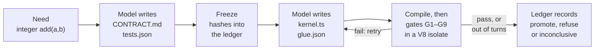

# EndoForge

EndoForge has an AI coding model write a small numeric function from a one-line request, compiles it to WebAssembly,
and accepts it only if tests frozen before the code existed, plus eight other automatic checks, pass on its exact
bytes. Every step is written to a tamper-evident log.

It is research software: a test bed for one question. When a model writes the code, what has to be true before you
keep it? It is for engineers and researchers who build or study code-writing agents and want to measure how far that
code can be trusted. It is not a finished code generator for production use.

## Why

A coding model can write a function and its tests in one go. If it can also change the tests after it sees them fail,
"all tests pass" tells you very little. EndoForge splits the work into fixed steps:

- The request (a "need": free text, such as `integer add(a,b)`) first becomes a written contract and a set of
  tests. Their hashes are stored before any code exists. Any later change to them is refused.
- The code is compiled to WebAssembly and run inside a V8 isolate (a separate instance of the JavaScript engine in
  Node.js and Chrome). It runs under a fuel meter (a counter charged at every function call and loop iteration) and
  a memory cap, and it may import nothing except an abort hook, so it cannot reach files or the network.
- Nine gates decide. A candidate that fails a gate is refused. If the evidence is incomplete, because a worker was
  lost, a deadline passed or a model call was held back by a usage limit, the result is "inconclusive", never a
  pass.

You get a kernel (a small, self-contained WebAssembly function) plus a SQLite ledger that shows which contract, which
tests and which checks it passed. The ledger is append-only and hash-chained, so an edited record is detected. The
promoted WebAssembly module is stored, base64-encoded, in the ledger's candidate record, so you can load it in any
WebAssembly runtime.

A kernel is a pure function of scalar values. Each argument and the result is a number, an integer, a boolean or an
integer code with named meanings, and each carries a unit. There are no arrays or strings.

## How it works



1. A model turns the need into `CONTRACT.md` (what the function computes) and `tests.json` (inputs and expected
   outputs).
2. EndoForge stores the hashes of both in the ledger. From here on they cannot change.
3. The model writes `kernel.ts` in AssemblyScript, a TypeScript-like language that compiles to WebAssembly, and
   `glue.json`, which gives each argument a name, a kind and a unit.
4. A pinned compiler builds the WebAssembly module, and the gates run it in an isolate:

   | Gate | Passes when |
   |---|---|
   | G1 frozen | The contract and tests still match their frozen hashes, and no test is too weak (it asserts nothing, or its tolerance exceeds 1% of the expected value) |
   | G2 compiles | The module was built from this exact source and imports nothing unexpected |
   | G3 exports | Every function the tests and glue name exists |
   | G4 tests | Every frozen test passes |
   | G5 deterministic | Two fresh instances, called in opposite orders, give the same results |
   | G6 bounded | Fuel, stack and memory stay within limits |
   | G7 glue | `glue.json` matches its schema, the kernel's parameters and the contract |
   | G8 nonfinite | Floating-point arguments set to NaN or infinity behave as the contract says |
   | G9 units | The kernel's arithmetic is consistent with the units in `glue.json` |

5. If a gate fails, its report becomes the model's next prompt. By default the model gets six turns to write and
   repair the code.
6. At a pass, or when the turns run out, EndoForge writes the candidate, a receipt with every gate result, and the
   decision to the ledger in one transaction: `promote` if every gate passed, `refuse` if one failed, `inconclusive`
   if evidence is missing.

The [candidate loop](docs/architecture/candidate-loop.md) page has the details.

## Example

Two scripts ship in [`examples/`](examples/): `first-loop.mjs` sends a need through the loop, and `show-gates.py`
prints the gate results from the ledger it wrote and saves the promoted kernel. The model here is a test double, a
script that replays fixed answers, so it needs no account and no network. Everything else is the real code: the
freeze, the compiler, the isolate, the gates and the ledger.

Ask for `integer add(a,b)` and the loop promotes a kernel in two model turns, one for the contract and one for the
code. `rounds` lists each run of the gates:

```console
$ node examples/first-loop.mjs
{
  "need": "integer add(a,b)",
  "promoted": true,
  "testDouble": true,
  "turns": 2,
  "rounds": [
    "passed"
  ],
  "ledger": "/tmp/ef-first-loop-rPp1e0/addition/ledger.sqlite"
}
$ python3 examples/show-gates.py /tmp/ef-first-loop-rPp1e0/addition/ledger.sqlite
ledger records: task, admitted_input, frozen_evaluator, candidate, receipt
  G1_frozen         pass
  G2_compiles       pass  {"wasmBytes": 57}
  G3_exports        pass  {"exports": ["add"]}
  G4_tests          pass  {"passed": 1, "total": 1}
  G5_deterministic  pass
  G6_bounded        pass  {"maxMs": 0.000751, "fuelUsed": 5}
  G7_glue           pass
  G8_nonfinite      pass  {"probes": 0}
  G9_units          pass  {"checks": {"add": "dimensionless"}}
decision: promote
kernel: /tmp/ef-first-loop-rPp1e0/addition/kernel.wasm (57 bytes)
```

G8 made no probes because `add` takes integers, not floating-point numbers. G9 found `add` dimensionless because both
arguments have unit `1`. The saved `kernel.wasm` is an ordinary WebAssembly module:

```console
$ node -e 'const m = new WebAssembly.Module(require("fs").readFileSync(process.argv[1])); console.log(new WebAssembly.Instance(m).exports.add(2, 3))' /tmp/ef-first-loop-rPp1e0/addition/kernel.wasm
5
```

Now run it with `wrong`, which makes the scripted model answer the same need with a kernel that subtracts. Each
failure goes back to the model, the script never fixes it, and after one contract turn and six code turns the loop
stops with nothing promoted:

```console
$ node examples/first-loop.mjs wrong
{
  "need": "integer add(a,b)",
  "promoted": false,
  "testDouble": true,
  "turns": 7,
  "rounds": [
    [
      "G4_tests"
    ],
    ...
$ python3 examples/show-gates.py /tmp/ef-first-loop-uNMOBv/addition/ledger.sqlite
  ...
  G4_tests          FAIL  {"passed": 0, "total": 1}
  ...
decision: refuse
```

`testDouble: true` marks a run where a test double wrote the code. Such a run shows the machinery works; it says
nothing about how good a real model is.

## Quickstart

You need Git, GNU Make, Python 3.11 or later and Node.js 22.8 or later. EndoForge is developed and tested on Linux;
other systems are untested.

```sh
git clone https://github.com/Akilleez-QA/endoforge.git
cd endoforge
make check        # the repository's own consistency checks; about a second
make loop-setup   # installs the pinned AssemblyScript compiler (needs network once)
node examples/first-loop.mjs
python3 examples/show-gates.py <the "ledger" path it printed>
```

The [getting-started tutorial](docs/guides/tutorials/getting-started.md) walks through the same run and explains each
step. It takes about five minutes.

The full test suite (`make tools`, then `make test`) also needs bubblewrap (process sandboxing), `age` (encrypted
checkpoints) and `gcc` (a small helper one test compiles); see [run local checks](docs/guides/how-to/local-checks.md).

### Using a real model

`ENDOFORGE_LOOP` picks one of three loop paths. All three use the same freeze, gates and ledger; they differ in where
the model conversation runs.

| `ENDOFORGE_LOOP` | Model | Where it runs |
|---|---|---|
| unset (default) | Codex CLI, through the command in `ENDOFORGE_CODEX_CMD` and the home in `CODEX_HOME` | The model in its own process; gates in isolates |
| `isolate` | The same Codex CLI command | Compile, gates and repair in one isolate that stays warm between rounds |
| `agent` | Any provider: the example's script, or a Claude transport | The model's whole turn loop inside the isolate |

The default path is the established one; the other two stay opt-in until their parity with it is accepted
([P-50](experiments/P-50-in-isolate/RESULT.md) measured them). Real-model results are in the experiments: in
[P-42](experiments/P-42-scalar/RESULT.md), the default path with a Codex model promoted 177 of 180 attempts (30 needs,
six runs each), with a median of about 49 seconds per need.

For the agent path, change the provider in a copy of `examples/first-loop.mjs`, which already imports
`createLoopPool`:

```js
import { WarmClaudeTransport } from '../core/runtime/x1/transports.mjs';
const pool = createLoopPool({ provider: new WarmClaudeTransport() });
```

That transport keeps a `claude` CLI process open and sends it each turn. EndoForge refuses to launch the CLI unless it
is signed in with a claude.ai subscription (Pro, Max or Team) and strips API-key variables from its environment, so a
misconfigured machine cannot fall back to metered API billing. This README does not show a real-model run, because
the shipped example is the scripted one; the swap above was checked to construct, not run. The
[runtime README](core/runtime/README.md#the-agent-loop-in-the-workcell) describes the transports, and the
[configuration reference](docs/configuration/configuration-reference.md) lists every setting.

## What is inside

| Part | What it does | Where |
|---|---|---|
| Candidate loop | Need to contract, freeze, code, compile, gates and decision | [`core/runtime/x1/`](docs/architecture/candidate-loop.md) |
| Workcells | The isolates candidates run in, as threads or processes, with memory limits and deadlines | [`core/runtime/`](core/runtime/README.md) |
| Ledger | The append-only, hash-chained SQLite record of every step | [`core/ledger/`](docs/interfaces/ledger-icd.md) |
| Evaluator | Runs a candidate against frozen checks | [`core/engine/`](core/engine/evaluator.mjs) |
| Library | Reuses a promoted kernel when a new contract matches its kinds, units and ranges and the kernel passes the new tests | [`core/library/`](core/library/README.md) |
| Lifecycle model | Checks that recorded decisions refer to real, unchanged artifacts | [`core/lifecycle.py`](core/lifecycle.py) |
| Tools | Scripts for running many agent jobs, a TypeScript checker and repository checks | [`tools/`](tools/README.md) |
| Experiments | The measurement behind each default, each planned in writing before it ran | [`experiments/`](experiments/README.md) |

## Limitations

- The same model writes the tests and then the code, in one conversation. Freezing stops it from changing the tests
  later, not from writing weak ones. A promotion means the frozen tests and the gates passed; it does not prove the
  kernel right for every input. In [P-52](experiments/P-52-real-gates/RESULT.md), 280 of 7,883 deliberately broken
  kernels (3.6%) still passed every gate, down from 441 (5.6%) before that experiment's stricter gates. The broken
  kernels were copies of 118 promoted kernels, each with one seeded change to its source.
- The repository tests use synthetic inputs and test doubles. They do not qualify a live model service.
- The hash chain shows a ledger was edited after the fact. It is not a signature: someone who rewrites the whole file
  can build a new valid chain.
- Thread workcells cannot cap memory outside the JavaScript heap. Use process workcells with a cgroup for that.
- Interfaces may change. There are no releases; only the latest `main` is supported.

More in [limitations and safe use](docs/guides/explanation/limitations.md).

## Documentation

The [documentation index](docs/README.md) is sorted by what you want to do:

- Learn: [getting started](docs/guides/tutorials/getting-started.md)
- Do: [run local checks](docs/guides/how-to/local-checks.md)
- Look up: [configuration](docs/configuration/configuration-reference.md),
  [data dictionary](docs/data/data-dictionary.md), [tools](tools/README.md)
- Understand: [the candidate loop](docs/architecture/candidate-loop.md),
  [limitations](docs/guides/explanation/limitations.md)

## Related projects

EndoForge is the engine of the Cstack family (code name Mjölnir). [Cstack](https://github.com/Akilleez-QA/cstack) is
the host and vendors part of EndoForge at a pinned commit; the [Cstack ICD](docs/icd/icd-cstack.md) lists what. The
family also includes [poodo](https://github.com/Akilleez-QA/poodo), a reasoning skill, and the foundation repositories
([engine](https://github.com/Akilleez-QA/foundation-engine), [math](https://github.com/Akilleez-QA/foundation-math),
[film](https://github.com/Akilleez-QA/foundation-film),
[refrigeration](https://github.com/Akilleez-QA/foundation-refrigeration),
[robotics](https://github.com/Akilleez-QA/foundation-robotics) and
[template](https://github.com/Akilleez-QA/foundation-template)).

## Engineering records

The project keeps a full set of engineering documents: a management plan, requirements traced to tests, a design
description, interface documents, a verification matrix and generated version descriptions. They are listed under
[engineering records](docs/README.md#engineering-records) in the documentation index.

Classification: self-assessed Class E analog, not safety-critical. The documents follow the Cstack family standard,
organized after NASA NPR 7150.2D. This is not a NASA compliance determination
([software management plan](docs/plan/software-management-plan.md)).

## Contributing and security

See [CONTRIBUTING.md](CONTRIBUTING.md), [CODE_OF_CONDUCT.md](CODE_OF_CONDUCT.md) and [SECURITY.md](SECURITY.md).

## License

GNU General Public License v3.0 only (GPL-3.0-only). Copyright © 2026 Refrigeration.AI, which also offers commercial
licenses for products or services under different terms. Contact craig@nh3.biz.
