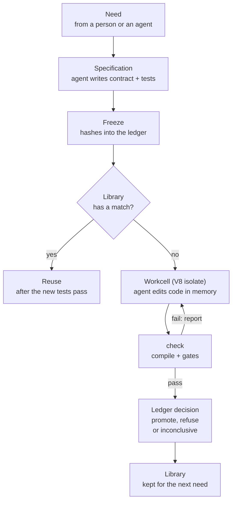

# EndoForge

EndoForge lets AI coding agents (Claude Code and Codex) build real software inside in-memory V8 isolates, checked
against tests frozen before the code exists, with every verdict in a hash-chained ledger and passing code kept for
reuse.

You give it a need: "I want software that does X". A coding agent (Claude Code through `claude -p`, or Codex) first
writes a contract and tests. EndoForge freezes them by writing their hashes into a ledger. The agent then writes the
code inside a workcell: a V8 isolate (one instance of the JavaScript engine that Node.js and Chrome use) kept warm in
memory with a pinned AssemblyScript compiler already loaded. Each check compiles the code and runs it against the
frozen tests and nine fixed gates (listed in the example below). The gate report goes back to the agent until the code passes or the turns run out. One ledger
transaction records the outcome: `promote`, `refuse` or `inconclusive`. Promoted code goes into a capability library, so
the next matching request runs that code instead of paying for another model turn.

It is for engineers who run coding agents and want results they can check, and for host applications, such as
[Cstack](https://github.com/Akilleez-QA/cstack), that add a feature when a user asks for one. EndoForge itself is a
JavaScript and Python code base you run from a clone; there is no package to install.

## What the agents build

EndoForge works at three scales:

| Scale | Output | How it is checked |
|---|---|---|
| One need | A logic module: kernel plus glue (below) | The candidate loop: frozen tests and nine gates in a workcell |
| Code that does not fit the kernel split | TypeScript, such as an existing module | The compatibility path: type checked in workcells, then the emitted JavaScript runs twice in a contained V8 process and both runs must match |
| A whole job | Changes across a git repository | The conductor: Claude Code and Codex workers in their own git worktrees, each landed change gated by the job's checks |

You do not write the code yourself; the agents do. For a single need, EndoForge splits software into two parts, so the
logic can be checked exactly and the side effects stay with the host:

- **The kernel** (here, the logic module, not an operating-system kernel) is a WebAssembly module of pure functions. Each takes the current state and an event and
  returns the new state, plus any effects (save this, send that, show this) as plain data. It can import nothing
  except an abort hook, so it cannot touch files, the network or the screen.
- **The glue** (`glue.json`) is data: it declares each function's label, inputs, outputs and their units, so a host
  application can show the function, call it and carry out its effects.

So an application here is kernels plus glue running in a host. The host supplies the screen, storage and network once
and runs the event loop; each feature is a kernel the agents write and the gates check. A to-do list in this shape is a
kernel that takes the list and an "add item" event and returns the new list and a
"save" effect; the host draws the list and does the saving. The host is whatever code loads the kernel and acts on its
effects: your own program (a promoted kernel is an ordinary WebAssembly file, as the example shows) or a host
application such as Cstack. The counter in the example below and the small functions in the
[experiments](experiments/README.md) are test workloads that measure the engine, not the limit of what agents build.

## Why

Coding models make proposals cheaply. The cost comes afterwards: deciding whether to trust the code, repairing it, and
paying a model to understand the same problem again next time. EndoForge goes after all three.

- **You trust the checks, not the model.** The contract and tests are frozen before any code exists. The agent can read
  them but cannot change them, so it cannot "fix" a failing test. Missing evidence (a lost worker, a missed deadline, a
  model call held back at the account's weekly usage limit) gives `inconclusive`, never a pass.
- **The repair loop stays in memory.** Edit, compile, run and check all happen inside the isolate. There is no
  container, virtual machine or process spawn per attempt, so one machine runs many agents at once. The isolates are
  there for speed, concurrency and low memory use. They are not an operating-system sandbox.
- **Working code is kept.** A promoted capability is stored with its contract and its evidence. A later request whose
  frozen tests it passes reuses it and skips the coding turn.

## How it works



1. **Specification.** The agent turns the need into `CONTRACT.md` (what the code does, its assumptions and limits) and
   `tests.json`. Tests that assert nothing, or whose tolerance is looser than 1% of the expected value, are refused
   before the freeze.
2. **Freeze.** The hashes of both files go into the ledger. Every later check verifies them again.
3. **Library.** If the caller passes a capability library, EndoForge looks up promoted capabilities by a key computed from the contract
   (each input's and output's kind, unit and range). A match is reused if it passes the new frozen tests and those
   tests are strong enough to reject deliberately broken copies of it.
4. **Workcell.** Otherwise the agent writes the code into the workcell's overlay (an in-memory set of files) and calls
   `check`. The check compiles with the pinned compiler and runs nine gates on the exact compiled bytes, then sends any failure back
   as the agent's next prompt. By default the agent gets six turns for the specification stage (contract and tests) and
   six for the implementation stage (the code).
5. **Decision.** The ledger records the candidate, every gate result and the decision in one transaction. The ledger is
   append-only and hash-chained, so an edited record is detected.

The [system overview](docs/architecture/architecture.md) maps each step to the code. The
[candidate loop](docs/architecture/candidate-loop.md) page lists what each gate checks.

## Example

### A counter, through the real loop

[`examples/counter-loop.mjs`](examples/counter-loop.mjs) sends one need through the real loop: the freeze, the
compiler, the workcell, the gates and the ledger. The only stand-in is the model. A test double replays fixed answers
(the contract, six tests, an AssemblyScript kernel and its glue, all visible in the script), so the example needs no
account and no network.

The need is a counter that handles increment, decrement and reset events and never goes below zero. The kernel is a
reducer, `next(count, event)`: state and event in, new state out.

```console
$ node examples/counter-loop.mjs
{
  "need": "a counter that handles increment, decrement and reset events and never goes below zero",
  "promoted": true,
  "testDouble": true,
  "turns": 2,
  "rounds": [
    "passed"
  ],
  "ledger": "/tmp/ef-counter-RjmeVH/counter/ledger.sqlite"
}
$ python3 examples/show-gates.py /tmp/ef-counter-RjmeVH/counter/ledger.sqlite
ledger records: task, admitted_input, frozen_evaluator, candidate, receipt
  G1_frozen         pass
  G2_compiles       pass  {"wasmBytes": 293}
  G3_exports        pass  {"exports": ["next"]}
  G4_tests          pass  {"passed": 6, "total": 6}
  G5_deterministic  pass
  G6_bounded        pass  {"maxMs": 0.0109, "fuelUsed": 288}
  G7_glue           pass
  G8_nonfinite      pass  {"probes": 0}
  G9_units          pass  {"checks": {"next": "dimensionless"}}
decision: promote
kernel: /tmp/ef-counter-RjmeVH/counter/kernel.wasm (293 bytes)
```

Two model turns: one wrote the contract and tests, one wrote the code. The gates checked, in order: the frozen files
are unchanged and the tests are not trivial (G1); the module compiled from this exact source and imports nothing but
an abort hook (G2); the named exports exist (G3); all six tests pass, including the two that must trap (G4); a second
run gives the same results (G5); fuel and stack stay in bounds, where fuel counts executed instructions (G6);
`glue.json` matches its schema and the code (G7); NaN and infinity inputs behave as the contract says (G8, no probes
here because the inputs are integers); and the arithmetic agrees with the units declared in `glue.json` (G9). Units
matter because a host connects these functions by what their values mean: adding a temperature to a pressure fails G9.
Unit `1` means a plain number, which G9 reports as `dimensionless`.

`testDouble: true` marks a run where a test double wrote the code: it shows the machinery works and says nothing about
how good a real model is.

The promoted `kernel.wasm` is an ordinary WebAssembly file. Here Node.js plays the host, feeds it the events increment,
increment, increment, decrement, reset, decrement, and prints the count after each:

```console
$ node -e 'const m = new WebAssembly.Module(require("fs").readFileSync(process.argv[1])); const { next } = new WebAssembly.Instance(m, { env: { abort() { throw Error("abort") } } }).exports; let c = 0; for (const e of [0, 0, 0, 1, 2, 1]) { c = next(c, e); process.stdout.write(c + " ") } console.log()' /tmp/ef-counter-RjmeVH/counter/kernel.wasm
1 2 3 2 0 0
```

[`examples/first-loop.mjs`](examples/first-loop.mjs) is the same loop on an even smaller test need, `integer add(a,b)`.
Run `node examples/first-loop.mjs wrong` and its scripted model answers with code that subtracts. The gates fail it six
times in a row (`"rounds": [["G4_tests"], ...]`), the double never repairs it, and the ledger records `refuse`.

### What an agent turn looks like

The agent's only tools are four calls, defined in [`agent.mjs`](core/runtime/x1/agent.mjs). The workcell runs them
against its overlay: an in-memory map of file names to contents that never touches disk.

| Call | What the workcell does |
|---|---|
| `read_file` | Returns a file from the overlay, including the frozen `CONTRACT.md` and `tests.json` |
| `edit_file` | Writes a whole file, or replaces one exact match. Only the stage's own files can be written; frozen files cannot |
| `check` | Compiles the code with the pinned compiler and runs the gates |
| `done` | Ends the stage. If the agent has not run `check` this turn, the workcell runs it first |

Each reply is one JSON object holding a list of calls. This is a real exchange from `first-loop.mjs wrong`, recorded by
logging each message the scripted provider received and sent (long strings trimmed):

```text
agent    {"calls":[{"name":"edit_file","path":"kernel.ts",
           "content":"export function add(a:i32,b:i32):i32{return a-b}"},
          {"name":"edit_file","path":"glue.json","content":"{\"id\":\"addition\", ...}"},
          {"name":"done"}]}
workcell {"results":[{"path":"kernel.ts","written":48},{"path":"glue.json","written":324},
          {"check":{"gates":{"G4_tests":{"ok":false,"passed":0,"total":1}},
           "tests":[{"name":"add","fn":"add","args":[2,3],"expect":5,"got":-1,"ms":0.01,"pass":false}]}}],
          "instructions":"Fix what failed, then done."}
```

The conversation and the overlay live in the workcell. It asks the host for only two things: a model turn and the
freeze. A Claude Code session is used purely as the model: EndoForge starts `claude -p` with its built-in tools turned
off, so every file the agent touches is in the overlay. While the agent waits for the model, the workcell writes the
conversation and overlay to the ledger and takes other work; the next reply resumes it in any free workcell.

## Quickstart

You need Git, GNU Make, Python 3.11 or later and Node.js 22.8 or later. EndoForge is developed and tested on Linux.

```sh
git clone https://github.com/Akilleez-QA/endoforge.git
cd endoforge
make check        # repository consistency checks, about a second
make loop-setup   # installs the pinned AssemblyScript compiler (needs network once)
node examples/counter-loop.mjs
python3 examples/show-gates.py <the "ledger" path it printed>
```

The [getting-started tutorial](docs/guides/tutorials/getting-started.md) walks through the same run step by step in
about five minutes. The full test suite (`make tools`, then `make test`) also needs bubblewrap, `age` and `gcc`; see
[run local checks](docs/guides/how-to/local-checks.md).

### With a real agent

A need is a plain-language string passed to `runNeed`, the loop's entry point; you call it from your own script. Save
this as `my-need.mjs` in the repository root and run `node my-need.mjs` to send one need to Claude Code on the agent
path, where the whole conversation lives in the workcell:

```js
import { mkdtempSync } from 'node:fs';
import { tmpdir } from 'node:os';
import { join } from 'node:path';
import { createLoopPool } from './core/runtime/x1/loop.mjs';
import { runNeed } from './core/runtime/x1/pipeline.mjs';
import { WarmClaudeTransport } from './core/runtime/x1/transports.mjs';

const pool = createLoopPool({ provider: new WarmClaudeTransport() });
const directory = join(mkdtempSync(join(tmpdir(), 'ef-')), 'counter');
const result = await runNeed({ need: 'a counter with increment, decrement and reset events that never goes below zero',
  directory, pool, env: { ENDOFORGE_LOOP: 'agent' } });
console.log(result.promoted, result.agent);
await pool.close();
```

`WarmClaudeTransport` keeps one `claude` process open and streams each turn to it. Claude Code must be signed in with
a claude.ai subscription (Pro, Max or Team): the transport refuses API-key and other provider configurations and
strips billing variables from the child environment, so a misconfigured machine cannot fall back to metered billing.
The script above was checked to construct its pool and transport; this README does not run it against a model.
Real-model runs are in the experiments, each planned in writing before it ran. In experiment [P-66](experiments/P-66-best-of-n/RESULT.md), this agent path with the warm
Claude Code transport made 600 model calls over 26 test needs; Claude Sonnet at low effort promoted 99.5% of needs,
with a median of 23 s per need and about two model calls per promoted candidate.

The agent path is the shortest setup for a real agent: one signed-in `claude` CLI. The default path needs a Codex CLI
login instead.

`ENDOFORGE_LOOP` picks one of three loop paths. All three share the freeze, the gates and the ledger; they differ in
where the agent's conversation runs.

| `ENDOFORGE_LOOP` | Agent | Where the work happens |
|---|---|---|
| unset (default) | Codex CLI (`codex exec`) | Codex writes the files on disk in the need's directory; compile and gates run in a workcell |
| `isolate` | Codex CLI | Codex writes the files on disk; check and repair run in one workcell that stays warm between rounds |
| `agent` | Claude Code (`claude -p`) or any provider object | The whole agent conversation runs inside the workcell |

Start with the agent path to see a real agent at work. The default path is the longest-established one, and capability-library reuse (pass `library: await openLibrary()` from
`core/library/library.mjs`) and evaluator synthesis (`ENDOFORGE_SYNTH=1`, a second check written by a model that never
saw the candidate) plug into it, so use it when you need those. The `agent`
path removes process spawns from the repair loop: experiment [P-50](experiments/P-50-in-isolate/RESULT.md) measured the same
verdicts as the default path on 31 inputs, with non-model time per need down from about 1.5 s to about 0.13 s at the
median. The [runtime README](core/runtime/README.md#the-agent-loop-in-the-workcell) describes the transports, and the
[configuration reference](docs/configuration/configuration-reference.md) lists every setting.

## What is inside

| Part | What it does | Where |
|---|---|---|
| Candidate loop | Need to contract, freeze, code, compile, gates and decision, on three loop paths | [`core/runtime/x1/`](docs/architecture/candidate-loop.md) |
| Workcells | V8 isolates as threads or processes, with heap, WebAssembly memory and deadline limits, kept warm | [`core/runtime/`](core/runtime/README.md) |
| Agent transports | Claude Code (`claude -p`, cold or kept warm, subscription login enforced) and a pool of Codex logins with failover on rate limits | [`transports.mjs`](core/runtime/x1/transports.mjs), [`agent-pool.mjs`](core/runtime/agent-pool.mjs) |
| Ledger | The append-only, hash-chained SQLite record of every step, written in batches | [`core/ledger/`](docs/interfaces/ledger-icd.md) |
| Capability library | Reuses a promoted capability when it passes a new need's frozen tests | [`core/library/`](core/library/README.md) |
| Evaluator synthesis | A second check written by a model that never saw the candidate (opt-in) | [`x1/synth/`](docs/architecture/evaluator-synthesis.md) |
| TypeScript path | The TypeScript 7 checker compiled to WebAssembly runs in workcells; emitted JavaScript runs in a contained V8 process | [`tools/tscheck/`](tools/tscheck/README.md) |
| Larger jobs | For work bigger than one need: job intake checks a written job plan and waits for the user's go; the atomizer splits a need into a graph of small pieces, each run in its own sandbox; the conductor runs coding agents on whole git repositories and gates each change they land | [`tools/`](tools/README.md) |
| Experiments | The measurement behind each default, planned in writing before it ran | [`experiments/`](experiments/README.md) |

## Limitations

- **A pass is only as good as the frozen tests.** On the agent path, the same model writes the tests and then the code.
  Freezing stops it from changing the tests, not from writing weak ones. In
  [P-52](experiments/P-52-real-gates/RESULT.md), 280 of 7,883 deliberately broken candidates (3.6%) still passed every
  gate. Evaluator synthesis adds a candidate-blind check, but it is off by default.
- **The nine gates check the kernel form.** The stage prompts ask for the kernel in AssemblyScript, a TypeScript-like
  language with a pinned compiler that runs inside the workcell. Code that does not fit the kernel split goes through
  the TypeScript compatibility path, which has its own checks.
- **The ledger detects edits; it does not sign.** Someone who rewrites the whole file can build a new valid chain.
- **Thread workcells cannot cap memory outside the JavaScript heap.** Use process workcells with a cgroup for that.
- **No releases.** Interfaces may change; only the latest `main` is supported. Only Linux is tested.

More in [limitations and safe use](docs/guides/explanation/limitations.md).

## Documentation

The [documentation index](docs/README.md) is sorted by what you want to do:

- Learn: [getting started](docs/guides/tutorials/getting-started.md)
- Do: [run local checks](docs/guides/how-to/local-checks.md)
- Look up: [configuration](docs/configuration/configuration-reference.md),
  [data dictionary](docs/data/data-dictionary.md), [tools](tools/README.md)
- Understand: [system overview](docs/architecture/architecture.md),
  [the candidate loop](docs/architecture/candidate-loop.md), [limitations](docs/guides/explanation/limitations.md)

## Related projects

EndoForge is the software engine of the Cstack family (code name Mjölnir). [Cstack](https://github.com/Akilleez-QA/cstack)
is a host application that grows new capabilities on request, using foundation libraries for domain knowledge, exact
primitives and checks. It vendors part of EndoForge at a pinned commit, and the
[Cstack ICD](docs/icd/icd-cstack.md) lists what. The family also includes [poodo](https://github.com/Akilleez-QA/poodo),
a reasoning skill, and the foundation repositories ([engine](https://github.com/Akilleez-QA/foundation-engine),
[math](https://github.com/Akilleez-QA/foundation-math), [film](https://github.com/Akilleez-QA/foundation-film),
[refrigeration](https://github.com/Akilleez-QA/foundation-refrigeration),
[robotics](https://github.com/Akilleez-QA/foundation-robotics) and
[template](https://github.com/Akilleez-QA/foundation-template)). You need none of them to run EndoForge.

## Engineering records

The project keeps a full set of engineering documents: a management plan, requirements traced to tests, a design
description, interface documents, a verification matrix and generated version descriptions. They are listed under
[engineering records](docs/README.md#engineering-records) in the documentation index.

Classification: self-assessed Class E analog, not safety-critical. The documents follow the Cstack family standard,
organized after NASA NPR 7150.2D. This is not a NASA compliance determination
([software management plan](docs/plan/software-management-plan.md)).

## Contributing and security

See [CONTRIBUTING.md](CONTRIBUTING.md), [CODE_OF_CONDUCT.md](CODE_OF_CONDUCT.md) and [SECURITY.md](SECURITY.md).

## License

GNU General Public License v3.0 only (GPL-3.0-only). Copyright © 2026 Refrigeration.AI, which also offers commercial
licenses for products or services under different terms. Contact craig@nh3.biz.
