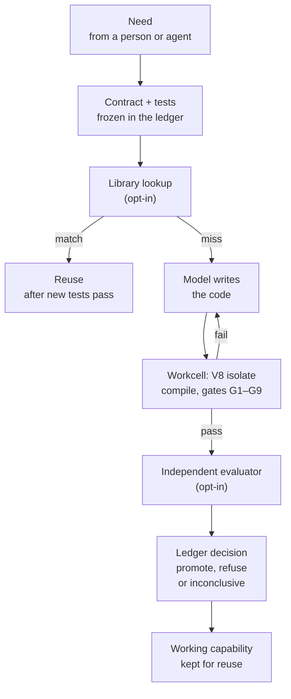

# EndoForge

EndoForge turns code that AI coding agents propose into trusted, reusable working software. A person or an agent asks
for a capability; a model writes the code; EndoForge checks, runs and measures it inside V8 isolates against tests that
were frozen before the code existed, records the verdict in a hash-chained ledger, and keeps what passes so the next
request runs the code instead of asking a model again.

Today the loop promotes one form of code: small numeric functions compiled to WebAssembly. TypeScript checking, reuse,
independent evaluators and tools that run coding agents on whole repositories are built around it. The goal is an
engine for generated user interfaces and disposable software (code made for one need and dropped when the need is
gone): applications that grow new features on request. That is not built yet;
[what it builds today](#what-it-builds-today) separates the two.

You trust the checks instead of the model. The model cannot change the tests after it sees them fail, and the ledger
shows exactly which checks the code passed. In today's loop the same model writes the tests and then the code, so a pass
is only as good as those tests; the opt-in evaluator synthesis adds checks written in a context that never saw the
code, and [limitations](#limitations) says what a pass does not prove.

It is research software, for engineers who build coding agents or tools that let agents write and run code.

## Why

Coding models are cheap and fast at proposing code. The expensive parts come after: deciding whether to trust it,
repairing it, and paying a model to understand the same problem again next time. EndoForge attacks all three.

- **Trust comes from the checks, not the model.** The contract and tests are hashed into the ledger before any code
  exists, and any later change to them is refused, so a model cannot "fix" a failing test. For a kernel, nine
  automatic gates then check the exact compiled bytes. Missing evidence (a lost worker, a deadline, a held-back model
  call) gives "inconclusive", never a pass.
- **The check loop stays local and fast.** Compile, run, check and repair happen in V8 isolates (separate instances of
  the JavaScript engine in Node.js and Chrome) kept warm in memory. There is no container or virtual machine per
  attempt, so one machine can run many attempts at once. The isolates are there for speed and density. Code in them
  still gets a fuel meter, a memory cap and no imports beyond an abort hook, but they are not an operating-system
  sandbox.
- **Working code is kept and reused.** A promoted capability is stored with its contract and its evidence. A later
  request with a matching contract can reuse it after it passes the new request's own tests, which skips the model's
  coding turn.

## How it works



1. A model turns the need into a contract (`CONTRACT.md`: what the code computes) and tests (`tests.json`). EndoForge
   stores their hashes in the ledger. From here on they cannot change.
2. With a library attached, EndoForge looks for a promoted capability whose contract matches. A match is reused only if
   it passes the new tests in a workcell.
3. Otherwise the model writes the code: for a kernel, `kernel.ts` plus `glue.json`, which names each argument's kind
   and unit. A pinned compiler builds it, and nine gates run it in a workcell (a V8 isolate
   with a fuel meter and a memory cap). A failed gate's report becomes the model's next prompt; by default it gets six
   turns to write and repair the code.
4. With evaluator synthesis on, a second check written in a context that never saw the candidate (a reference function
   plus generated test inputs) must also accept it.
5. One ledger transaction records the candidate, every gate result and the decision: `promote`, `refuse` or
   `inconclusive`. The ledger is append-only and hash-chained, so an edited record is detected.

| Gate | Passes when |
|---|---|
| G1 frozen | The contract and tests still match their frozen hashes, and no test is too weak (it asserts nothing, or its tolerance exceeds 1% of the expected value) |
| G2 compiles | The module was built from this exact source and imports nothing unexpected |
| G3 exports | Every function the tests and glue name exists |
| G4 tests | Every frozen test passes |
| G5 deterministic | Two fresh instances, called in opposite orders, give the same results |
| G6 bounded | Fuel, stack and memory stay within limits |
| G7 glue | `glue.json` matches its schema, the kernel's parameters and the contract |
| G8 nonfinite | Floating-point arguments set to NaN or infinity behave as the contract says |
| G9 units | The kernel's arithmetic is consistent with the units in `glue.json` |

The [candidate loop](docs/architecture/candidate-loop.md) page has the details.

## What it builds today

The loop above is general; the forms of code it can promote are still few. The kernel loop is where the full
discipline (frozen checks, nine gates, one ledger) runs today. The repository tools in the fifth row are where coding
agents build larger software now, under their own checks; bringing that work into the same workcell loop is planned,
not built.

| Part | State today |
|---|---|
| Numeric kernels: pure functions of numbers with units, written in AssemblyScript (a TypeScript-like language) and compiled to WebAssembly, plus `glue.json` naming each argument's kind and unit (gate G9 catches arithmetic that mixes units, a silent bug in numeric code) | Built and the default. The only form that is promoted. No arrays or strings yet. |
| TypeScript compatibility lane: the TypeScript compiler (a pinned WebAssembly port, `tsrs`) type checks inside workcells, and the emitted JavaScript runs twice in a contained V8 process | Built and opt-in. Its result is reported but does not decide a promotion, and it currently takes a kernel's TypeScript source. See [tscheck](tools/tscheck/README.md). |
| Library reuse of promoted kernels | Built and opt-in, on the default loop path. See [library](core/library/README.md). |
| Evaluator synthesis: a candidate-blind reference and generated tests, built from reusable invariants | Built and opt-in (`ENDOFORGE_SYNTH=1`), on the default loop path. See the [design](docs/architecture/evaluator-synthesis.md). |
| Larger jobs: the [atomizer](tools/atomizer/README.md) splits a need into small atoms and runs them as a dependency graph; [job](tools/job/README.md) intake checks a job manifest and waits for the user's go; the [conductor](tools/conductor/README.md) launches coding agents in git worktrees, gates each landed change and runs its checks | Built. They run coding agents on whole repositories, in bubblewrap sandboxes and git worktrees rather than V8 workcells, and keep their own append-only ledger. The nine gates apply only where an atomizer job composes a kernel. |
| Generated user interfaces (views and bindings as declarative glue), other languages (a one-task Rust experiment exists), swapping a live capability for a better one | Not built. |

## Example: the smallest end-to-end run

This is the whole loop on the smallest possible need, so every step fits on one screen. It is a demonstration of the
machinery, not the kind of software EndoForge is for.

Two scripts ship in [`examples/`](examples/): `first-loop.mjs` sends a need through the loop, and `show-gates.py`
prints the gate results from the ledger it wrote and saves the promoted kernel. The model here is a test double, a
script that replays fixed answers, so it needs no account and no network. Everything else is the real code: the
freeze, the compiler, the isolate, the gates and the ledger.

Ask for `integer add(a,b)` and the loop promotes a kernel in two model turns, one for the contract and one for the
code. `rounds` lists each run of the gates:

```console
$ node examples/first-loop.mjs
{
  "need": "integer add(a,b)",
  "promoted": true,
  "testDouble": true,
  "turns": 2,
  "rounds": [
    "passed"
  ],
  "ledger": "/tmp/ef-first-loop-rPp1e0/addition/ledger.sqlite"
}
$ python3 examples/show-gates.py /tmp/ef-first-loop-rPp1e0/addition/ledger.sqlite
ledger records: task, admitted_input, frozen_evaluator, candidate, receipt
  G1_frozen         pass
  G2_compiles       pass  {"wasmBytes": 57}
  G3_exports        pass  {"exports": ["add"]}
  G4_tests          pass  {"passed": 1, "total": 1}
  G5_deterministic  pass
  G6_bounded        pass  {"maxMs": 0.000751, "fuelUsed": 5}
  G7_glue           pass
  G8_nonfinite      pass  {"probes": 0}
  G9_units          pass  {"checks": {"add": "dimensionless"}}
decision: promote
kernel: /tmp/ef-first-loop-rPp1e0/addition/kernel.wasm (57 bytes)
```

G8 made no probes because `add` takes integers, not floating-point numbers. G9 found `add` dimensionless because both
arguments have unit `1`. The saved `kernel.wasm` is an ordinary WebAssembly module:

```console
$ node -e 'const m = new WebAssembly.Module(require("fs").readFileSync(process.argv[1])); console.log(new WebAssembly.Instance(m).exports.add(2, 3))' /tmp/ef-first-loop-rPp1e0/addition/kernel.wasm
5
```

Now run it with `wrong`, which makes the scripted model answer the same need with a kernel that subtracts. Each
failure goes back to the model, the script never fixes it, and after one contract turn and six code turns the loop
stops with nothing promoted:

```console
$ node examples/first-loop.mjs wrong
{
  "need": "integer add(a,b)",
  "promoted": false,
  "testDouble": true,
  "turns": 7,
  "rounds": [
    [
      "G4_tests"
    ],
    ...
$ python3 examples/show-gates.py /tmp/ef-first-loop-uNMOBv/addition/ledger.sqlite
  ...
  G4_tests          FAIL  {"passed": 0, "total": 1}
  ...
decision: refuse
```

`testDouble: true` marks a run where a test double wrote the code. Such a run shows the machinery works; it says
nothing about how good a real model is.

## Quickstart

You need Git, GNU Make, Python 3.11 or later and Node.js 22.8 or later. EndoForge is developed and tested on Linux;
other systems are untested.

```sh
git clone https://github.com/Akilleez-QA/endoforge.git
cd endoforge
make check        # the repository's own consistency checks; about a second
make loop-setup   # installs the pinned AssemblyScript compiler (needs network once)
node examples/first-loop.mjs
python3 examples/show-gates.py <the "ledger" path it printed>
```

The [getting-started tutorial](docs/guides/tutorials/getting-started.md) walks through the same run and explains each
step. It takes about five minutes.

The full test suite (`make tools`, then `make test`) also needs bubblewrap (process sandboxing), `age` (encrypted
checkpoints) and `gcc` (a small helper one test compiles); see [run local checks](docs/guides/how-to/local-checks.md).

### Using a real model

`ENDOFORGE_LOOP` picks one of three loop paths. All three use the same freeze, gates and ledger; they differ in where
the model conversation runs.

| `ENDOFORGE_LOOP` | Model | Where it runs |
|---|---|---|
| unset (default) | Codex CLI (OpenAI's command-line coding agent), through the command in `ENDOFORGE_CODEX_CMD` and the home in `CODEX_HOME` | The model in its own process; gates in isolates |
| `isolate` | The same Codex CLI command | Compile, gates and repair in one isolate that stays warm between rounds |
| `agent` | Any provider: the example's script, or a Claude transport | The model's whole turn loop inside the isolate |

The default path is the established one; the other two stay opt-in until their parity with it is accepted
([P-50](experiments/P-50-in-isolate/RESULT.md) measured them). Real-model results are in the experiments: in
[P-42](experiments/P-42-scalar/RESULT.md), the default path with a Codex model promoted 177 of 180 attempts (30 needs,
six runs each), with a median of about 49 seconds per need.

For the agent path, change the provider in a copy of `examples/first-loop.mjs`, which already imports
`createLoopPool`:

```js
import { WarmClaudeTransport } from '../core/runtime/x1/transports.mjs';
const pool = createLoopPool({ provider: new WarmClaudeTransport() });
```

That transport keeps a `claude` CLI process open and sends it each turn. EndoForge refuses to launch the CLI unless it
is signed in with a claude.ai subscription (Pro, Max or Team) and strips API-key variables from its environment, so a
misconfigured machine cannot fall back to metered API billing. This README does not show a real-model run, because
the shipped example is the scripted one; the swap above was checked to construct, not run. The
[runtime README](core/runtime/README.md#the-agent-loop-in-the-workcell) describes the transports, and the
[configuration reference](docs/configuration/configuration-reference.md) lists every setting.

## What is inside

| Part | What it does | Where |
|---|---|---|
| Candidate loop | Need to contract, freeze, code, compile, gates and decision | [`core/runtime/x1/`](docs/architecture/candidate-loop.md) |
| Workcells | The isolates candidates run in, as threads or processes, with memory limits and deadlines | [`core/runtime/`](core/runtime/README.md) |
| Ledger | The append-only, hash-chained SQLite record of every step | [`core/ledger/`](docs/interfaces/ledger-icd.md) |
| Evaluator | Runs a candidate against frozen checks | [`core/engine/`](core/engine/evaluator.mjs) |
| Library | Reuses a promoted kernel when a new contract matches its kinds, units and ranges and the kernel passes the new tests | [`core/library/`](core/library/README.md) |
| Lifecycle model | Checks that recorded decisions refer to real, unchanged artifacts | [`core/lifecycle.py`](core/lifecycle.py) |
| Tools | Scripts for running many agent jobs, a TypeScript checker and repository checks | [`tools/`](tools/README.md) |
| Experiments | The measurement behind each default, each planned in writing before it ran | [`experiments/`](experiments/README.md) |

## Limitations

- The same model writes the tests and then the code, in one conversation. Freezing stops it from changing the tests
  later, not from writing weak ones. A promotion means the frozen tests and the gates passed; it does not prove the
  kernel right for every input. In [P-52](experiments/P-52-real-gates/RESULT.md), 280 of 7,883 deliberately broken
  kernels (3.6%) still passed every gate, down from 441 (5.6%) before that experiment's stricter gates. The broken
  kernels were copies of 118 promoted kernels, each with one seeded change to its source.
- The repository tests use synthetic inputs and test doubles. They do not qualify a live model service.
- The hash chain shows a ledger was edited after the fact. It is not a signature: someone who rewrites the whole file
  can build a new valid chain.
- Thread workcells cannot cap memory outside the JavaScript heap. Use process workcells with a cgroup for that.
- Interfaces may change. There are no releases; only the latest `main` is supported.

More in [limitations and safe use](docs/guides/explanation/limitations.md).

## Documentation

The [documentation index](docs/README.md) is sorted by what you want to do:

- Learn: [getting started](docs/guides/tutorials/getting-started.md)
- Do: [run local checks](docs/guides/how-to/local-checks.md)
- Look up: [configuration](docs/configuration/configuration-reference.md),
  [data dictionary](docs/data/data-dictionary.md), [tools](tools/README.md)
- Understand: [the candidate loop](docs/architecture/candidate-loop.md),
  [limitations](docs/guides/explanation/limitations.md)

## Related projects

EndoForge is the engine of the Cstack family (code name Mjölnir), where it is meant to become the generative-UI and
disposable-software engine: an application that grows new features on request, with the foundation libraries
supplying domain knowledge, exact primitives and checks. [Cstack](https://github.com/Akilleez-QA/cstack) is
the host and vendors part of EndoForge at a pinned commit; the [Cstack ICD](docs/icd/icd-cstack.md) lists what. The
family also includes [poodo](https://github.com/Akilleez-QA/poodo), a reasoning skill, and the foundation repositories
([engine](https://github.com/Akilleez-QA/foundation-engine), [math](https://github.com/Akilleez-QA/foundation-math),
[film](https://github.com/Akilleez-QA/foundation-film),
[refrigeration](https://github.com/Akilleez-QA/foundation-refrigeration),
[robotics](https://github.com/Akilleez-QA/foundation-robotics) and
[template](https://github.com/Akilleez-QA/foundation-template)).

## Engineering records

The project keeps a full set of engineering documents: a management plan, requirements traced to tests, a design
description, interface documents, a verification matrix and generated version descriptions. They are listed under
[engineering records](docs/README.md#engineering-records) in the documentation index.

Classification: self-assessed Class E analog, not safety-critical. The documents follow the Cstack family standard,
organized after NASA NPR 7150.2D. This is not a NASA compliance determination
([software management plan](docs/plan/software-management-plan.md)).

## Contributing and security

See [CONTRIBUTING.md](CONTRIBUTING.md), [CODE_OF_CONDUCT.md](CODE_OF_CONDUCT.md) and [SECURITY.md](SECURITY.md).

## License

GNU General Public License v3.0 only (GPL-3.0-only). Copyright © 2026 Refrigeration.AI, which also offers commercial
licenses for products or services under different terms. Contact craig@nh3.biz.
