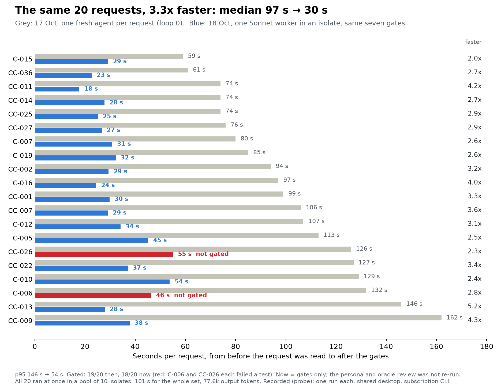

# Endoforge report, 18 October 2026: what we have, what we missed, where the opportunity is

Shareable copy: https://claude.ai/code/artifact/a657e74c-c5fe-4899-989b-36384cc7567f (same content; the chart there is drawn from the same rows).

Labels follow `docs/CONVENTIONS.md`. Every number is **Recorded (probe)** unless marked: one machine, one or two days, agent judgements of agent outputs, no replication beyond what is stated. All review is agentic (DEC-78). Sources: loop-1 receipts (`campaigns/hillclimb-loop-01/receipt/`), the atomizer ledger (`tools/atomizer/ledger/`), loop-0 and hc-01 receipts (`campaigns/x1-spec-study/receipt/`), and an independent audit by Codex run sealed from these conclusions (`docs/audits/AUDIT-2026-10-18-codex.md`).

## 1. Where things stand

| Track | Result |
|---|---|
| Speed (atomizer) | The 20 loop-0 requests now run at a median of 30 s per request (97 s on 17 Oct), p95 54 s (146 s), 18/20 gated, all 20 in 101 s in a pool of 10 isolates. A templated planner (about 9 s) reaches a gated result before the direct worker on two large requests in 6/6 paired runs. Every run, atom and attempt is in an append-only ledger with archives. |
| Quality (hill-climb loop 1) | No configuration adopted. Clean promotion on fresh requests is 0-1 of 20 for every arm; the all-new bundle with D-02 breached the wall and token guardrails; noise floor, gates and canaries held. 10.9M tokens, more of it spent judging than making. |
| Delivery | The 18 capabilities on `claude/endoforge-capabilities` were never merged: the merge was cancelled on 17 Oct (`~/LOCAL LLM/RETA-TO-ENDOFORGE-02-20261017.txt`). No Endoforge capability runs in the app; no runtime telemetry exists. |
| Review | All persona reviews, oracle scoring and use checks are agents (DEC-74, DEC-78). |

## 2. What the results say once read together

**The factory fails on decisions it makes for the requester, not on arithmetic.** Across loop 1's 471 oracle verdicts, the questions that made an artefact not usable were Q2 (the default assumption is not admissible) and Q3 (it asks the wrong question) far more than Q1 (it does not answer the question asked). Of 417 non-clean verdicts, 163 name a default that should have been an input or a question; Codex counts 136 of 351 judgments rejecting the assumption. Loop 0 had already found all 20 requests underdetermined.

**Two fifths of the fresh pool is the wrong kind of request for this artifact class.** Owner process rules were median-clean on 0 of 34 artefacts and not usable on 29; technician calculations were clean on 10 of 103. Eight of 20 working and 8 of 20 sealed requests are process rules a numeric kernel cannot answer.

**What is clean is closed-form.** The panel-clean requests across all sets are C-001, C-003, CC-002, CC-013, CC-014, CC-025 and CC-036: unit, power and psychrometric conversions with no consequential open fact.

**About 180 of the judges' reasons are evals that should have existed before the code.** Refusals that do not name the input at fault (61), ranges and physical bounds not enforced (62), precision and units (56), missing source or standard edition (32). By design (DEC-72, L-16) persona agents write these as executable evals in parallel with the generator, blind to its code, and gates run them; loop 1 instead had agents judge finished artefacts. DEC-79 restores the design.

**The judges disagree on reference truth.** Opus requires about −21.5 °F at 15 psig for CC-034; Sonnet rejects −21.5 °F against −25 ± 3 °F for CC-005 (Codex audit, item 4). Every kernel and every judge re-derives thermodynamic properties on its own.

**The speed and quality tracks never met.** The 30-second direct path has only been gated; it has never been scored by the panel. Loop 1's incumbent ran at 46-52 s and 18-21k tokens with a persona stage; the direct worker at about 30 s and 3-7k output tokens without one. Nobody knows whether the fast path is as useful.

## 3. Opportunities, ranked by expected gain per cost

Each is a hypothesis for the next loop, with the cheapest test that would settle it. Items 1-3 attack the binding constraint (intent fit); 4-6 make measurement cheaper and sharper; 7-9 are speed and reach.

1. **Decide every open fact before generating code (D-09, untested).** For each fact the request leaves open, choose one of: a harmless default (every plausible alternative gives the same action within tolerance), a required input, a source lookup, or no question at all. Loop 1's own critic forecast D-09 at +3 of 20 for 0.8k tokens against D-02's +4.5 for 17-23k, roughly 14-19 times more gain per token, and the loop still chose D-02, which lost. *Test:* revise only the stubs of six assumption failures and two clean conversions, hold generation and scoring fixed, and measure verdict change per added token.
2. **Route each request to the artifact that can serve it.** Classify the request first (closed-form calculation, lookup, text check, workflow or process rule) and trace the requested output back to inputs that are actually available. Calculations go to kernels; text checks and record queries go to thin executable adapters; process rules that no artefact can enforce are refused with the reason and counted as a separate outcome. *Test:* a wrapper for C-009 that takes the whole commit message, ten messages end to end, against the three loop-1 arms.
3. **One validated property core, shared by makers and judges.** Versioned refrigerant property tables with interpolation, validity limits and stated sources, used by every kernel and by every judge's reference computation, with independent spot checks. This removes a whole class of disagreement and saves the tokens every worker spends inventing thermodynamics. *Test:* settle the disputed 15 psig lookup, then reuse the core across CC-034, CC-005 and CC-024.
4. **Persona agents write executable evals in parallel with the coder (DEC-79); gates run them.** No after-the-fact judging. The evals cover the judges' findings: A typed contract carrying ranges, refusal conditions and non-finite values (D-11, S-10), checked by script: every refusal names the argument at fault, out-of-range and physically impossible inputs refuse, units and precision are declared, sources are named. Tests that contradict the contract's refusal rules are caught before freezing; the model arithmetic check (S-09) changed 0 of 169 tests live and missed both refusal contradictions in replay. *Test:* replay the R-02 failures and the Infinity/NaN cases through the validator.
5. **Run the fast path against the same evals.** Convert loop 1's criteria for the development set into executable eval suites and run the 20 direct-worker artefacts from the baseline re-run against them. Speed then counts only when the evals pass. *Test:* one eval-writing batch for 20 requests, then a deterministic run.
6. **Measure the evals, not the artefacts.** Two eval writers on different model families per request, disagreements resolved by computation or dropped before freezing; canary capabilities that must fail; mutation testing of known-good kernels. This replaces post-hoc judging, which cost more than generation in loop 1. *Test:* write two suites for five requests, report their agreement, canary recall and mutation kill rate.
7. **Measure completion, not only acceptance, with agent consumers.** Consumer agents in the technician frame run each capability through the runtime on fresh inputs and record whether the task was completed, elapsed time, and how many clarifications or retries it took. Loop 1's five consumer agents found 1 of 5 answered outright and 2 of 5 usable on the job; that signal should be a primary metric next to the panel. *Test:* the five loop-1 consumer packets, re-run with completion and time recorded.
8. **Repair as a minimal patch.** D-02 regenerated stubs, evaluators and candidates, which can lose correct behaviour while a reviewer adds a new requirement. Classify each finding as implementation defect, contract defect, missing data or reviewer dispute, and patch only a demonstrated defect under the frozen requirement. *Test:* three reproducible defects, minimal patch against regeneration, resolved findings per token.
9. **Speed and reach.**
   - **Route by measured outcome, not interpolation.** Run the five singles on the templated arm against the direct worker at equal pool capacity; the claimed crossover is an estimate until then.
   - **Reuse before generating.** A catalog lookup that answers a request with an existing capability costs milliseconds. CC-036 and CC-025 already overlap. Measure the reuse rate on the 60-request pool.
   - **Mechanical atoms to a local model.** The proposed local-model probe tests whether a small model on the RTX 4080 can take over glue and planning.
   - **No runtime anywhere to measure.** With the merge cancelled, agentic consumer runs through the capability runtime are the only route to use evidence, and they need nothing merged.

## 4. Where the record was wrong or outran its evidence

| Claim | Where | Correction |
|---|---|---|
| "Every rater, on either model family, finds exactly the same three of ten clean" | hc-01 `RESULT.md`, method v2.2 | Only the panel rules (median and strict) give the same three; the raters individually called 4 (Sonnet), 5 (Opus) and 4 (Codex) clean. |
| The cutover lies "near 40-60 s of direct time" | `tools/atomizer/CUTOVER.md` | An estimate: the 6/6 templated wins cover two distinct requests, and no single was run on the templated arm. |
| All three R-02 templated failures were wrong expected values | `CUTOVER.md` (corrected 18 Oct) | One arithmetic error; two tests contradicted the interface's refusal rule. |
| The panel-clean metric "has no resolution" at 1 of 20 | loop-1 `DECISION.md` | A rise from 1 to 7 of 20 is readable; the problem is power and base rate, not impossibility (Codex audit, item 1). |
| D-02 chosen as the top deviation by gain per cost | loop-1 `deviations.md` | By its own forecasts D-09 had 14-19 times the gain per token. |
| Atomized speedup as improvement | `tools/atomizer/RESULTS.md` | Pooled speedup is relative to summed atom time, not to a direct worker; on small requests the direct worker is faster. |
| The 18 capabilities await merge | `campaigns/x1-spec-study/receipt/notes.md`, execution plan DP-4 | The merge was cancelled on 17 Oct. |

## 5. Recommended next loop

Loop 2, halted before it started, should take this report as its deviation input: convert loop 1's 120 criteria sheets into executable persona eval suites and validate them (cross-family agreement, canaries, mutation kill rate), then put items 1, 2 and 4 against the incumbent with item 5's fast path as the cheap arm, measuring completion by agent consumers alongside the panel. Its precommit should state the power of each contrast at n = 20 before any run.

## 6. Addendum: the failures questioned, and the changes decided (POODO Deep, later the same day)

Every remaining failure was checked against the intended design. Most were drifts, not limits: the generator decided open facts silently; evals were frozen as example tables although DEC-72 called for procedures; loop 1's evaluator wrote from the generator's stub; D-02 regenerated the specification; no property library was built; one ranking overrode its own rule. Probe P-08 then tested the central correction on four requests with ground truth frozen first:

| Fault | Stub-fed evals (loop 1) | Request-blind evals |
|---|---|---|
| No input path (CC-020) | rejected 0 of 4 | rejected 4 of 4 |
| Answer above the critical point (CC-029) | rejected for an unrelated reason | rejected by physics 2 of 2 |
| Impossible negative pressure (C-022) | mostly missed | missed by physics; rejected only through the input check |
| Correct values, but accepts −500 °F | accepted | rejected 4 of 4 (a real defect the old evals missed) |

Decided (DEC-80): request-blind evals from two model families; mandatory interface evals gated by decision stability; physical validity as a sourced deterministic library; value references from a reference provider the consuming project supplies, independent of the kernel's own table (DEC-81); frozen evals challengeable only by independent evidence; out-of-class requests reported as their own stratum. Not yet shown: that these raise usable capabilities on fresh requests. Reference values settled the R-404A dispute (−21.46 F dew at 15 psig, CoolProp 8.0.0) and fail all three loop-1 CC-034 kernels at a 1 F tolerance. The reference data itself belongs to the consuming project, not Endoforge (DEC-81): refrigeration-ai already carries CoolProp-generated tables, and evals take values from a reference provider that project supplies.
