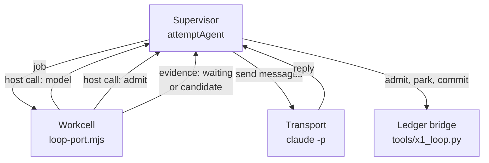

# The agent loop

On the agent path the whole coding-agent loop runs inside a workcell. The cell holds the conversation, the agent's
files and the tools the agent calls; it compiles and runs the gates in memory, with no process spawn and no temporary
file. It asks its host for exactly two things: a model turn, and the freeze of the specification into the ledger.
While the model is thinking, the cell is given back to the pool and the conversation is parked in the ledger, so a
handful of cells can carry many agents at once.

The model is a real coding agent reached through a transport: Claude Code (`claude -p`) with its own tools switched
off, used only as the model. Codex drives the other two paths. Select this path with `ENDOFORGE_LOOP=agent` and a
pool from `createLoopPool({ provider })`.

## Who does what



| Part | Holds | Code |
|---|---|---|
| Supervisor | The job key, the model session, a shadow copy of the files built from the model's replies, the token and call budget | [loop.mjs](../../core/runtime/x1/loop.mjs) `attemptAgent`, `answerCall` |
| Workcell | The messages, the in-memory overlay of files, the receipt (turns, tokens, tool calls), the compile cache, the check rounds | [loop-port.mjs](../../core/runtime/x1/loop-port.mjs) `createPort` |
| Agent protocol | The stage prompts, the reply schema, the four tools | [agent.mjs](../../core/runtime/x1/agent.mjs) |
| Transport | The model process and its login | [transports.mjs](../../core/runtime/x1/transports.mjs) |
| Ledger | The frozen evaluator, parked continuations, candidates, receipts, decisions | [tools/x1_loop.py](../../tools/x1_loop.py) through the pool's bridge |

## Run it

The example uses `scriptedProvider` (a test double that replays fixed replies) and the test workload
`integer add(a,b)`, so it spends no tokens:

```console
$ node examples/first-loop.mjs
{
  "need": "integer add(a,b)",
  "promoted": true,
  "testDouble": true,
  "turns": 2,
  "rounds": [
    "passed"
  ],
  "ledger": "/tmp/ef-first-loop-9N4s7O/addition/ledger.sqlite"
}
```

Two turns: one for the specification, one for the implementation, whose check passed. `rounds` lists the agent's
implementation checks, one entry per check, not the evaluator's two rounds. To use a real model, pass
`new WarmClaudeTransport({ model: 'sonnet' })` as the provider instead.

## The agent's tools

Every model reply must be one JSON object, `{"calls": [...]}`, with at most 16 calls (`MAX_CALLS`). The transport
enforces the shape with `--json-schema` (`replySchema`), and the cell parses it again (`parseReply`).

| Call | Effect |
|---|---|
| `{"name":"read_file","path":P}` | Returns the file from the overlay, or `no such file` |
| `{"name":"edit_file","path":P,"content":C}` | Writes the whole file |
| `{"name":"edit_file","path":P,"old":O,"new":N}` | Replaces `O`, which must occur exactly once |
| `{"name":"check"}` | Runs the stage's check now and returns its failures, or `passed` |
| `{"name":"done"}` | Ends the stage; if no check ran in this reply, one runs first |

Only the stage's editable paths can be written (`path refused` otherwise), and a file is at most 64 KiB (`LIMIT`).
A reply that isn't a calls object, or has too many calls, gets an error message as the next prompt, not a crash. When
`done` meets a failing check, the failures go back with `Fix what failed, then done.` An empty `calls` list counts as
`done`.

## Two stages

| Stage | Editable | Its check | Ends when |
|---|---|---|---|
| Specification | `CONTRACT.md`, `tests.json` (and `reference.js` with the oracle) | `specificationProblems`: a nonempty contract, JSON tests that pass [test strength](gates.md#test-strength-g1), and with the oracle, no flagged test | `done` with a passing check, then the freeze |
| Implementation | `kernel.ts`, `glue.json` | Compile in the cell, then `runGates` (all nine [gates](gates.md)) | `done` with a passing check, or the turn or token limit |

The stage prompts (`stagePrompts`) are JSON. Today they ask for the kernel candidate form: the specification prompt
asks for a pure, bounded AssemblyScript kernel with explicit assumptions, exports and tests including boundary and
trap cases, decimal places for every number result, and expected values derived from the formula; the implementation
prompt sends the frozen files, the closed glue schema, the glue rules and a template, and asks for AssemblyScript
0.28.20 on the stub runtime with no imports except `env.abort` and no `assert` (the compiler runs with `--noAssert`).
The loop itself does not depend on that form: the overlay, the check callback, the freeze and the ledger are the same
for any stage definitions.

The in-cell compile uses the pinned compiler already loaded in the cell (`compileInCell`, flags `--maximumMemory
1024`) over an overlay that holds only `kernel.ts`. It refuses a module that declares more than 1,024 pages (64 MiB)
and skips recompiling when `kernel.ts` hasn't changed since the last check.

## Budgets

`limits` defaults to `agentLimits`, `{ maxTurns: 6, maxTokens: 64000 }`.

- **Turns.** Each stage gets at most `maxTurns` model replies. The host also refuses a model call past
  `2 × maxTurns` calls for the attempt.
- **Tokens.** One budget for the whole attempt, both stages together, counted as the transport reports usage (input,
  output, cache creation and cache reads). The host passes the remainder with each call. A transport refuses a reply
  whose usage exceeds it (`model token budget exceeded`), and the cell ends the stage with `max_tokens` once the total
  reaches the budget.
- **Failed model calls.** Before the freeze, a failed call ends the attempt with an error and nothing durable. After
  the freeze it ends the attempt as `outcome_unknown`, which the ledger records as `inconclusive`.
- **Deadline.** `deadline` (milliseconds since the epoch) bounds the request; the transport's own timeout bounds each
  model call.
- **Compute.** `createLoopPool` sets `jobTimeoutMs` 60 s and `jobDeadlineMs` 900 s. The job budget starts when the
  cell reports ready, pauses while the host answers a call and restarts after.

## The freeze

When the specification stage ends, the cell writes `frozen.sha256` and sends `{kind: 'admit', files}`: the three
frozen files and the exact bytes of its implementation files (`host.mjs`, `gates.mjs`, `glue.schema.json`,
`measure.mjs`, `meter.mjs`, `contract.mjs`, `loop-port.mjs`, `agent.mjs`, `oracle.mjs`), all hex-encoded. The host
then:

1. checks that the frozen `CONTRACT.md` and `tests.json` equal its own shadow copy, built by applying the model's
   `edit_file` calls itself (`applyReply`), so the cell cannot freeze files the model didn't write;
2. runs `testProblems` again;
3. sends one `admit` request to the ledger bridge, which appends `task`, `admitted_input` and the `frozen_evaluator`
   in one transaction and returns its identity, digest and canonical encoding.

There is no frozen tree on disk. From then on the cell recomputes the evaluator's identity from that encoding at each
check (`verifyFromMemory`), and the commit compares EndoForge's own implementation files on disk with the frozen bundle.

## Waiting releases the cell

`createLoopPool({ waits })` is `release` by default.

1. When the cell needs a model reply it ends its job with status `waiting` and its continuation: stage, turn,
   messages, overlay, receipt, compiler identity and the check rounds so far.
2. The supervisor calls the model with no cell held.
3. Once the task is frozen and the conversation holds a reply, the supervisor first writes `{cell, host}` to the
   ledger with `park`. The ledger checks its SHA-256, refuses unless it names the latest waiting row (or none), marks
   that row `resumed` and stores the new one in `x1_continuations`.
4. The reply goes to a new job, in any free cell, with `{continuation, reply}`. That cell rechecks the frozen
   evaluator identity, its own implementation bytes, the frozen files and the compiler identity before it continues.
5. `commit` closes the last continuation in the receipt's transaction, so a continuation resumed twice cannot promote.

`hold` keeps the cell through every model call, as the loop did before P-57.

After a supervisor loss, `attemptAgent({ resume: true })`, or any call whose ledger already exists, asks the ledger
for the latest frozen evaluator, an existing promotion and the waiting continuation, and carries on from there. Turns
before the freeze are not parked, so a loss during the specification stage starts that stage again.

## Transports

A provider is `{ name, testDouble, start(), send({ session, messages, remaining, timeoutMs }), endSession(session),
close() }`, and `send` returns at least `{ text, usage }`.

| Provider | How it calls the model |
|---|---|
| `WarmClaudeTransport` | One long-lived `claude -p --input-format stream-json --output-format stream-json` per lane. Each `instances` entry is one `CLAUDE_CONFIG_DIR` (one login) with `lanes` processes. A session keeps its lane until `endSession`; `/clear` separates sessions; only new messages are sent. An idle lane exits after `idleMs` (300 s). A usage-limit event routes work away from that login until it resets |
| `SpawnClaudeTransport` | One `claude -p` process per turn, given the whole conversation |
| `scriptedProvider(script)` | A test double for tests and examples; marks results `testDouble: true` |

Both Claude transports launch `claude` with `--tools ""`, `--json-schema` (the reply schema), `--no-session-persistence`,
`--strict-mcp-config`, `--setting-sources ""`, `--permission-mode dontAsk`, `--safe-mode`, `--model` and a fixed system
prompt, in an allow-listed environment with `CLAUDE_CODE_DISABLE_NONESSENTIAL_TRAFFIC=1`. A session whose `init`
event reports any tool except `StructuredOutput`, an API key source, or an MCP server is refused. Before every launch
the [subscription guard](../../core/runtime/README.md#subscription-guard) proves the login is a claude.ai
subscription (or refuses with exit 78), and the [usage governor](../../core/runtime/README.md#usage-governor) parks
new calls near the usage ceiling (exit 75).

### Codex

Codex reaches EndoForge through the `current` and `isolate` paths, not through a provider port.
[generator.mjs](../../core/runtime/x1/generator.mjs) runs `codex exec --json --sandbox workspace-write` for the
specification and resumes the same thread (`codex exec resume`) for the implementation, in a temporary workspace, with
`ENDOFORGE_CODEX_CMD` as the executable and `CODEX_HOME` as its home. Point `ENDOFORGE_CODEX_CMD` at
[agent-pool.mjs](../../core/runtime/agent-pool.mjs) to spread those calls over several Codex accounts: it takes at most
`CODEX_POOL_PER_ACCOUNT` (2) launches per account, puts a rate-limited account in cooldown until the reset its error
names, and fails over to the next ([agent pool contract](../../core/runtime/README.md#agent-pool-contract)).

## Formula oracle

`limits.oracle` (off by default) adds a second source for frozen expectations. The specification stage may also write
`reference.js`, plain JavaScript computing each export, and states each formula in `CONTRACT.md` as
`name = expression`. Before the freeze, [oracle.mjs](../../core/runtime/x1/oracle.mjs) recomputes every number test
from the formula, the contract's stated ranges and the reference (run in a 50 ms sandbox), and gives it a status:
`verified`, `corrected` (formula and reference agree on another value, which is frozen instead), `flagged` (returned to
the model as a specification problem), `unverified`, or `abstained` (a rule the parser cannot read). The host applies
the same corrections to its shadow copy, and the result carries an `oracle` report.
[P-69](../../experiments/P-69-formula-oracle/RESULT.md) measured it catching 12 of 12 known wrong frozen values with
0.19% false flags, but refusing 3 of 177 pristine specifications, so it stays off;
[P-70](../../experiments/P-70-oracle-injected/RESULT.md) and [P-71](../../experiments/P-71-oracle-round2/RESULT.md)
continue that work.

## The result

`runNeed` returns `{ promoted, inconclusive?, candidate, receipt, decision, problem, status, agent, rounds, content,
testDouble, modelMs, timings, oracle? }`. `agent` is the receipt `{ turns, tokens, tool_calls, exit_reason }`;
`exit_reason` is `stop`, `max_turns` or `max_tokens`; anything but `stop` is recorded as a rejected evaluation,
so the ledger refuses the candidate. `rounds` lists
every implementation check, failed ones included. A failure before the freeze returns `promoted: false` with an
`error` and writes no candidate.

## Measured

| Probe | What it showed |
|---|---|
| [P-50](../../experiments/P-50-in-isolate/RESULT.md) | 0 spawns and 0 file writes from need to commit, on 21 kernels in both cell kinds. Non-model time 116 / 123 ms p50 / p95 in a process cell, against 1,297 / 1,766 ms on the `current` path. Transport overhead per turn: 343 ms for spawn, 15 ms for warm after its first turn. Two real runs through the warm transport promoted in two turns |
| [P-57](../../experiments/P-57-release-waits/RESULT.md) | With `release`, no cell is held at any model call; four cells carried 64 candidates in flight at 8.1× the throughput of `hold` and 11.5× the in-flight candidates per GiB. A resume costs 6.1 ms p50; a parked candidate about 0.09 MiB against about 281 MiB per process cell. The single ledger bridge then becomes the limit |
| [P-56 model and effort](../../experiments/P-56-model-effort/RESULT.md) | 30 needs × 8 Claude arms through this loop: Sonnet at low effort took 27.4 s of wall time per accepted capability, accepting 28 of 30, with non-model time about 0.3 s p50 against about 23 s of model time. 30 of the 38 failed candidates came from five specifications that froze a wrong expected value |

## Limits

- The cell's report comes from EndoForge's own code running in the cell. The commit checks it against the frozen
  bundle and the stored module but doesn't run the kernel again, so a bug that produced a consistent wrong report
  would not be caught there.
- The supervisor's shadow copy guards the frozen files, not the implementation files, which the cell reports and the
  commit re-checks.
- The library and evaluator synthesis are not wired into this path yet; both run on the `current` path.
