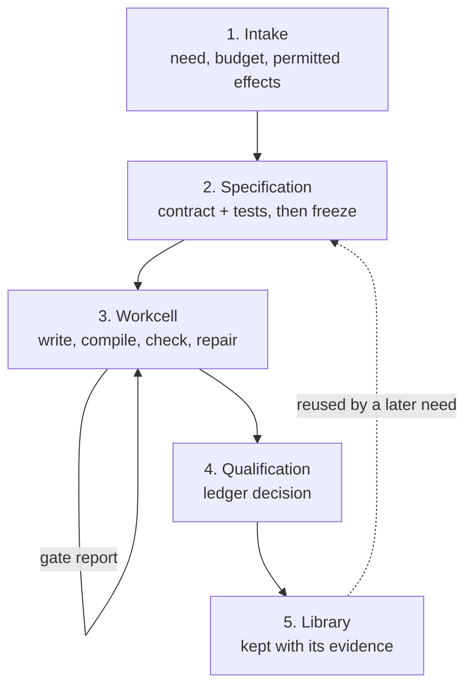
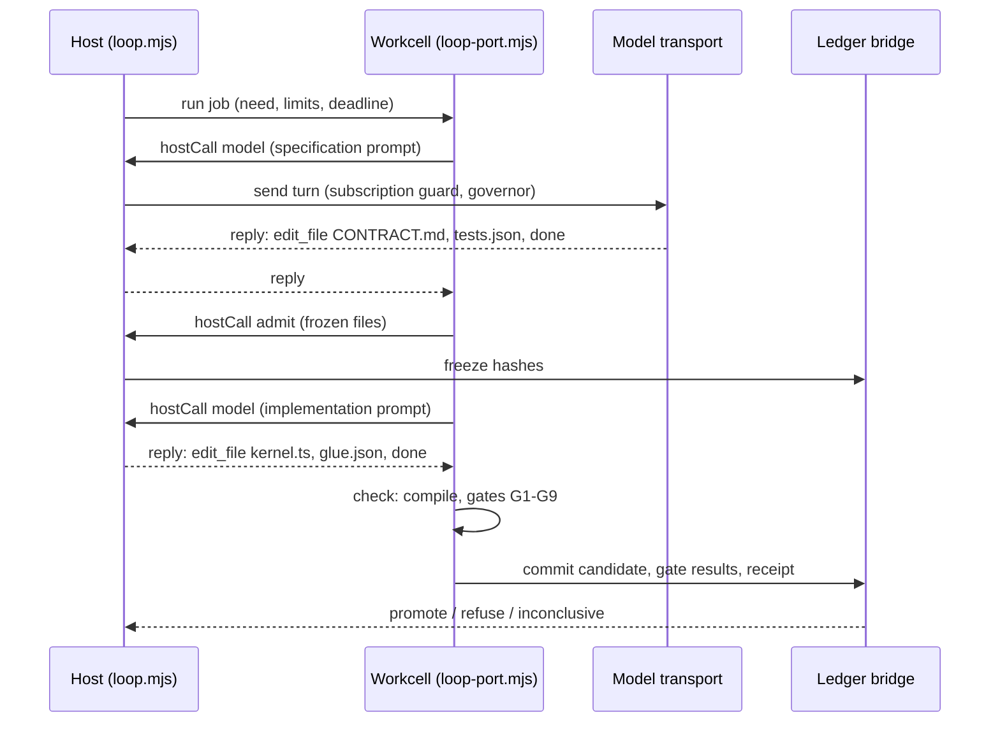

# EndoForge system overview (software design description)

| Field | Value |
|---|---|
| Document ID | ENDOFORGE-SDD |
| Version | 3.0 |
| Status | Baselined |
| Owner | Akilleez-QA maintainer |
| Date | 2026-11-08 |
| Baseline commit | 63e95c79afb282a7fcae4decd57d2e7ed6cf0d40 |
| Applies to | endoforge main at baseline commit |
| Classification | Self-assessed Class E analog; not safety-critical (see [SMP §1](../plan/software-management-plan.md#1-software-classification-self-assessed)) |

> Organized after [NPR 7150.2D](https://nodis3.gsfc.nasa.gov/displayAll.cfm?Internal_ID=N_PR_7150_002D_&page_name=all), [NASA-STD-8739.8B](https://standards.nasa.gov/standard/nasa/nasa-std-87398) and the [NASA Software Engineering Handbook](https://swehb.nasa.gov/display/SWEHBVD/7.18+-+Documentation+Guidance) documentation guidance. This is not a NASA compliance determination or certification. The software classification is a self-assessed analog (Class E, not safety-critical); no NASA authority, independent verification and validation, or hazard analysis is asserted. The document describes the implementation inspected at the baseline commit.

## 1. Purpose

EndoForge makes writing software something a running system does. A person or an agent brings a need. A coding agent
writes a contract and tests, EndoForge freezes them, and the agent then writes, checks and repairs the code inside a
V8 isolate until it passes or runs out of turns. The verdict goes into a hash-chained ledger, and passing code is kept
so a later matching need runs it instead of spending another model turn.

This page is the map of the whole system: what it is for, how one need moves through it, and where each part lives in
the code. Read it before changing the code. Two topic pages go deeper: [the candidate loop](candidate-loop.md) (one
attempt from need to decision, with every gate) and [evaluator synthesis](evaluator-synthesis.md). The
[runtime README](../../core/runtime/README.md) covers workcells and transports in detail.

## 2. Two products on one substrate

EndoForge serves two kinds of users with the same machinery.

| | Agent substrate | Generative applications |
|---|---|---|
| What it is | A cheap, trusted iteration loop for coding agents | An application that grows new capabilities on request |
| Who uses it | People who build or run coding agents | People using a host application, such as [Cstack](../icd/icd-cstack.md) |
| Where the checks come from | The agent's task: its contract, tests or build | Written per request, before any candidate exists |
| What a wrong answer costs | The task fails visibly | A wrong capability is kept and reused, so the bar is higher |

Both use the same substrate: warm workcells, a freeze before code, gates on the exact compiled bytes, a ledger that
records every decision, and a library of promoted capabilities. Claude Code (through `claude -p`) and Codex are the
coding agents in both. The isolates exist for speed, concurrency and low memory pressure. They keep the agent's
edit-compile-check loop in memory so many agents can run on one machine. They are not the security boundary of the
system.

## 3. The production cycle

One need crosses five stages. Each stage changes what the agent is allowed to do.

| Stage | What happens | Where in the code |
|---|---|---|
| 1. Intake | A caller hands `runNeed` a need, a working directory, a workcell pool and limits (turns, tokens, deadline). For larger work, job intake checks a manifest against the POODO gates and waits for the user's go, and the atomizer splits the need into a graph of small atoms. | [`pipeline.mjs`](../../core/runtime/x1/pipeline.mjs), [`tools/job/`](../../tools/job/README.md), [`tools/atomizer/`](../../tools/atomizer/README.md) |
| 2. Specification | The agent writes `CONTRACT.md` and `tests.json`. Tests that assert nothing or allow more than 1% tolerance are refused. The host hashes both files into the ledger (the freeze). With synthesis on, a second model that has seen no candidate writes an independent reference check, which is frozen with them. | [`agent.mjs`](../../core/runtime/x1/agent.mjs) `stagePrompts.specification`, [`loop.mjs`](../../core/runtime/x1/loop.mjs) `admit`, [`synth/`](../../core/runtime/x1/synth/stage.mjs) |
| 3. Workcell | The agent writes the code in the cell's in-memory overlay through `read_file`, `edit_file`, `check` and `done`. `check` compiles with the pinned compiler and runs the gates; the failures become the next prompt. | [`loop-port.mjs`](../../core/runtime/x1/loop-port.mjs), [`gates.mjs`](../../core/runtime/x1/gates.mjs), [`isolate-pool.mjs`](../../core/runtime/isolate-pool.mjs) |
| 4. Qualification | The exact candidate is evaluated against the frozen evaluator, and one ledger transaction records the candidate, every gate result and the decision: `promote`, `refuse` or `inconclusive`. The decision is made in Python from the recorded evidence, not by the cell. Activating a promoted capability in a host is the host's step; the lifecycle model validates the preview and activation references a host supplies. | [`tools/x1_loop.py`](../../tools/x1_loop.py) `decide`, [`core/lifecycle.py`](../../core/lifecycle.py) |
| 5. Library | A promoted capability is admitted after its promotion is verified from its own ledger and it re-passes its tests under the current gates. A later need with a matching contract key reuses it if it passes the new need's frozen tests and a mutation check. | [`core/library/`](../../core/library/README.md) |

The model takes part in three stages: it frames the contract, writes the optional synthesized check, and writes and
repairs the code. It is never in a position to promote its own output: the gates and the decision run on code it
cannot edit, against files it cannot change after the freeze.

### What a candidate is

A candidate is application logic in a form the gates can check byte for byte: a WebAssembly kernel (pure functions:
state and event in, new state and effects out as data) plus `glue.json`, a declarative description of the kernel's
inputs, outputs, units and traps that a host can render. Today the stage prompts ask for the kernel in AssemblyScript,
a TypeScript-like language compiled by a pinned compiler that the cell loads once. TypeScript code that does not fit
the kernel split goes through the compatibility lane: a WebAssembly build of the TypeScript 7 checker
([`tools/tscheck/`](../../tools/tscheck/README.md)) type checks it in workcells, and the emitted JavaScript runs twice
in a contained V8 process ([`core/runtime/contained/`](../../core/runtime/README.md#contained-javascript)).

## 4. Components

Each component lists the requirements it satisfies. A component marked with a gap ID has behaviour but no tested
requirement; see [SRS §11](../requirements/requirements.md#11-untested-behaviour-requirement-gaps).

| ID | Component | Paths | Responsibility | Requirements |
|---|---|---|---|---|
| C-01 | Lifecycle model | `core/lifecycle.py`, `core/__init__.py` | Artifact identities, proposals, receipts, state transitions and history replay; validates references without performing any host action | REQ-CORE-001, REQ-LIFE-001, REQ-LIFE-002, REQ-LIFE-003, REQ-LIFE-004, REQ-LIFE-005 |
| C-02 | Ledger | `core/ledger/` | The SQLite record: schema validation, durable references, hash chaining, provenance, the frozen evaluator | REQ-LEDGER-001, REQ-LEDGER-003, REQ-LEDGER-004 |
| C-03 | Engine evaluator and gates | `core/engine/`, `tools/factory_quality/` | Five ordered gates, caller invariants, fresh finalists, Pareto selection | REQ-DOMAIN-001, REQ-ENGINE-001, REQ-ENGINE-002 |
| C-04 | Constraint records | `core/constraints/`, `tools/constraint_store.py` | Constraints kept word for word outside transcript compaction; laundering refused | REQ-CONSTRAINT-001, REQ-CONSTRAINT-002 |
| C-05 | Library | `core/library/`, `tools/library_verify_promotion.py` | Reuse of promoted capabilities behind a canonical contract key and a discrimination gate | REQ-LIB-001 |
| C-06 | Isolate pool | `core/runtime/isolate-pool.mjs`, `isolate-workcell.mjs`, `isolate-wasm.mjs`, `isolate-wasm-compile.mjs`, `isolate-cgroup.mjs`, `isolate-ledger.mjs` | Thread or process workcells, heap, stack and WebAssembly limits, cgroups, deadlines, warm start, host calls, the persistent ledger bridge | REQ-ISO-001, REQ-ISO-002, REQ-ISO-003, REQ-ISO-004, REQ-ISO-005, REQ-ISO-006, REQ-ISO-007, REQ-ISO-008, REQ-ISO-009, REQ-ISO-010, REQ-ISO-011, REQ-ISO-012, REQ-ISO-013, REQ-ISO-014, REQ-ISO-015, REQ-ISO-016, REQ-ISO-017 |
| C-07 | X1 candidate loop | `core/runtime/x1/` (except `synth/` and `transports.mjs`), `tools/x1_loop.py`, `tools/x1_ledger.py`, `tools/asc/` | The three loop paths, generator, compiler, gates G1–G9, the in-cell agent loop, formula oracle, commit and promotion rule | REQ-X1-001, REQ-X1-002, REQ-X1-003, REQ-X1-004, REQ-LOOP-001, REQ-LOOP-002, REQ-LOOP-003, REQ-LOOP-004, REQ-GEN-001, REQ-GEN-002, REQ-GEN-003, REQ-GEN-004, REQ-GEN-005, REQ-GEN-006, REQ-GEN-007, REQ-GEN-008, REQ-PROMOTE-001, REQ-UNITS-001, REQ-ORACLE-001 |
| C-08 | Evaluator synthesis | `core/runtime/x1/synth/` | A candidate-blind evaluator, meta-gates M1–M5, frozen before code | REQ-SYNTH-001 |
| C-09 | Model access | `core/runtime/x1/transports.mjs`, `core/runtime/subscription-guard.mjs`, `core/runtime/usage-governor.mjs` | Claude Code transports, subscription proof, weekly usage parking | REQ-SUB-001, REQ-GOV-001, REQ-TRANSPORT-001 |
| C-10 | Contained JavaScript | `core/runtime/contained/` | A supervised V8 cohort that runs emitted JavaScript | REQ-CONTAINED-001 |
| C-11 | Capacity planner | `core/runtime/capacity/` | Width, placement and split fitted from a machine probe (Mjölnir) | REQ-CAP-001 |
| C-12 | Dump list | `core/runtime/dump-list.mjs`, `tools/dump_list.py` | Registers sheddable memory; sheds idle capacity on `SIGUSR2` | REQ-MEM-001 |
| C-13 | Stage rates | `core/runtime/stage-rates.mjs`, `tools/stage-rates.mjs` | Live per-stage rates and a bottleneck verdict | REQ-RATES-001 |
| C-14 | Ledger writer | `tools/ledger_writer.py` | Group-commit writer with a crash journal | REQ-LEDGER-002 |
| C-15 | Agent pool | `core/runtime/agent-pool.mjs` | Launches local Codex clients across logged-in accounts, with cooldown and failover on rate limits | REQ-POOL-001 |
| C-16 | TypeScript checker | `tools/tscheck/` | The pinned tsrs checker in workcells and in the contained cohort | REQ-TSC-001, REQ-TSC-002, REQ-TSC-003, REQ-TSC-004, REQ-TSC-005, REQ-TSC-006 |
| C-17 | Kernel host | `tools/kernel/` | Kernel WIT contract, capability broker, Wasmtime limits, kernel workcell, pinned tool install | REQ-KERNEL-001, REQ-KERNEL-002, REQ-KERNEL-003, REQ-KERNEL-004, REQ-TOOLS-001 |
| C-18 | Compatibility contract | `tools/compatibility/` | TypeScript reducers bound to the kernel WIT | REQ-COMPAT-001 |
| C-19 | Escape measurement | `tools/seeded_faults/`, `tools/escape_harness/` | Seeded faults and escape-rate statistics | REQ-FAULT-001, REQ-ESCAPE-001 |
| C-20 | Step harness | `tools/step_harness/` | Bounded agent step loop with evidence per step | REQ-STEP-001 |
| C-21 | Hardware record | `tools/hardware_record/` | Machine record for measurements | REQ-HW-001 |
| C-22 | Atomizer | `tools/atomizer/` | Plan validation, parallel fan-out, routing, failover, trace, receipts | REQ-ATOM-001, REQ-ATOM-002, REQ-ATOM-003 |
| C-23 | Conductor and job intake | `tools/conductor/`, `tools/job/`, `tools/job-locks/`, `tools/lib/` | Lane supervision, job event log, lock registry, typed exit codes | REQ-COND-001, REQ-COND-002, REQ-JOB-001, REQ-LOCK-001, REQ-ERR-001 |
| C-24 | Hillclimb | `tools/hillclimb/` | Lessons ledger across rounds | REQ-HILL-001 |
| C-25 | Factory campaign and portability | `tools/factory_campaign/`, `tools/factory_portability/` | Campaign state recovery, model journal, encrypted checkpoints | REQ-FACTORY-001, REQ-FACTORY-002 |
| C-26 | Rust lane | `tools/rust_lane/` | Reproducible Rust build under the same acceptance | REQ-RUST-001 |
| C-27 | Repository checks | `tools/check-docs.py`, `tools/check-privacy.py`, `tools/check_trace.py`, `tools/gen_data_dictionary.py`, `tools/experiments_index.py`, `tools/source_sums.py`, `tools/experiment_id.py`, `tests/test_reachability.py` | Links, digests, privacy, index, allocation, reachability, trace and data-dictionary checks | REQ-DOCS-001, REQ-REPO-001, REQ-REPO-002, REQ-REPO-003, REQ-REPO-004, REQ-REPO-005 |
| C-28 | Release records | `tools/gen_release_docs.py` | Generates the test report and version description from recorded runs | infrastructure; untested, GAP-EF-014 |
| C-29 | Factory runtime | `tools/factory_runtime/` | Job specs, scheduler, recovery, egress and WebAssembly runner | GAP-EF-002 |
| C-30 | Glue gate CLI and project scheduler | `tools/gate/`, `tools/project-scheduler/` | Stand-alone glue check; project scheduling | GAP-EF-003, GAP-EF-004 |
| C-31 | Stub pool and approved atoms | `core/runtime/stub-pool.mjs`, `tools/approved_atoms.py` | Replay stub outputs; approved-atom helper | GAP-EF-005, GAP-EF-007 |

## 5. Execution concept

### 5.1 Three loop paths

[`runNeed`](../../core/runtime/x1/pipeline.mjs) drives one need. `ENDOFORGE_LOOP` picks the path. All three share the
freeze, the gates and the ledger decision; they differ in where the agent's conversation and the repair loop run.

| `ENDOFORGE_LOOP` | Function | Agent | What runs where |
|---|---|---|---|
| unset | `attemptCurrent` | Codex CLI (`codex exec`) | Codex writes files on disk in the need's directory. The host compiles, the pool runs the gates in a workcell, and the ledger registers and promotes. Library reuse, evaluator synthesis and the contained TypeScript check plug in here. |
| `isolate` | `attemptInIsolate` | Codex CLI | Generation stays on the host. Admission, check, repair, evaluation and commit run in one workcell that keeps its compiler warm between rounds. |
| `agent` | `attemptAgent` | Any provider: `WarmClaudeTransport` or `SpawnClaudeTransport` over `claude -p`, or the scripted test double | The whole agent conversation runs in the workcell. The cell holds the messages and a file overlay in memory, runs `check` itself, and asks the host for only two things: a model turn (`hostCall {kind:'model'}`) and the freeze (`{kind:'admit'}`). |

### 5.2 Why the agent path runs in the isolate

On the other paths, every round of an agent's work crosses a process boundary: the model writes files to disk, a
compiler or gate process starts, and results come back through the file system. On the agent path the agent's tool
calls are function calls against an in-memory overlay, and the compiler is already loaded in the cell (`warm()` primes
it at start). [P-50](../../experiments/P-50-in-isolate/RESULT.md) measured the effect: no process spawns and no temp
files up to commit, the same verdicts as the default path on 31 inputs, and non-model time of about 133 ms at the
median against 1,472 ms.

Holding the conversation in the cell would tie up a cell during every model wait, which is most of a turn. Under
`waits: 'release'` (the default in `createLoopPool`) the cell writes its continuation (messages, overlay, stage,
receipt and compiler pin) to the ledger and returns; the next model reply resumes it in any free cell after the runtime
pin and frozen files are checked again. [P-57](../../experiments/P-57-release-waits/RESULT.md) measured no cell held
in 225 model waits and 8.1 times the throughput on 4 cells. The single ledger bridge then became the limit, which the
group-commit writer in [P-59](../../experiments/P-59-ledger-writer/RESULT.md) lifted.

### 5.3 One agent-path attempt

The host also keeps a shadow copy of every file the model writes, and refuses the freeze if the files the cell submits
differ from the model's replies. A failed check adds a round: the cell sends the failures back as the next prompt
until the gates pass or `maxTurns` (6 by default) is reached.

### 5.4 Concurrency

- One job per workcell, first in first out. Pool size defaults to `os.availableParallelism()` or the capacity
  planner's width (REQ-ISO-001, REQ-CAP-001).
- A candidate waiting on its model holds no cell; its continuation is durable first (REQ-X1-002).
- The ledger bridge batches concurrent writes per ledger into one transaction, and the ledger writer adds one journal
  sync per batch (REQ-ISO-010, REQ-LEDGER-002).
- Deadlines run in the supervisor, because a synchronous loop cannot stop itself. A cell past its deadline is
  terminated and replaced; its siblings keep running (REQ-ISO-003, REQ-ISO-012).

### 5.5 Resource use

Per-cell defaults: 128 MiB old and 16 MiB young generation heap, 64 MiB per WebAssembly memory, retirement after 256
jobs (`core/runtime/isolate-pool.mjs`). Thread mode does not bound memory outside the JavaScript heap; process mode
with a delegated cgroup does (REQ-ISO-013). The dump list hands idle memory back under pressure (REQ-MEM-001). No
throughput figure is a requirement; measured figures are in the experiments with their commit and machine.

### 5.6 Larger jobs

Above `runNeed` sit three tools for whole jobs. [Job](../../tools/job/README.md) takes an `endoforge/job/1` manifest
from intake to the user's go. The [atomizer](../../tools/atomizer/README.md) splits a need into a graph of atoms, each
run in its own bubblewrap sandbox, including a `compose-kernel` atom. The [conductor](../../tools/conductor/README.md)
is a resumable daemon that launches Codex and Claude Code workers in git worktrees and gates each change they land.

## 6. Interfaces

| Interface | Document |
|---|---|
| Cstack vendoring and calls | [Cstack ICD](../icd/icd-cstack.md) |
| Ledger records, CLI, workcell pool, writer journal, X1 host, generator and promotion | [Ledger ICD](../interfaces/ledger-icd.md) |
| Capacity planner library and CLI | [Capacity ICD](../interfaces/capacity-icd.md) |
| Constraint records | [Constraint record](../interfaces/constraint-record.md) |
| Environment variables, `limits` and options objects | [Configuration reference](../configuration/configuration-reference.md) |
| Data items | [Data dictionary](../data/data-dictionary.md) |

New ICDs go in `docs/icd/`; the existing `docs/interfaces/` files stay where they are.

## 7. Design decisions

- **Unknown is never a pass.** A lost workcell, a deadline, an unavailable frozen check or a parked model call gives
  `outcome_unknown` and an inconclusive receipt. Only a complete passing record promotes (REQ-ISO-003, REQ-X1-003,
  REQ-GOV-001).
- **Freeze before code.** The specification and evaluator are hashed into the ledger before any implementation
  exists, and every commit checks those hashes again (REQ-GEN-001, REQ-LOOP-002).
- **The cell proposes, Python decides.** The cell reports gate results; `tools/x1_loop.py decide()` promotes only when
  every gate passed in both evaluator rounds and the chain and receipt bindings hold.
- **Limits where they work.** WebAssembly memory is capped by declared maxima plus instruction checks, because a
  JavaScript heap flag does not cap it ([P-16](../../experiments/P-16-workerd-isolates/RESULT.md); REQ-ISO-006,
  REQ-ISO-012).
- **Standard library core.** The Python core's standard library boundary, including scoped ledger and test
  allowlists, is enforced by import inspection and a fresh Python process in the boundary tests. The engine Python
  adapter alone may import `core`, `pathlib` and `sys` beyond the lifecycle allowlist. The JavaScript gates keep their
  explicit dependency on `tools/factory_quality/index.mjs`; host operations stay caller callbacks (REQ-CORE-001).
- **Bound decisions.** Proposal digest binding and history replay reject stale decisions and hand-set states.
  Evaluator freezing stops edited checks from being accepted as the original basis (REQ-LIFE-003, REQ-LEDGER-001).
- **Measured defaults.** A default changes only after a measurement planned in `experiments/` before it ran; the
  decision and its evidence are the experiment's `RESULT.md`. The experiments use small test workloads so results are
  comparable across runs; they measure the engine, not the scope of what agents build.
- **Subscription only.** Every model launch proves a subscription login first (REQ-SUB-001).

No separate architecture decision records exist; the experiments and pull requests hold the rationale.

## 8. Quality attributes

- Correctness of verdicts: forged receipts, drift and crashes are tested never to promote (REQ-LOOP-002,
  REQ-LOOP-003).
- Availability: a lost cell costs one job; siblings keep running (REQ-ISO-003).
- Security: no ambient authority in cells and guests (REQ-LOOP-004, REQ-CONTAINED-001); subscription-only model
  access (REQ-SUB-001). See [SECURITY.md](../../SECURITY.md).
- Maintainability and testability: every test file is reached by `make test` (REQ-REPO-003) and traced here or in the
  matrix (REQ-REPO-004).
- Portability: CI runs Ubuntu with Python 3.12 and Node 22 and 26; the capacity probe degrades without sysfs or
  cgroups and reads macOS counters (REQ-CAP-001).

## 9. Not included

- A callable Cstack bridge. Cstack vendors a fixed slice at a pinned commit; see the [Cstack ICD](../icd/icd-cstack.md).
- Decision issuance or host activation inside the core.
- Library reuse and evaluator synthesis on the `isolate` and `agent` paths; both plug into the default path today.
- Qualification of live model services by the synthetic repository tests.

## 10. Domain ownership

Film utilities and the refrigeration invariant adapter are kept unchanged under `TODELETE/tools/film/` and
`TODELETE/tools/invariants/`. Their destination repositories are foundation-film and foundation-refrigeration; the
transfers are handled separately. They are outside the active engine and workflow tools.

The evaluator calls `port.invariant` for names in the frozen configuration. Callers own the registry and domain
dependencies. The job invariant catalog holds workflow rules and imports no refrigeration code. The engine tests use a
synthetic identity invariant, including failure propagation.

## Change history

| Version | Date | Commit | Change | Reviewed in |
|---|---|---|---|---|
| 1.0 | 2026-11-08 | `d4d7efa` | Components, data flow and boundaries (accuracy pass) | PR #129 |
| 2.0 | 2026-11-08 | `4d692a4` | Metadata header; component table with requirement IDs; execution concept, resource use, interfaces and quality attributes | PR #131 |
| 3.0 | 2026-11-08 | `63e95c7` | Rewritten as the system overview: two products on one substrate, the five-stage production cycle mapped to code, the three loop paths and why the agent path runs in the isolate; component IDs and requirement allocation unchanged | this PR |
