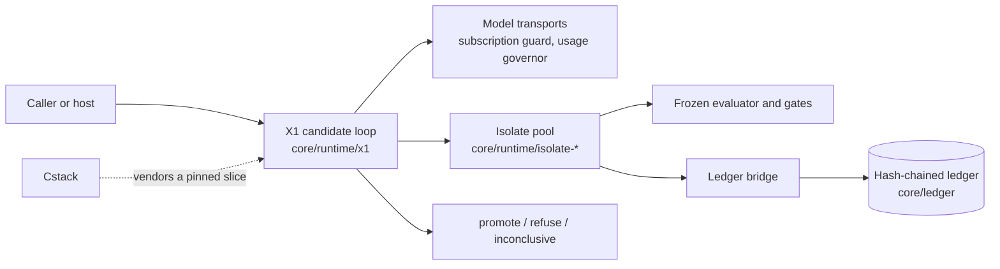
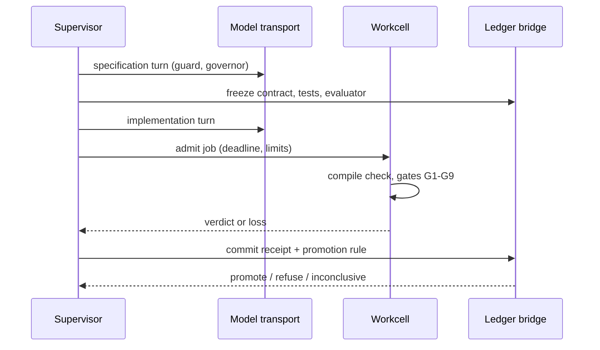

# EndoForge software design description

| Field | Value |
|---|---|
| Document ID | ENDOFORGE-SDD |
| Version | 2.0 |
| Status | Baselined |
| Owner | Akilleez-QA maintainer |
| Date | 2026-11-08 |
| Baseline commit | 4d692a41853045c4e013405d8e674528745a38b9 |
| Applies to | endoforge main at baseline commit |
| Classification | Self-assessed Class E analog; not safety-critical (see [SMP §1](../plan/software-management-plan.md#1-software-classification-self-assessed)) |

> Organized after [NPR 7150.2D](https://nodis3.gsfc.nasa.gov/displayAll.cfm?Internal_ID=N_PR_7150_002D_&page_name=all), [NASA-STD-8739.8B](https://standards.nasa.gov/standard/nasa/nasa-std-87398) and the [NASA Software Engineering Handbook](https://swehb.nasa.gov/display/SWEHBVD/7.18+-+Documentation+Guidance) documentation guidance. This is not a NASA compliance determination or certification. The software classification is a self-assessed analog (Class E, not safety-critical); no NASA authority, independent verification and validation, or hazard analysis is asserted. The document describes the implementation inspected at the baseline commit.

## 1. Purpose

This document explains how EndoForge meets its [requirements](../requirements/requirements.md), for a reader about to
change the code. Topic designs sit next to it: [the candidate loop](candidate-loop.md) (one attempt from need to
decision) and [evaluator synthesis](evaluator-synthesis.md). Runtime detail is in the
[runtime README](../../core/runtime/README.md).

## 2. Context

EndoForge groups the Python lifecycle model, evidence ledger, and evaluator and gates and local agent execution pools in
the engine core. The [lifecycle model](../../core/lifecycle.py) represents proposals and decision references without
issuing external decisions or activating artifacts in a host. The runtime runs candidate evaluation in V8 workcells and
drives the X1 candidate loop; workflow orchestration stays in `tools/`.

External interfaces: the [Cstack ICD](../icd/icd-cstack.md), the [ledger ICD](../interfaces/ledger-icd.md), the
[capacity ICD](../interfaces/capacity-icd.md) and the [constraint record](../interfaces/constraint-record.md). New ICDs
go in `docs/icd/`; the existing `docs/interfaces/` files stay where they are.

## 3. Design decisions

- **Unknown is never a pass.** A lost workcell, a deadline, an unavailable frozen check or a parked model call gives
  `outcome_unknown` and an inconclusive receipt. Only a complete passing record promotes (REQ-ISO-003, REQ-X1-003,
  REQ-GOV-001).
- **Freeze before code.** The specification and evaluator are hashed into the ledger before any implementation exists,
  and every commit re-checks those hashes (REQ-GEN-001, REQ-LOOP-002).
- **Limits where they work.** A synchronous loop cannot stop itself, so deadlines are enforced from outside the cell;
  WebAssembly memory is capped by declared maxima plus instruction checks, because a JS heap flag does not cap it
  (P-16; REQ-ISO-006, REQ-ISO-012).
- **Standard library core.** The Python core's standard library boundary, including scoped ledger and test allowlists,
  is enforced by import inspection and a fresh Python process in the boundary tests. The engine Python adapter alone
  may import `core`, `pathlib`, and `sys` in addition to the lifecycle allowlist. The JavaScript gates retain their
  explicit dependency on `tools/factory_quality/index.mjs`; host operations remain caller callbacks (REQ-CORE-001).
- **Bound decisions.** Proposal digest binding and history replay reject stale decisions and hand-set states.
  Evaluator freezing prevents edited checks from being accepted as the original evaluation basis (REQ-LIFE-003,
  REQ-LEDGER-001).
- **Measured defaults.** A default changes only after a precommitted measurement in `experiments/`; the decision and
  its evidence are the experiment's `RESULT.md`.
- **Subscription only.** Every model launch proves a subscription login first (REQ-SUB-001).

No separate architecture decision records exist; the experiments and pull requests hold the rationale.

## 4. Components

Each component lists the requirements it satisfies. A component marked with a gap ID has behaviour but no tested
requirement; see [SRS §11](../requirements/requirements.md#11-untested-behaviour-requirement-gaps).

| ID | Component | Paths | Responsibility | Requirements |
|---|---|---|---|---|
| C-01 | Lifecycle model | `core/lifecycle.py`, `core/__init__.py` | Immutable artifact identities, proposals, receipts, state transitions and history replay, without concrete integrations | REQ-CORE-001, REQ-LIFE-001, REQ-LIFE-002, REQ-LIFE-003, REQ-LIFE-004, REQ-LIFE-005 |
| C-02 | Ledger | `core/ledger/` | Schema validation, durable references, SQLite records, hash chaining, provenance, frozen evaluator | REQ-LEDGER-001, REQ-LEDGER-003, REQ-LEDGER-004 |
| C-03 | Engine evaluator and gates | `core/engine/`, `tools/factory_quality/` | Five ordered gates, caller invariants, fresh finalists, Pareto selection | REQ-DOMAIN-001, REQ-ENGINE-001, REQ-ENGINE-002 |
| C-04 | Constraint records | `core/constraints/`, `tools/constraint_store.py` | Constraints kept verbatim outside transcript compaction; laundering refused | REQ-CONSTRAINT-001, REQ-CONSTRAINT-002 |
| C-05 | Library | `core/library/`, `tools/library_verify_promotion.py` | Reuse of promoted kernels behind a canonical key and a discrimination gate | REQ-LIB-001 |
| C-06 | Isolate pool | `core/runtime/isolate-pool.mjs`, `isolate-workcell.mjs`, `isolate-wasm.mjs`, `isolate-wasm-compile.mjs`, `isolate-cgroup.mjs`, `isolate-ledger.mjs` | Thread or process workcells, heap/stack/WASM limits, cgroups, deadlines, warm start, host calls, persistent ledger bridge | REQ-ISO-001, REQ-ISO-002, REQ-ISO-003, REQ-ISO-004, REQ-ISO-005, REQ-ISO-006, REQ-ISO-007, REQ-ISO-008, REQ-ISO-009, REQ-ISO-010, REQ-ISO-011, REQ-ISO-012, REQ-ISO-013, REQ-ISO-014, REQ-ISO-015, REQ-ISO-016, REQ-ISO-017 |
| C-07 | X1 candidate loop | `core/runtime/x1/` (except `synth/` and `transports.mjs`), `tools/x1_loop.py`, `tools/x1_ledger.py`, `tools/asc/` | Generator, compiler, gates G1–G9, agent loop, formula oracle, commit and promotion rule | REQ-X1-001, REQ-X1-002, REQ-X1-003, REQ-X1-004, REQ-LOOP-001, REQ-LOOP-002, REQ-LOOP-003, REQ-LOOP-004, REQ-GEN-001, REQ-GEN-002, REQ-GEN-003, REQ-GEN-004, REQ-GEN-005, REQ-GEN-006, REQ-GEN-007, REQ-GEN-008, REQ-PROMOTE-001, REQ-UNITS-001, REQ-ORACLE-001 |
| C-08 | Evaluator synthesis | `core/runtime/x1/synth/` | Candidate-blind evaluator, meta-gates M1–M5, frozen before code | REQ-SYNTH-001 |
| C-09 | Model access | `core/runtime/x1/transports.mjs`, `core/runtime/subscription-guard.mjs`, `core/runtime/usage-governor.mjs` | Claude transports, subscription proof, weekly usage parking | REQ-SUB-001, REQ-GOV-001, REQ-TRANSPORT-001 |
| C-10 | Contained JavaScript | `core/runtime/contained/` | Supervised V8 cohort for emitted JavaScript | REQ-CONTAINED-001 |
| C-11 | Capacity planner | `core/runtime/capacity/` | Width, placement and split from a machine probe (Mjölnir) | REQ-CAP-001 |
| C-12 | Dump list | `core/runtime/dump-list.mjs`, `tools/dump_list.py` | Register sheddable memory; shed idle capacity on `SIGUSR2` | REQ-MEM-001 |
| C-13 | Stage rates | `core/runtime/stage-rates.mjs`, `tools/stage-rates.mjs` | Live per-stage rates and a bottleneck verdict | REQ-RATES-001 |
| C-14 | Ledger writer | `tools/ledger_writer.py` | Group-commit writer with a crash journal | REQ-LEDGER-002 |
| C-15 | Agent pool | `core/runtime/agent-pool.mjs` | Launch local Codex clients across accounts | REQ-POOL-001 |
| C-16 | TypeScript checker | `tools/tscheck/` | Pinned tsrs checker in workcells and in the contained cohort | REQ-TSC-001, REQ-TSC-002, REQ-TSC-003, REQ-TSC-004, REQ-TSC-005, REQ-TSC-006 |
| C-17 | Kernel host | `tools/kernel/` | Kernel WIT contract, capability broker, Wasmtime limits, kernel workcell, pinned tool install | REQ-KERNEL-001, REQ-KERNEL-002, REQ-KERNEL-003, REQ-KERNEL-004, REQ-TOOLS-001 |
| C-18 | Compatibility contract | `tools/compatibility/` | TypeScript reducers bound to the kernel WIT | REQ-COMPAT-001 |
| C-19 | Escape measurement | `tools/seeded_faults/`, `tools/escape_harness/` | Seeded faults and escape-rate statistics | REQ-FAULT-001, REQ-ESCAPE-001 |
| C-20 | Step harness | `tools/step_harness/` | Bounded agent step loop with evidence per step | REQ-STEP-001 |
| C-21 | Hardware record | `tools/hardware_record/` | Machine record for measurements | REQ-HW-001 |
| C-22 | Atomizer | `tools/atomizer/` | Plan validation, parallel fan-out, routing, failover, trace, receipts | REQ-ATOM-001, REQ-ATOM-002, REQ-ATOM-003 |
| C-23 | Conductor and job intake | `tools/conductor/`, `tools/job/`, `tools/job-locks/`, `tools/lib/` | Lane supervision, job event log, lock registry, typed exit codes | REQ-COND-001, REQ-COND-002, REQ-JOB-001, REQ-LOCK-001, REQ-ERR-001 |
| C-24 | Hillclimb | `tools/hillclimb/` | Lessons ledger across rounds | REQ-HILL-001 |
| C-25 | Factory campaign and portability | `tools/factory_campaign/`, `tools/factory_portability/` | Campaign state recovery, model journal, encrypted checkpoints | REQ-FACTORY-001, REQ-FACTORY-002 |
| C-26 | Rust lane | `tools/rust_lane/` | Reproducible Rust build under the same acceptance | REQ-RUST-001 |
| C-27 | Repository checks | `tools/check-docs.py`, `tools/check-privacy.py`, `tools/check_trace.py`, `tools/gen_data_dictionary.py`, `tools/experiments_index.py`, `tools/source_sums.py`, `tools/experiment_id.py`, `tests/test_reachability.py` | Links, digests, privacy, index, allocation, reachability, trace and data-dictionary checks | REQ-DOCS-001, REQ-REPO-001, REQ-REPO-002, REQ-REPO-003, REQ-REPO-004, REQ-REPO-005 |
| C-28 | Release records | `tools/gen_release_docs.py` | Generates the test report and version description from recorded runs | infrastructure; untested, GAP-EF-014 |
| C-29 | Factory runtime | `tools/factory_runtime/` | Job specs, scheduler, recovery, egress and WebAssembly runner | GAP-EF-002 |
| C-30 | Glue gate CLI and project scheduler | `tools/gate/`, `tools/project-scheduler/` | Stand-alone glue check; project scheduling | GAP-EF-003, GAP-EF-004 |
| C-31 | Stub pool and approved atoms | `core/runtime/stub-pool.mjs`, `tools/approved_atoms.py` | Replay stub outputs; approved-atom helper | GAP-EF-005, GAP-EF-007 |

## 5. Execution concept

### 5.1 Data flow

A caller creates a proposed record with generation input identity and a frozen oracle identifier. It requests a legal
transition with stage-specific evidence. The core validates the evidence and returns a proposal digest. A caller
supplies a decision reference bound to that digest; applying it creates a new record and appends the decided
transition to history.

Qualification binds a passing receipt to the candidate and frozen oracle. Preview requires a preview reference.
Activation requires a host approval reference after preview. These are validated references, not host-side actions or
proof that an external approver is authentic. The caller supplies that trust.

The core ledger stores evidence explicitly; ledger writes and evaluator execution are not automatic effects of applying
a lifecycle transition. Frozen evaluation checks bind evaluator files and configuration before judgment. Receipts and
ledger records preserve evidence for callers to inspect; generation alone cannot authorize later lifecycle stages.

In the X1 loop ([candidate loop](candidate-loop.md)), data moves need → `CONTRACT.md` and `tests.json` → frozen
ledger record → `kernel.ts` and `glue.json` → compiled module → gate results → receipt → decision file.

### 5.2 Control flow and concurrency

- One job per workcell; FIFO dispatch; pool size defaults to `os.availableParallelism()` or the capacity planner's
  width (REQ-ISO-001, REQ-CAP-001).
- Under `waits: 'release'` a candidate waiting on its model holds no cell; its continuation is durable first
  (REQ-X1-002).
- The ledger bridge batches concurrent writes per ledger in one transaction; the ledger writer adds one journal sync
  per batch (REQ-ISO-010, REQ-LEDGER-002).
- Deadlines run on the supervisor; a cell past its deadline is terminated and replaced (REQ-ISO-012).

### 5.3 Resource use

Per-cell defaults: 128 MiB old and 16 MiB young generation heap, 64 MiB per WebAssembly memory, retirement after 256
jobs (`core/runtime/isolate-pool.mjs`). Thread mode does not bound off-heap memory; process mode with a delegated
cgroup does (REQ-ISO-013). The dump list returns idle memory under pressure (REQ-MEM-001). No throughput figure is a
requirement; measured figures are in the experiments with their commit and machine.

## 6. Interfaces

| Interface | Document |
|---|---|
| Cstack vendoring and calls | [Cstack ICD](../icd/icd-cstack.md) |
| Ledger records, CLI, workcell pool, writer journal, X1 host, generator and promotion | [Ledger ICD](../interfaces/ledger-icd.md) |
| Capacity planner library and CLI | [Capacity ICD](../interfaces/capacity-icd.md) |
| Constraint records | [Constraint record](../interfaces/constraint-record.md) |
| Environment variables, `limits` and options objects | [Configuration reference](../configuration/configuration-reference.md) |
| Data items | [Data dictionary](../data/data-dictionary.md) |

## 7. Quality attributes

- Correctness of verdicts: forged receipts, drift and crashes are tested never to promote (REQ-LOOP-002,
  REQ-LOOP-003).
- Availability: a lost cell costs one job; siblings keep running (REQ-ISO-003).
- Security: no ambient authority in cells and guests (REQ-LOOP-004, REQ-CONTAINED-001); subscription-only model access
  (REQ-SUB-001). See [SECURITY.md](../../SECURITY.md).
- Maintainability and testability: every test file is reached by `make test` (REQ-REPO-003) and traced here or in the
  matrix (REQ-REPO-004).
- Portability: CI runs Ubuntu with Python 3.12 and Node 22 and 26; the capacity probe degrades without sysfs or cgroups
  and reads macOS counters (REQ-CAP-001).

## 8. Not included

- A callable Cstack bridge. Cstack vendors a fixed slice at a pinned commit; see the [Cstack ICD](../icd/icd-cstack.md).
- Decision issuance or host activation inside the core.
- Qualification of live model services by the synthetic repository tests.

## 9. Domain ownership

Film utilities and the refrigeration invariant adapter are preserved unchanged under `TODELETE/tools/film/` and
`TODELETE/tools/invariants/`. Their destination repositories are foundation-film and foundation-refrigeration,
respectively; the cross-repository transfers are handled separately. They are outside the active engine and workflow
tools.

The evaluator calls `port.invariant` for names in the frozen configuration. Callers own the registry and domain
dependencies. The job invariant catalog contains workflow rules and imports no refrigeration implementation. Existing
engine tests use a synthetic identity invariant, including failure propagation.

## Change history

| Version | Date | Commit | Change | Reviewed in |
|---|---|---|---|---|
| 1.0 | 2026-11-08 | `d4d7efa` | Components, data flow and boundaries (accuracy pass) | PR #129 |
| 2.0 | 2026-11-08 | `4d692a4` | Metadata header; component table with requirement IDs; execution concept, resource use, interfaces and quality attributes | this PR |
