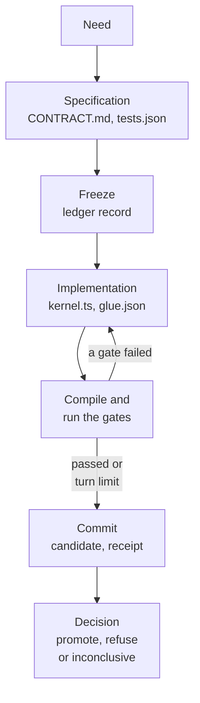

# The candidate loop

The candidate loop is how work from a coding agent becomes a capability EndoForge will run again without asking a model.
A person or an agent brings a need, a request for something software should do. The agent first writes what will be
checked; EndoForge freezes that in a ledger before any code exists; the agent then writes the code and repairs it
against the frozen checks inside a RAM-resident workcell; and the ledger, not the agent, decides whether the result is
promoted. The model writes all of the code and never grades its own work.

## Terms

| Term | Meaning here |
|---|---|
| Need | The request, in words, that starts a task. Each need gets its own ledger |
| Capability | What a promoted candidate provides: working code plus the contract and evidence that say what it does |
| Candidate | One proposed implementation, identified by the SHA-256 of its content |
| Kernel | The candidate form the stage prompts ask for today: application logic as a pure WebAssembly module (state in, event in, state out, effects out as data), with no imports except `env.abort` |
| Glue | `glue.json`: declarative data that names, types, labels and gives units to each kernel export, validated against a closed schema. A value is a scalar (`number`, `integer`, `boolean`, `code`) or structured state (`record`, `list`, `text`) with a declared memory layout |
| Frozen evaluator | The specification plus the exact gate code, hashed into the ledger before any candidate exists. The ledger action that does it is `admit` on the in-cell paths and `freeze` on the host-side path |
| Workcell | A warm V8 isolate that keeps the compiler and gates loaded between jobs ([workcells](workcells.md)) |
| Evaluator round | One pass of the engine's six checks over a candidate (five universal checks, then the residual check, which runs the nine gates); it includes two fresh runs of the tests in opposite call orders. A promotion needs two rounds ([gates](gates.md#from-gates-to-a-decision)). Not to be confused with the agent's check rounds, one per implementation check |
| Receipt | The ledger record of one evaluation: what was precommitted, what was observed, and the outcome. An evaluation that never reached an outcome is recorded `outcome_unknown`, and the decision on it is `inconclusive` |

Why a WebAssembly kernel: a module instantiates in well under a millisecond, its declared imports are its only
capabilities, its memory is its own, and a pure function of state and event is the easiest software to test
deterministically and to mutation-test. The glue travels as data checked against a closed schema, so no generated
imperative JavaScript runs on this path. Code that doesn't fit that split goes through the
[compatibility lane](compatibility-lane.md) instead.

This page is the map. Each mechanism has its own page:

| Page | Mechanism |
|---|---|
| [The agent loop](agent-loop.md) | The whole agent conversation running inside a workcell, with model turns parked in the ledger |
| [Workcells](workcells.md) | `IsolatePool`: V8 isolates in threads or processes, limits, warm machinery, the ledger bridge |
| [The gates](gates.md) | The nine deterministic checks and the ledger's promotion rule |
| [Evaluator synthesis](evaluator-synthesis.md) | A second evaluator written blind from the need, before any candidate |
| [The library](library.md) | Reusing a promoted capability instead of writing it again |
| [The compatibility lane](compatibility-lane.md) | Type checking and running TypeScript as JavaScript in a contained cohort |

## The shape of one attempt

1. **Specification.** The agent writes `CONTRACT.md`, what the capability does and its assumptions, and `tests.json`,
   the expectations it must meet. Before it can be frozen, every test must assert a definite value or a trap, with a
   tolerance of at most 1% ([test strength](gates.md#test-strength-g1)).
2. **Freeze.** The host hashes the specification together with the exact bytes of the gate implementation and writes
   one `frozen_evaluator` record into the task's ledger. From here on, a changed specification or gate file fails the
   commit. Code written before the freeze is refused.
3. **Implementation.** The agent writes the candidate: today `kernel.ts`, AssemblyScript compiled to the kernel
   module, and `glue.json`.
4. **Check.** The pinned AssemblyScript 0.28.20 compiler builds the module and the [gates](gates.md) run on it. On
   the agent path a failure goes back to the agent as its next prompt, up to the turn limit; on the other two paths a
   repair happens only when it is switched on (`ENDOFORGE_SELF_CHECK=1`, or a `repair` module).
5. **Commit.** On the in-cell paths the supervisor first runs the gates again on the committed bytes and refuses if
   they disagree with the cell's report ([re-run at commit](gates.md#commit-re-runs-the-gates)). One ledger transaction
   then registers the candidate, appends a receipt for its evaluation and re-checks the evidence against the frozen
   bundle.
6. **Decision.** The ledger's rule, `decide` in [tools/x1_loop.py](../../tools/x1_loop.py), returns `promote` only
   when every gate passed in both evaluator rounds for these bytes under this frozen evaluator. A lost cell, a deadline
   or a failed model call after the freeze is `inconclusive`, never a pass.

The test needs in the experiments, such as `integer add(a,b)`, are workloads that measure this loop. They are not a
limit on what an agent is asked to build: the overlay, the check hook, the freeze and the ledger are the same whatever
the stage prompts ask for, and today's stage prompts and gates implement the kernel form.

## After promotion

A promoted candidate stays in its task's ledger with the decision that promoted it. From there the
[library](library.md) can admit it, after re-verifying the promotion, and serve later needs that declare the same
capability without another model turn. EndoForge does not activate anything in a host application: the lifecycle
model ([core/lifecycle.py](../../core/lifecycle.py)) checks decision references for a host that does. An
`inconclusive` attempt promoted nothing and decided nothing about the candidate; running the need again is a new
attempt. On the agent path, a rerun on the same ledger starts the implementation again under the same frozen
evaluator, or picks up a parked conversation.

## Three loop paths

`runNeed` in [pipeline.mjs](../../core/runtime/x1/pipeline.mjs) runs one need. `ENDOFORGE_LOOP` picks where the work
happens:

| `ENDOFORGE_LOOP` | Path | Model | Where the rest runs |
|---|---|---|---|
| unset (default) | `current` | Two `codex exec` sessions through `ENDOFORGE_CODEX_CMD` ([generator.mjs](../../core/runtime/x1/generator.mjs)) | Generation in a temporary workspace; compile on the supervisor ([compiler.mjs](../../core/runtime/x1/compiler.mjs)); gates in an `IsolatePool`; ledger through `python3 -m tools.x1_ledger` per step |
| `isolate` | in-isolate | The same two `codex exec` sessions | Freeze, compile, gates, repair and commit in one warm cell and one persistent ledger bridge ([loop.mjs](../../core/runtime/x1/loop.mjs) `attemptInIsolate`) |
| `agent` | agent loop | A provider port: the warm or spawned Claude transport, or a scripted test double | Everything except the model call, including the conversation and the files, in the cell ([agent loop](agent-loop.md)) |

The `isolate` and `agent` paths need a pool from `createLoopPool`. The default stays `current` until the maintainer
accepts the in-cell paths' parity with it. [P-50](../../experiments/P-50-in-isolate/RESULT.md) measured all three on the same corpus
after its review (p50 / p95 non-model time per candidate, one cell, loaded desktop):

| Path | Non-model time | Spawns per candidate |
|---|---|---|
| `current` | 1,297 / 1,766 ms | 9 |
| `isolate`, process cell | 148 / 173 ms | 0 |
| `agent`, process cell | 116 / 123 ms | 0 |

Verdicts matched across paths on all 39 parity inputs. About half of the agent path's time is creating a new ledger
per task.

### The `current` path, step by step

1. `generate` makes `<directory>/candidate` (the agent's workspace) and `<directory>/oracle` (the frozen root, the
   directory whose files the freeze hashes), then
   runs the specification session. It refuses if the workspace holds anything except `CONTRACT.md` and `tests.json`
   (plus `reference.js` in `reference` mode), any file over 1 MiB, or a symlink.
2. It writes `frozen.sha256`, copies the specification and the gate implementation files into the oracle root, and
   asks the ledger to `freeze`.
3. With a library, `library.serve` may answer the need here, and no implementation session runs.
4. The implementation session resumes the same Codex thread by default (`ENDOFORGE_CODEX_SESSION=resume`). It may
   write only `kernel.ts` and `glue.json`; any change to a frozen file refuses the attempt. With
   `ENDOFORGE_SELF_CHECK=1` one repair session runs on gate failures.
5. The supervisor compiles, `register`s the candidate, runs the pool job, then calls `promote`, which writes and
   fsyncs `promotion.json`.

`ENDOFORGE_CODEX_TERSE` shapes the prompts: `exact` (the default) adds a rule to derive every expected value from the
formula, `scalar` adds a finite-scalar boundary rule and filters tests before the freeze, `reference` has the model
write `reference.js` and the supervisor fill in expected values from it, and `fallback` runs once terse and retries
once verbose within `ENDOFORGE_RETRY_BUDGET_MS`. The [configuration reference](../configuration/configuration-reference.md)
lists every variable.

### The `isolate` path

Generation is the same two Codex sessions, but the freeze, the checks and the commit go through the pool:
`admit` freezes in one bridge request (after evaluator synthesis writes its file into the oracle root, when on), a
library may answer the need right after it, a generator self-check is a cell job with no durable effect
(`checkCandidate`), and `evaluateAndCommit` compiles, gates and commits in one cell job plus one bridge request. A
`repair` module can run repair rounds inside the cell. [The runtime README](../../core/runtime/README.md#the-loop-inside-the-workcell)
has the details.

## Around the loop

Each of these is optional or sits beside the cell.

| Part | What it does | Default | Code |
|---|---|---|---|
| Library | A need that a promoted capability, or a composition of several, already meets skips implementation | Off; pass `library` from `openLibrary` (all paths) | [library](library.md) |
| Formula oracle | Recomputes frozen expectations from the contract's formula and a model-written reference before the freeze | Off; `limits.oracle` (agent path) | [agent loop](agent-loop.md#formula-oracle) |
| Evaluator synthesis | A candidate-blind evaluator built from the need can refuse a candidate after the gates, and flags frozen tests two references contradict | Off; `ENDOFORGE_SYNTH=1` (all paths) | [evaluator synthesis](evaluator-synthesis.md) |
| Compatibility route | Type checks, emits and runs the candidate's TypeScript in a contained cohort; inside `runNeed` it is reported and never changes the kernel decision; called directly, `route.promote` decides under the lane's own policy | Off; pass `containedRoute` (current path) | [compatibility lane](compatibility-lane.md) |
| Subscription guard | Refuses any `claude -p` launch not on a proven claude.ai subscription login (exit 78, a configuration error) | Always on for Claude launches | [subscription-guard.mjs](../../core/runtime/subscription-guard.mjs) |
| Usage governor | Parks new model calls near the usage ceiling (`USAGE_PARKED`, exit 75: try again after the reset) | On in both Claude transports; ceiling 0.85 | [usage-governor.mjs](../../core/runtime/usage-governor.mjs) |
| Stage rates | Per-stage throughput, queues and a bottleneck verdict | Off; pass `rates` to `createLoopPool` | [workcells](workcells.md#stage-rates) |
| Dump list | Registers sheddable memory so a machine memory guard can ask for it back | On only when the dump-list directory exists or `ENDOFORGE_DUMP_LIST=1` | [workcells](workcells.md#the-dump-list) |
| Capacity planner | Picks width and placement on L3 cache domains | Used by the compatibility route when no width is given | [capacity ICD](../interfaces/capacity-icd.md) |

## Where the evidence lives

- **Ledger.** One SQLite file per task (`<directory>/ledger.sqlite`), append-only and hash-chained: `task`,
  `admitted_input`, `frozen_evaluator`, `candidate`, `receipt`. The in-cell paths write it through one persistent
  bridge per pool, whose group-commit writer shares one `fdatasync` across a batch
  ([ledger ICD](../interfaces/ledger-icd.md#ledger-writer-journal)).
- **Decisions.** The `current` and `isolate` paths write a sealed `promotion.json`; the agent path stores its decision
  in an `x1_decisions` table beside the chain. `promote` reaches the same answer from the chain alone.
- **Experiments.** The measurement behind each default has a P-number in [experiments](../../experiments/README.md),
  with a precommitted plan and a result.

## Trust boundaries

Workcells are V8 isolates chosen for speed, density and low resource pressure. They are not an OS sandbox. Host ports,
the supervisor and the ledger writer are trusted code. A cell never receives the ledger path or the frozen root. A
thread cell cannot bound off-heap memory; a process cell in a delegated cgroup can. The hash chain detects changes; it
is not a signature or an external witness. The lifecycle model ([core/lifecycle.py](../../core/lifecycle.py))
validates decision references; it grants no authority and activates nothing in a host.

## Document control

| Field | Value |
|---|---|
| Document ID | ENDOFORGE-SDD-LOOP |
| Version | 3.0 |
| Status | Baselined |
| Owner | Akilleez-QA maintainer |
| Date | 2026-11-08 |
| Baseline commit | 63e95c7 |
| Applies to | endoforge main at baseline commit |
| Classification | Self-assessed Class E analog; not safety-critical (see [SMP §1](../plan/software-management-plan.md#1-software-classification-self-assessed)) |

> Organized after [NPR 7150.2D](https://nodis3.gsfc.nasa.gov/displayAll.cfm?Internal_ID=N_PR_7150_002D_&page_name=all), [NASA-STD-8739.8B](https://standards.nasa.gov/standard/nasa/nasa-std-87398) and the [NASA Software Engineering Handbook](https://swehb.nasa.gov/display/SWEHBVD/7.18+-+Documentation+Guidance) documentation guidance. This is not a NASA compliance determination or certification. The software classification is a self-assessed analog (Class E, not safety-critical); no NASA authority, independent verification and validation, or hazard analysis is asserted. The document describes the implementation inspected at the baseline commit.

### Change history

| Version | Date | Commit | Change | Reviewed in |
|---|---|---|---|---|
| 1.0 | before 2026-11-08 | — | Written in PR #129 at `d4d7efa` | earlier PRs |
| 2.0 | 2026-11-08 | `4d692a4` | Metadata header and change history added; content re-baselined | #131 |
| 2.1 | 2026-11-08 | `ea7b8d6` | Metadata header and NASA notice moved to this section; flow drawn as a diagram; plainer introduction. Content unchanged otherwise | #132 |
| 3.0 | 2026-11-08 | `63e95c7` | Rewritten from the code as the map of the loop; gates, agent loop, workcells, library and compatibility lane moved to their own pages; G5 described as the code runs it | earlier PR |
| 3.1 | 2026-11-09 | gap closure | Structured state in glue; commit re-run; library and synthesis on all paths; compatibility-lane promotion | this commit |
