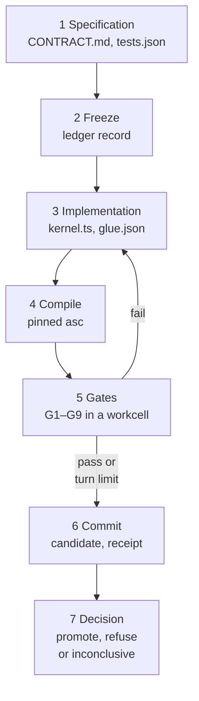

# The candidate loop

The candidate loop is how EndoForge turns a coding model's proposal into code it can trust: the checks are frozen
first, the code is written and repaired against them in a workcell, and the ledger records the verdict. Its default
candidate form is a kernel: a pure function compiled to WebAssembly. This page follows a test need (`integer add(a,b)`)
to a promoted kernel, what each gate checks, and where each part lives in
the code. To see it run,
follow the [getting-started tutorial](../guides/tutorials/getting-started.md). Settings are in the
[configuration reference](../configuration/configuration-reference.md).

## The shape of one attempt

1. **Specification.** A model writes `CONTRACT.md` (what the kernel computes) and `tests.json` (frozen expectations).
2. **Freeze.** The supervisor hashes the specification and the evaluator and stores them in the task's ledger before
   any code exists. Code written before the freeze, or a specification changed after it, is refused.
3. **Implementation.** The model writes `kernel.ts` (AssemblyScript) and `glue.json` (how each export's arguments and
   result are typed, labelled and given units).
4. **Compile.** The pinned AssemblyScript compiler builds a WebAssembly module with `--noAssert` and a 64 MiB memory
   maximum.
5. **Gates.** The frozen evaluator runs the gates in a workcell. A failure goes back to the model as its next prompt.
6. **Commit.** One ledger transaction registers the candidate, appends the receipt and evaluates the promotion rule.
7. **Decision.** `promote` only when every gate passed for the exact candidate bytes under the exact frozen evaluator,
   with a verified hash chain. A lost workcell, a deadline or a parked model call is `outcome_unknown` and never a pass.

## The gates

Gates are in [core/runtime/x1/gates.mjs](../../core/runtime/x1/gates.mjs). Promotion requires all nine to be present
and passing ([tools/x1_loop.py](../../tools/x1_loop.py)).

| Gate | Checks |
|---|---|
| `G1_frozen` | `CONTRACT.md` and `tests.json` match the frozen hashes, and the tests are not too weak |
| `G2_compiles` | The module compiled from this exact source, instantiates and has no unexpected imports |
| `G3_exports` | Every export the tests and glue name exists |
| `G4_tests` | Every frozen test passes |
| `G5_deterministic` | Two fresh instances in opposite call orders give the same results |
| `G6_bounded` | Metered fuel, stack and memory stay within bounds ([meter.mjs](../../core/runtime/x1/meter.mjs)) |
| `G7_glue` | The glue matches the closed schema, the kernel's parameters and the contract |
| `G8_nonfinite` | Float parameters probed with NaN and infinity behave as the contract says |
| `G9_units` | A static units check reads the kernel's arithmetic, the glue's kinds and parameter names, never the contract or evaluator ([dimensions.mjs](../../core/runtime/x1/dimensions.mjs), P-65) |

## Three loop paths

`runNeed` in [pipeline.mjs](../../core/runtime/x1/pipeline.mjs) picks a path from `ENDOFORGE_LOOP`:

| `ENDOFORGE_LOOP` | Path | Model | Where the work runs |
|---|---|---|---|
| unset (default) | current | Two `codex exec` sessions through `ENDOFORGE_CODEX_CMD` ([generator.mjs](../../core/runtime/x1/generator.mjs)) | Generation in a client process; compile on the supervisor; gates in an `IsolatePool` |
| `isolate` | in-isolate | Same generator | Compile, frozen check, gates and repair in one warm cell ([loop-port.mjs](../../core/runtime/x1/loop-port.mjs)) |
| `agent` | agent loop | A provider port, such as the warm Claude transport | Everything, including the agent's turn loop over an in-memory overlay ([agent.mjs](../../core/runtime/x1/agent.mjs)) |

The `isolate` and `agent` paths are off by default until their parity is accepted. P-50 measured them.

In the agent path the cell holds the turn loop. The model can call `read_file`, `edit_file`, `check` and `done`, up to
16 calls per reply. Turns and tokens are bounded by `limits` (`maxTurns` 6, `maxTokens` 64000). With `waits: 'release'`
(the default) a cell waiting for a model reply goes back to the pool; the continuation is written to the ledger first,
and the reply is admitted fresh into any free cell, which rechecks the frozen evaluator and the compiler identity.

## Around the loop

These parts are optional or sit outside the cell. Each is off by default unless the table says otherwise.

| Part | What it does | Default | Code |
|---|---|---|---|
| Library | A need that a promoted kernel already satisfies skips implementation | Off; pass `library` from `openLibrary` | [core/library](../../core/library/README.md) |
| Formula oracle | Recomputes frozen expectations from the contract's formula, ranges and a model-written `reference.js` before the freeze; corrects or flags wrong values, evaluates a piecewise rule branch by branch, and abstains on what it cannot read | Off; `limits.oracle` | [oracle.mjs](../../core/runtime/x1/oracle.mjs) |
| Evaluator synthesis | A candidate-blind evaluator is built from the need, qualified, and can refuse a candidate after the gates | Off; `ENDOFORGE_SYNTH=1`, current path only | [design](evaluator-synthesis.md) |
| Scalar filter and terse prompts | Generator prompt rules; `ENDOFORGE_CODEX_TERSE=exact` is the default | `exact` | [generator.mjs](../../core/runtime/x1/generator.mjs) |
| Contained route | Type checks, emits and runs the candidate's TypeScript in a supervised V8 cohort; reported under `contained`, never changes the decision | Off; pass `containedRoute` | [contained-route.mjs](../../tools/tscheck/contained-route.mjs) |
| Subscription guard | Refuses any `claude -p` launch that is not on a proven claude.ai subscription login (exit 78) | Always on for Claude launches | [subscription-guard.mjs](../../core/runtime/subscription-guard.mjs) |
| Usage governor | Parks new model calls near the weekly usage ceiling (`USAGE_PARKED`, exit 75) | On in both Claude transports; ceiling 0.85 | [usage-governor.mjs](../../core/runtime/usage-governor.mjs) |
| Capacity planner | Picks width, placement on L3 cache domains and the split into cohorts | Used by the contained route when no width is given | [capacity ICD](../interfaces/capacity-icd.md) |
| Stage rates | Per-stage throughput, queue and bottleneck verdict for a running loop | Off; pass `rates` | [stage-rates.mjs](../../core/runtime/stage-rates.mjs) |
| Dump list | Registers sheddable memory so a machine memory guard can ask for it back with `SIGUSR2` | On only if the dump-list directory exists or `ENDOFORGE_DUMP_LIST=1` | [runtime](../../core/runtime/README.md#memory-on-the-dump-list) |

## Where the evidence lives

- **Ledger.** A SQLite file per task, hash-chained, written through one persistent bridge per pool. The group-commit
  writer ([tools/ledger_writer.py](../../tools/ledger_writer.py)) shares one journal `fdatasync` across a batch.
  See the [ledger ICD](../interfaces/ledger-icd.md).
- **Decisions.** The agent path stores its decision in an `x1_decisions` table beside the chain; `promote` reaches the
  same answer from the chain alone.
- **Experiments.** Measurements behind each default are in [experiments](../../experiments/README.md), one P-number
  per probe, with a precommitted plan and a result.

## Trust boundaries

Workcells are V8 isolates, not an OS sandbox. Host ports, the supervisor and the ledger writers are trusted code. A
cell never receives the ledger path or the frozen root. Thread-mode cells cannot bound off-heap memory; process mode
with a delegated cgroup can. The hash chain detects changes; it is not a signature or an external witness. The
lifecycle model ([core/lifecycle.py](../../core/lifecycle.py)) validates decision references; it grants no authority
and activates nothing in a host.

## Document control

| Field | Value |
|---|---|
| Document ID | ENDOFORGE-SDD-LOOP |
| Version | 2.1 |
| Status | Baselined |
| Owner | Akilleez-QA maintainer |
| Date | 2026-11-08 |
| Baseline commit | 4d692a41853045c4e013405d8e674528745a38b9 |
| Applies to | endoforge main at baseline commit |
| Classification | Self-assessed Class E analog; not safety-critical (see [SMP §1](../plan/software-management-plan.md#1-software-classification-self-assessed)) |

> Organized after [NPR 7150.2D](https://nodis3.gsfc.nasa.gov/displayAll.cfm?Internal_ID=N_PR_7150_002D_&page_name=all), [NASA-STD-8739.8B](https://standards.nasa.gov/standard/nasa/nasa-std-87398) and the [NASA Software Engineering Handbook](https://swehb.nasa.gov/display/SWEHBVD/7.18+-+Documentation+Guidance) documentation guidance. This is not a NASA compliance determination or certification. The software classification is a self-assessed analog (Class E, not safety-critical); no NASA authority, independent verification and validation, or hazard analysis is asserted. The document describes the implementation inspected at the baseline commit.

### Change history

| Version | Date | Commit | Change | Reviewed in |
|---|---|---|---|---|
| 1.0 | before 2026-11-08 | — | Written in PR #129 at `d4d7efa` | earlier PRs |
| 2.0 | 2026-11-08 | `4d692a4` | Metadata header and change history added; content re-baselined | #131 |
| 2.1 | 2026-11-08 | `ea7b8d6` | Metadata header and NASA notice moved to this section; flow drawn as a diagram; plainer introduction. Content unchanged otherwise | this PR |
