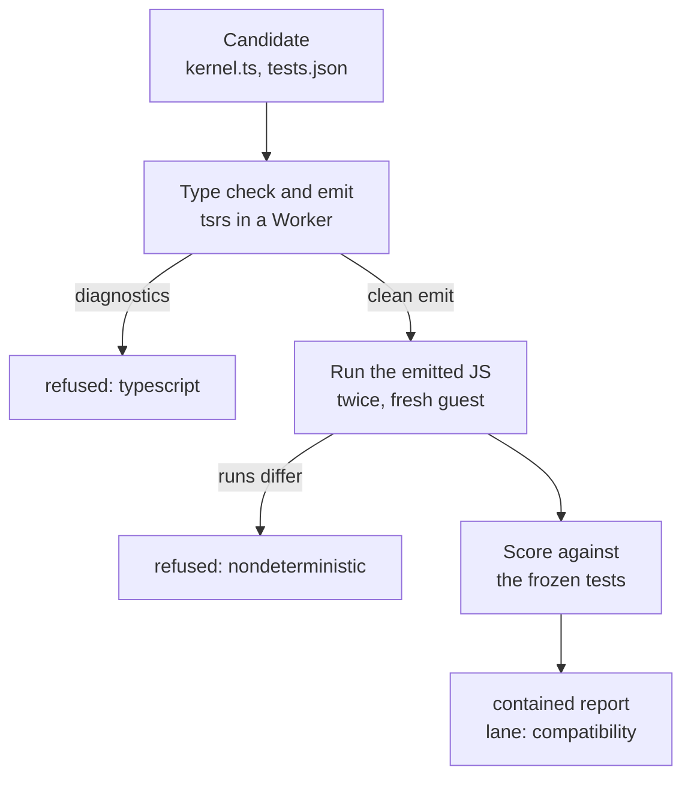

# The compatibility lane

The compatibility lane runs TypeScript as JavaScript, for imported code and for behaviour that doesn't fit the kernel
split of Edition 3 §5. It has two parts: a TypeScript 7 checker compiled to WebAssembly that type checks and emits
inside a V8 isolate, and a contained cohort that runs the emitted JavaScript in child isolates with no ambient
authority. Every result it produces is labelled `lane: compatibility`. It is a lane of its own, not a weaker form of
the kernel path, and nothing on the kernel path depends on it.

| Part | Code | Page |
|---|---|---|
| Checker: `tsrs`, a Rust port of the TypeScript 7 compiler, as WebAssembly | [tools/tscheck](../../tools/tscheck/README.md) | its README |
| Contained cohort: one hardened Node process holding reusable Worker isolates | [core/runtime/contained](../../core/runtime/contained/runner.mjs) | [runtime README](../../core/runtime/README.md#contained-javascript) |
| Route: check, emit, run twice, score against the candidate's tests | [tools/tscheck/contained-route.mjs](../../tools/tscheck/contained-route.mjs) | this page |

## The route on a candidate

`runNeed({ ..., containedRoute })` on the `current` path calls `containedRoute.check(candidate)` after the decision.
Its report joins the result under `contained` and never changes the decision; an exception becomes
`{ lane: 'compatibility', status: 'outcome_unknown' }`.



1. The candidate's `kernel.ts` becomes a project (`projectFor`) with strict options, `module: commonjs` and
   `noEmitOnError`, plus a declaration file for the scalar types.
2. The checker type checks and emits it. By default (`check: 'fused'`) this happens inside the cohort, in the Worker
   that then runs the guest; `'sibling'` uses checker Workers in the same cohort process; `'supervisor'` checks on the
   calling thread. A check with diagnostics is refused with reason `typescript`.
3. The emitted JavaScript runs twice through an adapter that calls each frozen test; the two runs must agree in status,
   output and reason.
4. Each test is scored with the same comparison rules as [G4](gates.md#how-a-test-passes-g4). The report records
   the compiler identity, the artifact's SHA-256, pass counts, the first failures and timings.

When the caller gives no `width`, the route asks the [capacity planner](../interfaces/capacity-icd.md) for one cohort
per L3 cache domain, pinned with `taskset`, as wide as that domain's cores within the job's CPU share.

## The contained cohort

`createContainedRunner({ width, heapMb, deadlineMs, ... })` starts one child process:

```text
node --permission --allow-worker --no-addons --disallow-code-generation-from-strings
     --no-warnings --no-experimental-websocket --max-old-space-size=64 -e <cohort>
```

with an environment of only `TZ=UTC` and `LC_ALL=C`, working directory `/`, core dumps off, and no file-system grant
except the pinned checker module when the cohort prepares checks. Inside it, `width` Worker isolates are kept between
attempts, plus spares; each attempt gets a fresh guest context with a closed allowlist of standard globals.

| Property | Rule |
|---|---|
| Authority | None unless the job's contract grants it: `grants.clock.fixedMs` (a fixed `Date`), `grants.random.seed` (a seeded `Math.random`), and named `ports` with `maxCalls` and `maxBytes`, reached by `require('host:ports')` and carrying JSON text. `Date.now` and `Math.random` are otherwise refused |
| Modules | CommonJS only. Any source containing `import` followed by `(` is refused as `dynamic_import` |
| Limits | Per-attempt heap, stack and deadline in the Worker; a process kill from the supervisor behind the deadline; an RSS watchdog behind that |
| Refusals | `heap`, `memory`, `deadline`, `stack`, `string_limit`, `thrown`, `never_settled`, `output_not_json`, `output_too_large`, `compile`, `dynamic_import`, `process_exit`, `nondeterministic` |
| Failure scope | A heap, stack or deadline breach that a Worker contains costs only that attempt. A V8 fatal error ends the cohort: every attempt it held is `outcome_unknown`, one replacement starts, and nothing is retried |

Other layouts: `reuse: false` gives a fresh Worker per attempt; `createContainedPool({ width })` gives one process
per cell, which loses no neighbour to a fatal error and costs about 70 MiB per cell. The route takes
`layout: 'shared-reuse' | 'shared-fresh' | 'process-per-cell'`.

## The checker in a workcell

[tools/tscheck](../../tools/tscheck/README.md) also runs the checker as an `IsolatePool` host port, adding a
`typescript` invariant to the frozen evaluator. The pool's `trustedWasmModules` names the checker's digest, so the WASM
guard admits it, and thread pools compile it once and share it. A hash mismatch, a missing compiler or a trap is an
unknown outcome, never a pass. Its README lists the file-name, option and program rules the host enforces, and the
requalification run that compares it with Microsoft's native compiler on every version bump.

## Measured

| Probe | Result |
|---|---|
| [P-54](../../experiments/P-54-contained-js/RESULT.md) | The shared, reused cohort matched one process per cell in attempts per second at every width with about a third of the memory per active attempt; a fresh Worker per attempt cost 9.6–27 ms of CPU against 0.46–1.1 ms |
| [P-58](../../experiments/P-58-cohort-typecheck/RESULT.md) | Checking inside the cohort: 380–516 accepted attempts per second at width 16, against 58–63 with the check on the supervisor, at 1.1–1.5× the CPU per attempt |
| [P-60](../../experiments/P-60-tscheck-snapshot/RESULT.md) | Reusing one checker instance per Worker and seeding each check with build info from the route's own baseline: 649–702 accepted per second at width 16 against 443–510 for fresh checks, with no verdict or emit difference |
| [P-43](../../experiments/P-43-tsrs-workcell/RESULT.md) | The checker's parity arm against the native compiler, and its memory floor in a workcell |

## Limits

- The cohort is not an OS sandbox and not a Spectre boundary. The permission model doesn't cover signals, and on
  Node 22 it doesn't cover the network. Passing the attack suite doesn't prove no escape exists.
- Mathematical and Unicode results follow the V8 and ICU of the running Node.
- The route reports; it does not promote. A compatibility-lane promotion rule is not built.
- Requires Node 22.8 or later.
