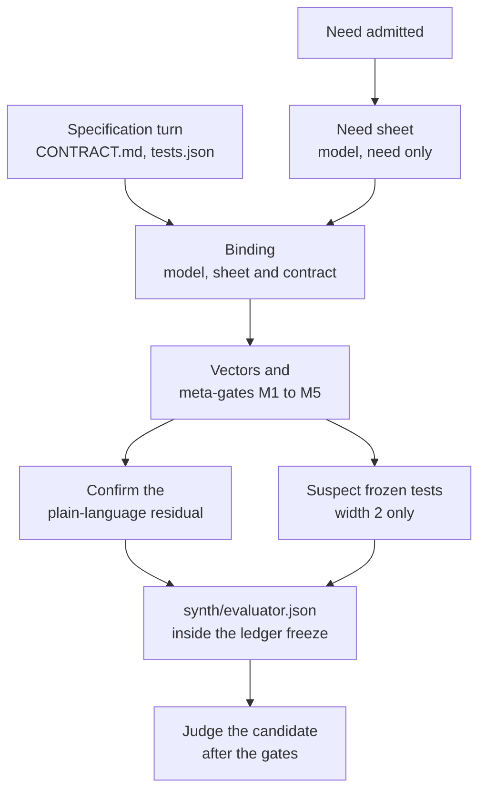

# Evaluator synthesis

Evaluator synthesis builds a second evaluator for a need from a model context that never sees a candidate. It turns
the need, and then the frozen contract, into an independent reference function per export and a set of declared
properties; deterministic code turns those into frozen test vectors and qualifies them against fixed meta-gates. After
the gates pass, the candidate must also agree with this evaluator, or it is refused. This is the specification stage
of Edition 3 §6: the part of acceptance that only this request determines, written blind, frozen, qualified and
confirmed before any candidate exists.

Code: [core/runtime/x1/synth/](../../core/runtime/x1/synth/stage.mjs). Off by default; `ENDOFORGE_SYNTH=1` turns it on
for all three loop paths (`current`, `isolate`, `agent`). Measured in [P-56](../../experiments/P-56-evaluator-synthesis/RESULT.md).

## Why

The frozen `tests.json` is written in the same model context that later writes the kernel, so a misreading of the need
can produce a test and a kernel that agree with each other. Before synthesis, [P-51](../../experiments/P-51-escape-rate/RESULT.md)
and [P-52](../../experiments/P-52-real-gates/RESULT.md) measured seeded faults escaping the gates on inputs the tests
didn't cover, most of them rounding faults, and glue faults, mostly swapped units, that no gate had a basis to refuse.
P-56 then measured, on the same tree:

| Measure | Synthesis off | Two evaluators, agreed checks only |
|---|---|---|
| Pristine kernels promoted | 177 of 177 | 177 of 177 |
| Seeded kernel faults that escaped | 280 of 7,883 (3.55%) | 105 (1.33%) |
| Of those, wrong rounding | 107 | 12 |
| Seeded glue faults that escaped | 312 of 799 | 184 |

The 29 faults visible only on NaN or infinity were untouched: synthesis doesn't probe non-finite inputs; G8 does.

## The stage



### 1. Need sheet (model, from the need alone)

`begin` starts as soon as the need is admitted, so it runs while the specification turn is being written. The prompt
(`prompts.need`) gives the need and the ids of the invariant library, and asks for `sheet.json`: up to eight sentences
of what must be checked, the quantities with units and expected sign, monotone relations, and which library
invariants apply. The reply uses the agent reply protocol (one `edit_file` call, then `done`).

### 2. Binding (model, from the sheet and the frozen contract)

When the specification is ready, the freeze calls `finish(root)`. It reads the frozen `CONTRACT.md` and `tests.json`
from the oracle root (on the agent path, from a temporary root written from the host's shadow copy) and asks for `binding.json` (`prompts.binding`): for every export, parameters in
contract order with units, bounds and openness, integer flags and code tables; the result kind, unit, displayed
decimals, codes and range; monotone relations the contract makes certain; and `reference`, one plain JavaScript source
computing every export in double precision with only `Math` and `Number`, throwing where the contract traps. Where
the contract returns a record, list or text, the binding declares the result's full layout (`fields`, `items` and
`max`, `maxBytes`, the same keys as the glue's) and the reference returns a plain object, array or string. The
model never sees `tests.json`, `kernel.ts`, `glue.json` or any candidate output.

The binding has to wait for the contract because the contract fixes the export names; one model turn is therefore on
the critical path.

### 3. Vectors and qualification (no model)

`compileMember` turns one binding into frozen vectors and a qualification record per export.

**Vectors** ([vectors.mjs](../../core/runtime/x1/synth/vectors.mjs)), seeded by the binding's hash: the first frozen
value test's arguments as a base point; for each parameter one at a time, the base, half of it, double it plus 0.37, each declared
edge, one step inside and outside it, a point well outside, and non-round interior fractions (or, for a code
parameter, every code and one past each end); then 48 seeded random points inside the domain. A denser set of 192
random points is kept aside for M5.

A parameter whose frozen base argument is a record, list or text is held at that value; only the numeric parameters
beside it are swept.

**The reference** runs in [sandbox.mjs](../../core/runtime/x1/synth/sandbox.mjs): a separate Node process under the
permission model, with an empty environment, where each variant gets a fresh `vm` context holding only `Math`,
`Number`, `Error`, `RangeError`, `TypeError`, `isFinite` and `isNaN`; 2 s to load, 200 ms per call, 4 s per variant, 30 s
in all. A reference may return a number, a boolean, a string, or a plain object or array; the sandbox copies an
object or array out as JSON, so a later call cannot see it change. Anything else (`undefined`, a function, a value
that can't be serialized) is marked unusable, which is a failure, never a throw. For an export with a declared
layout, [layout.mjs](../../core/runtime/x1/synth/layout.mjs) checks and normalizes each returned value by the same
rules as `revise` (declared field order, integer and code range, booleans from `0`/`1`, text within `maxBytes`, list
length within `max`); a value that does not fit fails M2.

**Meta-gates** ([qualify.mjs](../../core/runtime/x1/synth/qualify.mjs)). An export failing M1, M2, M3 or M5 is
unqualified and contributes no value check; a declaration failing M4 is dropped.

| Meta-gate | Passes when |
|---|---|
| M1 shape | The export exists in the binding with as many parameters as the frozen tests pass, numeric bounds, and a reference source |
| M2 deterministic and bounded | Two runs of the reference give identical results, within the time budget, and every result fits the declared layout |
| M3 anchor | The reference reproduces every frozen value test of the export (within its `tol`, or 1e-9 relative; a structured value field by field, exactly unless the test sets `tol`) and throws on its `expectError` tests |
| M4 self-consistency | Each declared range, code table and monotone relation holds on the reference's own outputs, and the reference doesn't return outside its declared domain |
| M5 discrimination | Of the reference's seeded faults (constant shift, comparison flip, operator swap, rounding swap, argument swap; at most 40) that the denser sample can tell apart, the frozen vectors reject at least 80% |

Only vectors whose reference result is finite, a value of the declared layout, or a throw are kept.

### 4. One or two evaluators

`ENDOFORGE_SYNTH_WIDTH=2` runs steps 1 and 2 twice, in independent sessions, and `combine` keeps only what both
members agree on: a vector counts only when the other member's reference gives the same outcome on it; a monotone
relation only when both declared it; a glue unit only when both state the same unit; decimals only when equal; code
labels only when both tables have the same codes and no label is swapped. Ranges take the wider bound, and code sets
the union. Width 1 keeps one member's qualified checks. An export that takes or returns a record, list or text contributes
only its glue checks to the combined set, at either width; its outcomes are checked by the frozen tests and, through
suspects, by the references (see [Limits](#limits)). In P-56 the agreed set refused exactly the same kernel faults
as one member alone.

### 4a. Suspect frozen tests (width 2, no model)

M3 refuses an export whose reference contradicts a frozen test. That usually means the reference is wrong, but when two
independent references agree with each other against the same test, the test is the likelier error (P-56 found one
such case). `compileMember` records, per export, every frozen test its reference contradicts and what the reference
returned. `suspectTests` then reports a test as suspect only when all of these hold:

- the width is 2 and both members compiled;
- for that export, both references fail no meta-gate except M3, and every M3 failure is a contested test;
- both contradict the same set of tests, with the same outcome on each (for a structured export: both declare the
  same layout shape, units aside, and their values agree field by field, exactly unless the test sets `tol`);
- each reference reproduces the other's frozen vectors.

`finish` runs this at the freeze, before the implementation turn. The suspects go into `evaluator.json` under
`suspects` and into `synth/suspect.json`:

```json
{ "kind": "suspect_frozen_tests", "before": "implementation", "evaluator": "<sha256 of evaluator.json>",
  "tests": [{ "fn": "allowance", "test": "negative", "args": [-1], "expectError": true,
              "references": [{ "value": 0 }, { "value": 0 }] }],
  "revision": { "reason": "specification_correction", "references": ["<binding sha256>", "<binding sha256>"],
                "rule": "a corrected test is frozen as a revision of the latest frozen evaluator, with outcome-independent admitted evidence" } }
```

For a structured export each suspect also carries the declared `layout`, which `revise` needs, since no glue exists
yet. A suspect names its test by `name`, or by its index in the frozen `tests.json` when it has none.

`begin({ suspect })` takes a hook that receives the same report before `finish` returns, and `finish` returns
`{ root, hash, suspects }`. The export itself stays unqualified. Width 1, references that disagree, and a reference
that fails another meta-gate give no suspects.

### 4b. Acting on suspects: a specification correction

Every loop path passes its own hook to `begin`, so the report reaches the pipeline before the ledger freeze returns.
Right after the first freeze, and before any candidate exists, the pipeline asks the ledger to `revise`
([tools/x1_loop.py](../../tools/x1_loop.py); through the pool's ledger bridge on `isolate` and `agent`, and as
`python3 -B -m tools.x1_loop revise < request.json` on `current`). `revise`:

1. refuses unless the request names the latest frozen evaluator, the report is a `suspect_frozen_tests` report made
   `before: "implementation"` with at least one test, and the ledger holds no candidate yet;
2. corrects each suspect test from the two agreeing reference outcomes: a returned finite number becomes the new
   `expect`, a throw becomes `expectError: true`, and a record, list or text value becomes the new `expect` when the
   suspect carries its declared `layout` (both values must fit it and agree under the commit's structured comparison,
   [REQ-X1-009](../requirements/requirements.md#req-x1-009--structured-comparison-at-commit), with the test's own
   `tol`; the value is frozen in the layout's field order). A structure without a layout, a malformed layout, a value
   that misfits it, references that disagree, or a throw against a value is refused, and nothing is appended. A
   suspect must name exactly one frozen test (by `name`, `fn` and `args`);
3. appends the report as an `admitted_input` (`suspect-1`, `suspect-2`, ...; origin `evaluator_synthesis`), then a new
   `frozen_evaluator` with the corrected `tests.json` and `frozen.sha256` and
   `revision: { of: <previous identity>, reason: "specification_correction", evidence: <admitted input id> }`.

From then on the revised identity is the frozen evaluator: the self-check, the library lookup, the commit and the
decision all use the corrected tests. The result carries `revision` (the new identity) and `suspects` (the corrected
tests). A caller's own `runNeed({ suspect })` hook is still called with the report.

| Path | What the implementation turn sees |
|---|---|
| `agent` | The cell restarts after the revision, so the implementation turn reads the corrected `tests.json` |
| `current`, `isolate` | After the freeze, `generate` ([generator.mjs](../../core/runtime/x1/generator.mjs)) re-reads `tests.json` and `frozen.sha256` from the oracle root. If they changed, it checks them against the frozen digest and the "each test can fail" rule (refusing before implementation on a mismatch), writes them into the Codex workspace, and sends the corrected `tests.json` in the implementation prompt with a notice that it replaces the earlier one, since a resumed session still remembers the first. The library lookup and the returned candidate use the corrected files too |

### 5. Confirm

`residualText` renders the need sheet's sentences plus one line per checked export, unit and relation. A `confirm`
callback, passed to `runNeed` as `confirm`, approves or declines it. Without one the answer is recorded as
`{ approved: true, confirmed_by: 'task contract, no person' }`. Nothing records a person who wasn't asked. An
unconfirmed evaluator abstains.

### 6. Freeze

`finish` writes `synth/evaluator.json` (version, width, library ids, residual, per-member qualification, the checks,
the suspects and the confirmation) before the ledger freeze runs, so the `frozen_evaluator` record's digest covers it.
Its SHA-256 is kept for step 7.

| Path | Where the file goes |
|---|---|
| `current` | The oracle root, before `python3 -m tools.x1_ledger freeze` |
| `isolate` | The oracle root, inside the `freeze` callback, before the pool's `admit` |
| `agent` | Added to the frozen files the host sends to `admit` (the cell never sees the evaluator), so it lives in the ledger's frozen bundle |

On the `agent` path `begin` starts with the attempt, unless the ledger already holds a frozen evaluator (a resumed
attempt keeps the one it froze).

### 7. Judge

`judge` ([judge.mjs](../../core/runtime/x1/synth/judge.mjs)) runs the frozen checks on one compiled candidate. Where it
runs depends on the path:

- **`current`.** After the pool gates and before the ledger's `promote`, `evaluate(candidate)` re-reads
  `synth/evaluator.json`, refuses if its hash changed, and judges in a separate worker thread
  ([cell-host.mjs](../../core/runtime/x1/synth/cell-host.mjs) `judgeInCell`): 128 MiB old generation, 16 MiB young,
  4 MiB stack, an empty environment and a 30 s deadline (`begin({ cell: { deadlineMs, resourceLimits } })` overrides
  them). A timeout (`cell_timeout`), an out-of-memory error (`cell_limit`), a crash or an exit without a verdict refuses
  the candidate; it never passes. The verdict records the cell's thread id.
- **`isolate` and `agent`.** At commit, after the [independent re-run](gates.md#commit-re-runs-the-gates) agrees,
  `checkAtCommit` reads `synth/evaluator.json` from the ledger's verified frozen bundle and judges in the same bounded
  worker thread (`judgeInCell`, with its default limits and deadline), so the verdict carries a thread id that is not
  the controller's. A refusal, a cell failure, or an exception marks the receipt `rejected` with
  "synthesized evaluator refused the candidate", so the ledger refuses the promotion. The result carries the verdict
  as `synthesis`, with the evaluator's hash.

On every path `judge`:

- abstains when the residual wasn't approved, or when nothing qualified;
- runs every vector on a fresh fuel-metered instance, then again in reverse order on another, and refuses if the two
  disagree; an export whose `glue.json` entry takes or returns a record, list or text is called through the declared
  layout and the host buffers, as the gates call it ([structured state](gates.md#structured-state)), and its whole
  decoded value is compared; a value that misfits the layout is a failure at the boundary, not a trap;
- refuses a result that differs from the reference by more than 1e-9 relative, a trap where the reference returned or
  a return where it threw, a missing export, or a fuel or stack limit; skips a vector with a fractional argument for
  an integer parameter;
- refuses a declared range, code set or monotone relation that the outputs break;
- compares the glue with the declarations: units by dimension and scale (a unit it can't parse is left unknown,
  never refused), displayed decimals, and code labels.

A `refuse` means no promotion: on `current` `runNeed` returns `promoted: false` before `promote`; on `isolate` and
`agent` the receipt is rejected. `synthesis.json` in the run directory holds the verdict on `current` and `isolate`.
`pass` and `abstain` leave the decision to the gates and the ledger.

## Configuration

| Variable | Default | Meaning |
|---|---|---|
| `ENDOFORGE_SYNTH` | unset | `1` runs the stage |
| `ENDOFORGE_SYNTH_WIDTH` | `1` | `2` runs two independent evaluators |
| `ENDOFORGE_SYNTH_MODEL` | `sonnet` | Model for `claude -p` (`SpawnClaudeTransport`) |
| `ENDOFORGE_SYNTH_CONFIG_DIR` | unset | Claude configuration directory for that transport |
| `ENDOFORGE_SYNTH_PROVIDER` | unset | A module exporting `createProvider(env)`, for replay and tests |

`runNeed({ synthProvider, confirm, suspect })` passes a provider object, the confirmation callback and a suspect hook
on every path. Called directly, `begin({ need, env, provider, confirm, suspect, cell })` also takes the judging cell's
limits.

## The invariant library

[invariants.mjs](../../core/runtime/x1/synth/invariants.mjs) holds the reusable checks, authored as deterministic
code. The model only selects and parameterizes them: `value.reference`, `boundary.domain`, `rounding.probe`,
`range.result`, `monotone`, `codes.result`, `units.glue`, `precision.glue`, `codes.glue`, `determinism`.

## Rules kept and where they stop

- **Before and blind.** Neither model step sees a candidate. The binding reads the contract, which the same context as
  the kernel wrote, so this evaluator is blind to the kernel, not to the contract's reading of the need. A misread
  contract is outside what it can catch; only the need sheet is independent of it.
- **One per task.** It is keyed by the task and frozen once, never regenerated after a candidate fails.
- **Qualified** by M1 to M5, without any candidate.
- **Confirmed**, with the confirming party recorded truthfully.
- It counts as the "model, candidate-blind" error source of Edition 3 §7: partly independent. A passing synthesized
  check grants no autonomy tier.

## Cost

P-56 ran 702 `claude -p` calls on Sonnet: four calls and about 14.4k tokens per task at width 2, 6.1 s mean per call.
Offline, compile, qualify and judge took 495 ms at p50; judging alone 0.6 ms.

## Limits

- `combine` keeps no value vectors, ranges, codes or monotone relations for an export that takes or returns a record,
  list or text, at width 1 or 2, so the frozen evaluator holds no synthesized vectors for such an export and `judge`
  checks only its glue. `judge` can run structured vectors (the to-do reducer test feeds it some directly), but synthesis
  produces none. Structured outcomes still reach the evaluator through M3 and suspect corrections.
- The `begin` cell limits apply on `current` only; at commit on `isolate` and `agent` the judging cell uses the
  defaults.
- The [formula oracle](agent-loop.md#formula-oracle) is the agent path's other check of frozen expectations.
