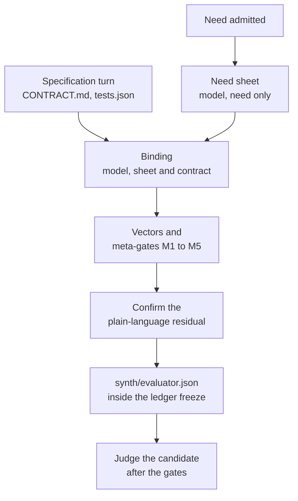

# Evaluator synthesis

Evaluator synthesis builds a second evaluator for a need from a model context that never sees a candidate. It turns
the need, and then the frozen contract, into an independent reference function per export and a set of declared
properties; deterministic code turns those into frozen test vectors and qualifies them against fixed meta-gates. After
the gates pass, the candidate must also agree with this evaluator, or it is refused. This is the specification stage
of Edition 3 §6: the part of acceptance that only this request determines, written blind, frozen, qualified and
confirmed before any candidate exists.

Code: [core/runtime/x1/synth/](../../core/runtime/x1/synth/stage.mjs). Off by default; `ENDOFORGE_SYNTH=1` turns it on,
on the `current` path only. Measured in [P-56](../../experiments/P-56-evaluator-synthesis/RESULT.md).

## Why

The frozen `tests.json` is written in the same model context that later writes the kernel, so a misreading of the need
can produce a test and a kernel that agree with each other. Before synthesis, [P-51](../../experiments/P-51-escape-rate/RESULT.md)
and [P-52](../../experiments/P-52-real-gates/RESULT.md) measured seeded faults escaping the gates on inputs the tests
didn't cover, most of them rounding faults, and glue faults, mostly swapped units, that no gate had a basis to refuse.
P-56 then measured, on the same tree:

| Measure | Synthesis off | Two evaluators, agreed checks only |
|---|---|---|
| Pristine kernels promoted | 177 of 177 | 177 of 177 |
| Seeded kernel faults that escaped | 280 of 7,883 (3.55%) | 105 (1.33%) |
| Of those, wrong rounding | 107 | 12 |
| Seeded glue faults that escaped | 312 of 799 | 184 |

The 29 faults visible only on NaN or infinity were untouched: synthesis doesn't probe non-finite inputs; G8 does.

## The stage

### 1. Need sheet (model, from the need alone)

`begin` starts as soon as the need is admitted, so it runs while the specification turn is being written. The prompt
(`prompts.need`) gives the need and the ids of the invariant library, and asks for `sheet.json`: up to eight sentences
of what must be checked, the quantities with units and expected sign, monotone relations, and which library
invariants apply. The reply uses the agent reply protocol (one `edit_file` call, then `done`).

### 2. Binding (model, from the sheet and the frozen contract)

When the specification is ready, the freeze callback calls `finish(root)`. It reads the frozen `CONTRACT.md` and
`tests.json` from the oracle root and asks for `binding.json` (`prompts.binding`): for every export, parameters in
contract order with units, bounds and openness, integer flags and code tables; the result kind, unit, displayed
decimals, codes and range; monotone relations the contract makes certain; and `reference`, one plain JavaScript source
computing every export in double precision with only `Math` and `Number`, throwing where the contract traps. The
model never sees `tests.json`, `kernel.ts`, `glue.json` or any candidate output.

The binding has to wait for the contract because the contract fixes the export names; one model turn is therefore on
the critical path.

### 3. Vectors and qualification (no model)

`compileMember` turns one binding into frozen vectors and a qualification record per export.

**Vectors** ([vectors.mjs](../../core/runtime/x1/synth/vectors.mjs)), seeded by the binding's hash: the first frozen
value test's arguments as a base point; for each parameter one at a time, the base, half of it, double it plus 0.37, each declared
edge, one step inside and outside it, a point well outside, and non-round interior fractions (or, for a code
parameter, every code and one past each end); then 48 seeded random points inside the domain. A denser set of 192
random points is kept aside for M5.

**The reference** runs in [sandbox.mjs](../../core/runtime/x1/synth/sandbox.mjs): a separate Node process under the
permission model, with an empty environment, where each variant gets a fresh `vm` context holding only `Math`,
`Number`, `Error`, `RangeError`, `TypeError`, `isFinite` and `isNaN`; 2 s to load, 200 ms per call, 4 s per variant, 30 s
in all.

**Meta-gates** ([qualify.mjs](../../core/runtime/x1/synth/qualify.mjs)). An export failing M1, M2, M3 or M5 is
unqualified and contributes no value check; a declaration failing M4 is dropped.

| Meta-gate | Passes when |
|---|---|
| M1 shape | The export exists in the binding with as many parameters as the frozen tests pass, numeric bounds, and a reference source |
| M2 deterministic and bounded | Two runs of the reference give identical results, within the time budget |
| M3 anchor | The reference reproduces every frozen value test of the export (within its `tol`, or 1e-9 relative) and throws on its `expectError` tests |
| M4 self-consistency | Each declared range, code table and monotone relation holds on the reference's own outputs, and the reference doesn't return outside its declared domain |
| M5 discrimination | Of the reference's seeded faults (constant shift, comparison flip, operator swap, rounding swap, argument swap; at most 40) that the denser sample can tell apart, the frozen vectors reject at least 80% |

Only vectors whose reference result is finite or a throw are kept.

### 4. One or two evaluators

`ENDOFORGE_SYNTH_WIDTH=2` runs steps 1 and 2 twice, in independent sessions, and `combine` keeps only what both
members agree on: a vector counts only when the other member's reference gives the same outcome on it; a monotone
relation only when both declared it; a glue unit only when both state the same unit; decimals only when equal; code
labels only when both tables have the same codes and no label is swapped. Ranges take the wider bound, and code sets
the union. Width 1 keeps one member's qualified checks. In P-56 the agreed set refused exactly the same kernel faults
as one member alone.

### 5. Confirm

`residualText` renders the need sheet's sentences plus one line per checked export, unit and relation. A `confirm`
callback, passed to `runNeed` as `confirm`, approves or declines it. Without one the answer is recorded as
`{ approved: true, confirmed_by: 'task contract, no person' }`. Nothing records a person who wasn't asked. An
unconfirmed evaluator abstains.

### 6. Freeze

`finish` writes `synth/evaluator.json` (version, width, library ids, residual, per-member qualification, the checks
and the confirmation) into the oracle root before the ledger freeze runs, so the `frozen_evaluator` record's digest
covers it. Its SHA-256 is kept for step 7.

### 7. Judge

After the pool gates and before the ledger's `promote`, `evaluate(candidate)` re-reads `synth/evaluator.json` and
refuses if its hash changed. Then `judge`:

- abstains when the residual wasn't approved, or when nothing qualified;
- runs every vector on a fresh fuel-metered instance, then again in reverse order on another, and refuses if the two
  disagree;
- refuses a result that differs from the reference by more than 1e-9 relative, a trap where the reference returned or
  a return where it threw, a missing export, or a fuel or stack limit; skips a vector with a fractional argument for
  an integer parameter;
- refuses a declared range, code set or monotone relation that the outputs break;
- compares the glue with the declarations: units by dimension and scale (a unit it can't parse is left unknown,
  never refused), displayed decimals, and code labels.

A `refuse` stops the pipeline before `promote`: `runNeed` returns `promoted: false` with the verdict, and
`synthesis.json` in the run directory holds it. `pass` and `abstain` leave the decision to the gates and the ledger.

## Configuration

| Variable | Default | Meaning |
|---|---|---|
| `ENDOFORGE_SYNTH` | unset | `1` runs the stage |
| `ENDOFORGE_SYNTH_WIDTH` | `1` | `2` runs two independent evaluators |
| `ENDOFORGE_SYNTH_MODEL` | `sonnet` | Model for `claude -p` (`SpawnClaudeTransport`) |
| `ENDOFORGE_SYNTH_CONFIG_DIR` | unset | Claude configuration directory for that transport |
| `ENDOFORGE_SYNTH_PROVIDER` | unset | A module exporting `createProvider(env)`, for replay and tests |

## The invariant library

[invariants.mjs](../../core/runtime/x1/synth/invariants.mjs) holds the reusable checks, authored as deterministic
code. The model only selects and parameterizes them: `value.reference`, `boundary.domain`, `rounding.probe`,
`range.result`, `monotone`, `codes.result`, `units.glue`, `precision.glue`, `codes.glue`, `determinism`.

## Rules kept and where they stop

- **Before and blind.** Neither model step sees a candidate. The binding reads the contract, which the same context as
  the kernel wrote, so this evaluator is blind to the kernel, not to the contract's reading of the need. A misread
  contract is outside what it can catch; only the need sheet is independent of it.
- **One per task.** It is keyed by the task and frozen once, never regenerated after a candidate fails.
- **Qualified** by M1 to M5, without any candidate.
- **Confirmed**, with the confirming party recorded truthfully.
- It counts as the "model, candidate-blind" error source of Edition 3 §7: partly independent. A passing synthesized
  check grants no autonomy tier.

## Cost

P-56 ran 702 `claude -p` calls on Sonnet: four calls and about 14.4k tokens per task at width 2, 6.1 s mean per call.
Offline, compile, qualify and judge took 495 ms at p50; judging alone 0.6 ms.

## Not built

- The `isolate` and `agent` paths don't call the stage.
- Judging runs in the controller process under the fuel meter, not in a pool cell.
- A frozen test that two qualified, agreeing references both contradict (P-56 found one) only unqualifies that
  export. Reporting it as a suspect test before the implementation turn, for repair under the ledger's revision rule,
  is proposed, not built. The [formula oracle](agent-loop.md#formula-oracle) is the agent path's check of frozen
  expectations.
