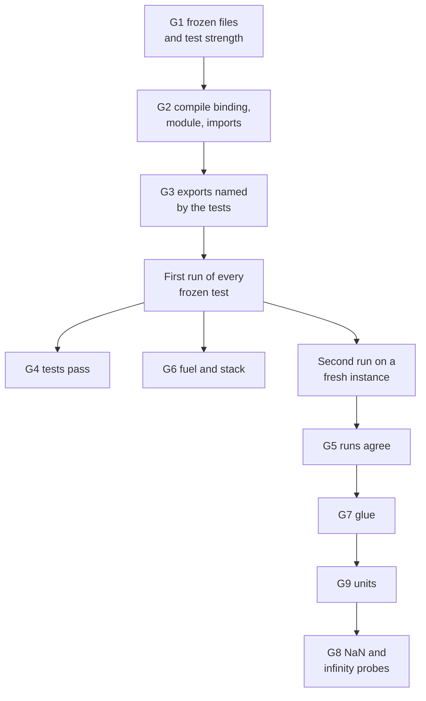

# The gates

A candidate is promoted only when nine deterministic gates pass for its exact bytes, under an evaluator that was frozen
before any code existed. The gates are ordinary code ([gates.mjs](../../core/runtime/x1/gates.mjs) `runGates`), they
never call a model, and the model that wrote the candidate cannot change them. This page lists what each gate checks,
in the order the code runs them, and then how the ledger turns gate results into a decision
([tools/x1_loop.py](../../tools/x1_loop.py) `decide`).

The gates check the kernel candidate form: a WebAssembly module compiled from `kernel.ts`, plus `glue.json`, the
declarative description of its exports, plus the frozen `CONTRACT.md` and `tests.json` it is judged against. A kernel's
arguments and results are scalars (`number`, `integer`, `boolean`, `code`) or structured state (`record`, `list`,
`text`) passed through host-owned memory, so a kernel can be a reducer: state and event in, next state out
([structured state](#structured-state)). How a candidate gets there is in [the candidate loop](candidate-loop.md).

## One run, end to end

The repository's example drives the agent loop with a scripted model (a test double) and a test workload, the
need `integer add(a,b)`, and prints the gate verdicts the ledger recorded:

```console
$ node examples/first-loop.mjs
{
  "need": "integer add(a,b)",
  "promoted": true,
  "testDouble": true,
  "turns": 2,
  "rounds": [
    "passed"
  ],
  "ledger": "/tmp/ef-first-loop-9N4s7O/addition/ledger.sqlite"
}
$ python3 examples/show-gates.py /tmp/ef-first-loop-9N4s7O/addition/ledger.sqlite
ledger records: task, admitted_input, frozen_evaluator, candidate, receipt
  G1_frozen         pass
  G2_compiles       pass  {"wasmBytes": 57}
  G3_exports        pass  {"exports": ["add"]}
  G4_tests          pass  {"passed": 1, "total": 1}
  G5_deterministic  pass
  G6_bounded        pass  {"maxMs": 0.000692, "fuelUsed": 5}
  G7_glue           pass
  G8_nonfinite      pass  {"probes": 0}
  G9_units          pass  {"checks": {"add": "dimensionless"}}
decision: promote
kernel: /tmp/ef-first-loop-9N4s7O/addition/kernel.wasm (57 bytes)
```

`node examples/first-loop.mjs wrong` feeds the same loop a kernel that fails its frozen test. The model gets the
failure back six times, the attempt stops at its turn limit, and the decision is `refuse` with `G4_tests FAIL
{"passed": 0, "total": 1}`.

## Order of evaluation



The numbers name the gates; they are not the order. The order follows the data: G4 and G6 both read the first run,
G5 needs the second, and the glue, units and probe gates come after the runs. A failure in G1, G2 or G3 stops evaluation at once, so later gates are missing from the result. From G4 on, every
gate runs and records its own verdict. `promotable` is true only when every recorded gate is `ok`.

## What each gate checks

| Gate | Passes when | Code |
|---|---|---|
| `G1_frozen` | `frozen.sha256` exists; the SHA-256 of `CONTRACT.md` and of `tests.json` equal the hashes in it; `tests.json` parses; and `testProblems` finds nothing (below) | `runGates`, `testProblems` |
| `G2_compiles` | The compiled record exists, has no error, and its `source` is the SHA-256 of this `kernel.ts`; the module loads through the fuel meter; it imports nothing except `env.abort`; and it instantiates | `runGates`, [meter.mjs](../../core/runtime/x1/meter.mjs) |
| `G3_exports` | Every `fn` named in `tests.json` is an exported function of the module | `functionNames` |
| `G4_tests` | Every frozen test passes on the first run (comparison rules below) | `runAll` |
| `G6_bounded` | No call in the first run ran out of fuel or stack | `runAll` |
| `G5_deterministic` | A second run, on a fresh instance and in the same order, gives the same output and the same error-or-not for every test | `runAll` |
| `G7_glue` | `glue.json` matches the closed schema and agrees with the module, the tests and the contract (below) | `validate`, [contract.mjs](../../core/runtime/x1/contract.mjs) `glueFindings` |
| `G9_units` | A static units analysis of `kernel.ts` against the glue finds no problem (below) | [dimensions.mjs](../../core/runtime/x1/dimensions.mjs) `unitFindings` |
| `G8_nonfinite` | Every float parameter probed with NaN, `Infinity` and `-Infinity` behaves as the contract says | [measure.mjs](../../core/runtime/x1/measure.mjs) `probeCalls`, contract.mjs `nonFiniteExpectation` |

### Test strength (G1)

`testProblems` refuses a `tests.json` that could not catch a wrong kernel. The same function runs before the freeze,
so a weak specification is never frozen. It requires:

- a nonempty array of objects, each with a string `fn` and an array `args`;
- either `expectError: true`, or an `expect` that is a finite number, a boolean or a string, or an object or array
  whose leaves are all of these (structured state);
- every integer leaf within the safe-integer range (larger integers must be strings), and no `null` leaf;
- a list `expect` only when some argument is structured (a list result needs the state it comes from, or a record
  around it);
- `tol` only where `expect` holds a number, finite, non-negative and at most 1% of `max(1, |v|)` for every number `v`
  it applies to (`maximumRelativeTolerance`).

### How a test passes (G4)

| Frozen test | Passes when the call |
|---|---|
| `expectError: true` | traps: a WebAssembly `RuntimeError`, or a call to `env.abort` |
| `expect` boolean | returns without error, and its truthiness equals `expect`, or it returns exactly `1` or `0` to match |
| `expect` number with `tol` | returns a value within `tol` of `expect` |
| `expect` number without `tol` | returns exactly `expect` |
| `expect` string | returns a value whose string form equals `expect` |
| `expect` object (record) | returns a record with exactly the same keys, each leaf matching by these rules (one `tol` for every number) |
| `expect` array (list) | returns a list of the same length, each item matching in order |

### Fuel and stack (G6)

[meter.mjs](../../core/runtime/x1/meter.mjs) rewrites the module before it is compiled: it adds a 64-bit fuel global,
charges each function entry and each loop header an upper bound on the instructions that block can execute, and traps
when the fuel goes negative. Bulk memory operations are charged a fixed 65,536. Each instance gets 1,000,000,000 units
(`kernelFuel`). A kernel that never returns therefore stops inside the guest instead of hanging the cell. G6 reports
`fuelUsed` and the slowest call (`maxMs`), but only fuel and stack exhaustion fail it.

Memory is bounded elsewhere: the in-cell compile refuses a module that declares more than 1,024 pages (64 MiB), the
workcell's WASM guard enforces the pool's ceiling, and the evaluator's `bounds` check (below) compares measured memory
with the 64 MiB limit.

### Glue (G7)

G7 first validates `glue.json` against the closed schema [glue.schema.json](../../core/runtime/x1/glue.schema.json):
no unknown fields, an `id`, an `assumption` and a `question` of at least 20 characters, at least one export, and a
`traps` list. Then it checks the glue against the candidate:

- `glue.id` equals the candidate's id;
- each exported function has exactly one glue entry, no entry names a function the module lacks, and names are unique;
- each entry lists as many `args` as the export takes, named exactly as the `kernel.ts` parameters;
- a `code` argument has a `codes` table; a `number` result has an integer `precision` from 0 to 6; a `code` result
  has a `codes` table that labels every code the frozen tests returned; a `boolean` result has `true` and `false`
  labels. The same rules apply to every scalar leaf inside a structured value;
- a structured value is well formed: a `record` has uniquely named `fields`, a `list` has `items` and `max`, a `text`
  has `maxBytes`, no kind carries another kind's keys, and the declared layout fits in 1 MiB;
- each structured argument is an `i32` pointer parameter; a structured result adds one trailing `i32` pointer
  parameter and the export returns nothing;
- every trap names an exported function, and every function with an `expectError` test has a trap entry;
- when the contract states exactly one number of decimal places for an export, the glue's `precision` matches it;
- code labels that fit the contract's code table better swapped are refused, unless the contract also states the
  result as a computation, in which case the finding is advisory only.

A unit that disagrees with its argument's name (`unitDisagreements`) is reported as advisory and does not fail G7;
G9 makes the binding units decision.

### Units (G9)

G9 reads only the glue, `kernel.ts` and the first run's outputs. For structured values it checks each scalar leaf
inside records and lists by the same rules, and skips the adjacent-swap rule (L) for pointer arguments. It never reads the contract or the evaluator, so it
is an error source independent of the specification ([P-65](../../experiments/P-65-unit-gate/RESULT.md)). Each
problem carries a letter:

| Letter | Refused when |
|---|---|
| K | a `code` or `boolean` field carries a physical unit |
| N | a unit's dimension or scale disagrees with the dimension its name implies (`massLb` with unit `kg`) |
| L | two adjacent arguments' units fit each other's names better than their own |
| C | a code labelled as never returned is returned by the frozen tests |
| D | the dimension inferred from the kernel's arithmetic disagrees with the glue, or two terms of a sum have different dimensions, or a temperature or time point is shown as a difference |
| R | an export computes a new code but shows the unit of one of its arguments |

`checks` records what was inferred per export (`dimensionless`, a dimension, `code`, `no source`, `arity`).

### NaN and infinity (G8)

For each export, `nonFiniteExpectation` reads the contract's text and classifies what it says about non-finite
input: `permitted`, `trap`, `excluded`, `finite` or `silent`. `probeCalls` takes the first value test's arguments
for that export and replaces one float parameter at a time with NaN, `Infinity` and `-Infinity`; for a structured
argument it replaces one `number` field inside the state at a time (up to 64 probes per export). A probe fails when
the contract requires a trap and the call returns, when the contract promises a finite result and the call returns a
non-finite one, or when a probe exhausts fuel or stack. Integer parameters are not probed, so an export with only
integer parameters records `probes: 0`.

## Structured state

A glue value of kind `record`, `list` or `text` is passed through linear memory instead of as a WebAssembly
parameter. The layout ([measure.mjs](../../core/runtime/x1/measure.mjs) `layoutOf`) is fixed by the glue:

| Kind | Layout (little-endian, natural alignment) |
|---|---|
| `integer`, `code`, `boolean` | 4-byte `i32` (`boolean` is 0 or 1) |
| `number` | 8-byte `f64` |
| `text` | `u32` UTF-8 byte length, then `maxBytes` bytes |
| `list` | `u32` count, then `max` item slots, the first at the item's alignment |
| `record` | Fields in order, each at the next multiple of its alignment; size rounded up to the largest alignment (at least 4) |

For example, a to-do list state `{ nextId, items: list of max 4 { id, done, hours, title: text of 16 bytes } }` lays
out as 176 bytes. `layoutOf(type).size` is 176, and `layoutTable(type)` returns these rows (shown here as text):

```text
nextId              offset 0                i32
items.count         offset 8                u32
items[i].id         offset 16, stride 40    i32
items[i].done       offset 20, stride 40    i32
items[i].hours      offset 24, stride 40    f64
items[i].title.bytes offset 32, stride 40   u32
items[i].title.utf8 offset 36, stride 40    u8[16]
```

For each call (`invoke`), the host grows the kernel's exported memory once to hold its own region, zeroes it, writes
every structured argument into it, and passes one pointer per structured argument plus, for a structured result, one
pointer to a zeroed output buffer. After the call it checks that the input bytes are unchanged and decodes the result.
A kernel that writes into an input buffer, a value that doesn't fit its layout (too many items, text over `maxBytes`, a
missing or extra field, a boolean that isn't 0 or 1, invalid UTF-8), or a module with no exported memory is a test
failure at the boundary, never counted as a trap. Scalar-only exports are called as before.

The agent's stage prompts carry these rules as `stateRules`, so the specification can ask for a reducer and
`tests.json` can hold records and lists as JSON. The measured port used at commit runs the same marshalling and records
the decoded state.

## From gates to a decision

`runGates` runs inside the frozen evaluator as its `residual` check, the task-specific part of acceptance that comes
after the universal checks. The engine's evaluator ([core/engine/evaluator.mjs](../../core/engine/evaluator.mjs))
evaluates every candidate once (round 0), keeps the survivors that are best on the measured objectives (the
frontier; here, the smallest module), and evaluates those again (round 1). Each round runs six checks in this order:

| Check | What it does here |
|---|---|
| `schema` | The shared gate input is well formed |
| `interface` | The module's observed signature equals the contract signature (`describe` refuses a missing export or a wrong arity) |
| `bounds` | Two fresh runs of the frozen tests and the NaN probes complete within 64 MiB of memory and the fuel limit; a run past 30 s of wall time is an unknown outcome, not a refusal |
| `determinism` | Those two runs give identical outputs and effects |
| `forbidden_effects` | The module's imports and calls are only `env.abort` |
| `residual` | `runGates`: the nine gates above |

The measured port ([measure.mjs](../../core/runtime/x1/measure.mjs) `measuredPort`) reverses the call order on every
second run of a candidate, so the `determinism` check compares a forward run with a reversed one. Usage is read from
outside the guest: fuel from the meter's global, memory from the instance's buffer.

The ledger decides. `decide` in [tools/x1_loop.py](../../tools/x1_loop.py) returns `promote` only when all of these
hold, and `refuse` otherwise:

- the candidate record's id is the SHA-256 of its content, and the receipt names that candidate and the frozen
  evaluator, is `finished` with outcome `passed`, and has the hash the commit just wrote (the receipt's precommit is
  what it bound before evaluation: the evaluator, its digest, the artifact, and what a failure means);
- the pool report is `completed`, its frontier is exactly this candidate, and it binds the same evaluator digest as
  the receipt's precommit;
- there are exactly two attempts, rounds 0 and 1, each `passed`, each running exactly the six checks above, all
  passing;
- in both rounds the residual's result is `promotable` and its gate set is exactly `G1_frozen` to `G9_units`, all
  `ok`.

`inconclusive` is a third answer, never a pass. `decide` returns it when the receipt records `outcome_unknown`: a
lost cell, a deadline, or a model call that failed after the freeze. On the host-side path
([tools/x1_ledger.py](../../tools/x1_ledger.py) `promote`), an unavailable ledger also gives `inconclusive`.

### Commit re-runs the gates

On the in-cell paths the gate report comes from EndoForge's code running in the cell. Before anything is written,
`commitCandidate` ([loop.mjs](../../core/runtime/x1/loop.mjs) `checkAtCommit`) runs `runGates` again on the committed
candidate whenever the cell's report claims a passing attempt. The re-run must be promotable and give the same outcome
for every test (function, arguments, value, pass, trap) as each passing attempt in the report. If it disagrees, the
observation is rewritten as `rejected` with "independent re-run at commit disagrees with the cell report", so the
ledger refuses. The result carries `rerun: { agrees, ms }`. With a frozen synthesized evaluator, its verdict is taken
next ([evaluator synthesis](evaluator-synthesis.md#7-judge)).

### Evidence re-check

Before `decide` runs, `commit` re-checks the evidence against the frozen bundle inside the same transaction
(`evidence_problem`): the evaluator tree and implementation files still match their frozen digests, the candidate's
oracle files equal the frozen ones, the compiled `source` is the hash of `kernel.ts`, the module digest in G2 matches
the stored module, and every frozen test appears in the report with its recorded value meeting the frozen
expectation. A problem marks the receipt `failed`, and the decision refuses.

"Meeting the frozen expectation" (`value_meets` in [tools/x1_loop.py](../../tools/x1_loop.py)) follows the
[G4 rules](#how-a-test-passes-g4) and reads the declared result of each export from the candidate's `glue.json`:

- a record must have exactly the frozen keys (and, when the glue declares the record, exactly its `fields`), in any
  order; each field is compared by these rules against its declared field;
- a list must have the frozen length, no more than its declared `max`, and each item must match against the declared
  `items`;
- text must not exceed its declared `maxBytes` and is compared as a string;
- a number matches within the test's `tol` when one is given, exactly otherwise, and the same `tol` applies to every
  numeric leaf inside a record or list;
- a leaf whose kind disagrees with its declaration (for example a number where the glue declares a list) fails.

A test in `core/runtime/test/gaps2-commit.test.mjs` promotes the structured to-do reducer through this commit on the
`isolate` path and on the `agent` path in both wait modes.

## Gate labels and the migration note

Records written from 2026-11-09 carry labels that match the nine-gate rule; earlier records keep theirs.

| Where | New records | Earlier records |
|---|---|---|
| Task `acceptance` and frozen `residual` (`tools/x1_loop.py` `admit`, `tools/x1_ledger.py` `freeze`) | `X1 G1-G9` (`GATE_LABEL`) | `X1 G1-G7` |
| Decision `policy` (`decide`, `tools/x1_ledger.py` `promote`) | `X1-G1-G9/v2` (`POLICY`) | `X1-G1-G8/v1` |
| Refusal reason inside `decide` | "all nine gates must pass" | "all seven gates must pass" |

The note, kept as `LABEL_MIGRATION` in [tools/x1_loop.py](../../tools/x1_loop.py): the labels are part of each
record's hash and identity, so old records are not rewritten. Drift checks recompute from the label stored in the
record, and no verdict reads a label, so an existing ledger still verifies and promotes. Both generations of decision
required all nine gates. The receipt precommit field `acceptance_boundary` (`receipt` in
[core/runtime/x1/ledger.mjs](../../core/runtime/x1/ledger.mjs)) also reads `X1 G1-G9` (its own `GATE_LABEL`) from
2026-11-09; earlier receipts read `G1-G7`. It is a label inside the receipt and is not checked.

## Limits

- The gates trust the code that runs them. On the in-cell paths, `commit` now runs the gates again on the supervisor
  ([above](#commit-re-runs-the-gates)), so a consistent wrong report from the cell is refused; a bug in `gates.mjs`
  itself would affect both runs ([P-50](../../experiments/P-50-in-isolate/RESULT.md) raised the first point).
- G7, G8 and G9 read contract text and names with fixed patterns. They catch the mistakes they were measured on
  ([P-52](../../experiments/P-52-real-gates/RESULT.md), [P-65](../../experiments/P-65-unit-gate/RESULT.md)), not
  every way glue can mislabel a result.
- The frozen evaluator records the bytes of `host.mjs`, `gates.mjs`, `glue.schema.json`, `measure.mjs`, `meter.mjs`,
  `contract.mjs`, `dimensions.mjs`, `generator.mjs`, `ledger.mjs`, `reference.mjs` and `scalar.mjs`
  (`implementationFiles` in [host.mjs](../../core/runtime/x1/host.mjs)) and, on the in-cell paths, `loop-port.mjs`,
  `agent.mjs` and `oracle.mjs`; the commit refuses if any drifts. The ledger's own drift check, `IMPLEMENTATION_FILES` in
  [tools/x1_loop.py](../../tools/x1_loop.py), names the same 14 files. Tests check that the lists cover every x1 file
  the host and the cell import, and that the Python list matches them.
- Frozen tests decide G4. A wrong expected value in a frozen test refuses every correct kernel; the
  [formula oracle](agent-loop.md#formula-oracle) and [evaluator synthesis](evaluator-synthesis.md) are the two
  mechanisms that check frozen tests from a second source.
