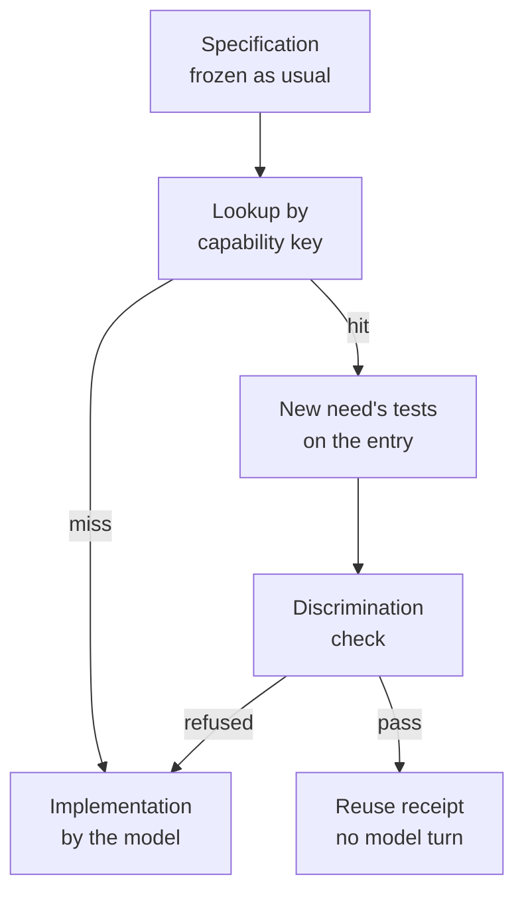

# The library

The library lets EndoForge answer a need with a capability it already promoted instead of asking a model to write it
again. A promoted candidate is admitted only after its promotion is re-verified from its ledger and it re-passes the
current gates. A later need that declares the same capability is served from it only after the new need's own frozen
tests pass on it and a mutation check shows those tests could tell it apart from a near variant. Every admission,
reuse, composition, refusal, grant, reclaim and revocation is written to a hash-chained journal.

Code: [core/library](../../core/library/README.md). Off by default: a loop path consults a library only when the
caller passes one from `openLibrary` to `runNeed`. All three paths do: `current` and `isolate` right after the freeze,
`agent` right after admission (and again on resume). Measurements: [P-53](../../experiments/P-53-library-v0/RESULT.md).

## Where it sits in the loop



The specification stage still runs, because the frozen evaluator is what a hit is judged against. A hit saves the
implementation model turn and the compile and gates behind it; P-53 measured that as about 15 s of a 48.6 s median
need.

## Admission

`library.admit([{ ledger, promotion, capability?, label? }])` takes promoted candidates:

1. [tools/library_verify_promotion.py](../../tools/library_verify_promotion.py) reads each ledger read-only and
   re-checks the sealed decision: its hash, `decision: promote`, scope, chain tip, candidate and receipt hashes, the
   receipt's binding and `passed` outcome, the evaluator digest, both evaluator rounds with all six checks passing,
   all nine gates `ok`, and that the candidate's frozen files equal the evaluator's. One Python process per batch.
2. The artifact binding must hold: a module present, its `source` hash equal to `kernel.ts`, and `frozen.sha256`
   matching the contract and tests.
3. The candidate's own tests are run again through `runGates` under today's gates. A failure is not admitted.
4. A behavioural fingerprint is taken: the module's outputs on a grid derived from its declared capability.
5. The entry is journaled with its capability, its keys, its fingerprint, the source promotion, and the digests of
   the `gates.mjs` and `host.mjs` it was qualified under.

The capability comes from the caller or from the entry's glue: its exports with argument and result kinds, units,
ranges, precision, codes and labels, and which exports trap.

## Lookup

A need declares its capability in a fenced `capability` JSON block inside its frozen `CONTRACT.md`, so the hash of the
declaration is bound at the freeze. The stage prompts don't ask for that block, so with the default `retrieval: 'key'`
a generated need misses with `no_capability`.

With `retrieval: 'semantic'`, lookup first ranks the visible entries by similarity between normalized contract texts
(`contractVector` in [key.mjs](../../core/library/key.mjs); deterministic, offline, no model). A need with no
capability block may then adopt the capability of an entry scoring at least 0.4 (`SEMANTIC_THRESHOLD`), provided the
adopted capability's key, computed over the need's own contract, equals that entry's key. The key match below still
decides. `library.retrieve(text)` returns the ranking on its own, and a `no_contract_match` miss lists the three
nearest entries.

The key (`keysOf`, mode `contract` by default) hashes, per export and by position, without export or argument names:
argument kind, unit, parsed range and its openness, code tables; result kind, unit, precision, declared rounding, code
tables, labels; whether the export traps; and the set of numerals in the contract outside headings and the capability
block. The need's prose is not part of the key. The `interface` mode drops the numerals, and `prose` uses the whole
normalized text.

`lookup` returns a miss, with a reason, unless exactly one behaviour is held under the key:

| Reason | Meaning |
|---|---|
| `need_not_frozen` | The need's `frozen.sha256` doesn't match its files |
| `no_capability` | No capability block |
| `no_contract_match` | Nothing under this key |
| `revoked` | Everything under this key was revoked |
| `needs_requalification` | Entries exist but were qualified under different gate or host bytes |
| `permission_denied` | Entries exist under the key in the caller's tenant, but none is open to the caller's lineage |
| `ambiguous_key` | Two entries under one key have different fingerprints, so the key doesn't pin the meaning |
| `artifact_tampered` | The stored module no longer matches its digest |
| `no_binding`, `unbound_test` | The need's exports can't be mapped one-to-one onto the entry's |
| `counterexample` | The entry already failed one of this need's tests, or this exact need was refused before; no cell runs |

Entries that were revoked, reclaimed, belong to another tenant, or are not qualified in the current environment are
not served.

## Serving

`library.serve(need)` runs in a warm worker thread ([cell.mjs](../../core/library/cell.mjs)) with the same heap
limits and WASM guard as a pool cell:

1. The need's frozen tests, with export names mapped onto the entry, run through `runGates` against the entry's module
   and glue under the need's own contract.
2. If they pass, `discriminate` mutates the module, up to 1,000 sites (comparison, arithmetic, rounding and join
   operator swaps), wraps its result (negated, scaled by 1.001, or rounded, floored or ceiled to 0, 2 or the declared decimals) and probes a grid of up to 512 rows per
   export. A variant the need's tests accept but the grid shows to behave differently is a survivor. A trapping
   export's declared bound that no test probes from outside is also counted.
   For an export that takes or returns a `record`, `list` or `text`, the grid is built from the declared layout: it
   starts from the need's test arguments (or a filled and an empty sample), varies each scalar leaf over its domain,
   tries every code (and one past each end) and both booleans, shortens, extends and reverses lists, varies text
   within `maxBytes`, and changes one item of a list at a time. Calls go through the host buffers of a fuel-metered
   instance (10,000,000 units per call), results are compared field by field with the gates' matcher, and the result
   wrappers act on every `number` leaf. A value that misfits its layout counts as a boundary problem, not a trap.
3. Any survivor refuses the reuse (`evaluator_cannot_discriminate`): the need's tests can't tell this kernel from a
   wrong one, so passing them proves too little.

A pass journals a `library_reuse` receipt naming the source promotion, the need's frozen hashes, the binding, the
host digests, the environment and the principal, and returns the candidate. A refusal journals `library_refused` with
its reason, its counterexamples (the need's tests the entry failed, for `evaluator_failed`, with a structured result
recorded as its decoded value) and up to 16 surviving
mutant witnesses. A cell timeout, a guard breach or a crash is a refusal, never a pass. A miss before any cell runs
writes nothing.

When lookup finds nothing under the key and the need has two or more exports, `serve` tries a union: for each wanted
export it picks a usable entry whose export has the same signature and whose contract numerals all appear in the
need's contract, and composes them when more than one entry is involved.

## Composition

`library.compose(need, plan)` builds one module from parts of several entries and serves it like a single entry. A
plan lists the need's exports:

```json
{ "exports": [
  { "name": "fee", "entry": "<entry id>", "fn": "fee" },
  { "name": "net", "stages": [
      { "entry": "<entry id>", "fn": "gross", "args": [{ "input": 0 }, { "input": 1 }] },
      { "entry": "<entry id>", "fn": "afterTax", "args": [{ "previous": true }, { "const": 0.2 }] }
    ], "output": { "scale": 100, "narrow": "nearest" } }
] }
```

- **Union.** An export taken as it is from one entry.
- **Pipeline.** Stages run in order. Without `args`, the first stage takes the export's inputs in order and each later
  stage takes the previous stage's result.
- **Adapter.** Each argument is `{ input: n }` (the export's n-th input), `{ previous: true }` or `{ const: v }`,
  optionally with `scale`, `offset` and `narrow` (`trunc` or `nearest`); `output` applies the same adapter to the
  final result. A lossy conversion, such as `f64` to `i32`, without `narrow` is refused.

[link.mjs](../../core/library/link.mjs) parses each part's module and writes one new module; it refuses what it cannot
link safely. Any number of parts may use linear memory or a table:

- **Memory.** When one part uses memory, the module keeps that part's memory as it is. When two or more do, the
  composed module has one WebAssembly memory per part (multi-memory). Memory 0 belongs to the host: it starts empty,
  may grow to 64 pages (4 MiB), and holds the buffers the host passes in. Memory 1, 2, ... each belong to one part,
  sized to the part's initial pages or, if it grows memory, up to its maximum or its share, plus its exchange window;
  all of them together must fit in 1024 pages (64 MiB, the workcell budget). Every load, store, `memory.size`,
  `memory.grow`, data segment and bulk memory operation of a part is rewritten to name the part's own memory and is
  still bounds-checked to the part's own size, so a part cannot read or write another part's state; an access outside
  it traps. The [meter](gates.md#fuel-and-stack-g6) reads, exports and counts every memory.
- **Tables.** Each part keeps its own table, and `call_indirect` dispatches through it.
- **Structured values.** A part whose export takes or returns a `record`, `list` or `text` gets an exchange window
  in its own memory, after the part's state. The linked wrapper copies each structured argument with `memory.copy`
  from the host's memory 0 (or from the previous stage's window, in that part's memory) into the window, and copies
  the final result back into memory 0, so structured state crosses between parts only as a copy between memories. The plan's layouts must match: a stage whose argument layout differs from what it is given, or a final stage
  that does not produce the declared layout, is refused. A plan cannot pass a buffer address, or the hidden result
  pointer, into a scalar parameter.

The copies are linker-generated code inside the module, not host calls: a kernel stays one module that imports only
`env.abort`. The composed module then goes through the
same cell as a single entry: the need's frozen tests, then the discrimination check. A pass journals
`library_compose` naming every source promotion and the plan; a refusal journals `library_refused`.

| Miss reason | Meaning |
|---|---|
| `unknown_part` | The plan names an entry the library doesn't hold |
| `memory_conflict` | The parts do not fit in the 64 MiB memory, or a part declares or addresses more than one memory |
| `adapter_arity`, `adapter_constant`, `adapter_narrowing` | An adapter's argument count, constant or narrowing is invalid |
| `plan_mismatch`, `unknown_export` | The plan doesn't match the need's capability or a part's declared layout, passes a buffer as a scalar, or names a missing export |
| `import_unsupported`, `data_unsupported`, `element_unsupported`, `initializer_unsupported`, `opcode_unsupported`, `malformed_module`, `link_invalid` | A part uses a module feature the linker doesn't rewrite, or the result doesn't validate |

The composition-wide reasons `need_not_frozen`, `no_capability`, `permission_denied`, `revoked`,
`needs_requalification`, `artifact_tampered` and `counterexample` mean what they mean for a single entry.

## Scopes and permissions

An entry's `scope` is `{ tenant?, lineage? }`, taken from the admit row or, failing that, from the admitting
principal. The caller passes a principal (`openLibrary({ principal })` as the default, or per call to `lookup`,
`serve`, `compose`, `retrieve`); it is never read from the need. `runNeed({ library, principal })` passes its
`principal` to every `serve` on all three loop paths.

| The caller is | Result |
|---|---|
| In another tenant | The entry is invisible |
| In the tenant, lineage outside the entry's lineage | `permission_denied` |
| In the tenant, lineage equal to or under the entry's (`a/b` is under `a`) | Allowed |
| Named by a grant | Allowed |

`grant(id, { tenant, lineage? })` and `ungrant(...)` open or close an entry to another tenant or lineage. Only a
principal the entry already allows may change its grants. Both are journaled.

## Duplicates, counterexamples and environments

- **Reclaim.** `reclaim()` groups usable entries by key, fingerprint, scope and source run, keeps the oldest of each
  group, and marks the others as reclaimed into it, releasing their stored module and own files. It then rewrites the
  journal: a first `library_compacted` record names the previous sequence number and tip, and the hash chain restarts
  from it. `reclaim({ compact: false })` skips the rewrite. A plan that names a reclaimed entry is redirected to its
  survivor.
- **Counterexamples.** A refusal records the failing tests as counterexamples on the entry. A later lookup whose tests
  include one of them, with an expectation the recorded output fails, misses with `counterexample` without running a
  cell, as does an identical need (same entry, tests, contract numerals, gate mode and host). `counterexamples(id)`
  lists them. They are rebuilt from the journal on open, so they survive a restart.
- **Environments.** Qualification is recorded per environment: Node version, V8 version, platform and architecture,
  hashed into an environment id (`openLibrary({ environment })` replaces it, for tests). An entry is served only in an
  environment where it has a passing qualification under the current host digests. `requalify()` runs entries that
  are not qualified here: a pass adds this environment; a failure after a host change revokes the entry; a failure in
  a new environment only records `ok: false` for that environment and leaves the others standing.
  `qualifications(id)` lists them. A journal written before this rule has no per-environment records, so its entries
  requalify once.

## Revocation and requalification

- `revoke(id, reason)` revokes the entry and every entry under the same key with the same fingerprint, journals it,
  and returns the reuse receipts that named them. Past receipts are kept.
- `dependants(id)` lists the reuse receipts that named an entry.
- `requalify()` re-runs each entry's own tests when the digests of `gates.mjs` or `host.mjs` have changed since it
  was qualified, or when it has no qualification in the current environment. Passing entries are journaled with the
  new host and environment; after a host change failing ones are revoked with "no passing qualification against the
  current host". Until then those entries are not served.

## What it cannot tell apart

| A near-miss that differs in | Caught by |
|---|---|
| A declared unit, precision, rounding mode, range bound or its openness | The key |
| A constant written as a numeral in the contract | The key |
| Sign, or any behaviour the need's tests see | The tests in the cell |
| A variant the tests can't see | The discrimination check, when a mutant or wrapper reaches it |

It does not see:

- an English-only difference that changes no numeral and no declared field ("round down", "exclusive");
- a wrong unit or label that the gates accept: G7 and G9 refuse some mislabels, not all, so an admitted entry can carry
  a unit it doesn't compute and match a need that declares it;
- unit spellings outside its small alias table (`F` and `C` are read as temperatures);
- a fault the mutant set and grid don't reach, including one visible only on NaN or infinity.

Equivalent contracts written with different numerals miss, which costs a regeneration, not soundness. P-53 served 16
of 92 seeded faults with an in-range witness when the need's frozen files said exactly what the kernel's own said;
that class needs a stronger evaluator, which is why reuse stays opt-in.

Composition inherits these limits from its parts. Two more apply to it:

- The parts' memories together, with the host's memory 0, are limited to the 64 MiB budget.
- A part that declares or addresses more than one memory of its own is refused (`memory_conflict`).

## Boundary with the engine

Library cells are worker threads, not `IsolatePool` cells, because the engine's evaluator checks the frozen evaluator
through Python on each check and the warm path must not spawn. Reuse receipts live in the library's own journal, not
in `core/ledger`, whose schema has no reuse record.
