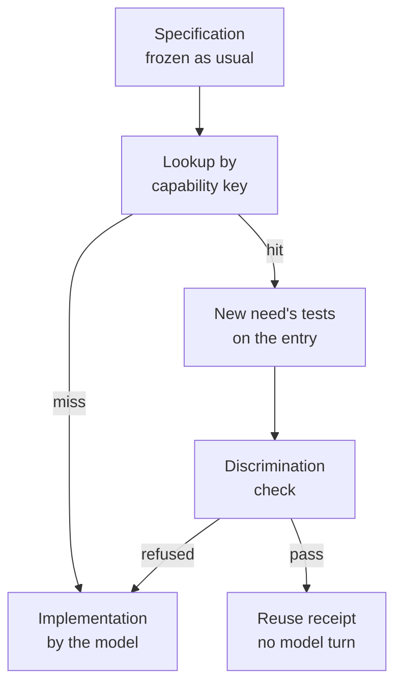

# The library

The library lets EndoForge answer a need with a capability it already promoted instead of asking a model to write it
again. A promoted candidate is admitted only after its promotion is re-verified from its ledger and it re-passes the
current gates. A later need that declares the same capability is served from it only after the new need's own frozen
tests pass on it and a mutation check shows those tests could tell it apart from a near variant. Every admission,
reuse, refusal and revocation is written to a hash-chained journal.

Code: [core/library](../../core/library/README.md). Off by default: the `current` path consults a library only when
the caller passes one from `openLibrary` to `runNeed`. Measurements: [P-53](../../experiments/P-53-library-v0/RESULT.md).

## Where it sits in the loop

The specification stage still runs, because the frozen evaluator is what a hit is judged against. A hit saves the
implementation model turn and the compile and gates behind it; P-53 measured that as about 15 s of a 48.6 s median
need.

## Admission

`library.admit([{ ledger, promotion, capability?, label? }])` takes promoted candidates:

1. [tools/library_verify_promotion.py](../../tools/library_verify_promotion.py) reads each ledger read-only and
   re-checks the sealed decision: its hash, `decision: promote`, scope, chain tip, candidate and receipt hashes, the
   receipt's binding and `passed` outcome, the evaluator digest, both evaluator rounds with all six checks passing,
   all nine gates `ok`, and that the candidate's frozen files equal the evaluator's. One Python process per batch.
2. The artifact binding must hold: a module present, its `source` hash equal to `kernel.ts`, and `frozen.sha256`
   matching the contract and tests.
3. The candidate's own tests are run again through `runGates` under today's gates. A failure is not admitted.
4. A behavioural fingerprint is taken: the module's outputs on a grid derived from its declared capability.
5. The entry is journaled with its capability, its keys, its fingerprint, the source promotion, and the digests of
   the `gates.mjs` and `host.mjs` it was qualified under.

The capability comes from the caller or from the entry's glue: its exports with argument and result kinds, units,
ranges, precision, codes and labels, and which exports trap.

## Lookup

A need declares its capability in a fenced `capability` JSON block inside its frozen `CONTRACT.md`, so the hash of the
declaration is bound at the freeze. The current generator prompt doesn't ask for that block, so generated needs miss
with `no_capability` until it does.

The key (`keysOf`, mode `contract` by default) hashes, per export and by position, without export or argument names:
argument kind, unit, parsed range and its openness, code tables; result kind, unit, precision, declared rounding, code
tables, labels; whether the export traps; and the set of numerals in the contract outside headings and the capability
block. The need's prose is not part of the key. The `interface` mode drops the numerals, and `prose` uses the whole
normalized text.

`lookup` returns a miss, with a reason, unless exactly one behaviour is held under the key:

| Reason | Meaning |
|---|---|
| `need_not_frozen` | The need's `frozen.sha256` doesn't match its files |
| `no_capability` | No capability block |
| `no_contract_match` | Nothing under this key |
| `revoked` | Everything under this key was revoked |
| `needs_requalification` | Entries exist but were qualified under different gate or host bytes |
| `ambiguous_key` | Two entries under one key have different fingerprints, so the key doesn't pin the meaning |
| `artifact_tampered` | The stored module no longer matches its digest |
| `no_binding`, `unbound_test` | The need's exports can't be mapped one-to-one onto the entry's |

## Serving

`library.serve(need)` runs in a warm worker thread ([cell.mjs](../../core/library/cell.mjs)) with the same heap
limits and WASM guard as a pool cell:

1. The need's frozen tests, with export names mapped onto the entry, run through `runGates` against the entry's module
   and glue under the need's own contract.
2. If they pass, `discriminate` mutates the module, up to 1,000 sites (comparison, arithmetic, rounding and join
   operator swaps), wraps its result (negated, scaled by 1.001, or rounded, floored or ceiled to 0, 2 or the declared decimals) and probes a grid of up to 512 rows per
   export. A variant the need's tests accept but the grid shows to behave differently is a survivor. A trapping
   export's declared bound that no test probes from outside is also counted.
3. Any survivor refuses the reuse (`evaluator_cannot_discriminate`): the need's tests can't tell this kernel from a
   wrong one, so passing them proves too little.

A pass journals a `library_reuse` receipt naming the source promotion, the need's frozen hashes, the binding and the
host digests, and returns the candidate. A refusal journals `library_refused` with its reason. A cell timeout, a
guard breach or a crash is a refusal, never a pass. A miss before any cell runs writes nothing.

## Revocation and requalification

- `revoke(id, reason)` revokes the entry and every entry under the same key with the same fingerprint, journals it,
  and returns the reuse receipts that named them. Past receipts are kept.
- `dependants(id)` lists the reuse receipts that named an entry.
- `requalify()` re-runs each entry's own tests when the digests of `gates.mjs` or `host.mjs` have changed since it
  was qualified. Passing entries are journaled with the new host; failing ones are revoked with "no passing
  qualification against the current host". Until then those entries are not served.

## What it cannot tell apart

| A near-miss that differs in | Caught by |
|---|---|
| A declared unit, precision, rounding mode, range bound or its openness | The key |
| A constant written as a numeral in the contract | The key |
| Sign, or any behaviour the need's tests see | The tests in the cell |
| A variant the tests can't see | The discrimination check, when a mutant or wrapper reaches it |

It does not see:

- an English-only difference that changes no numeral and no declared field ("round down", "exclusive");
- a wrong unit or label that the gates accept: G7 and G9 refuse some mislabels, not all, so an admitted entry can carry
  a unit it doesn't compute and match a need that declares it;
- unit spellings outside its small alias table (`F` and `C` are read as temperatures);
- a fault the mutant set and grid don't reach, including one visible only on NaN or infinity.

Equivalent contracts written with different numerals miss, which costs a regeneration, not soundness. P-53 served 16
of 92 seeded faults with an in-range witness when the need's frozen files said exactly what the kernel's own said;
that class needs a stronger evaluator, which is why reuse stays opt-in.

## Gaps in the current code

- Composition serves one entry with its export names bound. There is no union of entries yet, no pipeline from one
  entry's output to another's input, and no argument adapter.
- Retrieval is a key match; there is no semantic search step yet.
- There are no tenant or lineage scopes on entries yet, and no permission check on reuse.
- Duplicates are flagged but not reclaimed.
- Refusals are journaled, but nothing yet turns them into counterexamples that narrow later search.
- Qualification records are not yet kept per environment.
- The `isolate` and `agent` paths don't consult the library yet; only the `current` path does.

## Boundary with the engine

Library cells are worker threads, not `IsolatePool` cells, because the engine's evaluator checks the frozen evaluator
through Python on each check and the warm path must not spawn. Reuse receipts live in the library's own journal, not
in `core/ledger`, whose schema has no reuse record.
