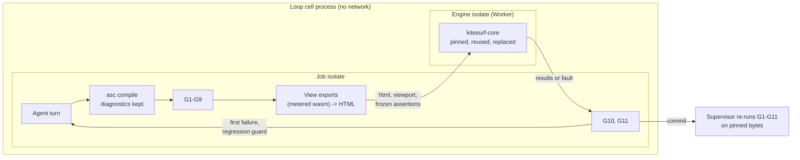

# The integrated repair loop (design)

Date: 2026-11-16. Status: design for review; nothing here is built, and no default changes. Decided with POODO 3.1; the
decision record, the evidence and the reversal conditions are at the end. This revision replaces an earlier one that
treated the current split between lanes as a constraint.

The goal, in the maintainer's words: software needs go in, working code comes out, with high trust from checking
before code is emitted, fast, using EndoForge, Kitesurf and tsrs together. This design says which checks run in the
agent's repair loop, where each runs, what the model is told, and what is measured before any default changes.

## The loop, every turn

On the agent path the conversation, the overlay, the compile and the gates already run in one loop cell, and each turn's
`check` is one closure, `checkRound(await compileRound(files()))`
([loop-port.mjs](../../core/runtime/x1/loop-port.mjs) `agentCandidate` and `releasedCandidate`). The design keeps that
cell and that closure and makes the closure a staged pipeline:



1. **Compile, with its diagnostics.** Today a failed compile reaches the model as `G2_compiles: compiler failed or
   timed out`: `compile` in [assemblyscript-toolchain.mjs](../../experiments/assemblyscript-toolchain.mjs) collects asc's
   diagnostics in a memory stream and returns `null`. The compiler's own errors carry a code, a message and a line, for
   example `TS2304: Cannot find name 'undefinedHelper'`. G2 keeps the first few, capped, and the model gets them.
2. **G1-G9**, unchanged.
3. **Render gates (G10, G11)** for kernels with render tests, below.

For a TypeScript candidate, stages 1 and 2 are tsrs, on every edit and at `check`, and the per-turn run of the emitted
JavaScript in the contained cohort; see [the TypeScript lane](#the-typescript-lane-in-the-loop).

Stages stop at the first failing stage, and the model gets that stage's failures only, in test order, with any check
that passed in the previous round and fails now marked as a regression.

## User interfaces

**Candidate form.** A user interface is a kernel with reducers, `next(state, event) -> state`, and views,
`view(state) -> text`, where the `text` result is a complete HTML document with inline CSS, at most 65,536 bytes. The glue
marks it `media: "text/html"`; the closed schema ([glue.schema.json](../../core/runtime/x1/glue.schema.json)) gains that
key and G7 checks it against the capability block. Views are ordinary AssemblyScript exports under the fuel meter, so
G4-G6 apply to them. Kernels compile with `--runtime stub` ([compiler.mjs](../../core/runtime/x1/compiler.mjs)), so a view
can build strings; the stage prompt's "never allocate" rule is prompt text and does not apply to views.

**The engine.** Kitesurf's `kitesurf-core` at [`4a29038`](https://github.com/cloudflare/kitesurf/tree/4a29038), admitted
as digest-pinned tooling WebAssembly (#153), runs in its own Worker inside the loop cell's process. References to Kitesurf
are `KS:path:line` at that commit.

- **Same process, separate isolate.** A panic inside the engine ends its Worker only. In a probe, a workload that
  reproduces Kitesurf's one known asynchronous panic (`RefCell already borrowed` in its futures queue) exited the Worker
  with code 1 and an `error` event carrying the panic, and the parent process carried on. The same panic in the job's
  own isolate would end the agent's turn. A request and reply between the two isolates took 0.011 ms at p50 for 16 KiB.
- **Reuse without restore.** The engine is kept warm and reused as it is. Restoring its memory image, as tscheck restores
  tsrs (`tools/tscheck/tsrs-reuse.mjs`), is unsafe for this engine: its glue keeps state outside linear memory. In a probe
  over 200 rounds, restore grew its externref table from 1,028 to 26,628 slots and its memory from 134 to 6,980 pages,
  and trapped when microtasks were pending; without restore the table reached 1,156 and memory 167 pages with no fault.
  The Worker is replaced after a fault, after 1,000 checks, or after 16 MiB of growth since warm.
- **Attribution.** The engine queues work on its microtask queue. The Worker drains it before it replies, and a fault
  between request and reply, or an exit of the Worker, makes G10 `outcome_unknown` for that check, never a pass.
- **Determinism.** The Worker runs the engine with a fixed clock (`Date`, `Date.now`) and seeded `crypto.getRandomValues`,
  which its glue calls at run time.

**Render tests** are frozen with `tests.json` before any code exists:

```json
{ "name": "adding an item shows it and keeps the add button reachable",
  "fn": "view", "args": [{ "nextId": 1, "items": [] }],
  "steps": [{ "fn": "next", "event": { "kind": 1, "title": "Milk" } }],
  "render": { "viewport": [390, 844], "expect": [
    { "select": "li", "count": 1 }, { "select": "li", "text": "Milk" },
    { "select": "button#add", "box": { "minWidth": 44, "minHeight": 44, "inViewport": true } },
    { "page": "noHorizontalOverflow" } ] } }
```

Reducer `steps` run in the job isolate under the meter; the view's HTML then goes to the engine. A property render test
replaces `steps` with an event alphabet and a state budget, and its assertions must hold in every reached state, in the
manner of spec-first property testing of web interfaces (Quickstrom, PLDI 2022).

| Assertion | Passes when | Engine call |
|---|---|---|
| `count` | the selector matches exactly that many nodes | `querySelectorAll`, KS:packages/core/src/dom/tree.rs:414 |
| `text` | the first match's rendered text, whitespace collapsed, equals the string | `innerTextRendered`, KS:packages/core/src/dom/tree.rs:713 |
| `attr` | the first match matches `[name="value"]` (the core exports no attribute getter) | `querySelectorAll` |
| `style` | each computed property of the first match equals its value | `computedStyleValue`, KS:packages/core/src/style/computed.rs:732 |
| `box` | the first match's rectangle meets its bounds and `inViewport` | `getBoundingClientRect`, KS:packages/core/src/layout/geometry.rs:864 |
| `apart` | two selectors' rectangles do not overlap | `getBoundingClientRect` |
| `page: noHorizontalOverflow` | no element passes the viewport's right edge | `querySelectorAll("*")`, `getBoundingClientRect` |
| `pixel` | the PNG pixel at the first match's centre equals a colour within 8 per channel | `ks_render_html_to_png`, KS:packages/core/src/paint/screenshot.rs:118 |

Assertions are structural; only `pixel` paints. Kitesurf is not pixel-perfect and the Blitz stack lacks some CSS
(`overflow: auto`, `position: sticky`, subgrid), so tests are about structure, layout and computed style. A test never
states a PNG digest.

**Gates.**

| Gate | Passes when |
|---|---|
| `G10_render` | every render test's assertions hold, the document caused no fetch, and no engine fault or Worker exit occurred during the check |
| `G11_render_stable` | the supervisor's commit re-run, on a fresh engine, gives the same assertion results |

G10 and G11 are recorded only for kernels with render tests, so other kernels are judged as today. Records with render
tests carry `X1 G1-G11` and a new policy version ([gate labels](gates.md#gate-labels-and-the-migration-note)). The render
stage, `tools/browser/pin.mjs` and the engine digest join the frozen evaluator's implementation files.

**Test strength (G1)**, before the freeze: a render test is refused when it has no assertions or an unknown one, a
viewport outside 1 to 4,096, a selector `canonicalizeSelector` refuses (KS:packages/core/src/dom/tree.rs:372), or when it
passes against the empty document or against DOM mutants of the reference view the specification supplies (each asserted
element removed in turn, each asserted text and style changed), the measure DOM-mutation analysis uses for web test
suites (MAEWU, ICSME 2021) and the counterpart of the module mutants the library uses before reuse
([serving](library.md#serving)).

## The TypeScript lane in the loop

tsrs is EndoForge's near-real-time TypeScript checker: a fresh check took 15.6 ms in
[P-58](../../experiments/P-58-cohort-typecheck/RESULT.md), an incremental check after a one-file edit was 65-80% faster in
[P-49](../../experiments/P-49-incremental/RESULT.md), and instance reuse held 23.6 ms of CPU per accepted attempt, two runs
included, in [P-60](../../experiments/P-60-tscheck-snapshot/RESULT.md). The loop uses it for what it is for: TypeScript
candidates, checked as they are written.

TypeScript is a first-class candidate language next to AssemblyScript, in the same loop cell and the same turn:

1. **On every edit.** When the agent's reply edits a `.ts` file, tsrs checks the project in the job isolate and the
   diagnostics go back in that reply's results, before the agent asks for a full check. Reuse and incremental build
   information come from the cell's own previous check, never from the candidate, as tscheck already requires.
2. **On `check`.** A clean check emits JavaScript, which runs twice per turn in the
   [contained cohort](../../core/runtime/README.md#contained-javascript) by host call, never in the loop cell's process:
   Node's `vm` is not a security mechanism, and an out-of-memory error can end the whole process. P-54 measured the
   cohort at about 0.5-1.1 ms of CPU per attempt. The two runs must agree, and the frozen tests score the result, as
   [contained-route.mjs](../../tools/tscheck/contained-route.mjs) does after the attempt today.
3. **Views.** A TypeScript view returns its HTML as a string; the job isolate hands it to the engine Worker and G10 and G11
   apply exactly as for AssemblyScript views.

The two languages carry different guarantees. AssemblyScript kernels keep the fuel meter (G6), the units gate (G9) and the
non-finite probes (G8); TypeScript candidates are bounded by the cohort's deadline and heap limits instead and are not
unit-checked. The specification stage chooses the language per need; which language promotes better for user
interfaces is measured, not assumed.

tsrs does not check AssemblyScript source: its errors come from asc's own diagnostics (stage 1). In a probe, tsrs given
the TypeScript lane's current project setup refused all 21 AssemblyScript kernels tried on AssemblyScript built-ins, so
AssemblyScript source must never be routed to it.

Comparing an AssemblyScript build with a JavaScript build of the same source stays advisory and limited to
AssemblyScript's portable subset with normalized outputs: by AssemblyScript's own documentation numeric types are plain
`number` under `tsc`, `i64` is not portable, a throw aborts in WebAssembly, and `Map#get` differs.

## Speed

A promoted need took a median 23 s and about two model calls in [P-66](../../experiments/P-66-best-of-n/RESULT.md); the
checks take milliseconds (probe, macOS, Node 26.13.1, plain Node: asc compile p50 26 ms, document check p50 0.6-0.7 ms,
PNG render p50 2.6 ms, engine start 1.9 ms plus 3.3 ms for fonts). Time to working code is therefore set by the number of
turns, and the design spends its effort there: compiler diagnostics instead of a bare failure, one stage's failures at a
time, a regression guard, and cheap property render tests that cover many states per check. Research on repair
feedback supports concise, structured feedback over volume: detailed type errors improve repair (arXiv 2606.01522), while
raw traces helped in 2 of 6 configurations (arXiv 2505.04441) and verbose test reports were no better than simple ones
(arXiv 2609.00362). Under many parallel agents check CPU becomes a bottleneck (arXiv 2609.19947); admission of heavy checks
against free CPU is a later step, taken when measured width calls for it.

## Checks instead of prose

The loop's trust comes from its environment, so each rule this design adds is enforced by code, and what a reviewer looks
at is evidence, not the candidate's source:

- **Boundaries are import rules.** The job isolate never imports the engine's modules (it reaches the Worker only through
  its message interface), the loop cell never imports the contained cohort's guest code, and tooling WebAssembly is admitted
  only through `toolingWasmModules`. A dependency check in `make check` refuses an import across these boundaries, with a
  message naming the allowed route.
- **A feature map for each view.** A view's glue declares its user-facing parts as named features (`id`, `selector`,
  `label`), and render tests refer to features by name. The specification, the tests, the view and the feedback share one
  vocabulary (`feature "add button" box 30x20, needs minWidth 44`), and G7 refuses a test that names an undeclared feature
  or a view whose features do not match its block in `CONTRACT.md`.
- **Exhaustive where small.** A property render test with a depth instead of a sample explores every reachable reducer
  state up to that depth, in the manner of bounded model checking, with a state budget that refuses the test at freeze
  when the space is too large.
- **State charts and renders as evidence.** For a promoted user interface the receipt records the reached-state graph of
  its property tests as a state chart, and the PNG digest of each render test with the engine pin. A host such as Cstack
  can show these with an approval, so a person reviews behaviour and pixels, not code.
- **Bans come with cleanup.** When a check bans a pattern, the same change removes the pattern's existing occurrences, so
  agents do not copy them from the codebase.

## Evaluation

One experiment, planned in writing before it runs, on a set of interface needs with a real model:

| Arm | Loop |
|---|---|
| A | Today's loop |
| B | A plus compiler diagnostics and staged, guarded feedback |
| C | B plus render gates, AssemblyScript candidates |
| D | B plus render gates, TypeScript candidates: tsrs on every edit, JavaScript per turn in the cohort |

Recorded per arm: promotion rate; model calls and wall time per promotion; check CPU per turn; engine faults and Worker
replacements per thousand checks; resident memory per cell; and the share of deliberately broken views and kernels that
pass every gate, as [P-52](../../experiments/P-52-real-gates/RESULT.md) measured for kernels. Defaults change only on its
result.

## Slices

Each one pull request of about 400 changed lines or fewer, with requirements and verification rows.

1. **Compiler diagnostics in G2**, and staged, guarded feedback. Independent of the browser.
2. **The engine Worker** in the loop cell: pin, warm, reuse and replacement, drain, fixed clock and seed, and
   `inspect(html, viewport, assertions)`. Reuses the artifact and setup from #154, not its separate pool.
3. **Render tests in the specification**: `render`, `steps` and property tests in `testProblems`; empty-document and
   mutation strength checks; `media` in the glue schema and G7.
4. **G10 and G11** in `check` and in the supervisor's commit re-run; labels; drift list. Opt-in with `ENDOFORGE_RENDER=1`.
5. **The TypeScript lane in the loop**: tsrs in the job isolate on every edit with reuse and incremental build
   information, the per-turn cohort run by host call, and TypeScript views to the engine.
6. **Prompts and examples**: `renderRules`, and a to-do user interface through the real loop with a test double in each
   language, promoted, with a `wrong` variant refused by G10.
7. **Boundaries and evidence**: the import-boundary check in `make check`, features in the glue and G7, depth-bounded
   exhaustive property tests, and state charts and render digests in the receipt.
8. **The experiment.**

An outer loop that fuzzes each promoted user interface and proposes fixes comes after these foundations hold, not before.

## Decision record

**Frame.** Goal as stated above. Hypotheses tested, not assumed: the browser check in the same isolate as the generated
code; every check in the repair loop; the candidate language; placement of each tool.

**Evidence.** Code: the loop cell's `check` closure, the contained cohort and its `harden()`, the tscheck lane and its
`projectFor`, the commit re-run in [host.mjs](../../core/runtime/x1/host.mjs), the discarded compiler diagnostics.
Experiments: P-54, P-58, P-60, P-66. Probes of the pinned engine and of tsrs and asc (macOS, Node 26.13.1, plain Node;
not comparable with EndoForge's Linux cell measurements). Web research on WebAssembly snapshot reuse, the Blitz stack,
Kitesurf's design, AssemblyScript and JavaScript semantics, differential testing, Node containment, repair feedback, user
interface test oracles and agent cost. Two blind councils (speed, trust, red team; then architect, trust, speed and turns,
red team), given the evidence and not a favoured answer; their agreement is not independent corroboration, since they
shared one evidence packet and one model family.

**Hypotheses.**

| Hypothesis | Outcome |
|---|---|
| Every check runs in the repair loop | Accepted for every trusted, deterministic check: compile, gates and render. Running untrusted JavaScript per turn is accepted only through the cohort, for TypeScript candidates |
| The browser runs in the same isolate as the generated code | Refined to the same process with its own isolate: a panic would end the job's isolate, and a Worker contains it at a measured 0.011 ms per request |
| tsrs belongs in the loop | Accepted: near-real-time type feedback on every edit of a TypeScript candidate, with TypeScript a first-class candidate language. AssemblyScript source is checked by asc's own diagnostics, not tsrs |

**Paths not taken.** Twenty were considered.

| Path | Why not |
|---|---|
| Engine in the job isolate | A panic would end the agent's turn; a Worker costs 0.011 ms |
| A separate render pool by host call | Same containment as the Worker, with a process hop and a second failure domain |
| Everything, including emitted JavaScript, in the loop cell | `vm` is not a security boundary, and an out-of-memory error ends the process |
| The agent loop moved into the cohort | Puts the conversation inside the hardened guest; no measured gain |
| Routing AssemblyScript source through tsrs | Not what tsrs is for; asc's own diagnostics cover AssemblyScript |
| A hard gate comparing the WebAssembly and JavaScript lanes | Dominated by documented language differences |
| Memory-image reuse of the engine | Measured unbounded growth and traps |
| Page JavaScript through Kitesurf's Boa | One to two orders of magnitude slower than V8, and unmetered |
| A vision model as a gate | Not deterministic; possible later as advisory |
| Declarative templates instead of generated views | Narrows what a need can produce; a fallback if views promote poorly |
| No integration | Contradicts the goal |

**Reversal conditions.**

- Engine faults above one per thousand checks, or engine memory the replacement rules do not contain: move the engine to
  a separate process.
- Arm B no faster to promotion than arm A: drop the staged feedback and keep diagnostics only.
- Arm C no better than B at refusing broken views, or slower to promotion: keep render checks as evidence after the loop.
- Arm D promoting more needs, or with fewer model calls, than C: make TypeScript the default language for user
  interfaces; the reverse makes AssemblyScript the default.
- Any G11 disagreement on a recorded test: stop and investigate engine determinism before using render gates for
  promotion.

**Open.** The cause of the engine's asynchronous panic is unknown; a reproducer exists and is to be reported upstream.
