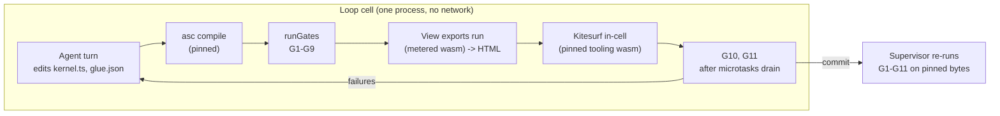

# Render gates in the loop cell (design)

Date: 2026-11-16. Status: design for review; nothing here is built, and no default changes. Decided with the POODO
method (Pontificate, Observe, Orient, Decide, Orchestrate); the decision record is at the end.

The goal is one loop: a need goes in, and code comes out that was rendered and checked inside the same isolate in which
the agent wrote and repaired it, against tests frozen before it existed. Today a kernel is checked by the nine gates
inside the loop cell, every turn ([gates](gates.md), [candidate loop](candidate-loop.md)). This design adds a pinned
browser engine, [Kitesurf](https://github.com/cloudflare/kitesurf)'s `kitesurf-core` at
[`4a29038`](https://github.com/cloudflare/kitesurf/tree/4a29038), to that same cell, so a user interface is checked in
the same turn as its logic. References to Kitesurf are `KS:path:line` at that commit.

## Where it runs: the loop cell

The agent's repair loop already lives in one isolate. On the agent path the conversation, the overlay, the AssemblyScript
compile and `runGates` all run in a process cell of the loop pool ([loop-port.mjs](../../core/runtime/x1/loop-port.mjs)
`warm`, `compileRound`, `checkRound`), and a failed check is the model's next prompt. The render gates join that cell:



- **Admission.** `kitesurf-core` loads as digest-pinned tooling WebAssembly through `toolingWasmModules` (#153). The loop
  pool already uses process cells with no network grant, and its WebAssembly ceiling (the asc pin, 4,096 MiB) covers the
  Kitesurf pin's 256 MiB maximum. Candidate kernels keep the existing guard and the 1,024-page compile limit; the tooling
  path does not apply to them.
- **Warm.** `warm()` compiles the module once, starts one engine instance, registers the four pinned fonts, and primes it
  with one render, next to the existing asc primes.
- **No memory restore.** The engine instance is reused across checks as it is, and replaced, never rewound (see
  [reuse](#instance-reuse-without-restore)).
- **No candidate code in the engine.** The browser parses, styles and lays out the HTML that a view export returned, as
  data. Page JavaScript and Kitesurf's Boa interpreter are not used.

## The candidate form: reducers and views

A user interface is a kernel with two kinds of export, both ordinary AssemblyScript under the fuel meter and the guard:

- **Reducers**, as today: `next(state, event) -> state` over structured state ([gates](gates.md#structured-state)).
- **Views**: `view(state) -> text`, where the `text` result holds a complete HTML document with inline CSS, at most
  65,536 bytes (`maxBytes`). The glue marks it with one new key, `media: "text/html"`, which the closed schema
  ([glue.schema.json](../../core/runtime/x1/glue.schema.json)) gains and G7 checks against the capability block.

G4, G5 and G6 apply to a view as to any export: it must return without a trap, agree on a second run, and stay within
fuel and stack. Kernels compile with `--runtime stub` ([compiler.mjs](../../core/runtime/x1/compiler.mjs)), so a view
can build its document with ordinary string operations; the stage prompt's "never allocate" rule is prompt text, not a
check, and view exports are exempt from it.

TypeScript views, checked by tsrs and run as contained JavaScript, are the contingency, not the default. They are taken
up only if the experiment below shows AssemblyScript views promote too rarely; see the decision record.

## Render tests

A render test is a frozen test whose call result is judged in the engine instead of by `expect`. It is written in the
specification stage and frozen with `tests.json`:

```json
{ "name": "adding an item shows it and keeps the add button reachable",
  "fn": "view", "args": [{ "nextId": 1, "items": [] }],
  "steps": [{ "fn": "next", "event": { "kind": 1, "title": "Milk" } }],
  "render": { "viewport": [390, 844], "expect": [
    { "select": "li", "count": 1 },
    { "select": "li", "text": "Milk" },
    { "select": "button#add", "box": { "minWidth": 44, "minHeight": 44, "inViewport": true } },
    { "select": "button#add", "style": { "background-color": "rgb(0, 102, 204)" } },
    { "page": "noHorizontalOverflow" } ] } }
```

`steps` run reducer exports first, in the loop cell under the meter; the view then renders the resulting state.
Assertions use the document API of the pinned core:

| Assertion | Passes when | Kitesurf call |
|---|---|---|
| `count` | `querySelectorAll(select)` returns exactly that many nodes | KS:packages/core/src/dom/tree.rs:414 |
| `text` | the first match's rendered text, whitespace collapsed, equals the string | `innerTextRendered`, KS:packages/core/src/dom/tree.rs:713 |
| `attr` | the first match also matches the attribute selector `[name="value"]` (the core exports no attribute getter) | `querySelectorAll` |
| `style` | each named computed property of the first match equals its value | `computedStyleValue`, KS:packages/core/src/style/computed.rs:732 |
| `box` | the first match's rectangle meets its bounds and `inViewport` | `getBoundingClientRect`, KS:packages/core/src/layout/geometry.rs:864, after `setViewport` (:1219) |
| `apart` | two selectors' rectangles do not overlap | `getBoundingClientRect` |
| `page: noHorizontalOverflow` | no element's rectangle passes the viewport's right edge | `querySelectorAll("*")`, `getBoundingClientRect` |
| `pixel` | the PNG pixel at the first match's centre equals a colour within 8 per channel | `ks_render_html_to_png`, KS:packages/core/src/paint/screenshot.rs:118 |

Assertions are structural by default. A `pixel` assertion is the only one that paints; without one, a check never
renders a PNG. Kitesurf states that it is not pixel-perfect, and the Blitz stack it builds on lacks some CSS (for
example `overflow: auto`, `position: sticky`, subgrid), so a render test that depends on those is refused at freeze
when the empty-document or mutation checks below cannot tell it apart.

A render test never states a PNG digest: the specification is written before the code, and a digest holds only within
one pin. Digests are evidence.

## Gates

| Gate | Passes when |
|---|---|
| `G10_render` | Every render test's assertions hold; the document caused no fetch (the fetch bridge refuses and counts); and the check window closed with no engine panic, trap or uncaught error |
| `G11_render_stable` | Each render test gives the same assertion results on the warm instance and on a fresh instance |

They run after `runGates` in the same `check`, only when `tests.json` has render tests, and `promotable` requires every
recorded gate, so a kernel without render tests is judged exactly as today. New records with render tests carry
`X1 G1-G11` and a new policy version, by the rule in [gate labels](gates.md#gate-labels-and-the-migration-note).

**Attribution.** The engine queues work on the microtask queue (`queueMicrotask` in its glue), and a failure there can
surface after the call that caused it returned. `check` is already asynchronous, so the render stage drains the queue
before it records anything: it awaits a macrotask turn after the last engine call, and any panic or uncaught error
seen between the first engine call and the end of that drain makes G10 `outcome_unknown` for that check, never a pass.
The cell then replaces the engine instance before the next check.

**Commit.** The supervisor re-runs G1 to G11 on the pinned bytes, as it re-runs G1 to G9 today
([host.mjs](../../core/runtime/x1/host.mjs)), with a fresh engine instance; that run is G11's fresh instance. The render
stage's source, `tools/browser/pin.mjs` and the engine digest join the frozen evaluator's implementation files.

**Test strength (G1).** `testProblems` refuses, before the freeze:

- a render test with no assertions, an unknown assertion, a viewport outside 1 to 4,096, or a selector that
  `canonicalizeSelector` refuses (KS:packages/core/src/dom/tree.rs:372);
- a render test that passes against the empty document `<!doctype html><html><body></body></html>`;
- a render test that passes against mutants of the reference view the specification stage supplies: every element
  matched by an assertion removed in turn, and each asserted text and style replaced. This is G1's counterpart of the
  module mutants the library uses before reusing a capability ([serving](library.md#serving),
  [discriminate.mjs and mutants.mjs](../../core/library/README.md)).

The freeze runs these through the same in-cell engine.

## Instance reuse without restore

tscheck reuses tsrs by restoring its memory image before each check (`tools/tscheck/tsrs-reuse.mjs`). That does not
carry over. Kitesurf's glue keeps state outside linear memory (an externref table, finalizers, a microtask queue), and
restoring memory alone desynchronizes it. In a probe on macOS with Node 26.13.1 and the pinned build, 200 rounds of
one PNG render and one document check on one instance gave:

| Reuse | Panics or traps | Externref table | Wasm memory |
|---|---|---|---|
| None (instance kept as is) | 0 | 1,028 to 1,156 | 134 to 167 pages |
| Memory restore, microtasks drained | 0 | 1,028 to 26,628 | 134 to 6,980 pages (436 MiB) |
| Memory restore, not drained | 100 (`memory access out of bounds`, `Module terminated`) | 1,028 to 26,628 | 134 to 6,980 pages |

So the cell keeps one instance as is and replaces it after 1,000 checks, after 16 MiB of growth since warm, or after
any panic, trap or uncaught error, the same thresholds as `REUSE_DEFAULTS` without the restore. Replacement costs a
new instance from the compiled module: about 2 ms to start and 3 ms to register fonts in the same probe.

## Speed

Probe numbers, macOS, Node 26.13.1, plain Node outside a cell; they are not comparable with EndoForge's Linux results
and are recorded as a starting point, not a budget:

| Step | Cost |
|---|---|
| Compile the 27.1 MB module, once per cell | 15.6 ms |
| Start an instance; register fonts | 1.9 ms; 3.3 ms |
| Document check: parse, viewport, layout, five queries | p50 0.6-0.7 ms; first 7-8 ms |
| PNG render, 390 by 844 | p50 2.6 ms |

A model turn takes seconds ([P-66](../../experiments/P-66-best-of-n/RESULT.md) reports a 23 s median per promoted need),
so the engine is not the term that matters for time to working code. The term that matters is the number of turns, and
the render stage is designed to cut it:

- **One turn, all failures.** A check reports every failed assertion of every render test with what was observed,
  for example `button#add box 30x20, needs minWidth 44 and minHeight 44`, plus a capped outline of the rendered
  document (tags, ids, classes, rectangles).
- **One target at a time, no regressions.** Feedback lists failures in test order and marks any assertion that passed
  in the previous round and fails now. Research on repairing generated user interfaces from rendered feedback finds
  that raw screenshots lead to repairs that fix one region and break another, and that structured, single-target
  feedback with a regression guard does better (arXiv 2608.24138).
- **Cheap breadth.** At under a millisecond per document check, a property-based render test can drive reducer event
  sequences through many reachable states and check invariants (`noHorizontalOverflow`, `box` minimums, `count`) on
  each, in the time of one compile. Its state budget is part of the frozen test.

## Evaluation

The design decides what to measure. One experiment, planned in writing before it runs, with these arms on the same set
of interface needs with a real model:

- AssemblyScript views with render gates (this design);
- the same without render gates (today's loop, with views judged by `expect` only);
- TypeScript views checked by tsrs and run as contained JavaScript, rendered in the same cell (the contingency).

Recorded per arm: promotion rate, model turns and wall time to promotion, check time, resident memory per cell, panics
per thousand checks, and the share of deliberately broken views that pass every gate, the measure
[P-52](../../experiments/P-52-real-gates/RESULT.md) used for kernels. Defaults change only on its result.

## Limits

- A pass is only as good as the frozen render tests. The empty-document and mutation checks refuse the weakest tests,
  not every weak one.
- Results hold for Kitesurf at the pinned commit. A page that passes can look different in Chromium; a Chromium check at
  promotion, outside the loop, is a later option for `final` evidence.
- The tooling path carries no fuel meter, so the engine's CPU is bounded by the job deadline, not per call. The input
  is bounded (64 KiB of HTML, no scripts, no fetches), which keeps the risk low, not absent.
- In the probe, one mixed workload produced one panic in the engine's futures queue (`RefCell already borrowed`) with
  and without restore, and it did not recur in 1,200 later rounds. Its cause is unknown. The attribution rule above
  makes such a panic `outcome_unknown`, and the experiment records its rate.
- Page JavaScript, web fonts, images, real input focus and accessibility checks are out of scope. The pinned core has
  no accessibility tree export.

## Slices

Each slice is one pull request of about 400 changed lines or fewer, with its requirements and verification rows.

1. **Engine in the loop cell.** Add the Kitesurf pin to the loop pool's `toolingWasmModules`, warm one instance in
   `warm()`, and provide `inspect(html, viewport, assertions)` with the reuse and replacement rules and the microtask
   drain. Reuse the artifact and setup from the render spike (#154), without its separate pool. Tests skip, never
   pass, without the artifact.
2. **Render tests in the specification.** `testProblems` accepts `render` and `steps`; G1's empty-document and mutation
   checks; `media` in the glue schema and G7.
3. **G10 and G11.** The render stage after `runGates` in `check`, the commit re-run with a fresh instance, labels, and
   the implementation-file list. Opt-in with `ENDOFORGE_RENDER=1`, off by default.
4. **Prompts, feedback and an example.** `renderRules` in the stage prompts, the structured feedback above, and
   `examples/todo-view-loop.mjs`: a to-do reducer and view through the real loop with a test double, promoted, and a
   `wrong` variant refused by G10.
5. **The experiment** above.

## Decision record

Method: POODO 3.1. Frame stated by the user: needs go in, working code comes out; the browser check runs inside the
isolate in which the code is generated; designed for speed; EndoForge, Kitesurf and tsrs together.

Evidence: the code paths above; probes of the pinned build (macOS, Node 26.13.1); web research on wasm snapshot reuse
(Wasmtime and Wizer documentation, CVE-2022-39393), the Blitz stack's CSS status, Kitesurf's published design,
benchmarks and repair studies for generated user interfaces, and JavaScript in WebAssembly interpreters; and a blind
three-member council (speed, trust, red team) given the evidence but not a favoured answer.

Twenty paths were considered. The chosen design combines: the engine in the loop cell; AssemblyScript views; structural
assertions with PNG only for `pixel`; instance reuse without restore; property-based render tests; a mutation strength
check; and structured feedback with a regression guard. Not taken, with the reason:

| Path | Why not |
|---|---|
| Engine fused into the contained cohort Worker next to tsrs | That lane runs after the attempt, not in the repair loop, and its `harden()` deletes `globalThis.crypto` and `queueMicrotask`, which the glue calls at run time |
| The agent conversation moved into the cohort Worker | Puts the conversation inside the hardened guest sandbox; large change for no measured gain |
| tsrs and contained JavaScript in the loop cell now | Feasible (P-54 ran guests on a process's main thread at about 0.5 ms an attempt) but adds the 1,024 MiB tsrs pin and about 24 ms of checking per attempt before evidence that AssemblyScript views fall short; kept as the experiment's third arm |
| Memory-image restore of the engine | Measured unsafe: unbounded table and memory growth, and traps |
| A separate render pool reached by host call | The red team's choice for isolation; kept as the fallback (below) |
| Page JavaScript through Kitesurf's Boa | Interpreter speed is one to two orders of magnitude below V8, and the tooling path has no fuel meter |
| A vision-model critique in the loop | Not deterministic, so it cannot be a gate; a possible advisory evaluator later |
| No integration | Contradicts the goal |

Reversal conditions, any of which moves the engine to a separate killable render pool (the red team's design):

- more than one panic or uncaught error per thousand checks in the experiment, inside cells;
- an engine call that runs past the job's check budget on a frozen render test;
- G11 disagreement between warm and fresh instances on any recorded test;
- growth of a reused instance that the replacement thresholds above do not contain.

And to TypeScript views: AssemblyScript views promoting markedly less often than the TypeScript arm on the same needs.
