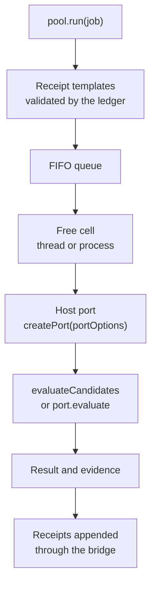

# Workcells

A workcell is a V8 isolate that stays alive between jobs, already holding the machinery a job needs: the pinned
compiler, the gates, the evaluator. Each job gets fresh mutable state; the machinery is reused. `IsolatePool`
([isolate-pool.mjs](../../core/runtime/isolate-pool.mjs)) keeps a fixed number of cells, queues jobs to them, enforces
their limits and writes every result to the ledger through one persistent bridge. Cells are there for speed,
concurrency and low resource pressure; they are not an operating-system sandbox.

Every loop path uses a pool: the `current` path for its gates, the `isolate` and `agent` paths for everything except
the model call ([candidate loop](candidate-loop.md#three-loop-paths)). The TypeScript checker in
[tools/tscheck](../../tools/tscheck/README.md) runs in the same pool. Cstack, a sibling project, runs a pinned copy of it ([Cstack ICD](../icd/icd-cstack.md)).

## One job through the pool



1. `run` deep-copies the job and requires a nonempty list of unique candidate identities.
2. Unless the job says `ledger: 'caller'`, the bridge validates its receipt templates (`prepare`) before dispatch.
3. The first free cell takes it. A cell runs one job at a time.
4. The cell imports the pool's `hostPort` module and calls `createPort(portOptions, { host, hostCall })`, once per
   job. Module state persists in the cell between jobs; the port is new each time.
5. If the port has `evaluate`, the cell calls it (the loop ports do); otherwise it calls the engine's
   `evaluateCandidates` with the port's callbacks.
6. The cell sends back `{ status, reason, report, evidence? }`. The pool adds the cell's metadata and, unless the
   caller writes its own records, appends one receipt per candidate.

A host port is trusted code. It exports `createPort` and may export `warm(options)`; its port supplies the evaluator's
callbacks (`describe`, `run`, `scanEffects`, `residual`, `measure`, optional `invariant`) and may add `evidence()`.

## Thread cells and process cells

| | `isolation: 'thread'` (default) | `isolation: 'process'` |
|---|---|---|
| Cell | A `worker_threads` Worker | A forked Node process with `--max-old-space-size` and `--max-semi-space-size` |
| Heap limit | V8 worker `resourceLimits`; a breach ends that Worker with `ERR_WORKER_OUT_OF_MEMORY` | V8's fatal heap error, recognized on stderr |
| Off-heap memory | Not bounded per cell | Bounded when the pool can attach a cgroup v2 group |
| Failure scope | A native crash or global OOM takes the process | A cell's exit takes only that cell |
| Stack | `resourceLimits.stackSizeMb` | `stackSizeMb` raises `RLIMIT_STACK` through `/bin/sh` and sets `--stack-size` 192 KiB below it, less the environment's size |
| Shared modules | `sharedWasmModules` can be compiled once and posted to every cell | Each cell compiles its own |
| Supervisor lost | Cells die with the process | A helper thread polls the parent every 250 ms and SIGKILLs the cell when it changes |

In process mode the pool tries the current cgroup v2 subtree, or `cgroupRoot`, before any job. Each cell gets its own
group with `memory.max`, `memory.oom.group=1`, `cpu.max`, `pids.max`, and `memory.swap.max=0` where the kernel has it.
Defaults: `max(256, old + 3 × young + 128)` MiB, `"100000 100000"` (one CPU) and 64 tasks. If the host has swap and
the kernel has no `memory.swap.max`, the cell gets no cgroup, because `memory.max` would not bound it. Results say
`cgroup: 'enabled'`, `'unavailable'` or `'not_applicable'`. Root is never requested.

[P-44](../../experiments/P-44-offheap/RESULT.md) measured why this matters: a job with a 128 MiB heap held 3 GiB of
ArrayBuffer, Buffer, Blob or separate WASM memories and still passed, in thread mode and in process mode without a
cgroup. [P-50](../../experiments/P-50-in-isolate/RESULT.md) found process cells with `--permission` no slower than
thread cells on the agent path (116 against 124 ms p50).

## Limits

| Limit | Default | Enforced by |
|---|---|---|
| `size` | `os.availableParallelism()` | The queue; at most `size` cells |
| `resourceLimits` | `{ maxOldGenerationSizeMb: 128, maxYoungGenerationSizeMb: 16 }` | V8 per cell. Heap flags in `execArgv` or `NODE_OPTIONS` are refused, so they can't override it |
| `wasmMemoryMaxMb` | 64 (1–4096) | The WASM guard, per linear memory |
| `jobTimeoutMs` | unset | Starts when the cell is ready, pauses during host calls; at expiry the cell is terminated and replaced |
| `jobDeadlineMs` | unset | Total time from dispatch, host calls included |
| `warmTimeoutMs` | 60,000 | A cell still warming is terminated and counts as a start failure |
| `retireAfterJobs` | 256 | A cell is replaced after that many jobs |
| Host calls | 4,096 per job, 1 MiB each, asynchronous and synchronous together; a synchronous reply up to 17 MiB | `hostCalls` and `syncHostCalls` channels |

`createLoopPool` ([loop.mjs](../../core/runtime/x1/loop.mjs)) builds a pool for the loop: process cells by default,
`jobTimeoutMs` 60 s, `jobDeadlineMs` 900 s, the `WORKCELL` limits of [tools/asc/pin.mjs](../../tools/asc/pin.mjs)
(1,024 MiB old and 32 MiB young generation, 4,096 MiB WASM ceiling, because the compiler's binaryen module declares
that maximum, and the compiler's digests as `trustedWasmModules`), and, for process cells, Node's permission model
with read access only to the repository, the compiler and the host port. The kernel itself is held to 1,024 pages
(64 MiB) by the in-cell compile.

### The WASM guard

Before a cell imports its host port, [isolate-wasm.mjs](../../core/runtime/isolate-wasm.mjs) replaces the cell's
`WebAssembly.Memory`, `Memory.prototype.grow`, `Module`, `Instance`, `compile`, `instantiate` and the streaming
variants with checked versions:

- a module memory with no declared maximum is refused, unless the module's SHA-256 is in the supervisor's
  `trustedWasmModules`, which supplies a `maximumPages`;
- an initial or maximum size above `wasmMemoryMaxMb` is refused before allocation;
- every `memory.grow` instruction is rewritten to call a checker, and JavaScript `grow()` is checked too; growth past
  the ceiling sets a flag and traps, and the cell exits with code 18 before any result leaves;
- SIMD, atomics, GC types, exceptions and memory64 in a memory-bearing module are refused;
- a module compiled outside the cell cannot be instantiated, except a `sharedWasmModules` entry the supervisor
  compiled through the same guard.

Candidates and `portOptions` cannot add trust: the policy is copied and frozen in the constructor, and every result
carries the supervisor's copy.

## Warm cells

`ready()` spawns `size` cells and resolves once each has installed its guard and reported `ready`, and the ledger
bridge has started. With `warm: {...}`, each cell first awaits its host port's `warm(options)`. The loop port's `warm`
verifies the compiler files against the digests in `tools/asc/pin.mjs`, loads the compiler, and runs a primer kernel
through compile and gates eight times (`primes`), so the first real job pays nothing to start. P-50 measured `ready()`
at 2.5–3.5 s for one cell and 6–8 s for eight; [P-46](../../experiments/P-46-prewarm/RESULT.md) showed warm state
moving the first job's cost into `ready()` without shrinking the total.

A replacement cell warms itself and is not awaited; a job handed to it isn't charged for its start. After `size + 2`
cells in a row exit before reporting ready, the pool stops respawning, `halted` turns true, and queued and later jobs
return `outcome_unknown` with reason `workcell_start_failed`.

## Failure outcomes

A lost job is never retried and never a pass.

| Event | Thread cell | Process cell |
|---|---|---|
| Heap limit | `outcome_unknown`, reason `limit` | `rejected`, reason `heap` |
| WASM ceiling | `outcome_unknown`, reason `limit` | `rejected`, reason `wasm_memory` |
| `jobTimeoutMs` or `jobDeadlineMs` | `outcome_unknown`, reason `deadline` | same; SIGTERM, then SIGKILL after 1 s |
| Any other exit | `outcome_unknown`, reason `worker_exit` | same |
| Exception in the port or evaluator | `outcome_unknown` with the message | same |

In a process cell the pool can tie the exit to the limit, from V8's fatal heap message on the cell's own stderr or
the guard's exit code 18, so it records a rejection; in thread mode the code records the loss as unknown. An unknown
outcome becomes a receipt with delivery `outcome_unknown` and outcome `inconclusive`; a process-limit rejection
becomes `finished` / `failed`. A thread cell blocked in a native call such as `execSync` cannot be
interrupted until the call returns; use process cells where a deadline must hold for code like that.

## Talking to the host

A cell has up to four channels to its supervisor, and no other route out:

| Channel | Used by | Rules |
|---|---|---|
| `hostCall(request)` | Ports that need the supervisor's `hostCalls` function | At most 4,096 per job and 1 MiB each; the supervisor decides what a request means |
| `host(call)` | The loop port's `model` and `admit` calls, answered by the pool's `hostCall` handler | The handler maps a call to its job from the host's own job data, so a cell cannot name another job. While a call is out, the cell answers liveness pings |
| `syncHostCall(request)` | Ports whose interface is synchronous, when the pool has `syncHostCalls`; the port gets the channel as `portOptions.syncHostCall` and opens it with `connectSyncHostCall` | The call blocks the cell until the supervisor's `syncHostCalls` function answers: a growable `SharedArrayBuffer` with `Atomics.wait` in a thread cell, length-prefixed frames on file descriptors 4 and 5 in a process cell. Same per-job count and request size as `hostCall`. `jobTimeoutMs` pauses while the host answers; `jobDeadlineMs` does not. Without `syncHostCalls` no channel is passed. The [compatibility workcell](../../tools/compatibility/README.md) reads snapshots this way |
| `verifyFrozen` | `frozenThroughLedger: true` | The evaluator's frozen checks go to the bridge instead of a new `python3` per check |

## The ledger bridge

Each pool owns one `LedgerBridge` ([isolate-ledger.mjs](../../core/runtime/isolate-ledger.mjs)): a persistent
`python3` process that speaks JSON lines and is served by the group-commit writer
([tools/ledger_writer.py](../../tools/ledger_writer.py)). It answers `prepare`, `append` and `frozen`, plus the
actions of an extension module (`createLoopPool` loads `tools.x1_loop`, which adds `admit`, `park` and `commit`).
Requests from many cells and many task ledgers share one batch and one journal `fdatasync`
([writer journal](../interfaces/ledger-icd.md#ledger-writer-journal)).

If the bridge exits, its pending requests reject with `outcome: 'outcome_unknown'` and are never resent. A bridge
created with `restart: true`, as the loop pool's is, starts again up to three times in a row; otherwise later requests
reject. `close()` drains pending requests before stopping it.

[P-57](../../experiments/P-57-release-waits/RESULT.md) found the bridge is the width limit once model waits release
their cells: at 64 candidates in flight, freezes and parks each waited about 200 ms for it.
[P-59](../../experiments/P-59-ledger-writer/RESULT.md) is the group-commit writer that followed.

## The dump list

EndoForge spends RAM for speed and gives it back when the machine's memory guard asks. A holder registers a file in
`${XDG_STATE_HOME:-~/.local/state}/memguard/dump-list.d/<pid>-<name>.json` ([dump-list.mjs](../../core/runtime/dump-list.mjs),
Python twin [tools/dump_list.py](../../tools/dump_list.py)):

```json
{"schema":"memguard-dump/1","pid":1234,"name":"endoforge-isolate-pool","priority":20,"sheddable_bytes":0,"signal":"SIGUSR2","updated":"..."}
```

The guard sends `SIGUSR2`; lower priorities are asked first. The handler is installed before the file is first
written, and the file is rewritten after each shed and at most every two seconds otherwise. Registration is off unless
the directory exists or `ENDOFORGE_DUMP_LIST=1` (`0` forces it off), and `dumpList: false | true | {...}` overrides it
per pool.

| Holder | Priority | Gives back | Never touches |
|---|---|---|---|
| `IsolatePool`, `endoforge-isolate-pool` | 20 | Idle ready cells beyond `floor` (1); not respawned for `holdMs` (30 s) unless a job needs one | Busy cells |
| Contained cohort, `endoforge-cohort` | 40 | Idle Workers beyond `floor` (1); the rest drop their reused checker instance | Attempts in flight |
| Ledger writer, `endoforge-ledger-writer` | 110 | Cached SQLite handles, then `malloc_trim` | Unacknowledged batches |

A process cell's estimate is its private RSS from `/proc/<pid>/smaps_rollup`; a thread cell's is its heap statistics
scaled by the RSS change the pool measured at boot and after each shed.
[P-61](../../experiments/P-61-dump-list/RESULT.md) measured the cohort freeing 251 of 336 reported MiB in its unloaded
trial; the isolate pool's cells give back only about 2 MiB each on Node 26.

## Stage rates

`createLoopPool({ rates: createStageRates({ stages: loopStages({ cells }) }) })` ([stage-rates.mjs](../../core/runtime/stage-rates.mjs))
stamps model turns, cell jobs (queued, dispatched, done, time blocked on host calls), each job's compile and gate time
and every ledger request into preallocated typed arrays. `rates.view()` returns, per stage and for any window,
arrivals and completions per second, utilisation and net utilisation (minus time blocked on the host), queue length,
service percentiles, a Little's Law check and a verdict:

| Verdict | Meaning |
|---|---|
| `saturated` | A stage at 0.8 net utilisation or more with a queue; the busiest such stage is named |
| `population` | No stage saturated; most candidates sit in an unbounded stage, such as a model call |
| `unsaturated` | No stage saturated; most candidates sit in a bounded stage |
| `idle` | Nothing happened in the window |

`rates.publish(path)` writes the view once a second, and `node tools/stage-rates.mjs <path> --watch` prints it.
[P-62](../../experiments/P-62-stage-rates/RESULT.md) found the verdict right in 6 of 6 controlled runs; at width 16
with P-57's stub model waits of a few seconds it names `model (population)`, and with fast stub models `ledger`.

## Sizing

The pool defaults to the machine's parallelism. [P-17](../../experiments/P-17-workcell-gap/RESULT.md) measured a
throughput plateau at 20–32 cells, and [P-68](../../experiments/P-68-tuner-occupancy/RESULT.md) returned the default
to `availableParallelism()` instead of the planner's width. The [capacity planner](../interfaces/capacity-icd.md) picks widths for
the compatibility lane; the pool does not call it.

## Limits

- Host ports and the supervisor are trusted code with normal Node privileges.
- Isolates in one process share its death, its memory pressure and its side channels. Process cells and cgroups are
  how to separate failure budgets.
- Heap limits cover V8's old and young generations only; without a cgroup, nothing bounds the sum of linear memories,
  native allocations or total RSS.
