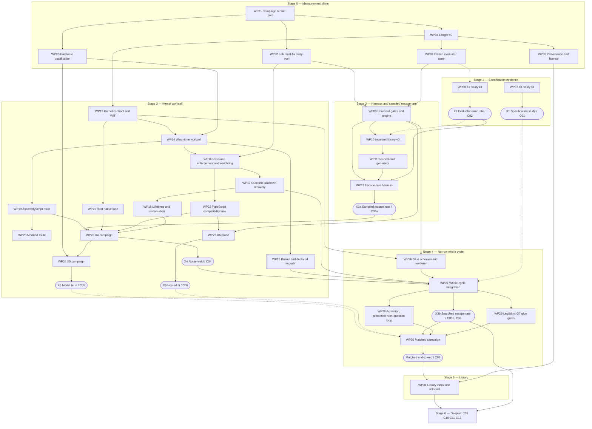

# Execution plan — one narrow vertical slice

> Current execution addendum, 2026-10-18: [the next-50 ledger](../../campaigns/next50-20261018/README.md) tracks new preproduction modules and their actual qualification state. Historical package/probe counts below are not the current implementation inventory. The cancelled capability merge remains cancelled; no application deployment or fresh-request improvement is claimed.

> Reconstructed 2026-10-17. The original execution plan was not available; this version is rebuilt from
> Edition 3 (§3, §4, §5, §6, §7, §9, §11, §12, §13, §15, §17), Edition 2 (§15, Appendix A), the white
> paper (pp. 21–23), R12, R13 and R14 of this library, and the isolate-factory-lab repository and
> worktrees. Content follows Edition 3 where the editions differ.
> Status 2026-10-18: hill-climb loop 1 ran (not adopted; `campaigns/hillclimb-loop-01/receipt/DECISION.md`), the atomizer speed track cut the median request from 97 s to 30 s, and `docs/REPORT-2026-10-18.md` ranks what comes next. All review is agentic (DEC-78).
>
> Redone 2026-10-17 (later the same day) to reconcile with the probes, the X1 dark-factory pilot and the persona review; see `docs/execution/CRITIQUE-2026-10-17-reconcile.md`.

## Purpose

This plan turns R13's stage sequence and R14's experiments into a schedule of work that can be started on Monday. It fixes the scope of the first vertical slice, gives every stage an entry condition, an exit gate and a kill or narrowing rule, assigns the 32 work packages (`WORK-PACKAGES.md`) and the 18 campaign records (`campaigns/`) to stages, and draws their dependencies. The order is Edition 3's: evaluation plane first, then substrate, then library [E3 §12, §15]. Everything here is **Proposed**; every duration is **Estimated**. Nothing has been run as a registered campaign; six probes and one X1 pilot ran on 2026-10-17 (Recorded (probe); Pilot (not a registered result)) and narrow what is marked below (DEC-64).

## Summary

- One slice: one domain (Field OS refrigeration engineering claims), one request class (a novel, determinate, small capability), one kernel route (AssemblyScript), one lane (Wasmtime on the Main-rig), one host renderer. "Whole cycle" means all five boundaries of E3 §4 exist, however thin.
- Seven stages, 0–6. X1 and X2 (Stage 1) start on day one in parallel with Stage 0 because they need no engineering [E3 §15]. The kernel workcell (Stage 3) does not start until a harness with a measured sampled escape rate exists (Stage 2).
- Every gate is a stop rule written before the result is known. A failed gate narrows the product, not the standard [E3 §15]. The narrowing each gate causes is named below.
- 32 work packages in seven groups; bottom-up estimates total about 130–207 person-days (Derived from the WP estimates, all Estimated). R13 now carries the same accounting; §6 states what its earlier stage figures (82–129 days) omitted. Two packages (WP20, the live-revision half of WP28) and four campaigns (C08, C14, C16, C17) are marked "Stage 6+ / optional": they are not on the path to rung 4 and no X1–X6 experiment needs them. WP29 (legibility) moved from optional onto the critical path on 2026-10-17: the persona review found that the five presentation rules decide whether a gated capability is usable (L-13, L-14), and they are enforceable as a gate on the glue (G7). The count stays 32.
- **Promotion means gated and persona-accepted** (WP28, DEC-71 pilot): a capability that passes every fixed gate but is rejected by a persona review is not promoted. Measured on the pilot: 2 of 41 verdicts rejected in the first review, 1 of 41 after re-runs; promoted shrank from 19 to 3 under the stricter rule, with 15 pending one named change (Pilot (not a registered result), R12 §7).
- **The product of the generative-applications slice is a capability plus the one question** it could not answer from the request: 20 of 20 pilot requests were underdetermined (rater 1; 9 of 10 by the blind rater). Promotion with a stated assumption is the normal outcome; the question is a first-class output rendered by the glue (G7). R19 §2.1 (disagreement inputs) is the mechanism by which the question gets answered and is now a Stage 4 deliverable of WP28, not a Stage 6+ deferral (§8.2).
- **Stage 1's X1 is piloted** under an agent specifier (DEC-71): 20 contracts in a median 95 s, 19 kernels gated; it is not a registered result (C01 §16–§17). The rung-4 path from here is the merge of refrigeration-ai branch `claude/endoforge-capabilities` (after the glue and the two re-run kernels are re-delivered) and one technician's use of one capability, with consent and a hashed task statement per DP-4.
- C01–C06 are X1–X6, C07 is the matched end-to-end campaign, C08–C18 are eleven further campaigns, each tied to a risk (R15) or decision (R16). All are drafts; none is registered.
- Six design decisions the plan used to assume silently are now explicit decision points (§7), each with a default, an owner placeholder and the stage by which it must be made: the host of the AssemblyScript compiler on the Wasmtime lane (E3-10), the home of the compatibility lane locally (E3-09), the second X3 domain, the named person for rung 4, the unified-memory host for X5 Part 2, and the X1 decision bands.
- The critiques that produced this revision are `docs/execution/CRITIQUE-2026-10-17-plan.md` (pre-registration) and `docs/execution/CRITIQUE-2026-10-17-reconcile.md` (after the probes and the pilot).

## 1. The slice

Edition 2's rule was "build the whole cycle narrowly, then deepen" [E2 §15]. Edition 3 keeps it and changes which boundary is engineered first [E3 §12, §15; R13 §1]. The slice is the narrowest thing that crosses every boundary of E3 §4.

| Dimension | Slice choice | Why | Widened when |
|---|---|---|---|
| Domain | Field OS refrigeration engineering claims (the `fuseEngineeringClaims` family: unit equivalence, gauge vs absolute pressure, repeated origin, unavailable source, reversed input) | Most existing invariants; the only recorded evidence [E3 §3, §6, §14; R12 §2] | A second, unrelated domain is required by X3 before any tier generalises (R14 X3). It must be chosen before C02 freezes (decision point DP-3, §7), because C03 needs 100 tasks with C02-frozen evaluators and a WP10 invariant set in that domain |
| Request class | Novel and determinate, "too small for a project" [E3 §3, §10] | The class X1 and X2 measure; composable requests need the library (Stage 5); ambiguous requests add only a human round trip | After Stage 5, composable requests enter through retrieval (C12) |
| Product | Generative application inside one host, with the agent-substrate variant kept runnable | Both products share the substrate; the evidence bars differ [E3 §3]. If X1 kills generative applications, Stage 4 runs the agent-substrate variant only | — |
| Kernel route | AssemblyScript, compiler inside the workcell [E3 §5] | Candidate default pending X4 | MoonBit (WP20) and Rust (WP21) join for X4; TypeScript compatibility lane (WP22) is a named lane, not the strict path |
| Lane and host | Wasmtime-based local lane on the Main-rig under OS sandboxing, cgroups and an external watchdog [E3 §13] | Kernel contract is native there; the Main-rig is the only qualified host | Hosted lane after X6 (C06); unified-memory host for X5 (C05) |
| Renderer | A minimal host with a fixed registered component set; interaction tests driven by the lab's Playwright renderer | Glue is data the host renders [E3 §5] | Field OS Construct once glue schemas are stable |
| Ledger | The R11 record set in one local store | Identities must exist before any receipt cites them [E3 §6, §8] | Sharded or hosted store only when attempt multipliers demand it (R10) |

Interim workcell. Until Stage 3 exits, candidates for X2 and X3a may execute through the existing Field OS guest adapter or a native baseline, so evaluation-plane work never waits on substrate work. Every receipt names the lane it ran on, so guest numbers are never mistaken for kernel evidence [R13 §1, open question 1].

## 2. Stages and gates

Stage numbering follows R13 §2. Each table gives purpose, entry, work packages and campaigns, exit gate, kill or narrowing rule, the claim-ladder rung it may move [E3 §17], and a duration.

### Stage 0 — Measurement plane

| Item | Content |
|---|---|
| Purpose | Make every later number a receipt: precommit, hash chain, environment identity, calibration, verification command [R13 Stage 0] |
| Entry | None |
| Work packages | WP01 campaign runner port; WP02 lab must-fix carry-over; WP03 hardware qualification (Main-rig record); WP04 ledger v0; WP05 provenance and license fields; WP06 frozen evaluator store; WP32 documentation upkeep (starts here, runs throughout) |
| Campaigns | None registered. A tiny smoke campaign exercises the runner |
| Exit gate | (1) A real smoke campaign on the Main-rig produces a receipt set that the ported verifier accepts. (2) The calibration suite passes at the measured commit on the same boot. (3) A noise baseline is recorded with its quiet gate passing. "Exclusive window" is not a declaration: it is a noise-baseline receipt taken inside the claimed window whose quiet gate passes under the same thresholds; without that receipt the gate item fails. (4) The ledger accepts and re-verifies a frozen-evaluator record and an evaluation-attempt record that cites it. (5) M3, M9, M10, M11 and the out-of-cgroup core-dump helper are closed with regression tests |
| Kill or narrowing rule | If the quiet gate cannot pass on the shared desktop, every later timing claim is restricted to effects above the recorded upper-bound MDE (1.3–9.3 % at N = 30 from the lab's failed-gate baseline; Recorded upper bounds, R12 §4.2) until an exclusive window or a root-owned cpuset exists. If the verifier cannot accept a real receipt set, no stage proceeds: this is a stop, not a narrowing |
| Rung moved | None |
| Duration | WP sum 17–28 days (Estimated; includes both WP03 records, the second of which is due only before C05 part b); R13 carries the same figure after reconciliation (§6); its earlier 3–5 days covered WP01 alone |

### Stage 1 — Specification evidence (X1, X2), in parallel with Stage 0

| Item | Content |
|---|---|
| Purpose | Decide whether generative applications have a market now and the starting autonomy tier, before building anything that assumes either [E3 §15]. X1 runs under an agent specifier (DEC-71): one fresh agent per request writes the contract and executable tests, a blind agent classifies the seeded half, the person confirms the recorded question |
| Entry | `docs/templates/CAMPAIGN-PRECOMMIT.md` exists (it does). Stage 0 may still be in progress; X1 and X2 use file hashes until WP06 lands, then their evaluator hashes are re-entered in the ledger |
| Work packages | WP07 X1 study kit (built; `campaigns/x1-spec-study/`); WP08 X2 study kit |
| Campaigns | C01 (X1): **piloted 2026-10-17, not registered** (C01 §16); C02 (X2): seeded with the pilot's 20 contracts, frozen tests, persona findings and two rejections (C02 §6) |
| Exit gate | C01 and C02 decided by their precommitted rules, including "inconclusive" and "extend" outcomes (R14 X1, X2). The pilot does not satisfy this gate (DEC-64): C01 needs a named author and reviewer, the tightened residual-counting rule and a fresh registered run (C01 §17). What X1 now decides: whether an agent specifier can turn the request class into contracts, and the residual thickness. What it hands to X2: the contracts and their frozen tests as the seed task set, and the question of whether each contract is the capability the person wanted |
| Kill or narrowing rule | X1 (C01 §3, three bands at n = 20, decided on the point estimate): below 10 % (0–1 of 20) kill; 10–35 % (2–7 of 20) extend to 60 requests from the frozen pool and decide at 60 on the point estimate against 20 %; above 35 % (8 or more of 20) pass. A kill means the agent substrate is the product and generative applications move to research [E3 §15]; Stage 4 then runs the agent-substrate variant and WP26, WP28 and WP29 drop to minimal scope. Edition 3's threshold stays 20 %; the bands only say when 20 requests are too few to read it (Derived, R14 X1). X2 (C02 §3): point estimate above 5 % on at least 100 pass-2 determinate evaluators, no autonomous tier anywhere and every domain starts Confirmed [E3 §15]; with fewer than 100 determinate evaluators the campaign extends until it has 100, and a result below that n is a screen that decides nothing. E3-12: C02 reads "two library passes" as two synthesis passes around one growth step and says how to switch reading |
| Rung moved | Prepares rung 3 (error-rate half). The pilot moved no rung: no person used a capability. The rung-4 path (DP-4) runs through the delivered package, not through this stage |
| Duration | X1 2–4 days (the pilot took one day for 20 requests end to end, Pilot (not a registered result)), X2 8–12 days (Estimated; R14). C02's invariant list v0 and its growth step are hand-authored and file-hashed inside WP08, so Stage 1 depends on no Stage 2 package; WP10 later ports that list (see WP08, WP10) |

### Stage 2 — The harness as trusted base, and the sampled escape rate (X3a)

| Item | Content |
|---|---|
| Purpose | Turn "harnessed" into a number: the escape rate of seeded faults through the full harness, per domain [E3 §7] |
| Entry | Stage 0 exit. C02 has produced at least one qualified synthesized evaluator per domain to be tested |
| Work packages | WP09 universal gates and evaluator engine; WP10 invariant library v0; WP11 seeded-fault generator; WP12 escape-rate harness |
| Campaigns | C03 part a (X3a, sampled) |
| Exit gate | Sampled escape rate per domain with its one-sided 95 % upper bound, at the n set in C03: 6,294 non-equivalent faults per domain, the two-escape plan (Derived, R14 §2; 4,742 is the one-escape plan, not used). Each domain receives a provisional tier. Candidates at this stage run on the interim lane, so the sampled rate is recorded per (domain, evaluator hash, candidate format) and names the lane; it is not kernel evidence |
| Kill or narrowing rule | No domain is Supervised until its sampled bound is below 1 in 1,000 (at most 2 escapes in 6,294; 12 or more escapes puts the lower bound above 1 in 1,000 and fails; 3–11 is not certified; Derived, C03 §3); a domain that misses stays Confirmed. If the generator cannot emit the planned S2 count for a domain (3,147 non-equivalent domain-semantic faults, 50 % of 6,294, across at least 105 tasks; C03 §6–§7), the Supervised tier for that domain is unreachable by measurement and the domain stays Confirmed (R14 open question). Width stays at one for every domain until the searched rate (Stage 4) is known |
| Rung moved | Rung 3, sampled half only |
| Duration | WP sum 19–30 days (Estimated); R13 carries the same figure after reconciliation (§6) |

### Stage 3 — The kernel workcell (X4, X5, X6)

| Item | Content |
|---|---|
| Purpose | Build the narrowest substrate that satisfies the kernel contract; decide the default route, inference placement and the hosted lane [E3 §5, §13] |
| Entry | Construction (WP13–WP22) may start once WP03 and WP04 exist and decision points DP-1 and DP-2 (§7) are recorded; it does not wait for Stage 2. Judging candidates (WP23, C04, C05, C06) waits for Stage 2 exit: an evaluator with a measured sampled escape rate must exist before any route's yield is read. For X5 Part 2, a qualified record (WP03) for the target unified-memory host (DP-5) |
| Work packages | WP13 kernel contract and WIT; WP14 Wasmtime workcell; WP15 broker and declared imports; WP16 resource enforcement and watchdog; WP17 outcome-unknown recovery; WP18 lifetimes and reclamation; WP19 AssemblyScript; WP20 MoonBit; WP21 Rust native lane; WP22 TypeScript compatibility lane; WP23 X4; WP24 X5; WP25 X6 |
| Campaigns | C04 (X4), C05 (X5; part a on any host, part b on the unified-memory host), C06 (X6), C15 (reclamation bytes). C16 and C17 are Stage 6+ / optional (§4) |
| Exit gate | Rung 2 recorded for the kernel contract: every ported w-contain case contained or a predeclared expected failure; owned groups verified empty after every case; the five Field OS recovery boundaries plus active cancellation reproduced as `outcome_unknown` or `cancelled` after verified closure. C04, C05 and C06 each decided by their precommitted kill rules |
| Kill or narrowing rule | X4: point estimate of (best in-isolate WebAssembly route − TypeScript) below −20 points at 5 generations per task per route, the compatibility lane stays default and the kernel contract waits; Stage 4 runs on the compatibility lane, named as such, and C07's arm K is then the compatibility lane and arm D is dropped as a duplicate [E3 §15]. X5 (part b): point estimate of local ÷ hosted above 1.5, local inference serves short calls only; if part b cannot run for want of a host (DP-5), placement is recorded as "undecided, hosted by default" and C07 declares it so. X6: over the memory limit in any of 10 repeats, or latency point estimate more than 3× native, the hosted lane consumes checked artifacts and never compiles. Containment: any case neither contained nor predeclared blocks Stage 4 on that lane |
| Rung moved | Rung 2 for the kernel contract. Rung 1 only if DP-1 (§7) places the AssemblyScript compiler inside the Wasmtime workcell and a receipt shows it running there; under the DP-1 default (compiler in a supervised V8 process beside the lane) rung 1 does not move in this slice and the plan says so |
| Duration | WP sum 43–69 days (Estimated); R13 carries the same figure after reconciliation (§6) |

### Stage 4 — One narrow whole cycle, the searched escape rate, and the matched campaign

| Item | Content |
|---|---|
| Purpose | One request crosses every boundary and a real person uses the result; candidate width is decided under search; the whole loop is compared against the arm that matters [E3 §4, §15] |
| Entry | Stage 3 exit. X1 did not kill generative applications (otherwise run the agent-substrate variant only) |
| Work packages | WP26 declarative glue and renderer binding; WP27 whole-cycle integration; WP28 activation, promotion rule (gated and persona-accepted) and the question loop (R19 §2.1); WP29 legibility, now on the critical path: the five presentation rules as glue gates (G7); WP30 matched end-to-end campaign |
| Campaigns | C03 part b (X3b, searched, width 16); C18 (holdout adaptation, to set the rotation rule before C07's release run); C07 (matched campaign). C08 (widths 1 and 4) and C14 (state-preserving live revision) are Stage 6+ / optional (§4) |
| Exit gate | Rung 4 attempt with a pass/fail rule (WP27 criterion e): the named person (DP-4, §7) sets a task of their own in the slice domain before the capability exists, the capability is qualified, and the person completes that task with it without the author touching the capability, the inputs or the person's session; the receipt records the person's consent, the task statement hash, the capability identity and the person's completion statement. Fail: the task is not completed, or any intervention is recorded. "Qualified" here means **promoted: gated (G1–G7) and persona-accepted** (WP28); a gated-but-persona-rejected capability may not be offered for the attempt. The product offered is a capability plus its recorded question, rendered through the glue (G7: labels, units, precision, assumption, question, trap messages). Searched escape rate per domain recorded. C07's verdict against the conventional-agent arm recorded, including inconclusive |
| Kill or narrowing rule | Searched escape rate above 1 in 1,000 with the full harness (12 or more escapes of 6,294 searched faults in a domain; Derived, C03 §9): width stays at one until a new non-model check lands [E3 §15]. C07 loses to or is inconclusive against arm G (lower 95 % bound of K ÷ G not above 1.0; C07 §3): the product proposition is not confirmed; claims narrow to whatever arm A or arm D comparisons support, and no "faster than an agent" claim is made. Rung-4 fail: rung 4 does not move; Stage 5 may still start on an accepted capability, but no claim above rung 3 is made. Until C14 runs (Stage 6+), kernel revisions activate only with the person's confirmation per revision. Legibility (WP29): a capability whose glue fails G7 is not promoted; this is a gate, not a secondary |
| Rung moved | Rung 3 (searched half); rung 4 |
| Duration | WP sum 24–38 days (Estimated); R13 carries the same figure after reconciliation (§6) |

### Stage 5 — The library

| Item | Content |
|---|---|
| Purpose | Make later requests cheaper by retaining what compounds: contracts, invariants, tests, counterexamples [E3 §12] |
| Entry | Stage 4 exit with at least one accepted capability |
| Work packages | WP31 library index with behavioural-fingerprint retrieval and lifecycle |
| Campaigns | C12 (retrieval hit rate); start of the rung-6 lifetime-economics measurement (precommit only; months to decide) |
| Exit gate | At least one capability is retained with a passing qualification against the current host (retiring everything does not pass the gate), and every other retained capability has a passing qualification or is retired [E3 §13]. C12 decided: the guard (zero false compositions in at least 59 proposals, bound below 5 %; Derived, C12) is read from the number of proposals actually made |
| Kill or narrowing rule | C12 guard fails (one or more false compositions, or fewer than 59 proposals so the bound cannot be stated): retrieval may only suggest, never compose without generation and full qualification. A capability without a passing qualification is retired, not kept (DEC-61) |
| Rung moved | Starts rung 6 |
| Duration | 12–18 days (Estimated); R13 carries the same figure after reconciliation (§6) |

### Stage 6 — Deepen

Each item is its own precommitted campaign, and none starts before the searched escape rate it depends on is known [R13 Stage 6].

| Item | Campaign | Gate |
|---|---|---|
| Incremental semantic state, admitted only with full-recomputation parity | C09 | Zero parity mismatches at the precommitted n, or the incremental path is not admitted |
| Parameter families instead of separate programs | C10 | Finalists qualify standalone; CPU effect above the recorded MDE |
| Batched evaluation | C11 | Batch equals solo byte for byte in every order; CPU moved, not only latency |
| Keeper refinement (rung 5 attempt) | C13 | Break-even predicted and then observed in the same units [E3 §11] |
| Searched escape rate at widths 1 and 4; state-preserving live revision; unified-memory contention; local evaluator synthesis | C08, C14, C16, C17 (moved here from Stages 3–4 as Stage 6+ / optional) | Each as written in its record; none is needed for rung 4 |
| Factory machinery as a challenger (rung 7) | Not yet drafted | Requires rungs 3 and 5 |
| Campaign specialisation | Not drafted in C01–C18 (see §5) | Amortisation inequality of R07 §7 |
| Hardware co-design | C16 results feed it | Hardware record per host (WP03) |

## 3. Dependency graph

Solid arrows are hard dependencies; dotted arrows feed a decision without blocking. Work packages sit inside the stage that must finish them. WP32 (documentation) runs alongside every stage and is omitted for legibility. Two corrections from the 17 Oct critique: Stage 2 exit (X3a) gates the judging of candidates (WP23), not the construction of the workcell (WP13), so WP13–WP22 may be built while Stage 2 runs; and C02 depends on no Stage 2 package (its invariant list v0 is hand-authored inside WP08, so the former WP10 → C02 link is reversed: WP10 ports what C02 authored).

## 4. Campaign schedule

| Record | Experiment or question | Stage | Blocks | Tied to |
|---|---|---|---|---|
| C01 | E3 X1 specification study (agent specifier; piloted 2026-10-17, not registered) | 1 | Stage 4 scope | RISK-11, RISK-25, DEC-42, DEC-71 |
| C02 | E3 X2 evaluator error rate | 1 | Stage 2 entry; tiers | RISK-07, RISK-29, DEC-43, DEC-44 |
| C03 | E3 X3 escape rate (a sampled, b searched) | 2 and 4 | Tiers; width | RISK-08, RISK-10, DEC-44, DEC-45 |
| C04 | E3 X4 kernel route yield | 3 | Default route | RISK-20, RISK-21, DEC-46, DEC-47 |
| C05 | E3 X5 model term (a: the lean subscription-CLI turn by effort and output length, descriptive, any host; b: local batched vs that hosted baseline, the kill, unified-memory host; no API arm) | 3 | Inference placement (b only) | RISK-17, RISK-18, DEC-50, DEC-65 |
| C06 | E3 X6 hosted fit | 3 | Hosted lane role | RISK-01, RISK-02, DEC-50, DEC-59 |
| C07 | Matched end-to-end campaign | 4 | Product proposition | RISK-22, RISK-23, DEC-10, DEC-55 |
| C08 | Searched escape rate at widths 1, 4, 16 | Stage 6+ / optional (X3b at width 16 is the slice's width decision; widths 1 and 4 refine it) | Width per domain | RISK-08, DEC-57 |
| C09 | Incremental vs full recomputation parity | 6 | Admitting incremental state | RISK-01, RISK-23 |
| C10 | Parameter family vs separate programs | 6 | Families as a regime | RISK-23, R06 rank 4 |
| C11 | Batch evaluation: does CPU move? | 6 | Batching as a regime | RISK-23, R06 rank 5 |
| C12 | Library retrieval hit rate | 5 | Retrieval may compose | RISK-13, RISK-28, DEC-52 |
| C13 | Keeper refinement break-even | 6 | Refinement budget rule | RISK-26, DEC-29, DEC-33 |
| C14 | State-preserving live revision | Stage 6+ / optional (until it runs, revisions activate only with the person's confirmation) | Automatic activation | RISK-19, DEC-06, DEC-08 |
| C15 | Reclamation bytes after a campaign | 3 | Trusting reclamation accounting | RISK-14, DEC-06 |
| C16 | Unified-memory contention sweep | Stage 6+ / optional (needs C05 part b and the DP-5 host; not needed for rung 4) | Overlap of compile and inference | RISK-17 |
| C17 | Local vs hosted evaluator synthesis | Stage 6+ / optional (needs C02 and a local model; synthesis stays hosted until it runs) | Where residual synthesis runs | RISK-07, RISK-18, DEC-56 |
| C18 | Holdout adaptation under repeated scoring | 4 (before C07 release run) | Fixture rotation rule | RISK-09 |

## 5. How C08–C18 were chosen

Candidates came from the open questions and ranked reductions in R04–R07, R09, R10, R11 and R15. The selection rule (**Proposed**): a record earns a slot if its result changes a gate, a default, or a budget rule in the slice before Stage 6, or if it is the only way to retire a High-impact risk. Ten of the eleven candidates proposed when this plan was commissioned met it. One did not, and one gap took its place:

| Considered | Decision | Reason |
|---|---|---|
| Campaign specialisation amortisation (R07 §7) | Not given a C-slot now | Its result changes nothing before Stage 6; it needs a stable campaign stream that does not exist until C07 has run. Draft it after C07 as a new record |
| Holdout adaptation under repeated scoring (RISK-09; R05 open question) | Selected (C18) | C07's release run needs a fixture rotation rule fixed before data [E3 §11]; no source settles it |
| Repository-event cost next to one attempt (R10 open question) | Not selected | DEC-38 already chose a native ledger; the number would not change a decision in the slice |
| Review throughput as the binding constraint (RISK-12) | Not separate | Measured inside C01 (time to specify) and C07 (reviewer minutes) |

## 6. Estimates and the critical path

The WP estimates in `WORK-PACKAGES.md` sum to 130–207 person-days (Derived: sum of lower and upper bounds; inputs Estimated). R13 §2 now carries the same stage figures and a reconciliation table. Its earlier figures (82–129 days) omitted WP02, WP03, WP04, WP05, WP06, WP20 and WP32 (22–36 days together) and under-counted Stages 2, 3 and 4 against the bottom-up packages (11–15, 14–21 and 4–8 days); it over-counted Stage 5 by 2–3 days. The 17 Oct critique also raised WP10 (second-domain invariants) and WP11 (known-good implementations for 100 tasks per domain) by 2–3 days each, which moved the total from 126–201 to 130–207.

Not costed in any package, and therefore not in the total: acquiring or borrowing the unified-memory host for C05 part b (DP-5); recruiting the rung-4 person and obtaining consent (DP-4); the person-hours of the people who grade in C02 beyond the author (WP08 counts the author's time only); re-delivery of the glue and the two re-run kernels to refrigeration-ai and the merge of `claude/endoforge-capabilities` (the rung-4 path, work in that repository); and anything marked Stage 6+ / optional once it is started. WP29's 2–4 days were already in the sum and stay there; moving it onto the critical path changes the path, not the total.

The critical path for one person runs WP01 → WP02 → WP09 → WP10 → WP11 → WP12 (X3a) → WP23 (X4) → WP27 → WP28 and WP29 (promotion rule and glue gates, which the rung-4 attempt needs) → X3b → WP30 (C07) → WP31, with WP13 → WP14 → WP16 → WP17 → WP18 built in parallel with Stage 2 once WP03 and WP04 exist (Stage 3 entry, §2). The parallel branch (WP13–WP18, 19–32 days) is shorter than Stage 2 (19–30 days) only at the lower bound, so it may become the critical path; either way X4 cannot be read before X3a is decided. X1 and X2 run beside Stage 0 and must finish before WP12 (X2) and WP27 (X1). X5 and X6 sit off the critical path; C07 freezes its arms after C06 is decided and after C05 part b is decided or recorded as undecided (hosted by default, DP-5).

Calendar dates are deliberately absent. Every stage ends on evidence, not on a date [R13 Edition 3 alignment].

## 7. Decisions this plan needs recorded

These are **Proposed** and belong in R16 once agreed; this plan does not edit R16.

### 7.1 Decision points the plan used to assume

Each has a default that applies if nobody decides, an owner placeholder, and the stage by which it must be recorded. A decision point not recorded by its stage blocks that stage's entry. Probe results (§8) may narrow a default; they do not make the decision.

| ID | Decision | Default if undecided | Owner | Must be recorded by | Source |
|---|---|---|---|---|---|
| DP-1 | What hosts the AssemblyScript compiler on the Wasmtime local lane | A supervised V8 process (Node `worker_threads`, as the lab's compiler-in-worker pattern and probe P-02 use) inside its own bwrap sandbox and cgroup, partitioned as a trusted-tooling cohort beside the Wasmtime lane; only the compiled kernel enters Wasmtime. Consequence: rung 1 does not move in this slice (Stage 3, "Rung moved"). The alternative, a JavaScript engine compiled to WebAssembly inside Wasmtime, is recorded as Stage 6+ / optional under WP19 | TBD (named person) | Stage 3 entry (before WP14 and WP19 start) | E3-10; WP19; C04 |
| DP-2 | Where the compatibility lane's child V8 isolate runs locally | workerd under bwrap in an owned cgroup (the configuration that contained every case in the lab's smoke matrix; R12 §4.2), reached only through the WP15 broker; never an in-process child isolate (R13 §4) | TBD | Stage 3 entry (before WP22 starts) | E3-09; E3-01; WP22 |
| DP-3 | The second X3 domain | None acceptable by default: if no domain is named, C03 registers for one domain only, the plan says so, and no tier generalises (R14 X3). Constraints: shares no invariants with refrigeration; can supply at least 100 determinate tasks for C02 and at least 3,147 non-equivalent S2 faults for C03; has a known-good implementation per task | TBD | C02 freeze (Stage 1), because C02's task set and WP10's invariant set must cover it | R13 open question 2; C02; C03; WP10 |
| DP-4 | Evidence for rung 4 | Superseded by DEC-78 (18 Oct): all review and use evidence is agentic. Rung 4 is evidenced by consumer agents running a capability through its runtime on fresh inputs (completion, time, clarifications), and by machine telemetry wherever capabilities are deployed. The refrigeration-ai merge was cancelled on 17 Oct, so no deployment exists. |
| DP-5 | The unified-memory host for X5 part b and C16 | None available by default: C05 part a runs on the Main-rig as a descriptive measurement; part b is recorded as "not run, no host"; inference placement is "undecided, hosted by default" and C07's arm K declares hosted inference | TBD | Stage 3 entry; re-checked at C07 freeze | R14 X5; C05; WP03; WP24 |
| DP-6 | The X1 decision bands at n = 20 | Below 10 % kill; 10–35 % extend to 60; above 35 % pass; final decision on the point estimate against Edition 3's 20 % (Derived, R14 X1) | TBD | C01 registration (Stage 1, day one) | C01; E3 §15 |

### 7.2 Other decisions

| Topic | Proposal | Source of the question |
|---|---|---|
| Ledger storage for the slice | A single local SQLite file with an append-only observations table; re-evaluate when attempt multipliers are known | R11 open question 1 |
| Canonical serialisation | Keep the lab's `ifl-canonical-json-v1` (sorted keys, no whitespace, finite numbers) for continuity; record its relation to RFC 8785 | R11 open question 2 |
| Lab fixes | Re-implement M2, M3, M9–M11 in Endoforge's measurement plane using the drafts on `wip/precampaign-scoped` and `wip/precampaign-deferred` as references, rather than merging those branches into the lab | R13 open question 4 |
| Price declaration | Fixed in C07's precommit before data: tokens, CPU-seconds and person-minutes to one cost | R14 open question 1 |
| MoonBit in X4 | Optional fourth arm; included in C04 if WP20 (Stage 6+ / optional) delivers before C04 freezes | E3-02 |
| Candidate format for X3a | Stage 2 candidates run on the interim lane (Field OS guest adapter or native baseline), so the sampled rate is per (domain, evaluator hash, candidate format) and names the lane; X3b on kernels sets tiers (DEC-45) | R13 open question 1; C03 |

## 8. Parallel probes and the frontier proposals

Two pieces of work written alongside this plan bear on it without changing it.

### 8.1 Probes

Probes (`experiments/P-01` to `P-06`, see `experiments/README.md`) are single runs on the shared desktop that turn one unknown into a number labelled **Recorded (probe)**. Under the README's rules they may narrow a design choice inside a work package or a decision point; they never satisfy an exit gate, never decide X1–X6, never change an evidence label in R12 §2–§3, and never stand in for a campaign's sample size or quiet gate. Results landed on 17 October 2026 and are summarised in the last column (full receipts in each probe's `RESULT.md`; R12 §7). The two rule columns are unchanged.

| Probe | May narrow | May not | Result |
|---|---|---|---|
| P-01 kernel-instantiate | WP13 and WP14 design choices: whether the per-attempt instance is created per candidate or pooled; the order of magnitude to budget for per-instance memory in the WP18 accounting; which Wasmtime configuration WP14 starts from | X4's footprint column (C04 secondary), which needs the WP18 increment method under the campaign runner; Edition 3 §5's "well under a millisecond" and "kilobytes to low megabytes" claims, which stay Proposed until a campaign records them; any Stage 3 gate | **Recorded (probe), 17 Oct:** instantiate median V8 18.6 µs, Wasmtime 5.0 µs (pooling 4.0 µs); ≈9–12 KB per live instance plus touched linear memory (74 KB at one page written). Narrows WP14 toward per-candidate instances from a pooled engine; WP18 budgets instances in tens of KB plus touched memory. R12 §7 |
| P-02 compiler-in-isolate | DP-1's default (it exercises only the V8-hosted case, so it can confirm or weaken that default, not the Wasmtime alternative); WP19's compile-time and memory budget; whether the compiler needs a filesystem (bwrap series) | Rung 1 (the probe does not run under Wasmtime; `experiments/README.md` rule 6); X4 yield or compile-time secondaries; the DP-1 alternative | **Recorded (probe), 17 Oct:** asc with in-memory callbacks in a worker isolate and under bwrap with no home/etc/network: 80/80 compiles, 0 real fs calls, 40–51 ms warm per 130–190-line kernel; process RSS plateau ≈480–490 MB (binaryen). Confirms DP-1's default is workable and that the compiler needs no filesystem; the RSS plateau is an input to WP19's budget and to WP25. Rung 1 unchanged. R12 §7 |
| P-03 escape-rate-method | WP11 and WP12 design: whether the four-stratum generator, the equivalence filter and the exact-bound reporting work end to end; the equivalent fraction to expect in S1; the per-run harness cost assumed in C03 §10 (0.1–1 s, Estimated); whether disagreement-input generation (R19 §2.1) is worth a Stage 6+ item | X3's escape rate for any domain (the task is a toy and the evaluator is not a Field OS evaluator); C03's n; any tier | **Recorded (probe), 17 Oct:** 381 non-equivalent toy mutants (S1 equivalent fraction 6.6 %); full-harness escape 17.8 % [14.1, 22.1]; invariants are the discriminating layer (S2: gates 0/23, invariants 19/23); disagreement inputs found for 99.4 % of pairs, one frozen answer killed 58/68 escapees; 4.65 ms per mutant. Narrows WP11/WP12: the pipeline works; the evaluator must be total over arbitrary output; the generator needs a rule for spec-ambiguous non-faults; the "compose top scorers" S4 rule degenerates and C03 must define S4 differently. C03 §10's 0.1–1 s per-run assumption is conservative for the harness alone. R19 §2.1 now sits in WP28 (Stage 4), pulled forward by the X1 pilot's 20/20 underdetermined (§8.2). R12 §7 |
| P-04 model-term | WP24 part a design: whether prompt caching is observable through the CLI, the order of magnitude of one hosted turn, whether the hosted path serialises parallel candidates; the token ceiling in C05 §10 | X5's decision (part b needs the unified-memory host, DP-5); Edition 3 §2's "5–10 s" estimate, which stays Estimated; any local-arm figure (no local arm existed when the probe was written) | **Recorded (probe), 17 Oct:** hosted Opus 5.5 via `claude -p`, 13/15 turns succeeded; wall median 93.9 s (71.7–123.0); 7.2k–13k output tokens per turn, about half thinking; ≈453k–468k cache-read tokens of CLI context per turn; TTFT to text ≈45–51 s; four parallel candidates 91–123 s vs 73–117 s sequential; 13/13 kernels passed `asc --noEmit`; $11.04 total. Narrows WP24a: caching is observable in the usage fields; the hosted path does not serialise four candidates; a CLI turn is not an API turn, so WP24a must call the API directly with a controlled context. R12 §7. **P-04b (17 Oct):** the bare API arms were dropped (user decision: subscription only); 48 `claude -p` turns with MCP, settings, tools, skills and project context off carried **7.2k tokens of context per turn, ≈63–65× less than P-04**, yet the Opus turn was the same length (median 90.6 s, 10k output tokens): the time is thinking plus ≈3.5k tokens of code, not context. `--effort low` gives 56.4 s and 5.9k tokens with the same visible code and 12/12 `asc`; Sonnet 5.5 65.6 s. The CLI caches the user turn as one block, so the 2.6k prefix is not reusable across different requests. Narrows WP24a to "the CLI's lean mode, by effort" with two operating points; the API-side cache question stays open. `--bare` is key-gated. R12 §7 |
| P-05 hosted-fit | WP25 design: the memory-sensor method, the overlay generator, the workerd configuration; the lab's predeclared P5 as a prior for C06's hypothesis row | X6's verdict (it is workerd on a desktop, not the production platform; its RSS is an upper bound on the isolate's footprint); C06's 10-repeat fit or 30-pair latency sample | **Recorded (probe), 17 Oct:** workerd + tsc-rs v0.7.0 size build + kernel instance: process RSS 77 → 183 MiB over a 5- and 50-file series (one run peaked 352 MiB), same in plain Node; 50-file check 1.90× native single-threaded (3.01× at 5 files); bundle 2.23 MB gzip; JS-heap limit enforced, WASM linear memory not bounded. Narrows WP25: the sensor must read per-isolate memory or the probe's RSS stands as an upper bound that already exceeds 128 MiB; C06's hypothesis row starts from "does not fit at process level". R12 §7 |
| P-06 bounded-equivalence | WP21's acceptance criterion (a) method (AssemblyScript and Rust kernels of one contract checked against each other); whether bounded equivalence (R19 §2.4) is a credible Stage 6+ evidence bar for C13 | C13's break-even metric; any refinement claim (rung 5); X4 (equivalence is not yield) | **Recorded (probe), 17 Oct:** AssemblyScript vs Rust kernels of one contract: 67,108,864 inputs, 0 disagreements, 0.7 s; a planted rounding fault exposed by 39.0 % of inputs. Narrows WP21 (a): exhaustive bounded checking is practical in seconds for integer contracts; C13 may adopt it as the refinement evidence bar for such contracts. R12 §7 |
| X1 dark-factory pilot (`campaigns/x1-spec-study/`) | WP07's design (agent specifier, DEC-71); WP28's promotion rule and question loop; WP29's gate set (the five presentation rules); C02's seed task set and residual-counting rule; the Stage 4 product definition | C01's result (not registered: no author, reviewer or campaign id; completeness is self-report plus one blind agent); rung 4 (no person used a capability); any escape rate (the gates are fixed functional gates, not a harness with a measured escape rate) | **Pilot (not a registered result), 17 Oct:** 20 primary requests, one fresh agent each; 20/20 contracts under 600 s (median 95 s, p95 147 s); 19/20 kernels gated (G1–G6, later G7); 18/20 first-run gate passes; 20/20 underdetermined (rater 1), 9/10 (blind rater); blind agreement complete 10/10, residual count differed on 7/10. Persona review: 41 verdicts, 16 accept / 24 accept-with-change / 1 reject after re-runs (14/25/2 before); promoted under the final rule 3, pending change 15, persona-rejected 1 (CC-011), gate-rejected 1 (CC-001, test-format NaN defect). Delivered to refrigeration-ai `abb90cc0` (unmerged). R12 §7; L-11 to L-14 |

### 8.2 R19 frontier proposals

R19 proposes ten changes for a future edition. Edition 3 governs this plan, so the architecture is unchanged; what fits the slice is folded into existing records as secondaries or conditional arms, and the rest is deferred.

Folded in:

- **R19 §2.5 and §2.3 → C01 (X1).** Two secondaries added: a clustering of the frozen requests by contract similarity to test for popularity skew, and a classification of each residual as structural (needs a new program shape) or parametric (a known shape with different constants). Neither changes the primary or the kill rule.
- **R19 §2.2 → C05 (X5).** A conditional local arm with type-constrained decoding is specified; it runs only if a token-granular checker interface exists at freeze. No such interface exists for AssemblyScript, MoonBit or tsc-rs (R19 open question), so the interface is recorded as a prerequisite under WP19 (Stage 6+ / optional), and C05 records the arm as absent with that reason if it is not built.
- **R19 §2.1 → WP28 (Stage 4), pulled forward 2026-10-17.** Disagreement inputs as the specification interface were deferred because the mechanism assumes most small requests are ambiguous and nobody had measured it. The X1 pilot measured it: 20 of 20 requests underdetermined by their specifier, 9 of 10 by a blind rater (Pilot (not a registered result)), and every promoted capability carries one recorded question. P-03 showed one answered disagreement input frozen as a test kills most survivors (58 of 68) but not those needing a different input shape (L-06). WP28 therefore owns the question loop: generate the disagreement input between surviving candidates (or between the candidate and its stated alternative assumption), pose it as a choice of concrete outputs, freeze the answer as a test authored by the person, and only then promote. It stays inside Edition 3's rule that promotion runs through the frozen evaluator; the evaluator hash changes only on person-authored evidence [R19 §2.1]. Handing persona findings forward to a fresh worker (C-006's re-run) is the same loop at one remove (L-14).

Deferred to Edition 4, with the reason:

| Proposal | Why deferred |
|---|---|
| R19 §2.4 bounded equivalence for refinement | Refinement is rung 5 (C13, Stage 6). Nothing in the slice refines a kernel, so the proof route has no decision to change before Stage 6. P-06 may show the check is cheap; C13's evidence bar is then revisited at its own precommit, not here |
| R19 §2.6–§2.10 (batch evaluation as derived data, implementations as a cache, never generate from real data, factory-specific model, approximate-then-swap) | None changes a gate, a default or a budget rule before Stage 6, which is this plan's selection rule (§5). §2.8 is partly in force already through WP05's data-lineage scope |

## Edition 3 alignment

- **Changed.** Edition 2's execution plan connected the streams "around a complete vertical slice and explicit gates" starting from one complete workcell [E2 §15, Appendix A]. This plan starts from the evaluation plane and puts the workcell third [E3 §12, §15].
- **Superseded.** The white paper's validation priority, a small fully in-isolate compiler and evaluator loop first [W p.23], and its arms B and C as the decisive comparison [W p.22].
- **Still holds.** Build the whole cycle narrowly, then deepen; compare against a warm baseline, never a cold VM [E2 §15; A sheet 28]; correctness before speed; every gate is evidence, not a calendar.

## Open questions

- Can a real person be recruited for the rung-4 attempt in Stage 4 within the slice's domain (DP-4)? If not, rung 4 cannot move regardless of engineering (WP27, WP30).
- Is a unified-memory host available for C05 part b and C16 (DP-5)? Without it, X5 runs only part a and placement stays undecided (WP03, WP24).
- Can the shared desktop ever pass the quiet gate? If not, every timing campaign needs an exclusive window whose own noise-baseline receipt passes the gate (Stage 0 exit gate 3; WP01, WP03).
- Should the agent-substrate variant be measured first if X1 extends to 60 requests? This plan says yes: it needs no specification evidence (C01).
- Is one persona-review agent an acceptable stand-in for the person's confirmation before rung 4? This plan says no: persona review is the promotion gate (WP28); the person's confirmation is the rung-4 attempt itself (DP-4).
- Does the stricter promotion rule starve Stage 5? Under it the pilot promoted 3 of 19 gated capabilities outright; if a registered run promotes fewer than the one qualified capability Stage 5's entry needs, the 15 pending items are the backlog the next factory round takes as input (L-14), not a reason to relax the rule.
- Does building WP13–WP18 in parallel with Stage 2 tempt the team to read X4 before X3a is decided? The gate is on WP23 (judging), not on construction; the runner refuses a C04 precommit without a C03a receipt.

## Sources

- Edition 3 §3, §4, §5, §6, §7, §9, §11, §12, §13, §15, §17 (`sources/text/Endoforge-Edition-3.txt`).
- Edition 2 §15 and Appendix A (`sources/text/Endoforge-Edition-2-The-Entire-Idea.txt`); white paper pp. 21–23; diagram atlas sheet 28.
- R11, R12, R13, R14, R15, R16 (this library); `docs/coverage/EDITION-3-ERRATA.md` (E3-02, E3-12).
- `~/Work/isolate-factory-lab` at `a95a492`: `CRITIQUE-2026-10-14-precampaign.md`; `docs/ENVIRONMENT.md`; branch list.
- `WORK-PACKAGES.md` and `campaigns/C01`–`C18` (this directory).
- `experiments/README.md` (probe rules and list) and `experiments/P-01` to `P-06` `RESULT.md` (Recorded (probe), 17 Oct); `experiments/P-04b-bare-api-model-term/RESULT.md`; R19 (frontier proposals).
- `campaigns/x1-spec-study/receipt/{summary.json,factory-summary.json,notes.md,persona-review-summary.md}` (Pilot (not a registered result)); `docs/execution/LESSONS-LOG.md` L-01 to L-14; R16 DEC-64 to DEC-71.
- `docs/execution/CRITIQUE-2026-10-17-plan.md` and `docs/execution/CRITIQUE-2026-10-17-reconcile.md` (the critiques whose fixes this revision applies).
