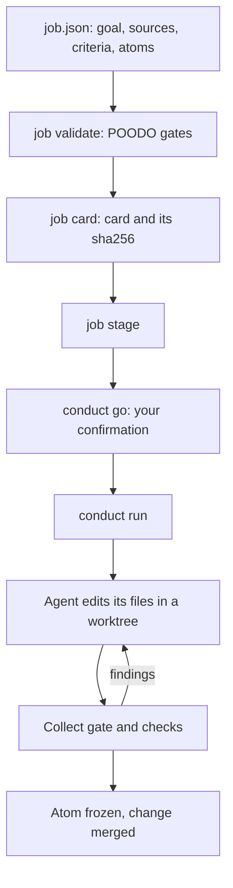

# Run a job

A job is a larger piece of work than one kernel: a change to a real repository, split into atoms that different
coding agents (Codex and Claude Code) work on at the same time. The job tool takes it from intake to your go, and the
Conductor runs it: each agent works in its own git worktree, and each change lands only after it passes the job's
checks.

This page walks through a whole job on a throwaway repository. A stub shell script stands in for the agent, so the
run calls no model; with real logins, the same commands launch real Codex and Claude Code workers.

## How a job flows



The manifest (`endoforge/job/1`) holds your goal in your own words, the primary sources, acceptance criteria with
checks, and atoms that each own a set of files. The job tool checks it against six gates (Pontificate, Observe,
Orient, Decide, Orchestrate, Loop) and fifteen invariants, I1 to I15. Each refusal names the invariant it breaks.
Nothing launches until you confirm the exact card by its sha256.

## 1. Make a throwaway repository and a job

Run this from the root of your EndoForge checkout. It creates a git repository with one file that says `TODO`, a
stub worker, and a one-atom job whose check is that the file no longer says `TODO`:

```sh
EF=$PWD
JOB=$(mktemp -d)
mkdir -p "$JOB/repo/src" "$JOB/home/.codex"
: > "$JOB/home/.codex/auth.json"
printf 'TODO\n' > "$JOB/repo/src/greeting.txt"
git -C "$JOB/repo" init -q -b main
git -C "$JOB/repo" -c user.email=demo@example.invalid -c user.name=demo add src
git -C "$JOB/repo" -c user.email=demo@example.invalid -c user.name=demo commit -q -m seed
printf 'Replace TODO in src/greeting.txt with a greeting.\n' > "$JOB/REQUEST.md"
printf '# notes\n' > "$JOB/NOTES.md"
printf '{}\n' > "$JOB/smoke.json"
cat > "$JOB/worker.sh" <<'W'
#!/bin/sh
for a in "$@"; do case "$a" in *READY*) echo READY; exit 0;; esac; done
echo 'Hello from a stub worker' > src/greeting.txt
W
chmod +x "$JOB/worker.sh"
cat > "$JOB/job.json" <<J
{
  "schema": "endoforge/job/1", "id": "greeting", "kind": "code", "title": "Greeting", "repo": "$JOB/repo",
  "goal": { "verbatim": "Replace TODO in src/greeting.txt with a greeting.", "by": "operator" },
  "brief": { "objective": "A greeting in src/greeting.txt", "acceptance": "The file no longer says TODO", "scope": "src/greeting.txt only",
             "authority": "operator", "assumptions": { "stated": [], "inferred": [] } },
  "sources": [{ "id": "req", "primary": true, "path": "$JOB/REQUEST.md", "governs": ["text"], "what": "the request" }],
  "criteria": [{ "id": "T1", "statement": "greeting.txt holds no TODO", "satisfiedBy": ["GREETING"], "requires": ["edit"],
                 "check": { "kind": "tests", "run": "! grep -q TODO src/greeting.txt" } }],
  "atoms": [{ "id": "GREETING", "engine": "codex", "aspects": ["text"], "capabilities": ["edit"], "files": ["src/greeting.txt"], "sources": ["req"], "checks": ["T1"] }],
  "gates": [], "resources": { "capacityDial": true, "throttle": "endoforge", "ownerBound": true, "health": ["true"] }, "ratchet": { "kind": "tests" },
  "criticalPath": "GREETING", "rival": "edit the file by hand", "deadline": "2099-01-01T00:00:00Z", "notes": "$JOB/NOTES.md",
  "proofs": { "smoke": { "engines": { "codex": true }, "receipt": "$JOB/smoke.json" } },
  "conductor": { "launcher": "local", "codexPool": "$JOB/worker.sh", "maxIterations": 2, "gate": "! grep -q TODO src/greeting.txt" }
}
J
cd "$JOB"
export ENDOFORGE_NOTIFY=none ENDOFORGE_JOBS=$JOB/none ENDOFORGE_VOLATILE=/nonexistent-volatile WORKER_STATE_DIR=$JOB/workers
```

What the parts of the manifest are for:

- `conductor.codexPool` is the command the Conductor runs for a Codex atom. Here it is the stub; by default it is
  `core/runtime/agent-pool.mjs`, which runs the real `codex` on the next free login.
- `conductor.launcher: "local"` starts each worker as a detached child. The default, `systemd`, starts it as a user
  unit in `heavy.slice`.
- `resources.health` is the health check run before launches. `true` always passes.
- `$JOB/home/.codex/auth.json` is an empty marker. Logins are discovered under the home directory, and step 4 points
  `HOME` there so the Conductor sees one Codex login and nothing else.
- The exported variables keep the demo quiet and self-contained: no desktop notifications, no lessons from earlier
  jobs, and the temporary directory counted as durable disk.

## 2. Validate the job

```sh
node "$EF/tools/job/bin/job.mjs" validate job.json --gate decide --offline
```

```text
Pontificate  passed  (I1)
Observe      passed  (I2, I4, I7)
Orient       passed  (I5, I6, I13, I15)
Decide       refused  (I3, I9, I11)
Orchestrate  not checked  (I8)
Loop         not checked  (I10, I12, I14)
REFUSED decide I14: open lessons from earlier jobs of this kind have not been retrieved into the card (job.mjs card)
REFUSED decide I1: the job card has not been confirmed by the user (job.mjs card, then job.mjs confirm)
```

It exits 1. Decide needs two things this job does not have yet: a card that carries lessons from earlier jobs of the
same kind, and your confirmation.

## 3. Render the card and stage it

```sh
node "$EF/tools/job/bin/job.mjs" card job.json --out card.md
node "$EF/tools/job/bin/job.mjs" stage job.json
```

`card` prints `card sha256 <64 hex characters>` and writes `card.md`: the goal, the brief, what governs what, the
atoms, the acceptance checks and the invariants. Read it; it is what you are about to approve. `stage` checks every
gate up to Decide except your go, prints the card and records a `STAGED` event.

## 4. Give the go and run

`conduct go` records your confirmation against that exact card. A different sha256 is refused.

```sh
SHA=$(node "$EF/tools/job/bin/job.mjs" card job.json --out card.md 2>&1 | awk '{print $3}')
node "$EF/tools/conductor/bin/conduct.mjs" go job.json --sha "$SHA" --by operator --words "go"
HOME=$JOB/home node "$EF/tools/conductor/bin/conduct.mjs" run job.json --tick 1 --max-ticks 20
node "$EF/tools/conductor/bin/conduct.mjs" status job.json
```

`go` prints `phase go`. `run` is the daemon in the foreground; `--max-ticks` makes it stop on its own, and it printed
`phase done`. `status` then showed:

```text
conductor: Greeting — phase done
budget: 1/200 launches, 2 iterations per atom
atoms: 1 frozen
  GREETING   frozen            iter 1  collect gate passed (no slice checks)

Greeting (code): 5 events
03:51:01    STAGED    Greeting: card ready for your go (2dd351bee435)
03:51:08    SMOKE     codex ok
03:51:08  * FIRED     Greeting fired: 1 atoms; 1 codex across 1 logins
03:51:09  * GATE      GREETING frozen at iteration 1: collect gate passed (no slice checks)
03:51:10  * DONE      Greeting done
```

The Conductor smoke-tested the Codex lane, launched the atom in its own worktree, collected its diff through the
gate, ran check T1, froze the atom and merged the change. The repository now has the worker's commit:

```sh
git -C repo log --oneline
cat repo/src/greeting.txt
```

```text
90f1297 greeting GREETING i1 (codex:default)
e3a157e seed
Hello from a stub worker
```

If the worker's change had failed the gate or a check, the Conductor would have relaunched the atom with the
findings. After `maxIterations` tries, or as soon as it failed the same way twice, it would have written an
escalation packet and emitted `NEEDS-COORDINATOR`.

## Run it with real agents

Drop `codexPool` from the `conductor` block (or set it to `core/runtime/agent-pool.mjs`), leave `HOME` alone, and run
the same commands. A Codex atom then runs `codex exec --sandbox workspace-write` in its worktree; a Claude atom
(`"engine": "claude"`) runs `claude -p` with edit tools and `--permission-mode acceptEdits`, model `opus` unless
`claudeModel` says otherwise. Claude launches pass the same subscription guard as the agent loop. Logins come from
`~/.codex/auth.json`, `~/.codex-accounts/<name>/auth.json` and `~/.claude-accts/<name>/.credentials.json`.

For a long job, start the daemon as a systemd user service in `heavy.slice` instead of in the foreground:

```sh
node "$EF/tools/conductor/bin/conduct.mjs" unit job.json --dry-run
```

`--dry-run` prints the `systemd-run` command without running it; drop it to start the service.

While it runs, `status`, `pause`, `resume`, `budget`, `lock` and `stop` steer it, and `node tools/job/bin/job.mjs
event` and `knowledge` record what you learn. The [job](../../../tools/job/README.md) and
[Conductor](../../../tools/conductor/README.md) READMEs list every command and manifest setting.

## Clean up

`cd` back to your checkout and delete the `$JOB` directory.
