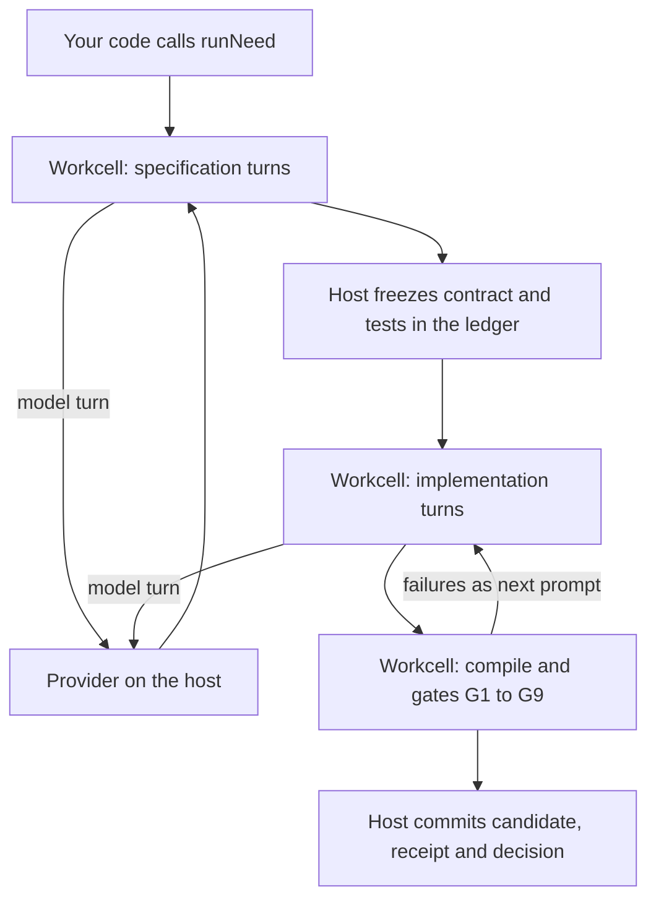

# Run the agent loop

This page shows how to run a coding agent inside a workcell from your own code: pick a provider, create a loop pool,
send needs, and read the result. It assumes you have done the [getting started](../tutorials/getting-started.md)
tutorial and run `make loop-setup`.

## What runs where



With `ENDOFORGE_LOOP=agent`, the agent's whole turn loop runs inside one V8 isolate workcell. The workcell holds the
conversation and the agent's files in memory. The agent edits them with four tool calls: `read_file`, `edit_file`,
`check` (compile with the pinned compiler, then run the gates) and `done`. The workcell asks the host for only two
things: a model turn, and the freeze, which writes the hashes of `CONTRACT.md` and `tests.json` to the ledger before
any code exists. No process is spawned and no temporary file is written between the need and the commit
([P-50](../../../experiments/P-50-in-isolate/RESULT.md)).

Agents edit `CONTRACT.md` and `tests.json` in the specification stage. Once they are frozen, agents can read them but
can only edit `kernel.ts` and `glue.json`.

## Run one need

This runs one need with Claude Code as the agent:

```js
import { createLoopPool } from './core/runtime/x1/loop.mjs';
import { runNeed } from './core/runtime/x1/pipeline.mjs';
import { WarmClaudeTransport } from './core/runtime/x1/transports.mjs';

const provider = new WarmClaudeTransport({ model: 'sonnet', effort: 'low' });
const pool = createLoopPool({ provider });
try {
  const result = await runNeed({ need, directory, pool, env: { ENDOFORGE_LOOP: 'agent' } });
  console.log(result.promoted, result.agent);
} finally {
  await pool.close();
  await provider.close();
}
```

- `need` is the request in plain words, a non-empty string. Say what the program must do, its inputs and outputs,
  and which inputs are errors; the agent turns it into the contract and tests.
- `directory` is where this need's ledger goes (`<directory>/ledger.sqlite`). Use a fresh path per need. Its last
  path segment becomes the candidate's id, which the agent repeats in `glue.json`.
- `env` selects the loop. Pass `{ ENDOFORGE_LOOP: 'agent' }` explicitly; without it, `runNeed` reads `process.env`.
- With no `instances` option, the transport uses the login in `~/.claude` (or `CLAUDE_CONFIG_DIR`). It must be a
  claude.ai Pro, Max or Team login; check with `claude auth status`.
- `provider.close()` stops the long-lived `claude -p` processes.

Two runnable versions are in `examples/`. [`agent-loop.mjs`](../../../examples/agent-loop.mjs) uses a scripted
provider and needs no account:

```sh
node examples/agent-loop.mjs
```

It prints `"promoted": true` after one failed round and three agent turns.
[`claude-agent-loop.mjs`](../../../examples/claude-agent-loop.mjs) is the snippet above with command-line options:

```sh
node examples/claude-agent-loop.mjs --model sonnet --effort low "Convert kilowatts to mechanical horsepower for 0 to 10000 kW."
```

We ran it here only with the P-56 stand-in CLI (`--command experiments/P-56-model-effort/fake-cli.mjs` and a
throwaway login directory), where it printed `"promoted": true` after one failed round. Real runs of this transport
are in [P-50](../../../experiments/P-50-in-isolate/RESULT.md) and [P-56](../../../experiments/P-56-model-effort/RESULT.md).

## Choose a provider

A provider answers model turns. The pool calls `provider.send({ session, messages, remaining, timeoutMs })` and
expects `{ text, usage }`, where `text` is the agent's reply (one JSON object with a `calls` array) and `usage` is a
non-negative integer token count. It calls `provider.endSession(session)` when a need finishes. `testDouble` is copied
into the result.

| Provider | From | Use it for |
|---|---|---|
| `scriptedProvider(script)` | `core/runtime/x1/transports.mjs` | Tests and demos. `script({ session, messages, turn, remaining })` returns `{ text, usage }`. Labelled `testDouble: true`. |
| `new WarmClaudeTransport({ model, effort, instances })` | same | Claude Code. One long-lived `claude -p` per lane in stream-json mode; about 15 ms of overhead per turn after the first ([P-50](../../../experiments/P-50-in-isolate/RESULT.md)). |
| `new SpawnClaudeTransport({ model, effort, configDir })` | same | Claude Code, one `claude -p` process per turn; about 343 ms per turn. |
| Your own object | | Anything with `send` and `endSession` as above. |

Both Claude transports run `claude -p` with its tools off (`--tools ""`), no MCP servers, no session persistence and
EndoForge's own system prompt, so Claude Code acts only as the model. Each turn first passes the subscription guard,
which refuses with exit 78 unless the login is a claude.ai Pro, Max or Team subscription, and the usage governor,
which parks new calls before the login's usage window runs out. `instances` takes
`[{ name, configDir, lanes }]` to spread turns over several logins. Every option is in the
[configuration reference](../../configuration/configuration-reference.md#claude-transports).

### Codex

Codex is not a provider: it edits files in a working directory instead of replying with tool calls. It runs on the
`isolate` path, where `codex exec` writes the files on the host and the freeze, compile, gates and commit happen in a
workcell. Create the pool without a provider and pass the Codex command and login in `env`:

```js
const pool = createLoopPool();
const result = await runNeed({ need, directory, pool,
  env: { ...process.env, ENDOFORGE_LOOP: 'isolate', ENDOFORGE_CODEX_CMD: 'codex', CODEX_HOME: `${process.env.HOME}/.codex` } });
```

`CODEX_HOME` holds a ChatGPT-plan login made with `codex login`; `codex login status` should print
`Logged in using ChatGPT`. [`examples/codex-loop.mjs`](../../../examples/codex-loop.mjs) is the same with the
settings read from the environment:

```sh
ENDOFORGE_CODEX_CMD=codex CODEX_HOME=~/.codex node examples/codex-loop.mjs "<need>"
```

To spread needs over several Codex logins, set `ENDOFORGE_CODEX_CMD` to
`["node","<absolute path>/core/runtime/agent-pool.mjs"]`: the account pool runs `codex` with the next free login and
cools a login down when it hits a rate limit. We ran the example here with the `fake-codex.mjs` test fixture as the
command, directly and through the pool. Real Codex runs are in [P-22](../../../experiments/P-22-real-need-to-candidate/RESULT.md)
and [P-28](../../../experiments/P-28-p21-nov2/RESULT.md). The `ENDOFORGE_CODEX_*` variables in the
[configuration reference](../../configuration/configuration-reference.md#x1-loop-and-generation) tune its prompts,
effort and sessions.

## The three loop paths

| `ENDOFORGE_LOOP` | Who generates | Where checks run | Pool |
|---|---|---|---|
| `agent` | A provider, one turn at a time | The whole agent loop in one workcell | `createLoopPool({ provider })` |
| `isolate` | `codex exec` on the host | Freeze, compile, gates and commit in a workcell | `createLoopPool()` |
| unset | `codex exec` on the host | Compile on the host (`ENDOFORGE_ASC_CMD`), gates in a workcell | `new IsolatePool({ hostPort: 'core/runtime/x1/host.mjs' })` |

The unset path, called `current`, is the original one: it spawns the compiler and writes temporary files on the
host, and it is where evaluator synthesis and the library are wired in (see
[turn on evaluator synthesis](turn-on-evaluator-synthesis.md) and [reuse with the library](reuse-with-the-library.md)).
The `agent` and `isolate` paths keep everything up to the commit inside the workcell. With a scripted model,
[P-50](../../../experiments/P-50-in-isolate/RESULT.md) measured the time spent outside the model per candidate at
1,472 ms on `current`, 301 ms on `isolate` and 132 ms on `agent` (p50). Use `agent` for Claude Code, `isolate` for
Codex, and `current` when you need synthesis or the library.

## Set the pool

`createLoopPool(options)` creates the workcells. The ones you are most likely to change:

| Option | Default | What it does |
|---|---|---|
| `size` | `1` | Workcells. Each carries one need at a time while it computes. |
| `isolation` | `process` | `process` runs each cell as a Node process under the permission model; `thread` uses worker threads. |
| `waits` | `release` | `release` parks the agent's state in the ledger during a model turn and frees the cell; `hold` keeps the cell busy while it waits. |
| `jobTimeoutMs` | `60000` | Compute budget per job, paused while the cell waits for the host. |
| `jobDeadlineMs` | `900000` | Wall-clock limit per job. |
| `rates` | `null` | A `createStageRates()` object that records how busy each stage is. |

With `waits: 'release'`, a cell is never held during a model turn: in
[P-57](../../../experiments/P-57-release-waits/RESULT.md) none of 225 sends held a cell, 4 cells carried 64
candidates at 8.1 times the throughput, and each resume added about 6 ms. Use `hold` only to compare.

Workcells keep the pinned compiler warm, so the first need waits for the cells to start; `await pool.ready()` does
that up front.

## Set the agent's limits

Pass `limits` to `runNeed`. The default is `{ maxTurns: 6, maxTokens: 64000 }`.

| Key | What it does |
|---|---|
| `maxTurns` | Turns per stage. A stage that has not finished by then ends with `max_turns`. |
| `maxTokens` | Token budget per need, counted from the provider's `usage`. Reaching it ends with `max_tokens`. |
| `oracle` | When true, the specification stage also writes `reference.js`, and each frozen expectation is checked against the contract's formula and the reference before the freeze. Off by default; see [P-71](../../../experiments/P-71-oracle-round2/RESULT.md). |

`runNeed` also takes `deadline`, an absolute time in milliseconds since the epoch. No model turn starts after it.

## Read the result

| Field | Meaning |
|---|---|
| `promoted` | `true` when the ledger's decision is `promote`. |
| `candidate`, `receipt`, `decision` | The candidate's content hash, the receipt id and the decision record's hash. |
| `status` | The receipt's outcome state, such as `passed` or `rejected`. |
| `agent` | `{ turns, tokens, tool_calls, exit_reason }`. `exit_reason` is `stop` when the agent finished with passing checks. |
| `rounds` | One entry per `check`: `{ round, source, failures }`, where `failures` is `null` or `{ gates, tests }`. |
| `content` | The candidate's files and compiled module as JSON. |
| `modelMs`, `timings` | Time spent waiting for the model, and per stage. |
| `error` | Set when the need failed before a decision, for example when no specification passed its own check. |
| `inconclusive` | Set when the outcome is unknown, for example a lost workcell. |

## Resume

Run `runNeed` again with the same `directory` and it resumes from the ledger. A promoted need returns at once with
`resumed: true` and no model call. A need that stopped after the freeze, before any decision, continues from its frozen
contract and tests, and with `waits: 'release'` from the last parked turn.

## Next

- [Turn on evaluator synthesis](turn-on-evaluator-synthesis.md) for a second, independent evaluator.
- [Split work with the atomizer](split-work-with-the-atomizer.md) for work larger than one kernel.
- [Candidate loop](../../architecture/candidate-loop.md) for how the gates and the ledger decide.
