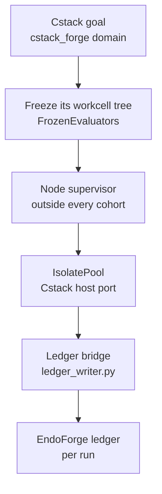

# Interface control: Cstack

Cstack (code name Mjölnir) runs EndoForge's workcell substrate as part of its own system: it vendors EndoForge's
ledger, frozen evaluator, evaluator engine, `IsolatePool` and capacity planner, and runs its own host port in
EndoForge workcells. This document records which EndoForge names Cstack calls and which files it copies, so a change
here that would break Cstack is recognized before it merges.

| Side | Repository | Role |
|---|---|---|
| Provider | [endoforge](https://github.com/Akilleez-QA/endoforge) | Lifecycle model, ledger, evaluator and gates, workcell pool, capacity planner |
| Consumer | [cstack](https://github.com/Akilleez-QA/cstack) | A pinned copy in `vendor/endoforge/` |

## How Cstack uses it

A goal in Cstack's `cstack_forge` domain freezes Cstack's workcell tree as the evaluator in an EndoForge ledger,
starts one Node supervisor outside every cohort, and runs Cstack's host port in an `IsolatePool`. Inside the pool the
vendored workcell calls the vendored gates and evaluator (`core/engine/`) and the ledger bridge. POODO evidence is
witnessed into the EndoForge `Ledger` through Cstack's `EndoforgePort` adapter.

## Pinned version

Cstack vendors EndoForge commit `ea7b8d651ce23acd100f5a5d81d6e8fda0d604a3` (the merge of #131), on `main`, checked
on 2026-11-08 against Cstack's `contracts/SOURCE-PINS.json` and `vendor/endoforge/SOURCE-MANIFEST.json`. Cstack's
`tools/pin_endoforge.py` builds the copy from a fixed list of 27 files, strips Python comments, and refuses a commit
that is not on EndoForge `main`. Cstack's `docs/icd/icd-endoforge-pin.md` describes the pin.

## Vendored slice

| Area | Files |
|---|---|
| Lifecycle | `core/__init__.py`, `core/lifecycle.py`, `tests/test_endoforge_core_boundary.py` |
| Ledger | `core/ledger/__init__.py`, `ledger.py`, `frozen.py`, `record.schema.json`; `tools/ledger_writer.py`, which the bridge runs |
| Engine | `core/engine/evaluator.mjs`, `gates.mjs`, `frozen.py`; `tools/factory_quality/index.mjs`, which the gates import |
| Workcells | `core/runtime/isolate-pool.mjs`, `isolate-workcell.mjs`, `isolate-cgroup.mjs`, `isolate-wasm.mjs`, `isolate-wasm-compile.mjs`, `isolate-ledger.mjs` |
| Dump list | `core/runtime/dump-list.mjs`, `tools/dump_list.py` |
| Capacity | All six files of `core/runtime/capacity/` ([capacity ICD](../interfaces/capacity-icd.md)); vendored, not called |
| Licence | `LICENSE` |

## Interface

Cstack's `docs/icd/icd-endoforge.md` section 8 is the authoritative list. At the current pin Cstack calls:

| EndoForge interface | Cstack use | Reference |
|---|---|---|
| `core.ledger.ledger.Ledger(path)`, `.append(...)`, `.records()` | Opens the run ledger, records the task and admitted input, reads receipts during recovery | [Ledger ICD](../interfaces/ledger-icd.md#python-interfaces) |
| `core.ledger.frozen.FrozenEvaluators(ledger).freeze(...)` | Freezes Cstack's workcell tree as the evaluator for one task, bound to the decision | [Ledger ICD](../interfaces/ledger-icd.md#python-interfaces) |
| `new IsolatePool({...})`, `ready()`, `run(job)`, `close()` | Options: `hostPort`, `size`, `isolation`, `trustedWasmModules`, `wasmMemoryMaxMb`, `resourceLimits`, `frozenThroughLedger: true`, `hostCalls`, `warm`, `jobTimeoutMs`, `cgroupRoot` | [V8 workcell pool interface](../interfaces/ledger-icd.md#v8-workcell-pool-interface) |
| `ENDOFORGE_LEDGER_JOURNAL`, read by `tools/ledger_writer.py` | Set to `<ledger>.journal` for every run | [Ledger writer journal](../interfaces/ledger-icd.md#ledger-writer-journal) |
| `ENDOFORGE_DUMP_LIST`, read by `core/runtime/dump-list.mjs` and `tools/dump_list.py` | Not set; inherited from the host. Cstack passes no `dumpList`, so the pool uses EndoForge's defaults | [Workcells](../architecture/workcells.md#the-dump-list) |
| `tests/test_endoforge_core_boundary.py` | Run as Cstack's import-boundary check | |

The Python lifecycle package `core` is vendored too. Its public names are those in `core.__all__`: `LEGAL`,
`Artifact`, `LifecycleError`, `LifecycleRecord`, `PoodoDecision`, `QualificationReceipt`, `State`, `Transition`,
`TransitionProposal`, `digest`. `core` imports no concrete integration;
[tests/test_endoforge_core_boundary.py](../../tests/test_endoforge_core_boundary.py) checks this, and
[tests/test_endoforge_lifecycle.py](../../tests/test_endoforge_lifecycle.py) checks the lifecycle behaviour.

## Not included

- The X1 loop (`core/runtime/x1/`), the transports, the agent pool, the contained runner, the library and the
  experiments.
- Agent runners, caching and receipts in `tools/`.

## Change control

A change to a name in the table above, or to the behaviour of a vendored file, is a breaking change for Cstack.
Record it in [CHANGELOG.md](../../CHANGELOG.md); Cstack moves its pin in a separate pull request. Compatibility is
checked on the Cstack side by its pin manifest and by running `tests/test_endoforge_core_boundary.py`.

## Requirements addressed

REQ-CORE-001, REQ-LIFE-001 to REQ-LIFE-005, REQ-LEDGER-001, REQ-LEDGER-002, REQ-LEDGER-003, REQ-DOMAIN-001,
REQ-ENGINE-001, REQ-ENGINE-002, REQ-ISO-001 to REQ-ISO-017 (vendored code); REQ-CAP-001 (vendored, not called).

## Document control

| Field | Value |
|---|---|
| Document ID | ENDOFORGE-ICD-CSTACK |
| Version | 3.0 |
| Status | Baselined |
| Owner | Akilleez-QA maintainer |
| Date | 2026-11-08 |
| Baseline commit | 63e95c7 |
| Applies to | endoforge main at baseline commit |
| Classification | Self-assessed Class E analog; not safety-critical (see [SMP §1](../plan/software-management-plan.md#1-software-classification-self-assessed)) |

> Organized after [NPR 7150.2D](https://nodis3.gsfc.nasa.gov/displayAll.cfm?Internal_ID=N_PR_7150_002D_&page_name=all), [NASA-STD-8739.8B](https://standards.nasa.gov/standard/nasa/nasa-std-87398) and the [NASA Software Engineering Handbook](https://swehb.nasa.gov/display/SWEHBVD/7.18+-+Documentation+Guidance) documentation guidance. This is not a NASA compliance determination or certification. The software classification is a self-assessed analog (Class E, not safety-critical); no NASA authority, independent verification and validation, or hazard analysis is asserted. The document describes the implementation inspected at the baseline commit.

### Change history

| Version | Date | Commit | Change | Reviewed in |
|---|---|---|---|---|
| 1.0 | before 2026-11-08 | — | Content checked by PR #129 at `49f388f`; Cstack pin re-checked 2026-11-08 (still `6dffea9`) | earlier PRs |
| 2.0 | 2026-11-08 | `4d692a4` | Metadata header, requirements addressed and change history added; content re-baselined | #131 |
| 3.0 | 2026-11-08 | `63e95c7` | Pin updated to `ea7b8d6` and 27 files (dump list added), checked against Cstack's manifest; `ENDOFORGE_DUMP_LIST` added to the interface; rewritten with the flow; metadata moved to this section | this PR |
