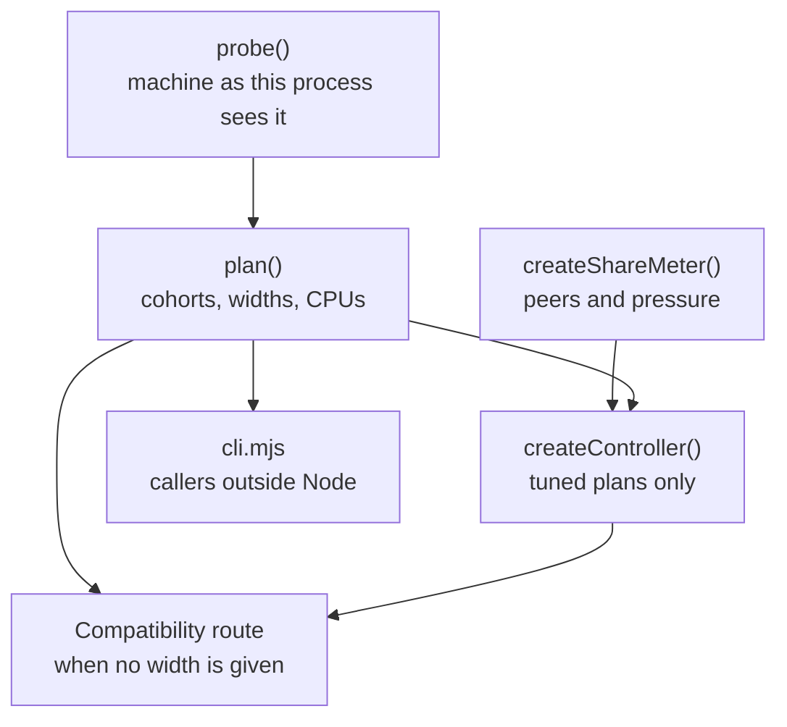

# Capacity planner interface control document (Mjölnir)

The capacity planner decides how many cells a job runs at once (its width), which CPUs they run on, and how the job
is split into cohorts, from the machine it is actually on: the CPUs it may use, its cgroup CPU quota, which CPUs share
an L3 cache, simultaneous multithreading, free memory, and what other jobs are using right now. Widths are measured
and fitted to the machine, never hand-picked. This document is the interface to
[core/runtime/capacity/](../../core/runtime/capacity/index.mjs).

The planner is part of the Cstack family (code name Mjölnir). EndoForge is its home; Cstack vendors it. It depends on
nothing beyond Node's standard library, writes nothing, and reads only `/proc` and `/sys` (on macOS it runs
`sysctl -n hw.perflevel0/1.physicalcpu` and `vm_stat` instead).

## Example

On a 16-core, 32-thread machine with two L3 domains and no CPU quota:

```console
$ node core/runtime/capacity/cli.mjs plan --queues=1
```

prints one JSON line `{ interface, probe, plan }`. Trimmed to the interesting fields:

```json
{ "interface": 1, "allotment": 32, "domains": 2, "cores": 16,
  "plan": { "mode": "fixed", "tuned": false, "width": 16, "max": 16, "pinned": true },
  "cohorts": [ { "queue": 0, "width": 8, "max": 8, "share": 16 },
               { "queue": 0, "width": 8, "max": 8, "share": 16 } ] }
```

One cohort per cache domain, each as wide as that domain's physical cores, each pinned to its domain's CPUs.

## Who uses it



- The [compatibility route](../architecture/compatibility-lane.md) (`tools/tscheck/contained-route.mjs`) calls
  `plan()` when the caller gives no width; an explicit width always wins.
- `IsolatePool` does not call it. Its default size is `availableParallelism()`, which
  [P-68](../../experiments/P-68-tuner-occupancy/RESULT.md)'s precommitted rule restored after the planner's width lost
  in one of two rounds; the rounds disagreed, so the evidence is weak either way.
- Callers that aren't Node use the command interface.

## Library interface

| Export | Contract |
|---|---|
| `probe()` | The machine as this process sees it, read once and cached ([probe record](#probe-record)) |
| `probeMachine(host?)` | The same, uncached; `host` replaces the readers (`read`, `exists`, `parallelism`, `freeMb`, `os`) for tests |
| `plan({ queues = 1, allotment?, probe?, policy? })` | Cohorts for `queues` independent queues within `allotment` CPUs (default: the probe's) ([plan record](#plan-record)) |
| `defaultWidth(options?)` | `plan(options).width` |
| `POLICY` | The default: `{ mode: 'fixed', width: 'cores', perDomain: 1, headroom: 1.25 }` |
| `TUNED_POLICY` | `{ mode: 'tuned', cap: 'occupancy', headroom: 1.25, oversubscribe: 3, ram: 0.75 }`: the same placement with an online tuner capped by measured occupancy. Opt-in |
| `P67_TUNED_POLICY` | `{ mode: 'tuned', cap: 'share', headroom: 1.25 }`: the tuner as P-67 shipped it, kept for comparison |
| `createTuner({ start, max, ...TUNER_DEFAULTS })` | Fed one window at a time: `observe({ completions, elapsedMs, cpuMs?, saturated? })` returns the next width; `setBound(n)` moves the ceiling (a change of at least max(2, 20%) that persists for `boundsWindows` calls); `width`, `phase` (`explore` or `settled`) and `history` |
| `createController({ plan, apply, cpuMs?, rssMb?, backlog?, probe?, meter?, memory?, windowMs?, minCompletions? })` | Runs a tuner for a plan's cohorts: call `started()` at dispatch and `completed(decided)` at the end; it closes 1 s windows, samples the share meter, sets the bound and calls `apply(widths)` when a width changes. A plan with `tuned: false` never changes |
| `createOccupancy()`, `occupancyCap({ share, u, headroom, max, memoryCells })` | Occupancy `u` is CPU time per in-flight cell second. The estimate is the running maximum of a 3-window median, decaying 0.5% per window. Cap per cohort = min(max, ceil(headroom × share ÷ u), memory cells) |
| `createShareMeter(probe?)` | `sample()` returns `{ share, mode, peers, othersCpus, throttledMs, level, legacyShare, levels, source }` since the previous sample ([share rule](#share-rule)) |
| `createMemoryMeter(probe?)` | `headroomMb()`: `MemAvailable`, lowered to the memory cgroup's limit minus its use |
| `fairShare(quota, peers)` | The max-min fair claim of one more job beside peers using `peers` CPUs (`Infinity` wants all it can get) |
| `parseCpuList`, `ACTIVE_PEER_CPUS` (0.5), `STARVED` (0.1), `TUNER_DEFAULTS`, `OCCUPANCY_DEFAULTS`, `INTERFACE_VERSION` (1) | Helpers and constants |

### Probe record

`{ os, cpus, quota, quotaCgroup, levels: [{ cgroup, quota, branch }], ownCgroup, allotment, domains: [{ cpus, cores }],
cores, smt, perfLevels, memory: { availableMb, headroomMb, limitMb, cgroup }, taskset, notes }`

- `cpus` are the allowed CPU ids: the affinity mask intersected with `cpuset.cpus.effective`.
- `allotment` = min(allowed CPUs, the tightest `cpu.max` on the process's cgroup chain).
- `domains` group allowed CPUs by shared L3 cache (`cache/index*/level == 3`, `shared_cpu_list`); `cores` counts
  distinct `thread_siblings_list` groups.
- `perfLevels` is `{ performance, efficiency }` physical cores on macOS, else `null`; mixed cores count as one domain,
  and `notes` says so.
- On macOS, memory headroom is free + inactive + speculative + purgeable pages from `vm_stat`.
- Anything unreadable degrades to one domain of `availableParallelism()` CPUs with no quota, and adds a line to
  `notes`. Treat any line in `notes` as "this figure is a guess".

### Plan record

`{ mode, tuned, cap, headroom, ram, allotment, queues, pinned, cohorts: [{ queue, width, max, share, cpus }], width,
max, notes }`

- `pinned` is true when `taskset` exists, there is more than one L3 domain, and the allotment is at least two CPUs
  per domain. Then there is one cohort per domain (times `perDomain`), each with that domain's `cpus`. Otherwise one
  unpinned cohort per queue, and `notes` says why.
- Fixed with `width: 'cores'`: each cohort's `width` = `max` = min(its physical cores, ceil(its share)). An integer
  `width` fixes it outright.
- Tuned: `width` starts at min(its share, its physical cores, `max`); `max` is min(its threads, ceil(headroom ×
  share)), or with `cap: 'occupancy'`, ceil(oversubscribe × share), and the controller's occupancy cap keeps the live
  bound below it.
- `queue` assigns cohorts to queues round-robin. `width` and `max` at the top are the cohort sums.

### Share rule

For every cgroup on the job's chain with a finite `cpu.max`, the meter reads the job's branch, its siblings (peers)
and their `cpu.pressure`. A peer is active above 0.5 CPU, and starved when some of its tasks waited for CPU more than
10% of the window. With no active peer at any level the job is `lone` and its share is the whole allotment. Otherwise
it is `shared`, and each level's claim is `fairShare(quota, peers)`, where a starved peer wants an equal split and any
other peer wants what it used. The share is the smallest claim, clamped to [1, allotment]. `legacyShare` is P-67's
rule: max(quota − others, quota ÷ (1 + peers)) at the tightest level.

## Command interface

[cli.mjs](../../core/runtime/capacity/cli.mjs) prints one JSON line with `interface: 1`; a usage error exits 2.

| Command | Output |
|---|---|
| `node core/runtime/capacity/cli.mjs probe` | `{ interface, probe }` |
| `node core/runtime/capacity/cli.mjs plan [--queues=N] [--allotment=CPUS]` | `{ interface, probe, plan }` |
| `node core/runtime/capacity/cli.mjs share [--ms=1000]` | `{ interface, share }`, sampled over `ms` |

The probe describes the calling process, so run the CLI inside the cgroup and affinity the job will get (for example
under the same `systemd-run` scope or `taskset`).

## Evidence

The tuner's thresholds and the default policy come from [P-63](../../experiments/P-63-usl-width/RESULT.md) and
[P-67](../../experiments/P-67-adaptive-width/RESULT.md); the occupancy cap and the share rule from
[P-68](../../experiments/P-68-tuner-occupancy/RESULT.md), where the tuned policy missed its stability, portability and
fair-share bars, which is why it is opt-in.

## Requirements addressed

REQ-CAP-001. A field removal or change of meaning bumps `INTERFACE_VERSION` in
[index.mjs](../../core/runtime/capacity/index.mjs).

## Document control

| Field | Value |
|---|---|
| Document ID | ENDOFORGE-ICD-CAPACITY |
| Version | 3.0 |
| Status | Baselined |
| Owner | Akilleez-QA maintainer |
| Date | 2026-11-08 |
| Baseline commit | 63e95c7 |
| Applies to | endoforge main at baseline commit |
| Classification | Self-assessed Class E analog; not safety-critical (see [SMP §1](../plan/software-management-plan.md#1-software-classification-self-assessed)) |

> Organized after [NPR 7150.2D](https://nodis3.gsfc.nasa.gov/displayAll.cfm?Internal_ID=N_PR_7150_002D_&page_name=all), [NASA-STD-8739.8B](https://standards.nasa.gov/standard/nasa/nasa-std-87398) and the [NASA Software Engineering Handbook](https://swehb.nasa.gov/display/SWEHBVD/7.18+-+Documentation+Guidance) documentation guidance. This is not a NASA compliance determination or certification. The software classification is a self-assessed analog (Class E, not safety-critical); no NASA authority, independent verification and validation, or hazard analysis is asserted. The document describes the implementation inspected at the baseline commit.

### Change history

| Version | Date | Commit | Change | Reviewed in |
|---|---|---|---|---|
| 1.0 | before 2026-11-08 | — | Accuracy pass in PR #129 | earlier PRs |
| 2.0 | 2026-11-08 | `4d692a4` | Metadata header, requirements addressed and change history added; content re-baselined | #131 |
| 3.0 | 2026-11-08 | `63e95c7` | Rewritten from the code with a run example; all exports listed; plan record gains `cap` and `ram`; metadata moved to this section | this PR |
