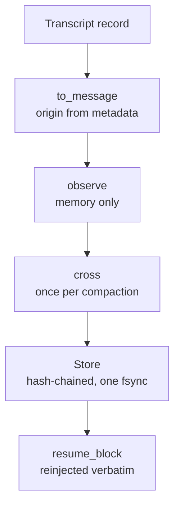

# Constraint record interface

A long agent session compacts its history into summaries, and constraints a person stated early ("don't touch the
public API", "no new dependencies") can be lost in the summary. The constraint record keeps them apart: an
append-only, hash-chained log of the person's own words, extracted once per compaction and reinjected verbatim when
the session resumes. Only text a person typed can become an active constraint, and the record grants no permission.

Code: [core/constraints](../../core/constraints/record.py), with the durable store in
[tools/constraint_store.py](../../tools/constraint_store.py). Off unless a caller passes it. Evidence and limits:
[P-55](../../experiments/P-55-constraints/RESULT.md); neither extractor has met its adoption bar.

## Flow

## Interface

| Interface | Contract |
|---|---|
| `core.constraints.port` | `Message(id, origin, text)`, `Origin` (`human`, `quoted`, `tool`, `agent`, `assistant`, `system`), `Segment`, `Candidate`, and the `Extractor`, `Store` and `ConstraintPort` protocols; errors `ExtractionFailed`, `PromotionRefused`, `RecordCorrupt` |
| `core.constraints.transcript.to_message(record)` | Classifies a transcript record by its metadata, never its text: assistant records are `assistant`; tool results `tool`; compact summaries and meta records `system`; sidechains `agent`; a user record is `human` only when its origin says a human typed it |
| `ConstraintRecord(store, extractor)` | The port. Extractors: `RuleExtractor` (`rule-v2`) and `ModelExtractor` (`model-v2`) |
| `.observe(message)` | Appends to memory. No process, no I/O |
| `.cross()` | The one durable crossing per compaction: splits pending messages into segments, extracts candidates from human segments, appends the new events and a `covered` marker in one store write, and clears the pending list. Returns `{ ok, added, failure, unverified }` |
| `.resume_block()` | `<constraint-record>`: a header saying the constraints restrict the work and grant nothing, then each active constraint as a JSON string with its id and source message id, then any refusal count, `EXTRACTION FAILED` and `NOT YET EXTRACTED` lines |
| `.set_status(id, status, by)` | Appends a status event (`active`, `withdrawn`, `superseded`). Only a `human` message may do this, and only on a constraint whose origin is `human`; otherwise `PromotionRefused` |
| `tools.constraint_store.JsonlStore(path)` | Durable store: hash-chained JSON lines, the chain verified before every append, one `fsync` per append, file mode 0600 |
| `StepHarness(constraints=port)` | Crosses before each fold and adds `constraint_record` to the model's view after the first checkpoint ([tools/step_harness](../../tools/step_harness/README.md)) |

## Provenance rules

- Only segments of `human` messages are given to the extractor. A candidate the extractor marks unverified, because
  it is not an exact substring of a human segment or it reports someone else's words, is recorded `refused` with
  reason `unverified`.
- Inside a human message, tagged blocks, code fences, `>` quote lines, pasted content and system reminders are
  `quoted` segments, and so is a whole message over 100,000 characters.
- Tool, agent, assistant and system text, and quoted segments, are scanned with the rule
  extractor only to record matches as `refused` with reason `origin:<origin>`. They can never be promoted.
- Constraint ids are the first 16 hex digits of the SHA-256 of message id, offset and text, so replaying a transcript
  after a crash adds nothing twice.

## Failure

An extractor exception appends a `failure` event, keeps the messages pending, and makes the resume block say
`EXTRACTION FAILED` for that range and `NOT YET EXTRACTED` for each pending message, until a later crossing covers
them. A broken chain raises `RecordCorrupt`. An extractor that returns nothing is not a failure, so low recall is
silent; P-55 measured it.

## Requirements addressed

REQ-CONSTRAINT-001, REQ-CONSTRAINT-002.

## Document control

| Field | Value |
|---|---|
| Document ID | ENDOFORGE-ICD-CONSTRAINT |
| Version | 3.0 |
| Status | Baselined |
| Owner | Akilleez-QA maintainer |
| Date | 2026-11-08 |
| Baseline commit | 63e95c7 |
| Applies to | endoforge main at baseline commit |
| Classification | Self-assessed Class E analog; not safety-critical (see [SMP §1](../plan/software-management-plan.md#1-software-classification-self-assessed)) |

> Organized after [NPR 7150.2D](https://nodis3.gsfc.nasa.gov/displayAll.cfm?Internal_ID=N_PR_7150_002D_&page_name=all), [NASA-STD-8739.8B](https://standards.nasa.gov/standard/nasa/nasa-std-87398) and the [NASA Software Engineering Handbook](https://swehb.nasa.gov/display/SWEHBVD/7.18+-+Documentation+Guidance) documentation guidance. This is not a NASA compliance determination or certification. The software classification is a self-assessed analog (Class E, not safety-critical); no NASA authority, independent verification and validation, or hazard analysis is asserted. The document describes the implementation inspected at the baseline commit.

### Change history

| Version | Date | Commit | Change | Reviewed in |
|---|---|---|---|---|
| 1.0 | before 2026-11-08 | — | Written with P-55 | earlier PRs |
| 2.0 | 2026-11-08 | `4d692a4` | Metadata header, requirements addressed and change history added; content re-baselined | #131 |
| 3.0 | 2026-11-08 | `63e95c7` | Rewritten from the code with the problem it solves, the flow and the classification rules; metadata moved to this section | this PR |
