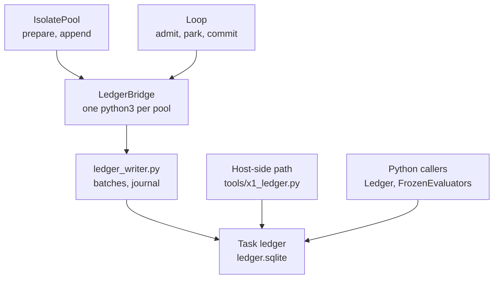

# Ledger interface control document

The ledger is where EndoForge keeps the truth about a task: what was asked, which evaluator was frozen, which
candidates were tried, what each evaluation observed and what was decided. It is one append-only, hash-chained SQLite
file per task. This document is the interface to it and to everything that writes it: the Python ledger, the frozen
evaluator, the persistent ledger bridge and its group-commit writer, the workcell pool, and the loop actions that
freeze, park, commit and promote.

## Who writes the ledger



| Writer | When | Durability |
|---|---|---|
| `LedgerBridge` + `tools/ledger_writer.py` | Every `IsolatePool` and every in-cell loop path | Group commit; one journal `fdatasync` per batch, across ledgers |
| `python3 -B -m tools.x1_ledger freeze \| register \| promote` | The `current` loop path, one process per step | `synchronous=FULL` per transaction |
| `core.ledger.ledger.Ledger(path).append` | Python callers, including Cstack | `synchronous=FULL` per transaction |

## Records

Each row of `records(seq, id, body, previous, hash)` holds one canonical-JSON record; `hash` chains it to the row
before it. Triggers refuse `UPDATE`, `DELETE` and an `INSERT` that reuses an id or sequence. Every read verifies every
row's sequence, link and hash; a cache skips only re-decoding rows whose sequence, hash and id still match a verified
row. Records are validated against [record.schema.json](../../core/ledger/record.schema.json) and by
`validate` in [ledger.py](../../core/ledger/ledger.py).

| Kind | Holds |
|---|---|
| `task` | The intent (the need) and its acceptance label |
| `admitted_input` | An input admitted for the task, with its origin |
| `frozen_evaluator` | The evaluator bundle (`files`, `configuration`, `residual`, `invariant_version`), its digest, and who confirmed and qualified it. Its id is `evr:` plus the SHA-256 of its encoded data. A second one for the same task must be a revision citing new admitted evidence, and a revision after a recorded failure must not change the content |
| `candidate` | The candidate's content; its id is the SHA-256 of that content |
| `receipt` | One evaluation of one candidate: the precommit (observable, acceptance boundary, oracle and its digest, artifact identity, environment, failure meaning, stop condition), `delivery_state`, `outcome_state` and the observations |

Field tables are generated in the [data dictionary](../data/data-dictionary.md#3-ledger-records-generated). Beside
the chain, outside the hash, a ledger may hold `ledger_journal(version, digest)` (written by the bridge),
`x1_continuations(seq, state, sha256, body)` (parked agent turns) and `x1_decisions(receipt, candidate, body)` (agent
path decisions). Record versions 0 and 1 and the hash construction are unchanged since the move from `tools.ledger`
to `core.ledger`; existing ledgers need no conversion. The ledger grants no execution or activation authority.

## Python interfaces

| Interface | Contract |
|---|---|
| `from core.ledger.ledger import Ledger` | `Ledger(path)` opens or creates a ledger. `append(record)` validates and chains one record; `records()` reads and verifies all; `admit(record)` admits a version 1 record; `lineage(id)` follows source references |
| `from core.ledger.frozen import FrozenEvaluators` | `freeze(root, **components)` snapshots an evaluator tree (refusing links, special files and credential file names) and appends the `frozen_evaluator`; `require_frozen(identity, root, ...)` re-snapshots and refuses on any difference; `evaluate(root, receipt, judge, ...)` records an evaluation receipt |
| `python3 -B -m core.ledger.frozen freeze LEDGER TREE MANIFEST` | Freezes the tree with the JSON manifest's components and prints the identity; a refusal exits 2 |
| `python3 -B -m core.engine.frozen` | Reads `{ledger, identity, root}` on stdin, re-verifies the frozen tree, prints `{identity, digest, bundle}`; a refusal exits 3, an OS or SQLite error 75 |
| `import core` | The lifecycle exports only; opens no ledger and loads no integration |

## Engine interfaces

| Interface | Contract |
|---|---|
| [core/engine/evaluator.mjs](../../core/engine/evaluator.mjs) | `evaluateCandidates(reference, candidates, port, { verifyFrozen? })`: verifies the frozen evaluator, evaluates every candidate in round 0 (universal gates, then each frozen invariant, then the residual, then measurement), evaluates the Pareto frontier of the survivors again in round 1, and returns `{ stage, frozen_evaluator, evaluator_digest, attempts, frontier }`. An unknown host outcome stops with `outcome_unknown`. Also exports `requireFrozen` and `paretoFrontier` |
| [core/engine/gates.mjs](../../core/engine/gates.mjs) | `GATE_ORDER` (`schema`, `interface`, `bounds`, `determinism`, `forbidden_effects`), each gate, and `runUniversalGates`; first failure stops |
| Invariant callback | `port.invariant(name, candidate, bundle, round)` for each name in the frozen `configuration.invariants`, returning `{ passed, reason }` with a nonempty reason. False rejects before measurement; malformed evidence rejects; a throw, including an unknown name, stops with `outcome_unknown`. The engine imports no registry; the caller resolves names |

## V8 workcell pool interface

`IsolatePool` is in [isolate-pool.mjs](../../core/runtime/isolate-pool.mjs); [Workcells](../architecture/workcells.md)
explains it. This section is its contract with the ledger and its callers.

### Constructor

| Option | Contract |
|---|---|
| `hostPort` | Path of the host module, resolved from the caller's working directory. It exports `createPort(portOptions, { host, hostCall })` and may export `warm(options)` |
| `size` | Positive integer, default `os.availableParallelism()` |
| `isolation` | `thread` (default) or `process` |
| `resourceLimits` | `{ maxOldGenerationSizeMb: 128, maxYoungGenerationSizeMb: 16, stackSizeMb? }`, positive integers. Heap flags in `execArgv` or `NODE_OPTIONS` are refused. Process mode passes them as Node flags and refuses `stackSizeMb` if the host won't raise its stack limit |
| `wasmMemoryMaxMb` | Integer 1–4096, default 64, per linear memory |
| `trustedWasmModules` | `[{ name, sha256, maximumPages }]`, default `[]`; unique names and digests; `maximumPages` at most `wasmMemoryMaxMb × 16`. Copied and frozen; every result carries it |
| `sharedWasmModules` | `[{ sha256, path }]` naming trusted digests; a thread pool compiles each once through the guard and posts it to its cells; ignored in process mode |
| `warm`, `warmTimeoutMs` | Options for each cell's `warm`, and its budget (60,000 ms) |
| `prewarm` | `true` calls `ready()` from the constructor |
| `jobTimeoutMs`, `jobDeadlineMs` | Compute budget from the cell's readiness, paused during host calls; and total time from dispatch |
| `hostCalls` | `(request, { candidates, workcell })` for the port's `hostCall`; at most 4,096 per job and 1 MiB each |
| `hostCall` | `(call, jobData)` for the port's `host(call)`, used by the loop's `model` and `admit` calls |
| `frozenThroughLedger` | `true` sends the evaluator's frozen checks to the bridge (`frozen` action) |
| `cellEnv`, `cellFlags` | Environment and extra Node flags for process cells |
| `ledgerBridge` | `{ extension?, restart?, journal? }` for the pool's bridge |
| `cgroupRoot`, `cgroupLimits` | Process mode: `{ memoryMax, cpuMax, pidsMax }`, default `max(256, old + 3 × young + 128)` MiB, `"100000 100000"`, 64 |
| `retireAfterJobs` | Default 256 |
| `dumpList`, `rates` | Dump-list registration and stage rates |

### Operations

| Operation | Contract |
|---|---|
| `ready()` | Spawns `size` cells, waits for each to install its guard (and warm) and report ready, and starts the bridge. Memoized. Rejects if a cell exits first or the pool is closing |
| `run({ reference, candidates, receipts, portOptions, ledger?, timing? })` | `reference` is `{ ledger, identity, root }`; `candidates` a nonempty list of unique identities; `receipts` one full receipt template per candidate, in order, each binding `reference.identity` and its digest. The bridge validates templates (`prepare`) before dispatch. `ledger: 'caller'` skips `prepare` and `append`. `timing: true` adds `timings: { gate, ledger }` outside the persisted observation |
| `stats` | `{ size, workers, busy, queued }` |
| `halted` | True after `size + 2` cells in a row exit before ready, or after the bridge fails |
| `ledger` | The pool's `LedgerBridge` |
| `close()` | Refuses new jobs, drains accepted jobs and receipt writes, closes the bridge, then stops the cells |

### Result

`{ status, reason, report, evidence?, workcell, isolation, cgroup, cgroupLimits?, resourceLimits, wasmMemoryMaxMb,
trustedWasmModules, sharedWasmModules?, receipts, timings? }`.

- `status` is `completed`, `outcome_unknown`, `rejected` (process-mode heap or WASM limit) or `waiting` (a loop port
  parked a model wait). A completed report may still reject candidates.
- `report` is the evaluator's report, unmodified, or `null`.
- `evidence` is the port's `evidence()` value: free-form observation data, no schema change, no authority.
- `receipts` is `[{ record, hash }]` as appended.

Receipt states follow the result: an unknown outcome gives `outcome_unknown` / `inconclusive` for every candidate; a
process-limit rejection gives `finished` / `failed`; otherwise a rejected attempt gives `failed`, only passed attempts
give `passed`, and no attempts give `unobserved`. Passing does not imply frontier membership or activation. A ledger
append failure rejects the job with `error.result` holding the evaluation. Lost jobs are never retried.

## Ledger bridge

`LedgerBridge` ([isolate-ledger.mjs](../../core/runtime/isolate-ledger.mjs)) starts `python3 -B -c <bridge>` in the
repository root, which calls `serve` in [tools/ledger_writer.py](../../tools/ledger_writer.py). The protocol is JSON
lines:

- request: `{ id, action, job: { reference, candidates, receipts }, result }`;
- response: `{ id, result }` or `{ id, error }`; `{ id: 0, result: 'ready' }` once imports are done.

Built-in actions are `prepare`, `append` and `frozen`. An `extension` module adds its `LOOP` actions;
`createLoopPool` passes `tools.x1_loop`, which adds `admit`, `park` and `commit`. If the process exits, pending
requests reject with `error.outcome === 'outcome_unknown'` and are never resent. With `restart: true` and after a
first ready, it restarts up to three times in a row; otherwise later requests reject. `close()` drains, then ends
the bridge's input so it retires its journal before exiting.

### Ledger writer journal

The writer drains up to 128 queued requests, groups them by ledger path, and applies each ledger's group in one
`BEGIN IMMEDIATE` transaction with a savepoint per request, so a failing request rolls back only itself. It commits
without a disk sync (WAL with `synchronous=OFF`, no checkpoint by the writer; `NORMAL` on Python before 3.12;
rollback-journal ledgers keep `FULL`) and instead records every statement the batch wrote, with its parameters, in one
frame of its journal segment: `EFJ1`, a 4-byte length, and the SHA-256 of the JSON payload
`{ writer, frame, ledgers: [[path, version, digest, statements]] }`. One `fdatasync` of the segment covers every ledger
in the frame; decision files are written and answers sent only after it. A journal thread coalesces batches applied
during a sync and, when requests arrive less than 5 ms apart on average, waits up to 10 ms or 16 requests. Each
ledger's `ledger_journal(version, digest)` row, written in the same transaction, says which frames it holds.

Segments live in `$ENDOFORGE_LEDGER_JOURNAL`, else `$XDG_STATE_HOME/endoforge/ledger-journal` (default
`~/.local/state/endoforge/ledger-journal`), or the bridge's `journal` option. Each writer locks its own segment. At
start, under the directory's `.recover` lock, a writer recovers every unlocked segment:

- a short or checksum-failing tail was never synced, so never answered: it is copied to
  `<segment>.torn-<offset>.<nanoseconds>` and cut off;
- a damaged frame followed by a valid one refuses to start;
- missing versions are replayed in order; a ledger whose version holds a different digest gets
  `<ledger>.journal-conflict` and is refused afterwards; a ledger whose directory is gone is skipped.

A segment is retired after `syncfs` of each file system it touched, at 128 MiB, and at a clean close.
`ENDOFORGE_LEDGER_STATS=<file>` writes the writer's counters there on exit. The writer is also a
[dump-list](../architecture/workcells.md#the-dump-list) holder at priority 110.

## X1 loop actions

The loop's ledger actions live in [tools/x1_loop.py](../../tools/x1_loop.py) (bridge) and
[tools/x1_ledger.py](../../tools/x1_ledger.py) (one process per step); both use the same `decide`.

| Action | Contract |
|---|---|
| `admit` (bridge) / `freeze` (process) | Without `reference.identity`, appends `task`, `admitted_input` and the `frozen_evaluator` in one transaction, from `reference.root` or, on the agent path, from `files` held only in memory. With an identity, re-verifies the tree. Returns `{ identity, digest, encoded? }`. `admit` with `resume: true` returns the latest frozen evaluator (refusing a different need or a drifted tree), any existing promotion, and the latest waiting continuation |
| `register` (process) | Appends the candidate; prints its identity |
| `park` (bridge) | `{ after, body, sha256 }`: checks the digest, refuses unless `after` names the latest waiting continuation (or is null with none waiting), marks it `resumed`, inserts the new row as `waiting`, returns `{ seq }` |
| `commit` (bridge) | Appends the candidate if new, numbers the receipt (`receipt`, `receipt-2`, ...), closes the continuation named by `continuation`, re-checks the evidence (`evidence_problem`), appends the receipt, runs `decide`, and stores the decision in `x1_decisions`; with `decisionPath`, the writer also writes and fsyncs the decision file after the journal sync. Returns `{ receipts, decision, problem }` |
| `promote` (process) | Runs `decide` under a write lock and exclusively writes and fsyncs the decision to `decisionPath`. An unavailable ledger gives `inconclusive` |

`problem` is `frozen_drift` (the frozen tree or a repository implementation file changed), a named report problem, or
`null`. With a problem the receipt is `finished` / `failed` and the decision refuses. The checks and the decision rule
are in [the gates](../architecture/gates.md#from-gates-to-a-decision).

### Decision record

```json
{ "version": 1, "issuer": "endoforge.local.x1", "policy": "X1-G1-G9/v2", "scope": "qualification",
  "candidate": "<sha256>", "frozen_evaluator": "evr:<sha256>", "receipt": { "id": "receipt", "hash": "<hash>" },
  "decision": "promote", "chain_tip": "<hash>", "evaluator_digest": "<sha256>", "sha256": "<seal>" }
```

`refuse` and `inconclusive` carry a `reason` instead of `chain_tip` and `evaluator_digest`. `sha256` seals the other
fields as sorted compact JSON. Decisions written before 2026-11-09 carry `X1-G1-G8/v1`;
both labels required all nine gates ([migration note](../architecture/gates.md#gate-labels-and-the-migration-note)).
The compatibility lane's decisions use issuer `endoforge.local.compat`, policy `COMPAT-TS-CHECK-RUN2-TESTS/v1` and
`lane: compatibility`, and are stored in a `compat_decisions` table ([compatibility lane](../architecture/compatibility-lane.md#promotion)). This is a local, trusted-host qualification
decision: not a signature, not a POODO authorization, and it activates nothing.

## Candidate generator interface

`generate({ need, directory, env?, timeout?, check?, deadline?, library?, freeze?, implementation? })` in
[generator.mjs](../../core/runtime/x1/generator.mjs) returns `{ candidate: { id, files }, reference, digest,
scalarFilter?, testDouble, session: { effort, resumed, packed }, repaired, modelMs, timings }`, or
`{ reused, reference, digest, ... }` when the library served the need. `directory` must not exist; the candidate id is
its basename. It runs `codex exec --json --skip-git-repo-check --sandbox workspace-write` for the specification and
`codex exec resume <thread_id>` for the implementation (unless `ENDOFORGE_CODEX_SESSION` is not `resume`), with
`ENDOFORGE_CODEX_CMD` (an executable or a JSON argv array) and `CODEX_HOME` required, 600 s per session by default.
Client transcripts are discarded. `ENDOFORGE_CODEX_TEST_DOUBLE=1` marks synthetic runs.

## X1 host port

`createPort({ candidates })` in [host.mjs](../../core/runtime/x1/host.mjs) maps the SHA-256 of
`JSON.stringify(candidate)` to `{ id, files, compiled }`, where `files` holds `CONTRACT.md`, `tests.json`,
`frozen.sha256`, `kernel.ts` and `glue.json`, and `compiled` holds the source SHA-256 and the base64 module, or an
error. Its `residual` refuses if any implementation file or oracle file differs from the frozen bundle, then returns
the full `runGates` result as its reason. `measure` reports the module's size in bytes.

## Requirements addressed

REQ-LEDGER-001 to REQ-LEDGER-004, REQ-DOMAIN-001, REQ-ISO-004, REQ-ISO-010, REQ-X1-001, REQ-X1-002, REQ-GEN-001,
REQ-PROMOTE-001, REQ-LOOP-002, REQ-LOOP-003.

## Document control

| Field | Value |
|---|---|
| Document ID | ENDOFORGE-ICD-LEDGER |
| Version | 3.0 |
| Status | Baselined |
| Owner | Akilleez-QA maintainer |
| Date | 2026-11-08 |
| Baseline commit | 63e95c7 |
| Applies to | endoforge main at baseline commit |
| Classification | Self-assessed Class E analog; not safety-critical (see [SMP §1](../plan/software-management-plan.md#1-software-classification-self-assessed)) |

> Organized after [NPR 7150.2D](https://nodis3.gsfc.nasa.gov/displayAll.cfm?Internal_ID=N_PR_7150_002D_&page_name=all), [NASA-STD-8739.8B](https://standards.nasa.gov/standard/nasa/nasa-std-87398) and the [NASA Software Engineering Handbook](https://swehb.nasa.gov/display/SWEHBVD/7.18+-+Documentation+Guidance) documentation guidance. This is not a NASA compliance determination or certification. The software classification is a self-assessed analog (Class E, not safety-critical); no NASA authority, independent verification and validation, or hazard analysis is asserted. The document describes the implementation inspected at the baseline commit.

### Change history

| Version | Date | Commit | Change | Reviewed in |
|---|---|---|---|---|
| 1.0 | before 2026-11-08 | — | Accuracy pass in PR #129 | earlier PRs |
| 2.0 | 2026-11-08 | `4d692a4` | Metadata header, requirements addressed and change history added; content re-baselined | #131 |
| 3.0 | 2026-11-08 | `63e95c7` | Rewritten from the code: records, writers, bridge protocol, loop actions and decision record; runtime launcher entries moved to the runtime README; metadata moved to this section | this PR |
