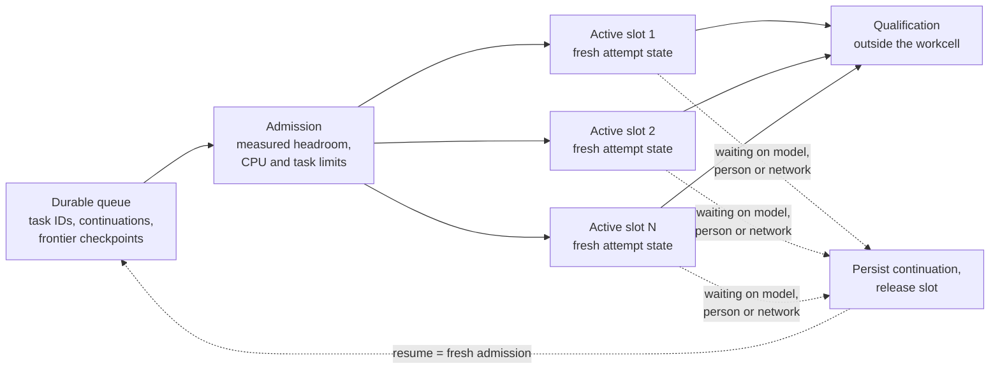
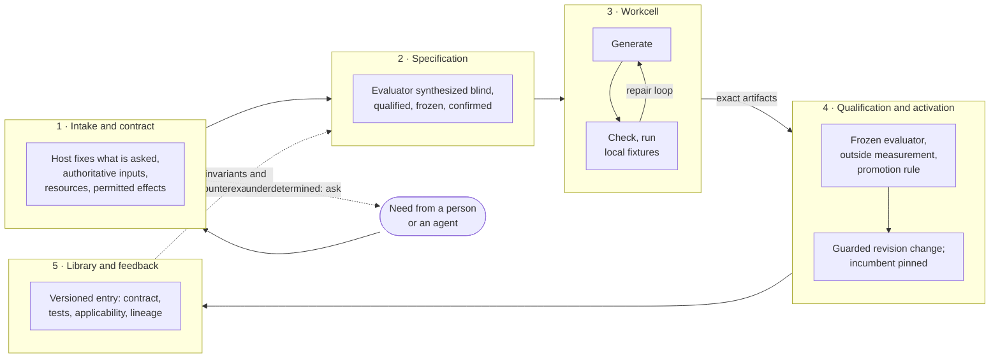

# R02 — The factory model

> Reconstructed 2026-10-17. The original R02 was not available; this version is rebuilt from
> Edition 3 (§4, §6–§11), Edition 2 (§2–§3, §8), the white paper (pp. 6, 9–11, 21), the diagram
> atlas (sheets 02, 07, 10–11, 15, 21–23, 29) and the isolate-factory-lab documents
> (`docs/UIHILL-IMPL.md`, `docs/LAB-DESIGN.md`). Content follows Edition 3 where the editions differ.

## Purpose

Endoforge is framed as a production system, not as manufacturing job titles given to coding agents [E2 §3]. This document defines that framing: the vocabulary of workpiece, machinery, material, cell and finishing; how setup and changeover work; how flow and work in process are bounded; the order of inspection; rework; scrap and reclamation; and a proposed scorecard. It then lays out Edition 3's five-boundary production cycle and states who may do what at each boundary. Everything here is **Proposed** unless a number is labelled otherwise.

## Summary

- The factory is engineered tools, routing, inventory, inspection and flow, not people or agents moving among tools [E2 §3].
- Machinery is prepared once and reused; every workpiece's mutable state is fresh. A changeover changes the candidate, not the machinery [E2 §3; E3 §4, §9].
- Work in process waits as durable records. Only a measured number of active slots consume execution, and candidate width is bounded by the evaluator's discriminating power before memory [E3 §9, §11].
- Inspection runs cheap and deterministic first. Scrap is measured in bytes, not candidate counts, and the library is inventory with a holding cost [E2 §3; E3 §12].
- One request crosses five boundaries: intake and contract, specification, workcell, qualification and activation, library and feedback. Each boundary changes who may do what, and the model never sits where it can promote its own output [E3 §4].

## 1. Why a production system

Edition 2 records the factory framing as the user's design direction. Endoforge should "embody the logic of a working production system" [E2 §3]. The distinction is between automating people moving among tools and engineering the tools, routing, inventory, inspection and flow as one system [E2 §3].

The framing earns its place because it forces questions that a coding-agent framing skips. Where is the bottleneck? What is in process? What does a changeover cost? What happens to scrap? What does inventory cost to hold? Edition 3 adds the hardest lesson of the metaphor, the one Edition 2 skipped: inventory costs money to hold [E3 §12].

## 2. Vocabulary

| Term | Edition 2 definition [E2 §3] | Edition 3 form |
|---|---|---|
| **Workpiece** | An exact candidate implementation or configuration against a task contract. | A pure WebAssembly kernel plus declarative glue: view specification, data and action bindings, interaction tests, result schema [E3 §5]. |
| **Machinery** | The reusable compiler, runtime, dependency base, evaluator and prepared execution interface. | A pinned compiler for each supported route, approved dependencies, the cheap deterministic gates, the evaluator engine and the invariant library [E3 §4, §8, §9]. |
| **Material** | Admitted source, inputs, reusable capabilities and existing evidence. | Unchanged. Imported code is material, not authority [E3 §4]. License is a provenance field from first admission [E3 §13]. |
| **Cell** | A bounded active workshop. | The workcell: a RAM-resident isolate holding prepared machinery and one private overlay per candidate [E3 §4]. |
| **Finishing** | Deeper engineering of a capability that has justified the investment. | Keeper refinement: a better algorithm, a Rust rewrite through the native lane, a smaller dependency closure [E3 §5, §12]. R03. |
| **Fixture** | Not named as such. | The frozen evaluator for the campaign: universal gates, domain invariants and the task residual [E3 §6]. |
| **Inventory** | The retained library, called "the compounding asset" [E2 §9]. | The library of contracts, implementations, qualification records, lineage and counterexamples, with a holding cost [E3 §12]. R04. |

Two rows are new in this reconstruction. "Fixture" and "inventory" are not named as factory terms in either edition. They are added because Edition 3 makes the evaluator a separately produced, separately qualified object [E3 §6] and makes the library a liability as well as an asset [E3 §12]. A factory that makes its own fixtures needs a word for them.

## 3. Setup and changeover

An ordinary candidate change should not mean installing another compiler, rebuilding a dependency tree or reconnecting a development environment [E2 §3]. The factory prepares compatible tooling and approved material once, under a measured residency policy. Changeover means changing the candidate and resetting its mutable state [E2 §3; W p.6].

The atlas draws the contrast directly. In the environment-centric path, each task obtains or reconnects a workspace, prepares tools and files, builds, gathers logs across tool boundaries, and then repairs. In the factory path, exact inputs are admitted once, warm immutable machinery is reused, and every attempt gets fresh mutable state [A sheet 02]. The atlas adds the essential caveat: an already-warm native pool is the required baseline, not a straw-man cold VM [A sheet 02].

### What is reused and what is fresh

Edition 3 keeps the three lifetimes of Edition 2 and changes only the attempt row [E3 §9].

| Lifetime | Contents | Rule | Loss means |
|---|---|---|---|
| Durable | Task identity, admitted inputs, frozen evaluator, kept candidates, accepted artifacts, receipts, application state that must survive restart | Persist before any reference points at it; never a live promise or guest heap | Loss of truth; not permitted |
| Warm (machinery) | Compiled modules per route, approved dependency base, invariant library, read-only input caches partitioned by permission | Reusable and evictable; a cache hit is never authorization | Higher latency on the next attempt |
| Attempt (workpiece) | One candidate's overlay, compiler state, module instance, buffers | Fresh per candidate; discarded after bounded execution; outputs published only after validation | Nothing; the task continues from durable records |

Source: [E3 §9; A sheet 07].

The white paper gives the cache keys for warm machinery. The compiler module is keyed by compiler bytes and runtime features. The pinned project base is keyed by dependency graph, SDK declarations and configuration. Checked build output is keyed by source, compiler, options and dependency digests [W p.6].

### Residency policy

A rarely used route need not stay resident. Machinery can load on demand and caches can be evicted. Losing an optional cache should raise the cost of the next attempt, not change correctness or erase the task. This is how local production avoids becoming unbounded inventory [E2 §3; A sheet 07].

### What the evidence says about changeover

- The Field OS warm trials kept host machinery while one arm recreated its virtual filesystem per job. Shared VFS gave an 18.64 ms median and fresh VFS 18.65 ms at 100% CPU quota (**Recorded**, Field OS main rig, 8 Oct 2026; six-case synthetic fixture). The 0.01 ms difference is not statistically meaningful [E3 §14; W p.17]. This supports testing the fresh-state pattern. It does not prove zero copy cost or zero cross-job leakage [W p.6].
- Cold payload latency was 669 ms against a warm shared-VFS median of 24.04 ms at 50% quota. 669 / 24.04 ≈ 27.8× (**Derived**). That is amortizable adapter overhead, not a system speedup [E3 §14].
- Edition 3 replaces the nested interpreter and its virtual filesystem with a module instance, and estimates that the per-attempt footprint falls by one to two orders of magnitude (**Estimated**; Experiment 4 measures it) [E3 §9]. The guest numbers above describe the adapter Edition 3 replaces. They are the baseline E3 X4 must beat [E3 §14].

## 4. Flow, work in process and bounded active slots

A thousand hypotheses do not need a thousand live compiler heaps [E2 §3]. Candidate identities, source deltas, priorities and continuations wait as records. Only a measured number of active workcells consumes execution [E2 §3; A sheet 10].

Adapted from [A sheet 23; E3 §9]. The slot count is illustrative, not a capacity claim [A sheet 23].

### The rules

1. **Waiting releases compute.** A task waiting on a person, a model or a network holds a continuation in durable records and no execution slot. Resumption is a fresh admission: source scope, context, policy, deadline and runtime are revalidated [E3 §9; A sheet 23].
2. **Feed the constraint, do not flood it.** Faster proposal generation can be counterproductive when evaluation is saturated. More compilation only lengthens the queue if the next stage cannot accept the output [E2 §3]. The whole flow is measured and active work is bounded. Maximum concurrency is not success [E2 §3].
3. **Width is bounded by the evaluator first.** Edition 3 adds a constraint the earlier editions lacked. Sixteen candidates against an evaluator that leaks 1% are sixteen chances to succeed and also sixteen chances to be credentialed wrong. Candidate width is bounded by the evaluator's measured discriminating power before it is bounded by memory [E3 §11]. E3 X3 sets this: if the searched escape rate is above 1 in 1,000, width stays at one until a new non-model check lands [E3 §15].
4. **A single-threaded isolate is not parallel CPU.** Many CPU-bound candidates in one isolate do not run in parallel. They must be scheduled across workers, processes or machines. The UI event loop must not carry an unbounded compiler queue [W p.11, p.21].
5. **Foreground first.** Separate UI interaction from background search. Throttle speculative work before capture, user input or durable-state work is affected [W p.21].

### Hosted limits on width

On the hosted lane, Cloudflare documents four distinct in-flight Dynamic Workers per request and ten per Durable Object I/O context (**Upstream**, checked 14 Oct 2026, carried by Edition 3 and not reverified) [E3 §13, §18; A sheet 17]. Any width plan for that lane must start from these.

## 5. Inspection order

Cheap deterministic checks reject malformed or incompatible candidates early. Expensive behavioural, integration, UI and performance evaluation is spent only on survivors [E2 §3; A sheet 11]. Edition 3 keeps that order and adds a distinction the earlier editions blurred: inspection inside the workcell is discovery feedback, and qualification outside it is acceptance [E3 §4].

### The combined ladder

The table merges the atlas's six-rung ladder [A sheet 11], the white paper's gate table [W p.10] and Edition 3's acceptance layers [E3 §6]. The merge is **Proposed**.

| Rung | Check | Where it runs | Acceptance layer [E3 §6] | Typical cost |
|---|---|---|---|---|
| 1 | Contract and syntax: closed schemas for glue, module validation, declared imports, bounded size | Workcell | Universal gates | Cheap |
| 2 | Type and interface conformance against the WIT contract or SDK declarations | Workcell | Universal gates | Cheap |
| 3 | Deterministic tests: resource bounds, determinism, forbidden effects; composed domain invariants (dimensional consistency, source-bound return, round trip, reconciliation of totals) | Workcell | Universal gates and domain invariants | Cheap to moderate |
| 4 | Task residual tests, frozen before the first candidate | Workcell for feedback; again outside for acceptance | Task residual | Moderate |
| 5 | Interaction and integration: render, exercise controls, accessibility, APIs | Outside, on survivors | Residual and universal | Expensive |
| 6 | Held-out acceptance on independent or rotated fixtures; resource measurement from outside the isolate | Outside | All three | Expensive |
| 7 | Cost and regression gate: matched baseline, tail latency, memory, stability; promotion rule | Outside | Promotion | Expensive |

Rules that hold across the ladder:

- **Hard gates come before ranking.** Correctness and permissions are constraints, not soft rewards [A sheet 11; W p.10].
- **Any hard failure stops the candidate.** It is rejected or quarantined with a bounded reason and its lineage [A sheet 11].
- **Measurement comes from outside the candidate.** Trusted counters, repeated runs, recorded failures, setup and inference costs counted [A sheet 11; E3 §9].
- **The candidate may see repair feedback.** It must not edit the evaluator, rewrite held-out fixtures or self-report trusted performance [A sheet 11].

### Cheap-first saves only what it can catch

Cheap-first ordering pays off only if the defects in the stream are ones the cheap gates can catch. The lab's generative-UI pilot illustrates the point. Its in-isolate gates (schema, typecheck, reducer fixtures) cost about 9 ms per candidate, against about 4.7 s for rendered gates (**Pilot (not a result)**, `isolate-factory-lab/docs/UIHILL-IMPL.md` §2). Yet on its open-loop stream the cheap gates rejected 0 of 10 unique mutants. Every precommitted mutation operator worked at the definition level and none touched the reducer, so the typecheck and fixture gates had nothing to reject (**Pilot (not a result)**, same file, §2 and limitation L3). The lesson is structural, not numerical: gate savings depend on the operator mix, and they must be measured on a precommitted candidate stream, not assumed.

## 6. Rework

Repair feedback should identify the actual failure [E2 §3]. Type checking is useful rapid feedback: missing method, wrong parameter, incompatible state shape, invalid result contract [W p.7]. But a type-correct hallucinated formula is still wrong. Semantic correctness needs independent tests and source validation [W p.7].

Three rules govern rework.

1. **Repairs change the workpiece, never the fixture.** In Edition 2's walk-through, the second repair "changes the join logic, not the acceptance oracle" [E2 §5]. Edition 3 makes this absolute. The residual evaluator is frozen, and "the test was wrong, let me fix it" after a failure is forbidden. It may be revised only on evidence independent of any candidate's outcome [E3 §6].
2. **Repair feedback is not evidence for promotion.** Candidates, repairs, self-generated tests and any model-as-judge step contribute discovery and repair feedback. They contribute nothing to promotion [E3 §7].
3. **The incumbent stays in service.** An alternative is manufactured and qualified while the accepted version keeps working [E2 §3; E3 §4].

### Parallel candidates buy yield, not speed

Edition 3 gives the arithmetic. At 50% first-pass yield, one candidate expects about one repair round. Four candidates give 1 − 0.5⁴ ≈ 94% chance that at least one passes, and cut expected repairs to about 0.07. Sixteen give 1 − 0.5¹⁶ ≈ 99.998% for four times the cost of four [E3 §10]. The yield figure is **Estimated**; the probabilities are **Derived** and assume independent failures. Independence needs different framings, such as POODO's rival-frame step, not different seeds on one prompt [E3 §10]. Rule 3 of §4 still applies: width is capped by the evaluator's escape rate.

## 7. Scrap and reclamation

Discarding a name is not the same as freeing storage [E2 §3]. Edition 2 cites a specific warning from the Mononoke source study: its test-only memory store removes link entries without reclaiming payload entries on those paths. That is not evidence about production-store leakage. It is a reason to design Endoforge's long-lived memory ownership explicitly [E2 §3, citing the Mononoke study §5]. This reconstruction has not re-inspected that source; R11 and `studies/mononoke/` carry it.

### Bytes, not counts

After a campaign the factory must know, for every byte it holds [E2 §3]:

| State | Meaning |
|---|---|
| Live | Referenced by an active attempt, warm cache or active version |
| Retained deliberately | Kept as an accepted artifact, receipt, counterexample or rollback target |
| Awaiting persistence | Produced but not yet durable; nothing may reference it yet |
| Reclaimable | No durable reference and no deliberate retention |

The factory measures bytes, not candidate counts. Shared immutable roots and private workpieces need compatible reclamation rules [E2 §3]. After teardown, the factory verifies that the intended resources were released [W p.21].

### What is recorded about reclamation

The Field OS W1/W2 gateway cases recorded verified empty or removed cgroups after every case (**Recorded**, W1/W2 receipt) [W p.18; A sheet 26]. That is process-level cleanup of attempts. Byte-level reclamation of long-lived stores has not been measured anywhere in this project.

### Scrap with value

Not all scrap is waste. A rejected candidate can leave a counterexample, a known incompatibility or a constraint that narrows future search [E2 §7]. Edition 3 keeps useful failures as library entries: "A rejected candidate that revealed a wrong join rule is worth more than a tenth accepted parser" [E3 §12]. Those entries are retained deliberately and are subject to the same holding cost as everything else.

### Inventory reclamation

Edition 3 extends reclamation to the library. Every retained capability carries maintenance against SDK and host churn, re-qualification, security review and retrieval cost. A library with no deprecation, deduplication or reclamation mechanism is "a landfill with provenance" [E3 §12]. A capability with no passing qualification against the current host is retired, not quietly kept [E3 §13]. R04 carries the inventory rules.

## 8. Proposed scorecard

The goal is more accepted useful output per unit of time and total resources, not higher utilization at every station [E2 §3]. Edition 2's scorecard has seven measures: first-pass yield, rework cost, time to evidence, accepted output, memory residency, tail latency, and lifetime return from retained improvements [E2 §3]. Edition 3 adds trust and specification measures [E3 §6, §7, §15]. The combined scorecard below is **Proposed**. None of these are existing production results.

| Measure | Definition | Why it matters | Origin |
|---|---|---|---|
| Accepted output | Independently accepted useful capabilities per unit of total cost | The north-star unit (R01 §4) | E2 §1; E3 §1 |
| First-pass yield | Fraction of candidates passing the frozen evaluator without repair, per route | Dominates time to first pass when inference is most of the budget | E2 §3; E3 §5, §10 |
| Rework cost | Repair rounds and their total cost per accepted capability | Exposes cheap proposals that are expensive to fix | E2 §3 |
| Time to evidence | Wall time from admission to a qualification verdict | The person's waiting time | E2 §3 |
| Specification time | Time and cost to produce a confirmed, qualified evaluator | Dominant cost for generative applications | E3 §3, §15 X1 |
| Evaluator error rate | Fraction of synthesized evaluators that people grade as wrong, by request type | The real size of the trust gap | E3 §15 X2 |
| Escape rate | Seeded faults promoted ÷ seeded faults submitted, sampled and searched | Sets the autonomy tier and the width ceiling | E3 §7, §11 |
| Review time | Human time at confirmation and promotion | Review throughput is the binding constraint of the design | E3 §13 |
| Memory residency | Peak and retained bytes per active attempt and per waiting task | Density; bytes, not counts | E2 §3; W p.11 |
| Queue time and active slots | Time waiting for admission; slots in use against limit | Shows where the constraint is | E2 §3; A sheet 23 |
| Tail latency | p95 and beyond, per stage | Medians hide the experience | E2 §3 |
| Bytes reclaimed | Bytes freed after a campaign against bytes declared reclaimable | Proves reclamation happens | E2 §3 |
| Lifetime return | Saving per later use × uses, minus refinement and holding cost | Decides finishing and retention | E2 §3; E3 §11, §12 |

The scorecard explains a result. Only the first row is the objective. Edition 2 warns that the hardest bottleneck may migrate as the system improves: setup, then checking, then data movement, inference, evaluation, and finally the lack of a precise task contract [E2 §14]. The scorecard exists so that migration is visible.

## 9. The production cycle

One request crosses five boundaries, and each boundary changes who may do what [E3 §4]. Edition 2's cycle had four: intake and contract, the workcell, qualification and activation, and the compounding loop [E2 §2]. Edition 3 inserts specification before the workcell, on purpose [E3 §4].

The Edition 3 PDF draws this cycle as a figure captioned "5 boundaries, 1 repair loop, 1 feedback path". The figure is not in the extracted text. The diagram below is reconstructed from the prose and caption.

The feedback path goes from the library to the specification stage, not to the workcell. The library feeds "the next request's evaluator rather than the next request's code" [E3 §4]. The code is the least valuable thing an accepted capability leaves behind [E3 §4, §12].

### What happens at each boundary

1. **Intake and contract.** The host establishes what is being asked, which inputs are authoritative, what resources may be spent and which effects are permitted. Imported code is material, not authority. If the request is underdetermined, the host asks. No amount of synthesis supplies a missing fact [E3 §4].
2. **Specification.** Before any candidate exists, an evaluator is synthesized from reusable invariants and the request. It is qualified (it must reject seeded faults and accept a known-good anchor where one exists), frozen (its hash enters the ledger before evaluation) and confirmed by a person in plain language [E3 §4, §6].
3. **Workcell.** Candidates are generated, checked, run against local fixtures and repaired. Machinery is reused; each candidate's mutable state is fresh [E3 §4].
4. **Qualification and activation.** Survivors leave as exact artifacts and meet the frozen evaluator, resource measurement from outside the isolate, and the promotion rule. Activation is a guarded revision change; the incumbent stays pinned until the replacement can take over without losing state, focus or authority [E3 §4].
5. **Library and feedback.** An accepted capability becomes a versioned entry. Its invariants and counterexamples return to the specification stage [E3 §4].

Edition 3 lets evaluator synthesis overlap with generation. Blind contexts can run concurrently; the evaluator's hash must be frozen before evaluation, not before generation starts [E3 §10]. So boundaries 2 and 3 are ordered by what each may see, not strictly by time.

### Who may do what

The model participates at three of the five boundaries: it frames the contract, synthesizes the evaluator, and generates and repairs candidates. It participates at none from a position that can promote its own output [E3 §4]. The table spells out the rest. Entries are derived from Edition 3 §4, §6, §7 and §8 and are **Proposed**.

| Boundary | Host (deterministic code) | Person | Model | Candidate |
|---|---|---|---|---|
| 1 Intake and contract | Fixes authoritative inputs, budget, permitted effects; asks when underdetermined | States the need; answers clarification | Frames the contract; may name rival framings (POODO discipline) | Does not exist |
| 2 Specification | Runs meta-gates; records the evaluator hash in the ledger | Confirms the plain-language residual (Confirmed and Supervised tiers) | Synthesizes the residual in a context that has seen no candidate | Does not exist; cannot see the residual |
| 3 Workcell | Enforces limits, gates and quotas; supplies diagnostics | Not involved | Generates and repairs candidates; sees repair feedback only | Runs bounded; cannot reach evaluator, broker, ledger or its own quotas |
| 4 Qualification and activation | Runs the frozen evaluator; measures from outside; applies the promotion rule; changes revision | Approves promotion where the tier requires it (Confirmed tier) | No role | Is judged; cannot self-approve |
| 5 Library and feedback | Records the entry, lineage and scope; feeds invariants back | Reviews retained capabilities where required | No role at this boundary; may propose new invariants later as a trusted-base change | No role |

Three properties define the trust boundary, and none of them is human versus model [E3 §7, §8]:

- **Time of authorship:** offline and frozen, or during the task it governs.
- **Context separation:** whether the checker shares the prior of the thing checked.
- **Privilege:** whether a component can change what judges it.

The trusted base itself (harness, evaluator engine, invariant library) may be model-written. It is changed only through the promotion path, with the current version judging the proposed one and a person approving [E3 §8]. Edition 3 expects that to be a handful of approvals a month [E3 §8].

## Edition 3 alignment

- **Changed.** The cycle gains a fifth boundary, specification, ahead of the workcell [E3 §4]. The feedback path now targets the evaluator, not the code. Inventory gains a holding cost [E3 §12]. Width is capped by evaluator discriminating power [E3 §11]. The attempt lifetime holds a module instance, not a nested interpreter and virtual filesystem [E3 §9].
- **Superseded.** Edition 2's statement that the trusted harness is "not generated" [A sheet 03] is replaced by the three-property trust boundary [E3 §8]. The atlas's QuickJS inner boundary [A sheet 03] is replaced by the WebAssembly module boundary [E3 §5].
- **Still holds.** The vocabulary, setup and changeover, durable waiting, cheap-first inspection, the rule that repairs never change the oracle, bytes-not-counts reclamation, and the scorecard's purpose [E2 §3; E3 §9].

## Open questions

| Question | What would settle it |
|---|---|
| What is the per-attempt footprint of a module instance against the ~150 MiB guest baseline? | E3 X4. |
| What candidate width does the searched escape rate allow, per domain? | E3 X3. |
| Do cheap gates save meaningful evaluation time on a realistic, model-generated defect stream? | A precommitted open-loop stream with model-generated candidates (G > 0). The lab's U1 prediction tests this only for deterministic definition-level mutations (`isolate-factory-lab/docs/UI-HILLCLIMB.md`). |
| What reclamation rule covers shared immutable roots referenced by both kept and scrapped workpieces? | Ledger design in R11; no source settles it. |
| Should "fixture" and "inventory" enter R17 as factory terms? | Terminology decision in R16/R17. |

## Sources

- Edition 3: `sources/text/Endoforge-Edition-3.txt`, §4, §5, §6, §7, §8, §9, §10, §11, §12, §13, §14, §15.
- Edition 2: `sources/text/Endoforge-Edition-2-The-Entire-Idea.txt`, §1, §2, §3, §5, §7, §9, §14.
- White paper: `sources/text/In-Isolate-Software-Workshop-v1.txt`, pp. 6, 7, 10, 11, 17, 18, 21.
- Diagram atlas: `sources/text/Diagram-Atlas.txt`, sheets 02, 03, 07, 10, 11, 17, 23, 26.
- Lab: `~/Work/isolate-factory-lab/docs/UIHILL-IMPL.md` (§2 pilot outputs; limitation L3), `~/Work/isolate-factory-lab/docs/UI-HILLCLIMB.md` (prediction U1).
