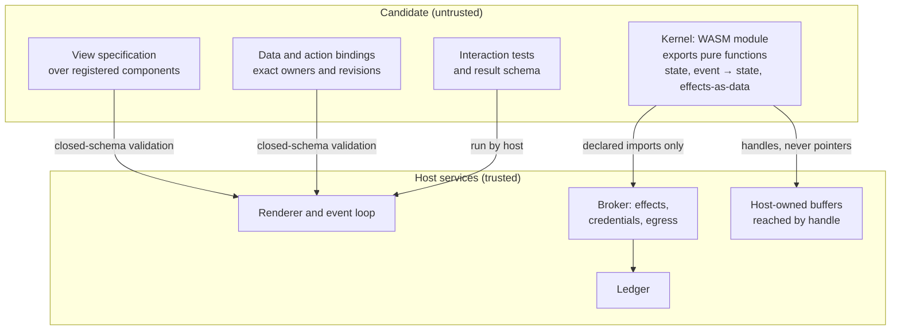

# R03 — Intake routes and keeper finishing

> Reconstructed 2026-10-17. The original R03 was not available; this version is rebuilt from
> Edition 3 (§1, §5, §9, §11–§13, §15), Edition 2 (§4, §8, §9), the white paper (pp. 4, 7, 13–14,
> 20) and the diagram atlas (sheets 03–05, 12, 16). Content follows Edition 3 where the editions
> differ.

## Purpose

This document describes how material enters Endoforge and how a capability's implementation can mature without losing its identity. It covers the broad intake funnel, Edition 3's candidate shape (a pure WebAssembly kernel plus declarative glue), the admission routes and their compiler locations, the typed boundary, how to choose a route by total feedback cost, the difference between promotion and refinement, and what behavioural equivalence across a rewrite requires. It also records a contradiction in Edition 3 about the compatibility lane and proposes wording that resolves it. Everything here is **Proposed** unless labelled otherwise.

## Summary

- Admit quickly, refine selectively. Material enters by whatever supported route is cheapest for the task; careful engineering is spent only on keepers [E2 §4].
- Edition 3 narrows the funnel's narrow end to one contract: a pure WebAssembly kernel with declared imports, plus glue that is data validated by closed schemas [E3 §5].
- Five routes: AssemblyScript and MoonBit compile inside the isolate; Rust compiles in a native lane outside it for keeper refinement; TypeScript→JavaScript is a compatibility lane; pre-built WASM is validated only. WAT and Rust-first are not admission routes [E3 §5].
- Edition 3 says no generated imperative JavaScript executes anywhere, but its own compatibility lane executes generated JavaScript. This document proposes making the lane a named exception with its own isolate boundary.
- Promotion and refinement are separate events. A rewrite gets a new artifact identity, its own qualification and a controlled activation; it inherits no correctness from resembling the previous source [E2 §4; E3 §12].

## 1. The broad funnel

Edition 2 calls the broad funnel central to the user's idea. Endoforge should generate or ingest code in whatever supported form suits the task, get it into the common WebAssembly execution system quickly, evaluate many candidates, and give careful implementation effort to the keepers that deserve it. "Rust is an optional refinement route, not the price of admission" [E2 §4].

Three distinctions from Edition 2 still hold under Edition 3.

1. **Directly compiled and runtime-backed are different mechanisms.** A program compiled to WASM and a language runtime packaged in WASM have different costs. Both can serve the funnel when their compatibility and costs are explicit [E2 §4].
2. **Producing WASM elsewhere is not producing it in the workcell.** For the strict path, the frontend, shims, admitted dependencies and evaluator must actually run inside the chosen isolate and resource envelope. A route that still needs an external build per candidate is an explicit compatibility lane or an open integration task. It is not silently counted as local [E2 §4].
3. **Preparing tooling is not compiling workpieces.** Building the factory's compiler happens once, outside the per-edit loop [E2 §4; A sheet 05].

Edition 3 keeps the funnel wide at the top and makes the narrow end a single contract [E3 §5].

## 2. The candidate shape: pure kernel plus declarative glue

Every candidate is a pure WebAssembly kernel plus declarative glue [E3 §5].

**The kernel** is a WebAssembly module exporting pure functions: state in, event in, state out, effects out as data. Its declared imports are its only capabilities. It gets linear-memory isolation and no ambient authority [E3 §5]. Edition 3 estimates that it instantiates in well under a millisecond and costs kilobytes to low megabytes per candidate (**Estimated**). The nested QuickJS guest it replaces peaked at about 150 MiB for the whole unit (**Recorded**, Field OS main rig, 8 Oct 2026) [E3 §5, §14].

**The glue** is data [E3 §5]:

- a view specification over the host's registered components;
- data and action bindings that name exact owners and revisions;
- interaction tests;
- a result schema.

Closed schemas validate the glue. The host renders it and runs the event loop. The candidate never touches the renderer, the broker or the ledger [E3 §5].



Edition 3's figure is captioned "kernel, three glue artifacts, four host services". The figure is not in the extracted text. The prose lists four glue items; this reconstruction groups interaction tests with the result schema, as the atlas does [A sheet 12]. The prose names three host services (renderer, broker, ledger); host-owned buffers are shown as a fourth because Edition 3 places large inputs there [E3 §5]. Both groupings are reconstruction choices, not source facts.

### Three consequences

Edition 3 draws three consequences [E3 §5].

1. **The nesting collapses from three levels to two.** The earlier inner boundary, a JavaScript interpreter nested inside the factory isolate [A sheet 03], becomes the module boundary itself.
2. **Pure reducers are the easiest software to test.** They are easy to test deterministically and to mutation-test, which feeds the specification subsystem directly [E3 §5, §6].
3. **Density becomes arithmetic.** A resident candidate is a module instance, not a heap. E3 X4 measures it against the 150 MiB guest baseline [E3 §15].

### Lineage of the shape

The kernel-plus-glue shape descends from the atlas's generative-UI package: view specification, behaviour module, data and action bindings, interaction tests and result schema [A sheet 12]. Edition 3 keeps the glue and replaces the behaviour module, previously generated JavaScript run in a nested guest, with the WASM kernel. The isolate-factory-lab's `w-ui/instrument@0` format is a working precursor of the glue half: an instrument is data interpreted by a fixed trusted component library, with no `innerHTML`, `eval`, `Function` or dynamic import (`isolate-factory-lab/docs/RENDERER.md`). Its reducers, however, are generated TypeScript run as JavaScript in a QuickJS guest (`isolate-factory-lab/docs/UIHILL-IMPL.md`), which is exactly the layer Edition 3 removes. R04 §10 covers that work.

## 3. The route table

| Route into the contract | Compiler location | Output | First-pass yield (Estimated) | Role | Runs in the workcell? |
|---|---|---|---|---|---|
| **AssemblyScript** | JavaScript-hosted compiler, inside the isolate | Small WASM module | Below TypeScript until measured; models emit constructs it lacks | Candidate default for kernels, pending measurement | Yes |
| **MoonBit** | Browser-hosted compiler, inside the isolate | Small GC-based WASM module | Unknown; little training data | Second in-isolate route | Yes |
| **Rust** | rustc and LLVM, native lane outside the isolate | Small WASM module; strongest static checks; near-native speed | High for pure functions; the borrow checker adds about half a repair round | Keeper refinement; kernels that earn it | No |
| **TypeScript → JavaScript** | tsc-rs as WASM, inside the isolate; execution in a child V8 isolate | JavaScript module | Highest of the four | Compatibility lane for imported code and behaviour that resists the kernel split | Checking yes; execution in a separate isolate |
| **Pre-built WASM** | None; validation only | Module as supplied | Not applicable | Imported components after admission and qualification | Validation only |

Source: [E3 §5]. The last column is added here from the compiler-location column. Every yield entry is **Estimated** in the source and none has been measured. E3 X4 measures yield, tokens, compile time, per-candidate memory and escape rate for TypeScript, AssemblyScript and Rust on the same twenty tasks [E3 §15].

### Inconsistencies in Edition 3's route table

- **Wrong experiment numbers.** The table says AssemblyScript is default "pending Experiment 1" and MoonBit is "compared in Experiment 1". Experiment 1 is the specification study. Route yield is Experiment 4 [E3 §15]. The table's references should read Experiment 4.
- **MoonBit is not an arm of Experiment 4.** Experiment 4 compares TypeScript, AssemblyScript and Rust only [E3 §15]. Either MoonBit joins X4 or its comparison needs its own experiment.
- **The heading claims too much.** The table is headed "Route into the kernel contract", but the TypeScript route outputs a JavaScript module, not a kernel. It is a route into the system, not into the kernel contract.
- **Lane placement is unclear.** Edition 3 says the local lane is Wasmtime-based and that "the V8 route exists mainly to serve the hosted lane" [E3 §13]. The compatibility lane, though, executes in a child V8 isolate [E3 §5]. Edition 3 does not say where that child isolate runs on a local Wasmtime host.

These belong in `docs/coverage/EDITION-3-ERRATA.md`.

### Routes Edition 2 named that Edition 3 drops

Edition 2 listed JavaScript through runtime-backed tools such as Javy, Python through compatible component packaging, existing Rust or other WASM-targeting source, and already-built WASM. It called these "candidate adapter families from the prior discussion, not a verified Endoforge support matrix" [E2 §4]. Edition 3 does not mention Javy or Python. Under Edition 3, a Python routine can enter only as pre-built WASM that passes admission and qualification, or not at all. Edition 2's walk-through, which admits "an existing Python routine through a compatible prepared adapter" [E2 §5], therefore has no Edition 3 route. R04 §2 adjusts the walk-through.

## 4. What is not an admission route

### WebAssembly text

Writing WebAssembly text directly is not a route [E3 §5]. Edition 3 gives three reasons:

- models have almost no training signal for it;
- a 100-line function becomes a thousand lines of text (**Estimated**);
- the result cannot be reviewed.

### Rust-first generation

Rust-first generation is not the default either [E3 §5]. The Rust toolchain cannot live inside the isolate, so every attempt leaves the workcell. Edition 3 estimates per-attempt cost as "roughly a wash" against TypeScript, with a better artifact at the end (**Estimated**). That makes Rust a refinement profile, not an admission profile [E3 §5]. Edition 2's rule supports the same conclusion from the other side: a route needing an external build per candidate is a compatibility lane, not the strict path [E2 §4].

### No universal TypeScript-to-WASM compiler

Edition 3 does not require a universal TypeScript-to-WASM compiler and does not claim every imported application fits the kernel contract [E3 §5]. Edition 2 said the same: Endoforge can admit through different routes and converge at a controlled artifact contract without forcing every imported application into one representation [E2 §4].

## 5. The typed boundary: WIT, the Component Model and host-owned buffers

Values cross the module boundary through a typed interface. WIT and the Component Model are the intended contract [E3 §5]. Edition 3 states that they are mature in Wasmtime and polyfilled rather than native in V8 hosts, which is one reason the local lane is Wasmtime-based [E3 §5, §13]. That maturity statement is Edition 3's own reading and is not pinned to a release; R18 should carry it for revalidation.

Two limits apply.

1. **Interface agreement is not behavioural equivalence.** Agreeing on how values cross a boundary does not establish that two implementations behave the same [E2 §4]. Section 9 covers what equivalence requires.
2. **Large inputs stay with the host.** Large inputs stay in host-owned buffers reached through handles. A candidate never receives a pointer into trusted state [E3 §5]. Host-managed handles expose narrowly authorized operations on buffers [E2 §8].

Whether a particular boundary can be zero-copy is an implementation question to test, not an architecture-label guarantee [E2 §8]. Keeping work in one isolate does not remove UTF-8/UTF-16 conversions, object construction, WASM-memory copies or host buffers [E2 §8; A sheet 08]. R09 carries the zero-copy argument.

The narrow end is a contract, not a file extension. It includes input and output schemas, state requirements, declared capabilities, dependency identity, build identity, applicability, provenance and evidence [E2 §4]. The white paper's capsule contract lists the same fields: artifact digest, module map, locked dependencies, entrypoint, compiler and runtime pin, input/output/state/view schemas, capability requests and lineage [W p.20].

## 6. A compiler written in Rust is not a candidate compiled to Rust

The original workshop had two distinct transformations [W p.4; A sheet 05]:

- Rust source → WASM produces the TypeScript checker and emitter that the workshop loads.
- Generated TypeScript → JavaScript produces the candidate.

"The candidate does not become a Rust application because its compiler is written in Rust" [W p.4]. The atlas puts it as: Rust accelerates the checker implementation, WASM makes it embeddable, and neither turns generated JavaScript into native Rust [A sheet 05].

Under Edition 3 there are now three separate Rust facts, and they must not be merged:

| Fact | What it is | Where it sits |
|---|---|---|
| tsc-rs is written in Rust | The compatibility lane's checker and emitter, built to WASM | Inside the isolate; the candidate output is JavaScript |
| Rust as a kernel route | Candidate source written in Rust, compiled natively by rustc and LLVM to a WASM kernel | Native lane, outside the isolate |
| The kernel path does not need tsc-rs | AssemblyScript, MoonBit, Rust and pre-built WASM routes do not use it | Edition 3 §13, risk 1 |

tsc-rs being model-written and days old is a named risk [E3 §13]. That risk touches only the compatibility lane, because the kernel path does not depend on it [E3 §13].

## 7. Route by total feedback cost

The cheapest route is the one that gets trustworthy feedback economically for this task. Compilation time alone is not enough [E2 §4]. The terms are preparation, checking, loading, boundary transfers, execution, evaluation and the expected number of uses [E2 §4]. A slower-to-build direct implementation may repay itself over extensive testing. A cheap runtime-backed implementation may be better for a one-shot candidate [E2 §4].

Edition 3 changes which terms dominate. If roughly four fifths of a novel run is model inference [E3 §10, **Estimated**], then first-pass yield and repair rounds outweigh compile time. A route with fast compilation and low yield can cost more in total than a slower route with high yield.

A **Proposed** accounting form, for comparing routes on one task:

```
C_route ≈ C_generate × (1 + R_expected)
        + N_attempts × (C_prepare + C_check + C_load + C_transfer + C_run)
        + C_evaluate
        + U_expected × C_per_use
```

Here *R*_expected is expected repair rounds per accepted candidate, *N*_attempts is the total number of attempts including repairs, and *U*_expected is the expected number of later uses. No term has been measured for any route in this project. E3 X4 supplies yield, tokens, compile time and per-candidate memory; X5 supplies the first measured model term [E3 §15].

Two practical corollaries from Edition 2 [E2 §4]:

- Where a known compiled primitive already does most of the work, compose it rather than regenerate it. Parameters can often vary without new compilation.
- Existing useful code should not be rejected only because another language would make a more polished final artifact.

## 8. The compatibility lane

### What Edition 3 says

Edition 3 §1 and §5 state a strict rule: "No generated imperative JavaScript executes anywhere in the system" [E3 §5]. Edition 3 §5 also defines a compatibility lane in which tsc-rs checks TypeScript inside the isolate and the resulting JavaScript module executes in a child V8 isolate. The lane serves imported code and behaviour that resists the kernel split [E3 §5]. Edition 3 names it "as a lane rather than disguised as the strict path" [E3 §5]. Experiment 4's kill criterion goes further: if the best in-isolate WASM route is more than 20 points below TypeScript, "the compatibility lane stays default and the kernel contract waits" [E3 §15].

### The contradiction

These statements conflict. The compatibility lane executes generated JavaScript whenever the TypeScript came from a model, which it may for "behavior that resists the kernel split". Under the X4 fallback, that lane could become the default. The absolute rule and the lane cannot both be literally true.

The conflict is not just wording. The rule protects three things: the renderer, broker and ledger are reachable only through the host; candidate code never runs in a trusted realm; and resident density is a module instance, not a heap. The compatibility lane can preserve the first two with a separate isolate boundary. It cannot preserve the third.

### Proposed resolution

Replace the rule in E3 §1 and §5 with the following wording (**Proposed**):

> No generated imperative JavaScript executes in the factory isolate, in the host, in the renderer, or in any realm that holds authority, measurement, or the ledger. Computation on the strict path ships only as a WebAssembly kernel with declared imports.
>
> The single exception is the named compatibility lane. JavaScript emitted by the pinned checker from admitted TypeScript executes only in a dedicated child isolate, or a process sandbox where the host has no child isolate. That isolate receives explicitly scoped bindings, no ambient egress, externally enforced limits, and no fine-grained timers. Every artifact, receipt and library entry from the lane carries the lane label. A lane artifact may be promoted under the same evaluator, but it is never relabelled as a kernel, and its density and footprint are reported separately from the kernel path.
>
> If Experiment 4 keeps the compatibility lane as the default, this rule is restated before any further claim about kernel density.

The wording keeps the lane honest in four ways.

1. **It draws the boundary physically.** The lane gets its own isolate, matching the atlas's "child V8 isolate" topology. That topology "moves the trust boundary" and is "not literally one isolate" [A sheet 04; W p.14].
2. **It carries the hosted-platform rules.** Ambient egress must be blocked explicitly; the Dynamic Workers loader inherits outbound access unless overridden [W p.14]. Isolates in one process are not a Spectre boundary, so candidate code never gets fine-grained timers [E3 §13].
3. **It stops relabelling.** Edition 2 forbade relabelling a child-isolate route as the same topology as the same-isolate loop [E2 §8]. The lane label carries that rule into the library.
4. **It makes the fallback visible.** If X4 fails, the architecture document has to say so rather than leave a rule that the default path violates.

It also answers where the lane runs on a local host: in a child isolate under the local lane's OS sandbox, cgroups and external watchdog [E3 §13]. Whether that is V8 beside Wasmtime or a separate process is an implementation decision to record in R16.

## 9. Promotion versus refinement

Promotion and refinement are distinct [E2 §4].

- **Promotion** makes a candidate the active implementation of a capability, after qualification, under a guarded revision change [E3 §4].
- **Refinement** constructs a better implementation of an already-accepted capability while the current one stays in service [E2 §4].

A capability can be accepted in its first implementation and stay useful while a better one is built. The rewrite gets a new artifact identity, comparison against the actual contract, new qualification and controlled activation. It does not inherit correctness from resembling the previous source [E2 §4].

### Implementations live under a contract

Edition 3 makes this structural. A capability contract names what an operation means. Implementations are separate artifacts under the contract, each with its own identity, evidence and resource profile [E3 §12]. A low-startup build, a direct-WASM build and a bounded fallback can coexist [E3 §12; E2 §9]. A compatibility-lane artifact and a later kernel are two implementations of one contract, which is how a capability moves from the lane to the strict path without losing identity.

A Rust rewrite is one refinement among several. Better algorithms, data structures, batching, layout, dependencies or placement may matter more. The measured improvement is rewarded, not the language label [E3 §12; E2 §9].

### When refinement pays

The break-even is optimization cost divided by saving per later use, in the same units. Spending 200 CPU-seconds to save 1 ms per execution needs 200 / 0.001 = 200,000 executions to repay the CPU alone, before model, review and storage costs (**Derived**, illustrative) [E3 §11; E2 §6]. A one-use capsule and a shared compiler path do not get the same budget [E3 §11]. Some keepers will never justify a rewrite [E2 §4].

Do not penalize an idea forever for its first language. The search should distinguish current operational value from bounded refinement potential. Evidence of better scaling can justify another experiment. It does not entitle the candidate to promotion before the improvement exists [E2 §9].

## 10. Behavioural equivalence across rewrites

A faster implementation that silently changes the rules is a different behaviour, not a free optimization [E2 §4]. Edition 2's example: a parser in Python and a replacement in Rust must agree on malformed records, ordering, Unicode, overflow, missing values, errors and resource limits [E2 §4].

### The old implementation is evidence, not the oracle

The first implementation is valuable evidence but not the only oracle. It may contain bugs that should not be translated faithfully [E2 §4]. So a rewrite is judged against the contract and the frozen evaluator first, and against the incumbent second.

### Proposed equivalence obligations

Before a refinement can replace an incumbent (**Proposed**):

| Obligation | Check | Independent error source [E3 §7] |
|---|---|---|
| Contract conformance | Same schemas, declared capabilities and applicability; same WIT interface | Deterministic tooling |
| Evaluator pass | The capability's frozen evaluator, including domain invariants | Offline-qualified invariants |
| Differential agreement | Same outputs as the incumbent over recorded inputs and generated edge cases (the categories above); every disagreement triaged as an incumbent bug or a regression | Existing implementations |
| Metamorphic stability | Relations that hold without knowing the right answer, such as reordering independent inputs or round trips | Deterministic tooling |
| Resource profile | Measured from outside under the conditions where it will run; tradeoffs recorded on a Pareto frontier, not hidden in one score | Deterministic tooling |
| State compatibility | State migration at an explicit boundary, never an assumed transfer of one language's live heap to another's | Deterministic tooling |
| Regression against a fixed reference | Compared with both the incumbent and a fixed reference, so a chain of small tolerated regressions cannot accumulate | Existing implementations |

Sources: [E2 §4, §6; E3 §7, §11]. Kernel purity helps with every row. State is explicit, effects are data, and a pure reducer can be replayed against recorded events.

## Edition 3 alignment

- **Changed.** The candidate is a pure WASM kernel plus declarative glue, not generated TypeScript emitted to JavaScript and run in a nested QuickJS guest [E3 §2, §5]. AssemblyScript is the candidate default, pending measurement. TypeScript is a compatibility lane. MoonBit is new. WIT and the Component Model move from "relevant precedent" [E2 §4] to "intended contract" [E3 §5].
- **Superseded.** QuickJS leaves the architecture [E3 §2]. Javy and Python routes [E2 §4] are not carried. The three-level nesting of the atlas [A sheet 03] collapses to two.
- **Still holds.** Broad intake with selective refinement; strict path versus explicit lane; compiler-in-Rust is not candidate-in-Rust; route by total feedback cost; promotion versus refinement; behavioural equivalence and new identity for rewrites [E2 §4, §9].
- **Unresolved in Edition 3.** The compatibility-lane rule (§8 above), the experiment numbering in the route table, MoonBit's absence from X4, and where the child V8 isolate runs on the local lane (§3 above).

## Open questions

| Question | What would settle it |
|---|---|
| Which kernel route has acceptable first-pass yield, and is the kernel contract justified now? | E3 X4; kill criterion: best in-isolate WASM route more than 20 points below TypeScript. |
| How does MoonBit compare? | Add MoonBit as an X4 arm, or a separate precommitted comparison. |
| Is WIT/Component Model support in the chosen Wasmtime release sufficient for the glue and kernel interface? | Pin a release in R18 and run an interface conformance test before X4. |
| Does tsc-rs as WASM fit the hosted 128 MB isolate with a harness and module instance? | E3 X6. |
| How does an imported Python routine enter, if at all? | Decision in R16; no Edition 3 route exists. |
| Which runtime hosts the compatibility lane's child isolate on a local Wasmtime host? | Decision in R16 after X4. |

## Sources

- Edition 3: `sources/text/Endoforge-Edition-3.txt`, §1, §2, §5, §6, §7, §10, §11, §12, §13, §14, §15.
- Edition 2: `sources/text/Endoforge-Edition-2-The-Entire-Idea.txt`, §4, §5, §6, §8, §9.
- White paper: `sources/text/In-Isolate-Software-Workshop-v1.txt`, pp. 4, 13, 14, 20.
- Diagram atlas: `sources/text/Diagram-Atlas.txt`, sheets 03, 04, 05, 08, 12.
- Lab: `~/Work/isolate-factory-lab/docs/RENDERER.md` (instrument-as-data contract), `~/Work/isolate-factory-lab/docs/UIHILL-IMPL.md` (reducers as generated TypeScript in QuickJS).
