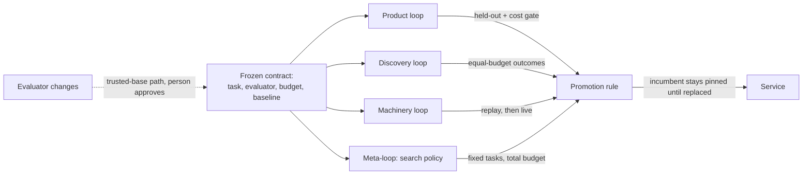

# R05 — Improvement loops and campaign controls

> Reconstructed 2026-10-17. The original R05 was not available; this version is rebuilt from
> Edition 3 (§7, §8, §10, §11, §15, §17), Edition 2 (§6, §14, §15), the white paper (pp. 9–11, 22),
> the diagram atlas (sheets 10, 11, 15, 23) and the isolate-factory-lab documents listed under Sources.
> Content follows Edition 3 where the editions differ.

## Purpose

This document defines how Endoforge may improve anything at all: the software it makes, the process that finds that software, and its own machinery. It states what each loop may and may not change, how a gain is isolated, what a promotion rule must contain, and how a campaign is protected from fooling itself. It then folds in the campaign-control machinery that the 14 October test lab actually built, and the defects an independent critic found in it, restated as rules that transfer to any Endoforge campaign. Everything in the loop design is **Proposed**. The lab machinery exists as code; it has produced no campaign result.

## Summary

- Three primary loops (product, discovery, machinery) plus a later meta-loop. Each changes one thing and must not touch the contract that decides whether its change is real [E3 §11; E2 §6].
- Correctness, authority, declared resource limits, source fidelity and user-state continuity are gates. Performance is a vector. A promotion improves a declared objective inside predeclared tolerances, against both the incumbent and a fixed reference [E2 §6].
- Search is an optimizer against the evaluator. The escape rate that sets autonomy is the one measured under search, not under random sampling, and candidate width is bounded by the evaluator's discriminating power before memory [E3 §7, §11].
- Refinement budget follows break-even arithmetic: optimization cost divided by saving per use, in the same units [E3 §11; E2 §6].
- The lab's precommit hash chain, fail-closed spec gate, calibration gate, verified-only report and replication tool are the working shape of these controls. Its critique (M1–M12) shows how each control fails when the code does not match the rule.

## 1. The loops

Edition 2 names three primary loops and a later meta-loop, and requires that they be measured separately before their gains are combined [E2 §6]. Edition 3 keeps the three and tightens what each may touch [E3 §11].

| Loop | What it changes | What it must not change | How a gain is isolated |
|---|---|---|---|
| Product | Algorithms, data structures, layout, parsing, state transitions of an accepted capability | The task contract and the invariants | Held-out acceptance, plus a matched cost and regression gate against both the incumbent and a fixed reference |
| Discovery | Proposal strategy, model routing, context, retrieval, repair feedback, candidate diversity, stopping rules | The evaluator and the budget accounting | Same tasks, same total budget, accepted outcomes compared |
| Machinery | Compiler bridge, module instantiation, VFS, memory layout, caching, allocation, scheduling | Its own acceptance contract or quotas | Replay of identical inputs through baseline and challenger, then live synthesis under equal budgets |
| Meta (later) | How campaigns allocate effort; the search policy itself | The evaluator that judges the policy | Fixed tasks and total budgets; a change to the evaluator goes through the trusted-base promotion path with a person at the end |

Sources: [E3 §11; E2 §6; E3 §8]. All rows are **Proposed**.

Three notes on the rows.

- **Product.** A performance campaign should first preserve visible behaviour. A UI campaign that asks whether an interaction helps more is a separate campaign and needs task and renderer evidence, not execution timings [E2 §6; W p.8].
- **Discovery.** A cheaper model response is not a cheaper solution if it causes more failures and retries. A larger swarm is not better if the accepted result is unchanged and total cost rises [E2 §6].
- **Machinery.** Both comparisons are needed. Replay isolates the substrate effect; live synthesis tells you whether that effect helps the complete task. Without replay, model luck can pass for a runtime improvement [E2 §6].

The arrow that matters is the dotted one. Nothing inside a loop has a path to the contract. Changes to the evaluator or the harness are themselves candidates under E3's three trust boundaries: time of authorship, context separation and privilege [E3 §7, §8].

## 2. Campaign shape

A campaign freezes a task, an evaluator, a budget and a baseline. It then runs a bounded frontier: an incumbent plus diverse parents, a batch of proposals, cheap deterministic rejection first, independent measurement of survivors, and selection that keeps a Pareto frontier rather than one score [E3 §11; A sheet 10]. Many hypotheses may wait as durable records; only a measured number of candidates hold execution slots [E3 §11; A sheet 23]. A campaign stops on budget, plateau, regression or ambiguous execution, and the incumbent stays in service throughout [E3 §11; W p.10].

Evaluation is a ladder: contract and syntax, type and interface, deterministic tests, interaction and integration, held-out acceptance, then a cost and regression gate. Any hard failure exits the ladder [A sheet 11]. The white paper's search skeleton (select diverse parents, generate bounded variants, check and emit, evaluate exact artifacts, select under a frozen objective, held-out acceptance, commit under an expected revision) is the reference pseudocode. It is proposed orchestration, not an API [W p.10].

## 3. Gates versus the performance vector

Correctness, authority, declared resource limits, source fidelity and necessary user-state continuity are **gates**. A gate is pass or fail; no amount of speed buys back a failed gate [E2 §6; W p.10].

Among eligible candidates, performance is a **vector**: latency, CPU, inference usage, peak memory, retained memory, memory occupancy over time, and measured energy where instrumentation exists [E2 §6]. CPU time is not an energy measurement [E2 §6; A sheet 08].

**Pareto profiles.** Some trade-offs are deployment profiles, not losers. A faster implementation that doubles memory may suit a workstation and not a small appliance [W p.10]. Keep such alternatives on a Pareto frontier as named profiles, each with its own evidence, rather than hiding the trade-off inside a weighted score [E2 §6; A sheet 10]. Edition 3's library already allows several implementations under one contract (a low-startup build, a direct-WASM build, a bounded fallback) [E3 §12]. A Pareto profile is how a campaign feeds that structure.

## 4. The promotion rule

The default rule, **Proposed** [E2 §6; E3 §11]:

1. All gates pass.
2. The declared objective improves by more than a predeclared meaningful margin.
3. Every protected metric stays within its **predeclared tolerance**.
4. Both comparisons hold: against the **immediate incumbent** and against a **fixed reference**.
5. The improvement is confirmed on held-out or fresh fixtures, with paired, randomised, repeated measurement and real host accounting.
6. An inconclusive difference stays inconclusive and does not promote.

The fixed reference is the part most often skipped. If each promotion is judged only against its predecessor, a chain of small tolerated regressions accumulates without any single step failing. Comparing against a stable reference makes the accumulated drift visible [E2 §6, §15]. Edition 2 applies the same rule to the factory's own changes: test the factory against its predecessor and a stable reference [E2 §15].

Tolerances must be declared before data. The lab's form of this is an equivalence margin of ±10% on one pre-registered primary metric, a verdict per prediction of lower, higher, equivalent or inconclusive, and a symmetric retraction rule under which a win on a secondary metric cannot rescue a lost primary [`~/Work/isolate-factory-lab/docs/PREDICTIONS.md`].

## 5. Complete cost accounting

All work belongs in the accounting: rejected candidates, repairs, model calls, test generation, evaluation, publishing, rendering, storage and review [E2 §6; W p.10]. A candidate's speed does not justify removing required tests or changing the meaning of success [E2 §6]. The atlas states the cost model as inference + compute + I/O + review + failures [A sheet 15].

The north-star unit follows: accepted improvement under an equal complete budget [E2 §1]. Edition 3 adds that review throughput is the binding constraint of the whole design [E3 §13], so reviewer minutes are a first-class cost term, not an overhead.

## 6. Making search hard to fool

### 6.1 Searched versus sampled escape rate

Edition 3 defines trust as the escape rate: seeded faults promoted divided by seeded faults submitted [E3 §7]. It then states why that number must be measured under search. If synthesized evaluators are wrong one time in a hundred, search pressure meets the wrong evaluators as the easiest tasks and the candidates that exploit them as the best-scoring [E3 §11]. An escape rate measured under random sampling therefore overstates safety under optimization, and autonomy tiers are set against the **searched** rate [E3 §7, §11]. Experiment 3 measures both, first sampled, then inside a sixteen-wide campaign [E3 §15].

**Derived — how many seeded faults a tier needs.** With zero escapes observed in n independent seeded faults, the 95% upper bound on the escape rate p satisfies (1 − p)^n = 0.05. For the Supervised tier (p < 1/1,000): n = ln 0.05 / ln 0.999 ≈ 2,994. For the Autonomous tier (p < 1/10,000): n ≈ 29,956. This is the familiar "rule of three" (n ≈ 3/p). It assumes independent faults and zero observed escapes; any escape raises n. It is arithmetic on E3's proposed thresholds [E3 §7], not a measured requirement.

### 6.2 Parallel samples multiply evaluator leaks

Sixteen candidates against a 1% leak are not sixteen chances to succeed; they are also sixteen chances to be credentialed wrong [E3 §11].

**Derived.** If each candidate independently finds a leak with probability 0.01, the chance that at least one of k candidates does is 1 − 0.99^k. For k = 4 that is 3.9%; for k = 16 it is 14.9%. Under selection, the leaking candidate is also the likely winner, so the promoted-wrong rate approaches that figure rather than 1%. Independence is an assumption; correlated candidates from one prompt would leak together, which is no better.

### 6.3 Candidate width is bounded by discriminating power

Edition 3's yield arithmetic: at 50% first-pass yield, one candidate expects about one repair round; four give a 94% chance that one passes and cut expected repairs to about 0.07; sixteen buy 99.998% for four times the cost [E3 §10].

**Derived check.** 1 − 0.5^4 = 0.9375. With rounds that each succeed with probability 0.9375, expected repair rounds = 0.0625 / 0.9375 ≈ 0.067. 1 − 0.5^16 ≈ 0.999985 (99.998%). One candidate: expected repairs = 0.5 / 0.5 = 1. All four figures in E3 check out.

Put 6.2 and 6.3 together: going from four to sixteen buys about six percentage points of pass probability and roughly quadruples leak exposure. That is why E3 says width is bounded by the evaluator's measured discriminating power before it is bounded by memory [E3 §11], and why Experiment 3's kill criterion holds width at one until a new non-model check lands if the searched escape rate exceeds 1 in 1,000 [E3 §15]. Independence of candidates comes from different framings (POODO's rival-frame step), not different seeds on one prompt [E3 §8, §10].

### 6.4 Holdout adaptation

Scores obtained repeatedly from the same held-out set adapt the search to that set even without access to its contents [E3 §11; E2 §6]. Release confirmation therefore uses rotated or fresh fixtures, paired randomised comparisons, repeated measurements and real host accounting [E3 §11; W p.10]. A release-confirmation set must not be treated as untouched after repeated feedback [E2 §6]. Exploration receives useful feedback; promotion uses controlled confirmation [E2 §6]. The candidate may see repair feedback but must not edit the evaluator, rewrite held-out fixtures or self-report trusted performance [A sheet 11].

## 7. Where refinement pays: break-even arithmetic

The rule is optimization cost divided by saving per subsequent use, in the same units [E3 §11; E2 §6].

**Derived.** N_break-even = C_optimize / s_per-use. E3's example: 200 CPU-seconds to save 1 ms of CPU per execution gives 200 / 0.001 = 200,000 executions, before model, review and storage costs [E3 §11]. The arithmetic is correct.

A second illustration, on lab numbers that are **Pilot (not a result)**: FASTLOOP's R-batch regime cut tsc-rs WASM CPU per candidate from 29.6 ms to 9.3 ms on S-medium [`FASTLOOP.md` §0]. A saving of 20.3 ms per candidate would repay a hypothetical 200 CPU-seconds of optimization after 200 / 0.0203 ≈ 9,850 candidates. A shared compiler path sees that many candidates quickly; a one-use capsule never does. That is the reason the two do not get the same budget [E3 §11].

Two cautions. First, units must match: CPU saved does not repay model tokens or reviewer time spent. Second, the denominator is expected future use, which is itself an estimate; the library's applicability records are what make it more than a guess [E3 §12].

## 8. The search policy as a challenger

The factory's own search policy can be a challenger. It competes on fixed tasks and total budgets, it cannot alter the evaluator that decides whether it improved, and a change to that evaluator goes through E3 §8's promotion path with a person at the end [E3 §11]. This is controlled recursive engineering, not a claim of unbounded self-improvement [E3 §11; E2 §6]. On the claim ladder it is rung 7, and it requires rungs 3 (measured evaluator error and escape rate) and 5 (a campaign beating a baseline at equal cost) first [E3 §17].

## 9. Campaign controls the lab built

The lab at `~/Work/isolate-factory-lab` implemented a measurement harness under PREDICTIONS v1. None of it has produced a campaign result; it is the machinery. Each control below is a transferable rule for any Endoforge campaign.

| Control | What the lab built | Transferable rule |
|---|---|---|
| Prospective predictions | PREDICTIONS v0 → v1.5, each amendment dated "before any campaign"; one primary metric, ±10% margin, symmetric retraction, multiplicity declared, P4 Holm-corrected [`PREDICTIONS.md`] | Every decision rule and its amendments exist before data. Post-hoc findings are exploratory and need a fresh replication |
| Precommit hash chain | `precommit.json` written and fsynced before any unit starts; it holds the spec hash, HEAD and dirty state, tree digests of harness, workload and adapters, the PREDICTIONS sha256, the embedded calibration receipt, seed and block schedule. `precommit.sha256` = every EvaluationRequest's `expectedContextRevision` = `summary.precommitSha256`. Inputs are re-hashed at the end; drift marks the campaign invalid [`HARNESS.md`] | Every observation cites the frozen context it was made under; drift after freezing invalidates, it does not annotate |
| Fail-closed spec gate | `check-spec.mjs` refuses placeholders (`fromPilot: true` cannot pass as a number), missing pilot receipts, unmet `dependsOn`, too few blocks, adapter `scope` options, non-empty `allowNotRun` on official specs, and digest mismatches, before any scope or receipt directory exists [`HARNESS.md`] | A campaign that cannot prove its inputs does not start. Refusal leaves no partial evidence to be misread |
| Calibration before judging | Known-truth instrument through the real harness arm: C1 timing, C2 CPU, C3 memory, C4 I/O sensors, C5 throttling, C6 evaluator sensitivity (mutants must be 100% rejected), C7 noise floor. Gate refuses another commit, a dirty tree, another boot, over 12 h old, or any check not passing [`TESTING.md`] | Instruments and the evaluator are qualified against known truth on this boot and this commit before they judge anything. C6 is E3's "an evaluator that accepts mutants confers nothing" in executable form [E3 §6] |
| Steady-state rule | Predeclared windows of 20, median within 3%, twice in a row; warm-up curve published [`HARNESS.md`] | Warm-up ends by rule, never by a fixed count, and the rule must compare like with like (see M10 below) |
| Verified-only report | `report.mjs` refuses an unverified receipt set; contradictions first; every number labelled OBSERVED or DERIVED; any failed lifetime, parity failure, `outcome_unknown` or not-run candidate makes the decision inconclusive [`HARNESS.md`] | A report is derived only from verified receipts, and incompleteness downgrades a verdict instead of being footnoted |
| Replication | `replicate.mjs` recomputes two reports from verified receipts and flags differing verdicts, rules or PREDICTIONS digests; same campaign fails, same day or seed warns [`HARNESS.md`] | A result is a pair of independent campaigns that agree, not one run |

Other controls carried into the design: an open-loop candidate stream fed identically to every arm, an independent final validator outside every arm, one front door, all helper processes inside the arm cgroup, a host-wide `/proc/stat` cross-check, a quiet-machine gate and sentinel per block, and `outcome_unknown` recorded once and never retried [`HARNESS.md`; `CRITIQUE-2026-10-14.md`].

## 10. Lessons from the critiques, as rules

Two independent critiques ran before any data: a methodology critique that shaped PREDICTIONS v1, and a pre-campaign implementation critique of the code [`docs/CRITIQUE-2026-10-14.md`; `CRITIQUE-2026-10-14-precampaign.md`]. Both note their limited independence (same model family, fresh context). The must-fix findings generalise.

1. **Count what the rule says (M1).** The registered P6 denominator was content-unique, holdout-verified, non-marginal accepts. The code counted behaviour-unique accepts, which collapsed 12 accepts to 3 on S-small and could hide a yield deficit. *Rule:* the denominator is defined in code and tested against the written definition; secondary denominators are reported, never substituted. The lab later fixed content-uniqueness; marginal exclusion was still unimplemented [`PILOT-2026-10-14.md`].
2. **Holdout must run the arm's own artifact (M2).** Holdout verification ran the validator's emit, not the arm's. An arm whose emitted code differs only on holdout paths would be credited with an accept its own artifact fails. *Rule:* confirmation executes the exact bytes that would be promoted, or requires their digest to equal the reference's. This is E3's "survivors leave the workcell as exact artifacts" [E3 §4].
3. **Unknown is not a reject (M3).** `outcome_unknown` on a should-reject candidate scored as a correct reject. *Rule:* unknown is its own state and an admissibility flag, never a pass or a fail; record stage-level parity, not only the final bit [E3 §9].
4. **Bridges are evaluator code (M4, M5).** The workload bridge could silently drop expected outputs (any output then passed), and lib bytes were not pinned across arms. *Rule:* every transformation between frozen workload and evaluator is committed, digested, fail-closed, and covered by the evaluator's mutation tests.
5. **Digests cover everything that executes (M6, S4).** Excluding `node_modules` to fix a digest error would have removed the compiler binaries from drift detection. *Rule:* fix identity by extending coverage (symlink targets, import closures, binaries), never by narrowing it.
6. **Calibrate the topology you measure (M7).** The I/O sensor was calibrated on a single-process arm; the representative arm had two processes and a pipe, which would read as a violation. *Rule:* re-calibrate whenever the measured topology differs from the calibrated one, before data.
7. **Declare every representative fully (M8).** E-warm's checker was undeclared, a forking path. *Rule:* every arm's full adapter options are in the precommit.
8. **Accounting boundaries are asserted, not assumed (M9).** An adapter option could move helper CPU outside the arm cgroup. *Rule:* refuse options that create units; at every readback assert every descendant is in the arm cgroup.
9. **Steady-state rules must compare like with like (M10).** Consecutive windows over a mixed stream compare stream composition, not warm-up. The pilot confirmed it: arms C and E-warm never converged; B converged by coincidence at sample 220 [`PILOT-2026-10-14.md`]. *Rule:* compare whole passes, or the same window position across passes.
10. **Official means clean (M11).** A dirty tree at the same HEAD passed the calibration commit check, and a spec could waive calibration. *Rule:* refuse official runs on dirty trees and refuse spec-level waivers.
11. **Limits scale with the sweep (M12).** One memory and task limit across concurrency 1–16 would make "memory binds" an artefact of configuration. *Rule:* limits per level, declared in the precommit.
12. **Subtract the harness constant (S1) and use honest intervals (S2).** A constant per-candidate harness cost pulls ratios toward 1 and toward "equivalent"; a percentile bootstrap on 8 blocks under-covers. *Rule:* run a null arm; use BCa or t intervals and at least 16 blocks.

The pilot adds one more: its variance estimate is an upper bound because only one of eight blocks ran, under contention, and it recommends 32 blocks (floor 16) for P6 [`PILOT-2026-10-14.md`]. Those counts are **Pilot (not a result)**.

## Edition 3 alignment

- **Holds from Edition 2:** the three loops plus meta-loop, gates versus vector, predeclared tolerances, incumbent and fixed reference, complete accounting, holdout adaptation, break-even arithmetic, search policy as challenger [E2 §6].
- **Added by Edition 3:** the escape rate as the measure of trust; the searched-versus-sampled distinction; parallel samples as leak multipliers; width bounded by discriminating power; evaluator changes going through the trusted-base path [E3 §7, §8, §11].
- **Changed:** "the protected evaluator" of Edition 2 is now a synthesized per-task residual for generative applications, so its own error rate, not only the candidate's, is under measurement [E3 §6]. The Edition 2 rule that the harness is "not generated" is replaced by the three trust boundaries [E3 §8].
- **Superseded:** nothing in E2 §6 is withdrawn.

## Open questions

- What is the searched escape rate for any real domain? Decided by E3 X3; until then width stays at one under its kill rule [E3 §15].
- What tolerance per protected metric is "meaningful"? The lab used ±10% on one metric; per-metric tolerances for a product loop have not been chosen (R14).
- How fast does a fixed reference itself go stale as hosts and SDKs churn [E3 §13]? No rule yet for rotating references.
- Is the P6 cost model fair when 94–99.5% of denominator CPU is spent on doomed candidates running to their budget [`PILOT-2026-10-14.md`]? A plan decision is required before the official campaign.
- How many fresh fixtures does release confirmation need per campaign, and how are they generated without sharing the generator's prior? Linked to E3 X2.

## Sources

- `sources/text/Endoforge-Edition-3.txt` §6, §7, §8, §9, §10, §11, §12, §13, §15, §17.
- `sources/text/Endoforge-Edition-2-The-Entire-Idea.txt` §1, §6, §15.
- `sources/text/In-Isolate-Software-Workshop-v1.txt` pp. 8–11.
- `sources/text/Diagram-Atlas.txt` sheets 08, 10, 11, 15, 23.
- `~/Work/isolate-factory-lab/docs/PREDICTIONS.md`, `HARNESS.md`, `TESTING.md`, `CRITIQUE-2026-10-14.md`.
- `~/Work/isolate-factory-lab/CRITIQUE-2026-10-14-precampaign.md`.
- `~/Work/isolate-factory-lab-wt/measure/docs/PILOT-2026-10-14.md` (branch `feat/measure`).
- `~/Work/isolate-factory-lab-wt/fastloop/docs/FASTLOOP.md` (unmerged branch `feat/fastloop`).
