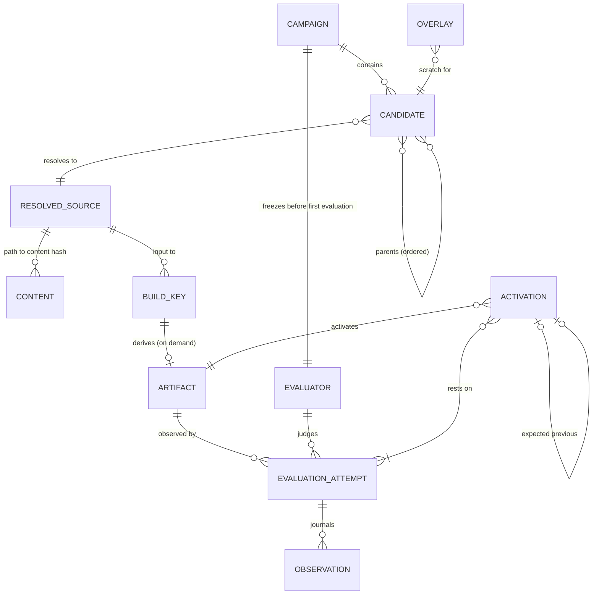

# R11 The experiment ledger

> Reconstructed 2026-10-17. The original R11 was not available; this version is rebuilt from
> Edition 2 §3, §7, §10, Edition 3 §6, §8, §9, §16, §18, the POODO skill, and a fresh Mononoke source
> study (`docs/studies/mononoke/`). Content follows Edition 3 where the editions differ.

## Purpose

Specify the ledger that records what the factory tried, built, observed and activated. It meets the requirements in R10 (L1–L6). It separates six identities that a commit would conflate, keeps regenerable derived data apart from unrepeatable observations, publishes only closed object graphs, activates by conditional update, treats an interrupted attempt as outcome-unknown, and makes reclamation explicit. Every mechanism is grounded in either the Mononoke source study or an Edition 3 rule. The whole document is **Proposed** unless a line says otherwise.

## Summary

- Six identities, never merged: candidate/provenance, resolved source, build key, artifact, evaluation attempt, activation record [E2 §10]. Two more support them: the frozen evaluator and the observation.
- Derived representations are regenerated on demand from pinned inputs; observations are journalled once and never regenerated [E2 §10].
- No durable record may reference an object that is not yet durable. Activation is a compare-and-swap on a named slot; a lost acknowledgment is reconciled from the authoritative record [E2 §10; E3 §9].
- The evaluator's hash enters the ledger before evaluation begins, and each evaluation receipt carries the POODO precommit fields [E3 §6, §8].
- Scratch has an owner, an expiry and a retain flag; reclamation is recorded in bytes.

## Grounding

Mechanisms below cite the Mononoke study by claim letter and section. All of those findings are **Upstream** (read from `facebook/sapling` at `79071c2a3ea20c36ed71332608535e5801101bba`, not run).

| Study finding | Verdict | Used for |
|---|---|---|
| (a) Bonsai record: ordered parents, metadata, path→content-id map; contents separate | CONFIRMED | Candidate record; content by hash |
| (b) Canonical records vs derived data fetched or derived on demand | CONFIRMED | Derivation mappings |
| (c) Default batch derivation sequential to avoid repeated work | CONFIRMED | Build coalescing |
| (d) Bubbles: read-through overlay with expiry, grace, labels | CONFIRMED | Attempt overlays, retain flags |
| (e) Sharded maps load by key path | CONFIRMED | Large indexes, later |
| (f) Bookmark compare-and-swap; lost race is a distinct non-error result | CONFIRMED | Activation |
| (g) Test in-memory store unlinks names without freeing payloads | CONFIRMED | Reclamation states |
| §3 Derived blobs flushed before mapping is written | Upstream | Publication after closure |
| §7 Lost-ack replay identified by already-advanced log id | Upstream | Lost-ack reconciliation |
| §4 Bubble owner stored but not checked on open | Upstream | Ownership checks |

## Identity separation

| Identity | Names | Hash input | May be shared by |
|---|---|---|---|
| Candidate (provenance) | One proposal and its lineage: who or what proposed it, from which parents, under which campaign and framing | Canonical candidate record | Nothing; each proposal is its own event |
| Resolved source | The effective source tree and dependency state the candidate resolves to | Sorted path→content-hash map plus dependency lock | Many candidates that resolve identically |
| Build key | Every input that affects the build: resolved source, toolchain identity, target, flags, configuration, trust scope | Canonical build-key record | Many candidates; one in-flight build |
| Artifact | Exact output bytes | SHA-256 of bytes | Many build keys, in principle |
| Evaluation attempt | One observation of one artifact by one frozen evaluator in one environment | Attempt record (not content-addressed; it is an event) | Nothing |
| Activation record | One authorized transition of a named slot to an artifact | Activation record | Nothing |

Two proposals can share a build without becoming the same historical event. One artifact can have many evaluation attempts across inputs and machines. A hash names bytes; it does not grant permission or prove task correctness [E2 §10; E3 §16].

Content-addressed identities (resolved source, build key, artifact, evaluator) use SHA-256 over a canonical serialization. Event identities (candidate, evaluation attempt, activation, observation) are unique ids issued by the ledger, because two identical-looking events are still two events. Ids are typed by prefix (`cand:`, `src:`, `bkey:`, `art:`, `evr:`, `eval:`, `obs:`, `act:`) so a hash never crosses types. (Study §2: Mononoke uses one key type per blob type.)



## Record schemas

JSON field lists. `*` marks a field included in the record's hash or required at creation. Times are UTC ISO 8601. All records are immutable once written, except the state fields named in each section, which change only by appending a transition.

### Candidate

```json
{
  "id": "cand:<ulid>",
  "campaign_id*": "camp:<ulid>",
  "parents*": ["cand:<ulid>"],
  "proposer*": {"kind": "model|person|search_policy|import", "identity": "<model id, person, or policy hash>"},
  "framing*": "<rival-frame label or null>",
  "changes*": {"<path>": {"op": "put|delete", "content": "sha256:<hex>|null"}},
  "intake_route*": "<route id, e.g. rust-wasm, ts-compat>",
  "created_at*": "<time>",
  "resolved_source": "src:<sha256>|null"
}
```

Ordered `parents` and a path→content-hash `changes` map follow Bonsai (study (a)). Contents are stored separately by hash. Validating the record checks internal consistency only (for example, every copy source is a listed parent); it does not check the change against its parents. Mononoke's `verify` draws the same line (study §1).

### Resolved source

```json
{
  "id": "src:<sha256>",
  "tree*": {"<path>": "sha256:<hex>"},
  "dependency_lock*": "sha256:<hex>",
  "source_restrictions*": ["<permission or tenant scope>"]
}
```

### Build key

```json
{
  "id": "bkey:<sha256>",
  "resolved_source*": "src:<sha256>",
  "toolchain*": {"name": "<compiler>", "version": "<version>", "binary": "sha256:<hex>"},
  "target*": "wasm32-<...>",
  "flags*": ["<flag>"],
  "config*": "sha256:<hex>",
  "trust_scope*": "<cohort or tenant scope>"
}
```

Trust scope and source restrictions are in the key, so coalescing never joins builds across scopes [E2 §7].

### Artifact

```json
{
  "id": "art:<sha256 of bytes>",
  "size_bytes*": 0,
  "media_type*": "application/wasm|application/json",
  "produced_by": ["bkey:<sha256>"],
  "storage_state": "attempt|warm|durable",
  "retained": false
}
```

### Frozen evaluator

```json
{
  "id": "evr:<sha256>",
  "campaign_id*": "camp:<ulid>",
  "universal_gates*": "sha256:<hex>",
  "domain_invariants*": ["sha256:<hex>"],
  "task_residual*": "sha256:<hex>",
  "plain_language_statement*": "sha256:<hex>",
  "qualification*": {"seeded_faults_rejected": 0, "seeded_faults_total": 0, "anchor_accepted": true, "deterministic": true, "receipt": "<path>"},
  "confirmed_by*": "<person or agent task contract>",
  "frozen_at*": "<time>",
  "revision_of": "evr:<sha256>|null",
  "revision_evidence": "<outcome-independent evidence ref>|null"
}
```

### Evaluation attempt (the receipt)

```json
{
  "id": "eval:<ulid>",
  "artifact*": "art:<sha256>",
  "evaluator*": "evr:<sha256>",
  "precommit*": {
    "observable": "<what is measured>",
    "acceptance_boundary": "<pass condition>",
    "oracle": "<oracle identity>",
    "oracle_version": "<version or hash>",
    "artifact_identity": "art:<sha256>",
    "environment": {"host": "<id>", "runtime": "<id+version>", "limits": {}},
    "failure_meaning": "<what a failure would show>",
    "stop_condition": "<when to stop>"
  },
  "precommitted_at*": "<time>",
  "delivery_state": "admitted|authorized|running|finished|outcome_unknown|reconciled|aborted",
  "outcome_state": "unobserved|observed|passed|failed|failed_with_test_concern|invalid|inconclusive",
  "observations": ["obs:<ulid>"],
  "overlay": "ovl:<ulid>"
}
```

### Observation (journal entry)

```json
{
  "id": "obs:<ulid>",
  "attempt*": "eval:<ulid>",
  "kind*": "timing|resource|test_result|model_output|reviewer_judgment|external_response",
  "value*": {},
  "scope*": {"host": "<id>", "inputs": "sha256:<hex>", "counter_source": "outside-isolate"},
  "recorded_at*": "<time>"
}
```

### Activation

```json
{
  "id": "act:<ulid>",
  "slot*": "<capability slot name>",
  "artifact*": "art:<sha256>",
  "expected_previous*": "act:<ulid>|null",
  "idempotency_key*": "<uuid>",
  "evidence*": ["eval:<ulid>"],
  "evaluator*": "evr:<sha256>",
  "authority*": "<promotion rule version and approver>",
  "requested_at*": "<time>",
  "result": "applied|lost_race|outcome_unknown|reconciled_applied|reconciled_not_applied"
}
```

### Overlay (scratch)

```json
{
  "id": "ovl:<ulid>",
  "owner*": "cand:<ulid>|eval:<ulid>",
  "base*": "<warm base identity>",
  "created_at*": "<time>",
  "expires_at*": "<time>",
  "grace_s*": 0,
  "retain_labels": [],
  "bytes_written": 0,
  "reclaim_state": "live|expired|unlinked|freed",
  "bytes_freed": 0
}
```

## Derive on demand versus the observations journal

| | Derived data | Observation |
|---|---|---|
| Examples | Build output, index, packaging, explanation, Git export | Timing sample, resource counters, model output, reviewer judgment, external response |
| Regenerable | Yes, from complete pinned inputs | No; repeating it makes a new observation |
| Storage | Warm, evictable; mapping from key to result may be durable | Durable, append-only journal |
| Loss means | Recompute | Loss of evidence |
| Grounding | Study (b): Mononoke fetches an existing mapping and derives only when absent | [E2 §10]; Mononoke has no equivalent |

Rules:

1. Produce a representation only when the next step requires it. Activation gates are always required [E2 §10].
2. One in-flight derivation per build key. A second caller with the same key joins it. Batch derivation over dependent keys runs in dependency order, not as naive concurrent recursion. (Study (c): Mononoke's default batch path is sequential because concurrent derivation can repeat work, and it shares per-type futures inside one call tree.)
3. A cache hit is never authorization [E3 §9].
4. Observations are written to the journal with their scope before any decision uses them.

## Publication after closure

A durable record may reference only objects that are already durable. Order of writes for one attempt:

1. Artifact bytes and any content they need are stored.
2. Store is flushed.
3. The build-key→artifact mapping is written.
4. Observations are journalled.
5. The evaluation attempt's terminal state is appended.
6. Only then may an activation reference the attempt.

Mononoke follows the same order for derived data: derived blobs are flushed before the mapping is written (study §3). Edition 3 states the rule as "persist before any reference points at it" [E3 §9].

## Conditional activation and lost-acknowledgment reconciliation

Activation is a compare-and-swap on a named slot: set `slot` to the new activation only if its current activation equals `expected_previous`. The ledger appends the activation record and the slot update in one transaction.

| Result | Meaning | Next step |
|---|---|---|
| Applied | Slot now points at the new activation | Done |
| Lost race | Slot held something other than `expected_previous` | Candidate stays inactive; re-qualify against the new incumbent if still wanted |
| No acknowledgment | Request may or may not have committed | Reconcile |

Reconciliation reads the authoritative state, never the compare-and-swap's apparent result [E2 §10]:

1. Look up an activation with the same `idempotency_key`. If present, the activation applied: record `reconciled_applied`.
2. Otherwise, if the slot still equals `expected_previous`, nothing applied: record `reconciled_not_applied`; a retry may reuse the same key.
3. Otherwise another activation won: record `reconciled_not_applied` with the winner's id.

Grounding: Mononoke's bookmark update is a conditional SQL update that must affect exactly one row, and returns a lost race as a distinct non-error result (study (f)). Its mirror path recognizes a lost-ack replay by an already-advanced log id, because a compare-and-swap that matched no rows can mean any divergence (study §7). The idempotency key plays the role of the log id here.

```mermaid
stateDiagram-v2
    [*] --> Requested
    Requested --> Applied: CAS matched
    Requested --> LostRace: CAS did not match
    Requested --> OutcomeUnknown: no acknowledgment
    OutcomeUnknown --> ReconciledApplied: record with idempotency key exists
    OutcomeUnknown --> ReconciledNotApplied: no record; slot unchanged or won by another
    Applied --> [*]
    LostRace --> [*]
    ReconciledApplied --> [*]
    ReconciledNotApplied --> [*]
```



## Outcome unknown is a state

An attempt authorized before a crash may have executed [E3 §9]. The ledger therefore has an explicit `outcome_unknown` delivery state for evaluation attempts and activations. Recovery:

1. Fences future work for the affected owner (no new attempt reuses its overlay or slot).
2. Verifies the exact owned closure: the overlay, the artifact, the journal entries.
3. Records what is known and what is ambiguous.
4. Never infers success from leftover output, a process name, a PID, or a successful spool [E3 §9].

An attempt in `outcome_unknown` cannot support an activation until it is re-run as a new attempt or reconciled with evidence. Field OS recorded five named recovery boundaries behaving this way [E3 §9, §14]; that evidence is about Field OS, not about this ledger, which does not exist yet.

## Reclamation and ownership

Every scratch object has an owner, an expiry, a grace period and optional retain labels. (Study (d): Mononoke bubbles have expiry, a grace period during which open readers continue, labels that keep a bubble alive, and deletion modes.)

- Ownership is checked on every open and every reclamation. Mononoke stores a bubble owner but does not yet check it on open (study §4); Endoforge should not copy that gap.
- Reclamation passes through recorded states: `live` → `expired` → `unlinked` → `freed`. `bytes_freed` is measured, not assumed. Unlinking a name is not freeing storage [E2 §3]. (Study (g): Mononoke's in-memory test store unlinks names and never removes payloads. That is a test store, not evidence about production; the lesson is that the two steps differ.)
- Shared immutable roots (the warm base, the invariant library) are reference-counted or retained explicitly. Private overlays are reclaimed whole. Both follow the same state sequence [E2 §3].
- After a campaign, the ledger can report what is live, retained, awaiting persistence, and reclaimable, in bytes [E2 §3].

## Frozen evaluator before evaluation

The evaluator record, including the task residual's hash, is written before the first evaluation attempt of the campaign [E3 §6]. Generation may overlap with evaluator synthesis; the freeze must precede evaluation, not generation [E3 §10]. The ledger enforces:

- Every evaluation attempt names one evaluator id, and that evaluator's `frozen_at` precedes the attempt's `precommitted_at`.
- A revised evaluator is a new record with `revision_of` and outcome-independent `revision_evidence`. Attempts against the old evaluator keep their old id; nothing is silently re-scored [E3 §6].
- Candidates cannot write to the ledger or the evaluator [E3 §8].

Local prior art: the isolate-factory lab keeps a frozen evaluator in `evaluator/FROZEN.json` (fields `schema`, `digest`, `covers`) and a precommit hash chain in its harness (`~/Work/isolate-factory-lab` at `a95a4925`). These are design inputs, not results.

## POODO precommit fields as the evaluation receipt

Edition 3 adopts POODO's precommit record as the evaluation receipt and requires its separation of delivery state from outcome state to be enforced in the ledger by deterministic code [E3 §8]. POODO is not an evaluator and runs at campaign boundaries, never per candidate [E3 §8].

| Receipt field | Source |
|---|---|
| `observable` | [E3 §8]; POODO "predicted observable result" |
| `acceptance_boundary` | [E3 §8] |
| `oracle`, `oracle_version` | [E3 §8] |
| `artifact_identity` | [E3 §8]; here always an `art:` id |
| `environment` | [E3 §8] |
| `failure_meaning` | [E3 §8] |
| `stop_condition` | [E3 §8] |
| `delivery_state`, `outcome_state` | POODO terminal claim contract (`~/LOCAL LLM/poodo/SKILL.md` lines 64–72 at `bbcd8998`) |

The `outcome_state` values follow POODO's list (unobserved, reported, observed, corroborated, passed, failed, invalid, inconclusive) plus `failed_with_test_concern` from its contradiction rule (`SKILL.md` line 19). `invalid` requires outcome-independent evidence. The ledger adds `outcome_unknown` to `delivery_state`, from [E3 §9]. Deterministic checks: precommit fields are present and hashed before `running`; `outcome_state` never strengthens without a new observation.

## Edition 3 alignment

- **Holds from Edition 2:** the six identities, derivation on demand, observations versus derived data, publication after closure, conditional activation and lost-ack reconciliation [E2 §10].
- **Added by Edition 3:** frozen evaluator hash in the ledger before evaluation [E3 §6]; POODO receipt fields and delivery/outcome separation [E3 §8]; outcome-unknown as a state and the three lifetimes [E3 §9]; ledger outside every cohort [E3 §9].
- **Changed:** the attempt overlay now wraps a WebAssembly module instance's inputs and outputs, not a QuickJS guest with a virtual filesystem [E3 §9].
- **Superseded:** none of Edition 2's ledger mechanisms.

## Open questions

- Storage engine for the first slice (SQLite file, append-only log, or Durable Object storage on the hosted lane). Decide in the vertical slice (`execution/EXECUTION-PLAN.md`) and record in R16.
- Canonical serialization for hashed records (for example RFC 8785 JSON canonicalization). Needs a decision in R16.
- Whether cross-process build coalescing needs leases. The study found only in-process sharing in Mononoke's files read.
- Whether `outcome_state` should include `reported` and `corroborated` for machine evaluations, or only for claims relayed from people and agents.
- Retention policy for observations of discarded candidates: useful failure (R07) argues for keeping some.
- How ledger records link to incremental compiler state; a changeset record is not an incremental compiler graph [E2 §10]. See R07.

## Sources

- [E2 §3], [E2 §7], [E2 §10].
- [E3 §6], [E3 §8], [E3 §9], [E3 §10], [E3 §14], [E3 §16], [E3 §18].
- `docs/studies/mononoke/STUDY.md`, `SOURCE-MAP.md` (`facebook/sapling` at `79071c2a3ea20c36ed71332608535e5801101bba`).
- `~/LOCAL LLM/poodo/SKILL.md` at `bbcd899802df81ec5b987194215f14e7aecfa4ad`, lines 18 (precommit), 19 (contradiction rule), 64–74 (terminal claim contract); `references/epistemic-integrity.md` lines 61–77 (precommitment and test integrity).
- `~/Work/isolate-factory-lab` at `a95a4925f2b9899375482432600a5515f090c93f`: `evaluator/FROZEN.json`, `harness/`.
- R10 for requirements L1–L6.
