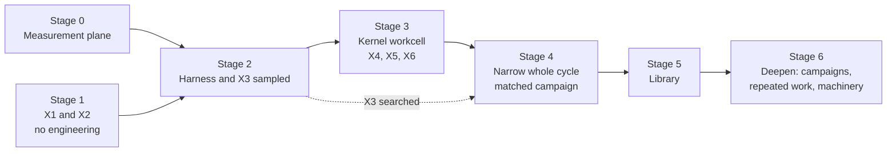

# R13 — Implementation sequence

> Reconstructed 2026-10-17. The original R13 was not available; this version is rebuilt from
> Edition 3 (§4, §5, §6, §7, §9, §12, §13, §15, §17), Edition 2 (§15), the white paper (pp. 21–23),
> the diagram atlas (sheet 28), the Field OS receipts and specification, and the isolate-factory-lab
> repository and worktrees listed under Sources. Content follows Edition 3 where the editions differ.

## Purpose

This document sets the order in which Endoforge is built, the gate a stage must pass before the next begins, and what existing local work is carried into each stage. Edition 2 said: build the whole cycle narrowly, then deepen. Edition 3 keeps that rule but changes what is built first: the evaluation plane, then the substrate, then the library. This document reconciles the two and names, by path, which parts of the 14 October isolate lab and the Field OS worker fabric are reused and which are retired. Every stage, gate and estimate here is **Proposed**.

## Summary

- The first milestone is still one narrow, complete cycle, from request to retained capability, not a fast component. What changes is the build order inside it: the evaluator and its measured error rate come before the kernel workcell, and the library comes last [E2 §15; E3 §12, §15].
- Stages run 0 to 6. Each has an entry condition, an exit gate written as a stop rule, and the claim-ladder rung it may move. A failed gate narrows the product, not the standard [E3 §15].
- The first two experiments (X1, X2) need no engineering, so they run in parallel with Stage 0 plumbing.
- The lab's measurement plane carries forward almost whole: precommit and hash chain, receipt verification, environment control, calibration, fault and metamorphic tests, the frozen evaluator discipline. Its candidate path does not: QuickJS nested interpreters and per-candidate VFS guests are superseded by the WebAssembly kernel contract.
- The Field OS worker fabric carries forward as the recovery and custody pattern (durable admission, fenced dispatch, `outcome_unknown`, source-bound return), which is the only recorded evidence the project has [E3 §9, §14].

## 1. The rule, and why the order changed

Edition 2's route: establish one complete workcell, then one useful generated interface, then contrasting routes, then controlled improvement, then systematic removal of repeated work, then improvement of the factory itself, then hardware co-design [E2 §15]. It warns against spending the first milestones on a universal compiler, a Git replacement or exotic hardware.

Edition 3 reorders the emphasis because of how each component fares as models improve [E3 §12]:

| Component | As models improve | Consequence for build order |
|---|---|---|
| Evaluation plane and harness | More valuable | Build first; it is what makes any later number mean something |
| Substrate (density, locality, bounded execution) | More valuable | Build second, against a measured evaluator |
| Invariant and contract library | More valuable | Build third; it is what the synthesized residual shrinks against |
| Retained code | Less valuable | Do not optimise for it |
| In-isolate locality as a headline | Roughly neutral | Do not lead with it |

The two rules are compatible. "Narrow" means one domain, one route, one request class and one host. "Whole cycle" means intake, specification, workcell, qualification, activation and library feedback all exist, however thin [E3 §4]. Edition 3 changes which of those boundaries gets real engineering first. The first cycle may run its candidates through the existing Field OS guest adapter or a native baseline, so evaluation-plane work is never blocked on substrate work.

## 2. Stages and gates

### Stage 0 — Measurement plane

| Item | Content |
|---|---|
| Purpose | Make every later number a receipt: precommit, hash chain, environment identity, calibration, verification command |
| Entry | None |
| Work | Port the lab's receipt and precommit chain and environment control into the Endoforge repository (§3). Adopt `docs/templates/CAMPAIGN-PRECOMMIT.md` and `docs/templates/RECEIPT.md`. Fix, before reuse, the lab defects that would invalidate any campaign: M3 (`outcome_unknown` is its own stage), M9 (every descendant in the arm cgroup), M10 (steady state compares like with like), M11 (refuse dirty trees and calibration waivers), and the out-of-cgroup core-dump helper |
| Exit gate | A tiny real campaign on the target host produces a receipt set that `verify` accepts; the calibration suite passes at the measured commit on the same boot; a noise baseline is recorded **with its quiet gate passing** (or the campaign window is declared exclusive). If the quiet gate cannot pass on the shared desktop, timing claims are restricted to effects above the recorded upper-bound MDE |
| Rung moved | None |
| Estimated cost | 17–28 days (Estimated; WP01–WP06 of `docs/execution/WORK-PACKAGES.md`, reconciled 2026-10-17, see §2.1). The port alone (WP01) is 3–5 days |

### Stage 1 — Specification evidence (X1, X2)

| Item | Content |
|---|---|
| Purpose | Decide whether generative applications have a market now, and the starting autonomy tier, before building anything that assumes either |
| Entry | Campaign precommit template (Stage 0 may still be in progress) |
| Work | E3 X1: twenty real requests, hand-written acceptance contracts, timed. E3 X2: one hundred tasks, POODO synthesizes the residual in a candidate-blind context, people grade the evaluators. Details in R14 |
| Exit gate | X1 kill rule: under 20 % specifiable in ten minutes, the agent substrate is the product and generative applications move to research. X2 kill rule: above 5 % evaluator error on determinate requests after two library passes, no autonomous tier anywhere and every domain starts Confirmed [E3 §15] |
| Rung moved | Prepares rung 3 (error rate half) |
| Estimated cost | X1 2–4 days; X2 8–12 days (Estimated; WP07, WP08). The X1 decision at n = 20 is read in three bands (C01 §3); X2's kill is read only on at least 100 pass-2 determinate evaluators (C02 §3) |

### Stage 2 — The harness as trusted base, and the sampled escape rate (X3a)

| Item | Content |
|---|---|
| Purpose | Turn "harnessed" into a number: the escape rate of seeded faults through the full harness [E3 §7] |
| Entry | Stage 0 exit; X2 has produced at least one qualified evaluator per domain to be tested |
| Work | Universal gates (contract and schema validity, type and interface conformance, resource bounds, determinism, forbidden effects) as deterministic code. A seed domain-invariant library from Field OS (dimensional consistency, source-bound return, no cross-room mutation, round-trip and idempotence, reconciliation of totals) [E3 §6]. The evaluator engine with a frozen identity. A fault generator stratified by domain and fault class (R14 X3). Candidates may execute in the compatibility lane or the existing guest adapter; the kernel workcell is not required for the sampled measurement |
| Exit gate | Sampled escape rate per domain with a one-sided 95 % bound (R14 X3). Each domain gets a provisional tier; no domain is Supervised until its sampled bound is below 1 in 1,000 |
| Rung moved | Rung 3 (sampled half only) |
| Estimated cost | 19–30 days (Estimated; WP09–WP12, reconciled 2026-10-17). The earlier 8–15 counted fault generation and filtering only; the engine, the invariant sets for both domains and the known-good implementations per task are the difference |

### Stage 3 — The kernel workcell (X4, X5, X6)

| Item | Content |
|---|---|
| Purpose | Build the narrowest substrate that satisfies the kernel contract, and decide routes, inference placement and the hosted lane [E3 §5, §13] |
| Entry | Construction of the workcell (WP13–WP22) may begin once the ledger and the host record exist and the host of the AssemblyScript compiler and of the compatibility lane are decided (`EXECUTION-PLAN.md` §7.1, DP-1 and DP-2). Judging candidates (X4, X5, X6) waits for Stage 2 exit: an evaluator with a measured escape rate must exist first |
| Work | The local lane: a Wasmtime-based host under OS sandboxing, cgroups and an external watchdog. One pure-kernel route first (AssemblyScript, compiler inside the isolate); declarative glue under closed schemas; host-owned buffers reached by handle. Port the w-contain cases to kernels. Carry the Field OS recovery boundaries unchanged: durable intent before execution, fenced dispatch, `outcome_unknown` as a state, verified closure [E3 §9]. Then run X4 (route yield), X5 (model term) and X6 (hosted fit) |
| Exit gate | Rung 2 recorded for the kernel contract: every containment case contained or a predeclared expected failure, cleanup verified, recovery boundaries reproduced. X4, X5 and X6 each decided by their precommitted kill rules (R14) |
| Rung moved | Rung 2 for the kernel contract; rung 1 only if the AssemblyScript compiler runs inside the Wasmtime workcell under receipt, which the default of DP-1 (a supervised V8 process beside the lane) does not do |
| Estimated cost | 43–69 days (Estimated; WP13–WP25, reconciled 2026-10-17): 29–46 for the workcell and routes (WP13–WP19, WP21, WP22), 3–5 for MoonBit (WP20, Stage 6+ / optional), and X4 5–8, X5 3–5, X6 3–5 (WP23–WP25). The earlier 15–25 for the workcell did not count the broker, resource enforcement, recovery and lifetimes as separate packages |

### Stage 4 — One narrow whole cycle, and the matched end-to-end campaign

| Item | Content |
|---|---|
| Purpose | One request goes through every boundary and a real person uses the result; then the cycle is compared against the arm that matters |
| Entry | Stage 3 exit; X1 did not kill generative applications (otherwise run the agent-substrate version of this stage only) |
| Work | Intake and contract → specification (synthesized, frozen, confirmed residual) → workcell → qualification outside the isolate → guarded activation → library entry with contract, tests and lineage [E3 §4]. One useful generated interface with behaviour, source inspection and a state-preserving revision; restart and rollback demonstrated [E2 §15]. Then X3b (escape rate under a sixteen-wide search) and the matched end-to-end campaign with four arms (R14 §3) |
| Exit gate | A named person completes a real task with the capability (rung 4 attempt). Searched escape rate per domain: above 1 in 1,000 keeps candidate width at one until a new non-model check lands [E3 §15]. The matched campaign's verdict against the conventional-agent arm is recorded, including inconclusive |
| Rung moved | Rung 3 (searched half), rung 4 |
| Estimated cost | 24–38 days (Estimated; WP26–WP30, reconciled 2026-10-17; WP29 and the live-revision half of WP28 are Stage 6+ / optional but remain in the sum) |

### Stage 5 — The library

| Item | Content |
|---|---|
| Purpose | Make later requests cheaper by retaining what compounds: contracts, invariants, tests and counterexamples [E3 §12] |
| Entry | Stage 4 exit with at least one accepted capability |
| Work | Capability contracts separate from implementations; qualification records that do not transfer across environments; lineage that follows the data; counterexamples kept; deprecation, deduplication and reclamation from the first entry; retrieval treated as a model call with its own trust properties |
| Exit gate | Precommitted lifetime-economics measurement started (rung 6 needs months). Every retained capability has a passing qualification against the current host or is retired |
| Rung moved | Starts rung 6 |
| Estimated cost | 12–18 days to a usable first version (Estimated; WP31, reconciled 2026-10-17 from the earlier 15–20) |

### Stage 6 — Deepen

Controlled improvement campaigns on a bounded hotspot or retained capability (rung 5); systematic removal of repeated work, each backed by a full-recomputation comparison [R06, R07]; the factory's own machinery as a challenger under an external contract (rung 7); hardware co-design including unified-memory placement [R09]. Each item is its own precommitted campaign. Nothing in Stage 6 may begin before the escape rate it depends on is measured under search.

### 2.1 Reconciliation with the work-package estimates (2026-10-17)

The stage costs above were first written top-down and summed to 82–129 days. The bottom-up packages in `docs/execution/WORK-PACKAGES.md` sum to 130–207 days. This document now carries the package sums, so the two agree on one accounting. What the top-down figures omitted (all Estimated; arithmetic Derived):

| Omission or difference | Days (low–high) |
|---|---|
| Packages not costed at all: WP02 lab must-fix carry-over (5–8), WP03 hardware records (2–4), WP04 ledger (4–6), WP05 provenance (1–2), WP06 frozen evaluator store (2–3), WP20 MoonBit (3–5), WP32 documentation (5–8) | 22–36 |
| Stage 2 under-counted: engine, two invariant sets, known-good implementations (19–30 against 8–15) | 11–15 |
| Stage 3 workcell under-counted: broker, enforcement, recovery, lifetimes and routes as separate packages (29–46 against 15–25) | 14–21 |
| Stage 4 under-counted: glue, integration, activation, legibility, matched campaign (24–38 against 20–30) | 4–8 |
| Stage 5 over-counted (12–18 against 15–20) | −3 to −2 |
| Total difference | 48–78 |

82 + 48 = 130 and 129 + 78 = 207. The WP10 and WP11 figures include a 2–3 day rise each from the 17 Oct critique (second-domain invariants; known-good implementations), which is why the package total moved from 126–201 to 130–207. Not costed in either accounting: the unified-memory host for X5 part b, recruiting the rung-4 person, and the hours of graders other than the author (`EXECUTION-PLAN.md` §6).

## 3. What carries forward from the isolate lab

Paths are relative to `~/Work/isolate-factory-lab` at `main` = `a95a492` unless a branch is named. "Fix first" names the critique item that must be closed before reuse [`CRITIQUE-2026-10-14-precampaign.md`].

| Capability | Lab path | How Endoforge uses it | Fix first |
|---|---|---|---|
| Precommit written before the first measured job, hashed, cited by every request and summary | `harness/run.mjs` (precommit write), `harness/lib/receipts.mjs`, schema `ifl-precommit-v1` | Stage 0 precommit; extended with the POODO fields (`docs/templates/CAMPAIGN-PRECOMMIT.md`) | M11 (refuse dirty tree and waivers) |
| Canonical JSON and tree digests | `harness/lib/canonical.mjs`, `evaluator/lib/canonical.mjs`, `evaluator/lib/tree-digest.mjs` (`ifl-canonical-json-v1`, `ifl-tree-sha256-v1+symlink-targets`) | Identity of every artifact, evaluator and workload | Extend adapter digests to import closures and binaries (S4) |
| Receipt-set schema and verifier | `harness/lib/receipt-schema.mjs` (`ifl-receipt-set-v1`), `harness/verify-receipts.mjs`, `make verify RECEIPTS=…` | The verification command in every receipt | — |
| Fail-closed spec gate; verified-only report; replication compare | `harness/check-spec.mjs`, `harness/report.mjs`, `harness/replicate.mjs` | Campaign admission; results report listing contradictions first; replication on a different day | S2 (bootstrap method), S3 (orientation) |
| Environment control | `tools/env-control/{snapshot,gate,pin,noise-baseline}`, `tools/env-control/lib/*.mjs` | Environment identity before and after; quiet gate per block; pinning plan; noise baseline feeding sample size | None; record the lesson that the preferred cores were the noisiest |
| Calibration against known truths (C1 timing, C2 CPU, C3 memory, C4 I/O, C5 throttling, C6 evaluator sensitivity, C7 noise floor) and its gate | `tests/calibration/` (`checks.mjs`, `c6.mjs`, `c7.mjs`, `known-truth/`, `receipt.mjs`) | Every campaign embeds a calibration receipt at the measured commit. C6 is the template for qualifying a synthesized evaluator (X2) and for X3's fault seeding. C2 and C3 must be re-derived for the Wasmtime lane | M7 (two-process I/O accounting) for any P10-style claim; S7 (C6 must exercise the scoring path) |
| Fault injection and ledger checks | `tests/faults/` (F1 SIGKILL mid-candidate → `outcome_unknown`; F2 driver kill; F3 corruption), `tests/lib/ledger.mjs` (L1–L5) | The recovery acceptance for Stage 3, alongside the Field OS boundaries | M3 |
| Metamorphic and determinism tests | `tests/metamorphic/` (`transforms.mjs`, `determinism.test.mjs`) | Metamorphic relations are one of Edition 3's non-generator sources of residual authority [E3 §6]; determinism is a universal gate | — |
| Contract conformance probe | `tests/conformance/` | Conformance of every kernel host, compatibility-lane executor and renderer | S8 (plateau rule for bounded pools) |
| Containment workload and expected-failure oracle | `workloads/w-contain/`, `oracles/w-contain/expected.json` | Ported to kernels in Stage 3; expected failures predeclared with provenance | S9 (bound the checker-DoS excuse) |
| Frozen evaluator discipline | `evaluator/` (`requireFrozen`, gate order, `strict-json.mjs`, `pareto.mjs`, `finalists.mjs` winners'-bias re-check), `oracles/w-exec/check.mjs` | The evaluator engine's shape in Stage 2: frozen identity, gates before ranking, no weighted sum, finalist re-check on fresh rounds | M2 (judge the arm's own artifact) |
| Typed mutation operators | `workloads/w-search/generator/` (`ir.mjs`, `mutate.mjs`) | Seed for X3's fault generator (operator swaps, constant tweaks, loop bounds, deletions); must be extended with Edition 3's domain faults (swapped units, dropped rows, wrong join rule, stale binding) | — |
| G = 0 adaptive search | `evaluator/lib/search.mjs` | Search pressure for X3b before any model proposer exists | — |
| tsc-rs build provenance | `docs/CHECKERS.md` build section; `adapters/checkers/tscrs-wasm/vendor/BUILD-INFO.txt` | Compatibility lane and X6: pinned commit `3644f32`, reproducible size build `d96d8d53…`, speed build `f4ca6a46…` | — |
| Zero-I/O syscall tracer and lessons on pools and lib retention | `feat/fastloop`: `factory/tools/sctrace.c`; `docs/FASTLOOP.md` §2–§4, §7 | Measurement technique for P10-style claims; the finding that retained parsed state, not WASM versus native, decides check cost (pilot) | — |

## 4. What is superseded

| Lab or Field OS element | Path | Why superseded | What remains of it |
|---|---|---|---|
| QuickJS nested interpreter as the candidate boundary | `adapters/executors/quickjs-fresh/`, `adapters/executors/quickjs-bwrap/`; `feat/fastloop`: `factory/src/guest-quickjs.mjs`; Field OS `tools/worker-fabric/guest-runner.mjs` (Just Bash + QuickJS) | Edition 3: no generated imperative JavaScript executes anywhere; the module boundary replaces the nested interpreter, and three-level nesting collapses to two [E3 §5, §9] | The Field OS guest numbers are the baseline X4 must beat [E3 §14]. Lab findings stay as cautions: QuickJS's memory limit is ineffective in the emscripten build, and its deadline is cooperative |
| Per-candidate VFS guest | Field OS Just Bash VFS (shared or fresh per job); the lab's guest-side in-memory filesystems | Large inputs stay in host-owned buffers reached by handles; a candidate never receives a pointer into trusted state [E3 §5] | The compiler-side in-memory project map (`adapters/checkers/*`, `factory/src/tscrs-host.mjs`) remains valid for the compatibility lane |
| Arm C as "tsc-rs WASM + QuickJS guest" and P6 as the decisive question | `docs/PREDICTIONS.md` v1.2–v1.5; `harness/campaigns/primary-p6.json` | The decisive arm is now the kernel workcell; TS→JS is the compatibility lane | P6's design (open-loop stream, content-unique verified accepts, paired blocks, equivalence margin) is reused for the matched campaign. Its pilot numbers stay pilot |
| Generated TypeScript reducers in QuickJS for UI | `uihill/` (reducers in a worker QuickJS guest) | Reducers become WASM kernels; views and bindings become declarative glue [E3 §5] | The UI checks carry forward to glue validation: axe, keyboard journeys, stable ids, host-side interaction CPU, negative-control instruments |
| In-process V8 child isolates without an outer process | `adapters/executors/isolated-vm/`, `adapters/executors/worker-threads/` | Smoke matrix: neither contains `alloc-heap-unbounded`; blast radius is the whole process [`docs/EXECUTORS.md`] | The compatibility lane's child isolate, but only inside an owned process and cgroup |

## 5. What carries forward from Field OS

The worker fabric at `58d6826` is the applied case and the source of every recorded number [E3 §14]. Its boundary rules carry forward unchanged [E3 §9]:

- durable admission and idempotent retries (`src/fieldops/worker_fabric.py`);
- fenced dispatch and a single durable claim (`src/fieldops/worker_fabric_execution.py`);
- custody before reference, and source-bound return that re-checks authority on every read (`src/fieldops/worker_fabric_return.py`);
- `outcome_unknown` after any kill between claim and canonical finish; cancellation only after verified closure (`src/fieldops/worker_fabric_recovery.py`);
- precommitted predictions with SHA-256 identities before every trial (W1/W2 and W3/W4 receipts).

The testbed harness (`tools/worker-fabric/testbed/`: `supervision.py`, `lab.py`, `warm.py`) is the method the lab reused; Endoforge reuses the lab's version of it.

## Edition 3 alignment

- **Changed.** Edition 2 began with "establish one complete workcell". Edition 3 begins with the specification study and the evaluator error rate, and puts the workcell after the harness has a measured escape rate [E3 §15]. The white paper's priority, "prove a small, fully in-isolate compiler/evaluator loop first" [W p.23], is superseded in the same way.
- **Superseded.** The nested QuickJS candidate, the per-candidate VFS guest, and TypeScript→JavaScript as the default candidate format.
- **Still holds.** Build the whole cycle narrowly before deepening; compare against an already-warm baseline, not a cold VM per candidate [E2 §15; A sheet 28]; every stage requires evidence rather than a calendar.

## Open questions

- Can the first narrow cycle use the Field OS guest adapter as its interim workcell without its numbers being mistaken for kernel evidence? Proposed answer: yes, if every receipt names the lane.
- Which domain is the first for X3? Field OS refrigeration has the most existing invariants; a second, unrelated domain is needed before any tier generalises (R14 X3). The second domain must be named before X2 freezes, because X3 needs X2's evaluators in it (`EXECUTION-PLAN.md` §7.1, DP-3).
- Does the AssemblyScript compiler fit and run inside the Wasmtime workcell within the attempt lifetime? Under the DP-1 default it does not run there at all in the first slice (`EXECUTION-PLAN.md` §7.1); the in-Wasmtime alternative is Stage 6+ / optional, and rung 1 waits for it.
- Should the lab's unmerged fixes (`wip/precampaign-scoped`, `wip/precampaign-deferred`) be cherry-picked into the lab, or re-implemented in Endoforge's measurement plane? Decision belongs in the decision register (R16).

## Sources

- Edition 3 §4, §5, §6, §7, §9, §12, §13, §14, §15, §17 (`sources/text/Endoforge-Edition-3.txt`).
- Edition 2 §15 (`sources/text/Endoforge-Edition-2-The-Entire-Idea.txt`).
- White paper pp. 21–23; diagram atlas sheet 28.
- `~/Work/field-ops/docs/specs/FIELD-OS-WORKER-FABRIC-V1.md` §10–§12; `~/Work/field-ops/docs/receipts/FIELD-OS-MAIN-RIG-001-RECEIPT.md`; `~/Work/field-ops-github-review/docs/receipts/FIELD-OS-WORKER-FABRIC-W1W2-20261008.md`, `FIELD-OS-WORKER-FABRIC-W3W4-20261008.md`; file list at commit `58d6826`.
- `~/Work/isolate-factory-lab` at `a95a492`: `docs/END-STATE-AND-TEST-PLAN.md`, `PREDICTIONS.md`, `TESTING.md`, `WORKLOADS.md`, `EXECUTORS.md`, `CHECKERS.md`, `ENVIRONMENT.md`; `CRITIQUE-2026-10-14-precampaign.md`; `Makefile`; directory listings of `harness/`, `tests/`, `tools/env-control/`, `evaluator/`, `adapters/`, `workloads/`, `oracles/`.
- `~/Work/isolate-factory-lab-wt/fastloop/docs/FASTLOOP.md` and `factory/` file list on `feat/fastloop`; `~/Work/isolate-factory-lab-wt/measure/docs/PILOT-2026-10-14.md`; `docs/BACKLOG.md` on `wip/precampaign-scoped`.
- R12 (this library) for the evidence state.
- `docs/execution/WORK-PACKAGES.md` and `docs/execution/EXECUTION-PLAN.md` (estimates reconciled 2026-10-17); `docs/execution/CRITIQUE-2026-10-17-plan.md`.
