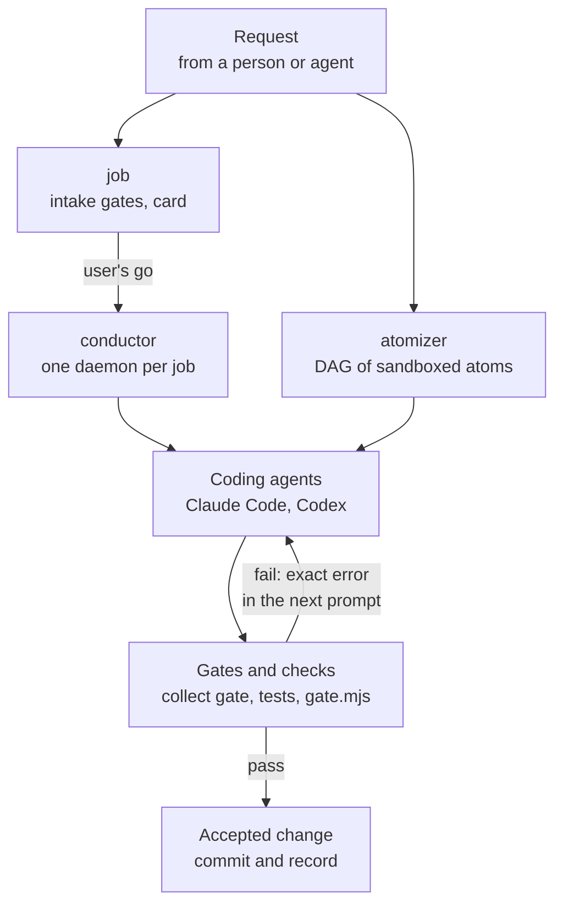

# Tools

EndoForge is where AI coding agents (Claude Code through `claude -p`, and Codex) build software. The candidate loop
that runs inside V8 isolates lives in [core/runtime](../core/runtime/README.md). This directory holds everything around
it: the tools that take a whole job from a request to merged commits, the checkers that decide whether code is
accepted, the harnesses that measure how good those checks are, and the scripts that keep this repository honest.

Every directory has its own README with a real example. This page is the map.

Why isolates: a V8 isolate is a separate instance of the JavaScript engine inside one process. Kept warm in memory
with a compiler already loaded, it can compile and check a candidate without starting a process, a container or a
virtual machine, so one machine runs many attempts at once. The isolates are there for speed and density, not as a
security sandbox.

You need Git, GNU Make, Python 3.11 or later and Node.js 22.8 or later (the [repository README](../README.md) has the
install steps). The atomizer also needs bubblewrap (`bwrap`); the conductor's `unit` command needs systemd user
services.

## Start here

Two runs need no model, no account and no network, and show the core idea in seconds:

```sh
tools/conductor/demo.sh /tmp/ef-demo/job
```

runs a two-atom job end to end with a stub in place of the coding agents: each agent's first change fails the gate,
is reverted, and is fixed on the second try with the exact error in its prompt ([conductor](conductor/README.md)).

```sh
DEMO=$(mktemp -d)
export ATOMIZER_LEDGER_DIR=$DEMO/ledger ENDOFORGE_CLAUDE_ACCOUNTS=$DEMO/none
node tools/atomizer/bin/schedule.mjs run tools/atomizer/test/fixtures/synthetic-fanout.json --run-dir $DEMO/run
```

runs a ten-atom dependency graph in sandboxes, ten seconds of work in three ([atomizer](atomizer/README.md)).

## Words used on these pages

| Word | Meaning here |
|---|---|
| Atom | One piece of work for one worker, with its own files or outputs and its own check |
| Workcell | A V8 isolate kept warm in memory with a pinned compiler and the gates loaded, where candidates are checked |
| Kernel | The application logic of a candidate: a pure WebAssembly module (state and event in, next state and effects out) plus `glue.json` describing its interface |
| Gate | An automatic check a change must pass before it is kept |
| Frozen | Hashed and recorded before any code exists; a later change is refused |
| Ledger | The append-only, hash-chained record of every decision |
| Card | The one-page summary of a job that the user confirms before any agent starts |
| Login | One signed-in Claude Code or Codex subscription account; agents are spread across the available logins |
| Capacity dial | A percentage in `$WORKER_STATE_DIR/CAPACITY` that scales how many workers start at once (a `DRAIN` file there stops new launches) |
| P-number, GAP-EF, REQ, C-nn | Ids from the engineering records: experiments, known test gaps, requirements and design components |

## How the tools fit together



A person states what they want. [job](job/README.md) turns it into a manifest, checks it, and shows a card the user
confirms. The [conductor](conductor/README.md) then launches one coding agent per atom (a piece of work that owns its
own files), puts every change through a gate the moment it lands, and relaunches an agent with the exact error when
its change fails. The [atomizer](atomizer/README.md) is the other way to split work: a dependency graph of small atoms,
each in its own bubblewrap sandbox, with roles kept apart (the agent writing code never sees the frozen tests).
[hillclimb](hillclimb/README.md) repeats rounds of critique and fixing against a goal.

Which to use: the conductor when agents should change an existing repository and iterate until its tests and checks
pass; the atomizer when a new capability should be built from a written need by separate atoms (contract, tests,
code, review) that cannot see each other's work; hillclimb when quality is judged by critique over several rounds
rather than by one test.

These tools run each agent as an ordinary process, in a git worktree or a bubblewrap sandbox. The other way agents
work here is the in-isolate agent loop (`ENDOFORGE_LOOP=agent` in [core/runtime](../core/runtime/README.md)), where
the agent's file reads, edits and checks run against an in-memory overlay inside a V8 isolate and only the model
turns and ledger writes leave it.

## Whole-job layer: agents building real repositories

| Tool | What it does | Status |
|---|---|---|
| [job](job/README.md) | Checks a job manifest against six intake gates and fifteen invariants, renders the card the user confirms by its SHA-256, compiles every atom's prompt | Active; tested by `make lib-test` |
| [conductor](conductor/README.md) | Resumable daemon: launches Codex and Claude Code workers in git worktrees, gates each landed change, runs its checks, freezes or relaunches it, escalates what it cannot decide | Active; tested by `make lib-test` with a stub worker, including the adopt example, criteria-derived checks and the collect lock in a git worktree |
| [atomizer](atomizer/README.md) | Validates and runs a DAG of atoms in bubblewrap sandboxes, verifies outputs against receipts, writes an append-only ledger | Active; tested by `make atomizer-test`, including `atomize`, `direct`, `fanout`, `report` and `cutover` |
| [hillclimb](hillclimb/README.md) | Round-based improvement campaigns (render, critique, fix, apply, score) with a lessons ledger | Active; the lessons ledger, the default runner (`bin/run-atoms.mjs`, on the atomizer scheduler), `plan-review`, `scripts/hc-patch.sh`, fan-out, planning and the scoreboard have tests (`make lib-test`) |
| [lib](lib/README.md) | Shared exit codes (75 busy, 78 stop), typed retry, file locks, headroom, exit files | Active; `errors.mjs` tested |
| [job-locks](job-locks/README.md) | Prints the locked decisions of active jobs for a session-start hook | Active; tested by `make lib-test` |
| [project-scheduler](project-scheduler/README.md) | Runs one cross-project batch of pieces plus a recombine step under token reservations | Works; tested by `make gap-tools-test` (REQ-SCHED-001) |

## Checking: what decides whether code is accepted

| Tool | What it does | Status |
|---|---|---|
| [asc](asc/README.md) | Pins the AssemblyScript compiler (0.28.20) that workcells load, with file digests and workcell limits | Active; used by every `isolate` and `agent` loop run |
| [tscheck](tscheck/README.md) | Type checks TypeScript inside workcells with `tsrs`, a WebAssembly build of the TypeScript 7 compiler | Active, opt-in route; `make tscheck-test` |
| [gate](gate/README.md) | Stand-alone freeze-then-check runner for one kernel directory; compiles `kernel.ts` with the `tools/asc` pin (or `ENDOFORGE_ASC`) and runs the core gates G1 to G9, structured state included | Used inside atomizer compose atoms; tested by `tools/test_gate_structured.mjs` (REQ-GATECLI-001) in `make gate-test` |
| [kernel](kernel/README.md) | The WIT kernel contract, its exact-interface validator and a Wasmtime host with limits and a per-call broker | Standalone conformance lane; nothing in the loop imports it; `make kernel-test` |
| [compatibility](compatibility/README.md) | TypeScript binding of the kernel contract and a probe for trusted reference reducers, run in `IsolatePool` workcells | Standalone slice; `make compatibility-test` |
| [rust_lane](rust_lane/README.md) | Reproducible Rust build of one reference kernel as a WIT component | Standalone slice; `make rust-lane-test`, not in `make test` |
| [factory_quality](factory_quality/README.md) | Typed request, signature, contract and eval-suite checks | Active: `core/engine/gates.mjs` imports it |

## Measurement: how much to trust the checks

| Tool | What it does | Status |
|---|---|---|
| [seeded_faults](seeded_faults/README.md) | Makes known-wrong variants of a trusted function (swapped units, dropped rows, off by one, reversed inputs, stale binding) | Library; `make seeded-fault-test` |
| [escape_harness](escape_harness/README.md) | Runs seeded faults through an evaluator and counts how many get promoted (the escape rate) | Library; `make escape-test`. P-51 measured the real gate path with its own scripts, not this harness |
| [hardware_record](hardware_record/README.md) | Records the machine a measurement ran on and checks the record still applies | Active; `make hardware-test` |
| [step_harness](step_harness/README.md) | Retired 2026-11-09: the bounded agent step loop over a POODO decision core had no caller here and moved to `TODELETE/tools/step_harness/` | `make harness-test` checks the retirement and runs the archived tests |

## Carried over from the earlier factory design

These arrived with the first commit and sit beside, not inside, the isolate loop. They work as described in their
READMEs; say "carried over" rather than "current design" when you cite them.

| Tool | What it does | Status |
|---|---|---|
| [factory_campaign](factory_campaign/README.md) | Hash-chained stage state, a fenced model-ownership journal, bounded text repair | Tested by `make factory-state-test`, including bounded repair; nothing outside its own tests imports it |
| [factory_portability](factory_portability/README.md) | Encrypted campaign checkpoints and offline WebAssembly stage resume on another machine | Tested by `make portability-test`; `campaign_transfer.py` is also tested over real `ssh` and `scp` when `ENDOFORGE_SECOND_HOST` is set (passed against a separate machine on 2026-11-09; skips in CI) |
| [factory_runtime](factory_runtime/README.md) | One worker attempt in a locked-down Docker container with checked publication | Tested by `make gap-tools-test` against a stand-in Docker CLI (REQ-FACTORY-003); real sandboxed workers through the `bridge.py` relay are tested where `bwrap` and a systemd user manager exist; needs a qualified image to run |

## Repository scripts

Run these from the repository root. `make check` runs the first seven.

| Script | What it does | Entry point | Tested by |
|---|---|---|---|
| [check-docs.py](check-docs.py) | Fails on broken relative Markdown links and an invalid `sources/SHA256SUMS` | `python3 -I tools/check-docs.py` | `make check`; `make core-test` |
| [check-privacy.py](check-privacy.py) | Fails on home paths, Claude project paths, scratch workspace ids and email addresses in experiment records, except files allowlisted in `privacy-allowlist.json` | `python3 -I tools/check-privacy.py` | `make check`, `make check-privacy`; `make core-test` |
| [check_trace.py](check_trace.py) | Checks requirement, design and verification traces, anchored links and configuration coverage | `python3 -I tools/check_trace.py` | `make check` |
| [experiment_id.py](experiment_id.py) | Checks `experiments/ALLOCATED` and reserves the next P-number | `python3 -I tools/experiment_id.py check\|reserve <slug>` | `make check`; `make core-test` |
| [experiments_index.py](experiments_index.py) | Builds the index in `experiments/README.md` from each probe's `INDEX.md` | `python3 -I tools/experiments_index.py [--check]` (`make index`) | `make check`; `make core-test` |
| [source_sums.py](source_sums.py) | Regenerates or checks `sources/SHA256SUMS` | `python3 -I tools/source_sums.py [--check] [--add PATH ...] [--remove PATH ...]` (`make sums`) | `make check`; `make core-test` |
| [gen_data_dictionary.py](gen_data_dictionary.py) | Regenerates or checks `docs/data/data-dictionary.md` from the schemas | `python3 -I tools/gen_data_dictionary.py [--check]` | `make check` |
| [gen_release_docs.py](gen_release_docs.py) | Writes the test report and version description from recorded runs | `python3 -I tools/gen_release_docs.py --name <suffix> --pr <n> --log LABEL=PATH ...` | `make gap-tools-test` (`tools/test_gen_release_docs.py`, REQ-REPO-008) |
| [x1_loop.py](x1_loop.py) | Ledger-bridge extension that admits, parks and commits promotion decisions for the candidate loop | loaded by `core/runtime/x1/loop.mjs` as `tools.x1_loop` | `make loop-test`, `make pipeline-test` |
| [x1_ledger.py](x1_ledger.py) | Freezes the evaluator, registers candidates and decides promotions, JSON on stdin | `python3 -B -m tools.x1_ledger freeze\|register\|promote`; usage and exit 2 otherwise | `make pipeline-test`, `make loop-test` |
| [compat_policy.py](compat_policy.py) | The compatibility lane's promotion rule (`COMPAT-TS-CHECK-RUN2-TESTS/v1`): freezes tests and compiler, records receipts, re-scores the route's output and decides | `python3 -B -m tools.compat_policy freeze\|register\|receipt\|promote` (JSON on stdin; usage and exit 2 otherwise) | `make isolate-test` (`core/runtime/test/gaps-compat.test.mjs`) |
| [ledger_writer.py](ledger_writer.py) | Persistent ledger writer with a crash journal, served by the isolate ledger bridge; reads `ENDOFORGE_LEDGER_JOURNAL` and `ENDOFORGE_LEDGER_STATS` | `serve(process, extension)` | `make ledger-test` |
| [dump_list.py](dump_list.py) | Registers a process's sheddable memory in the memguard dump list and sheds it on `SIGUSR2`; reads `ENDOFORGE_DUMP_LIST` and `XDG_STATE_HOME` | `register(name, priority, measure, shed)` | `make ledger-test` |
| [constraint_store.py](constraint_store.py) | Hash-chained JSONL store for constraint records | `JsonlStore(path)` | `make core-test` |
| [library_verify_promotion.py](library_verify_promotion.py) | Verifies promotion decisions against their ledger, one JSON result per row read from stdin | `python3 -B -m tools.library_verify_promotion` | `make library-test` |
| [approved_atoms.py](approved_atoms.py) | Append-only JSONL registry of approved atoms with approval, retirement and consumers | `python3 -I tools/approved_atoms.py --store <file> add\|get\|consumers\|approve\|retire ...` | `make gap-tools-test` (`tools/test_approved_atoms.py`, REQ-FACTORY-004) |
| [stage-rates.mjs](stage-rates.mjs) | Prints a stage-rates snapshot, once or every second | `node tools/stage-rates.mjs <snapshot.json> [--watch] [--json]` | `make isolate-test` |
| [privacy-allowlist.json](privacy-allowlist.json) | Hash-pinned exceptions for `check-privacy.py` | data | `make check` |

The tests for `dump_list.py` and `ledger_writer.py` are `tools/test_dump_list.py`, `tools/test_ledger_shed.py` and
`tools/test_ledger_writer.py`; `tools/test_x1_labels.py` checks the nine-gate labels and usage of `x1_loop.py` and
`x1_ledger.py`. All run in `make ledger-test`.
