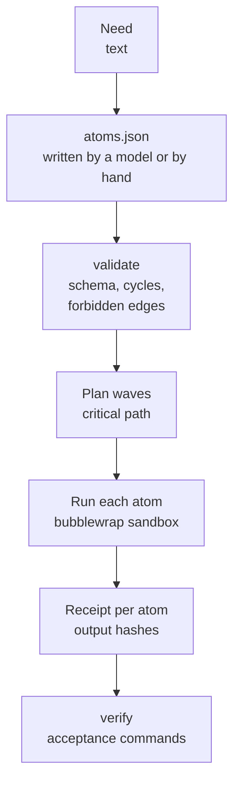

# Atomizer

The atomizer splits one piece of software work into small atoms and runs them as a dependency graph, many at once.
Each atom is one job for one worker (a Claude Code or Codex agent, or a fixed script) with a written contract,
declared inputs and outputs, and its own bubblewrap sandbox. The scheduler checks every output against a receipt and
writes every step to an append-only ledger.

## Why it exists

A single agent asked to "build X" writes the tests, writes the code, reviews it and decides it is done, so every check
comes from the same reading of the request. The atomizer makes the roles separate atoms and refuses graphs that leak
between them: the agent writing a kernel never sees the frozen tests, the test writer never sees the kernel, and
reviewers judge the result through its interface, never its source. Independent atoms also run in parallel, so wall
time follows the critical path instead of the sum of the work.

Two words recur below. A **kernel** is the application logic of a candidate: a pure WebAssembly module (state and
event in, next state and effects out as data) plus `glue.json` describing its interface. **Frozen** tests are hashed
and recorded before any code exists, so no later atom can change them to make its code pass. The **compose** atom
assembles the other atoms' outputs into the result; a **receipt** records the SHA-256 of every output an atom wrote.
The atomizer needs bubblewrap (`bwrap`) on Linux.

## How it works



1. **Plan.** `atoms.json` (`endoforge/atoms/1`) holds the need, acceptance checks written from the need, and the atoms.
   `atomize.mjs` asks a model to write it and repairs it once if invalid; you can also write it yourself.
2. **Validate.** `lib/validate.mjs` refuses bad ids, missing contracts, absolute or `..` output paths, unknown inputs,
   cycles, oversized atoms and the forbidden edges in [policy.json](policy.json). There must be exactly one `compose`
   atom, or a single `direct` atom.
3. **Run.** Atoms run in waves as their inputs finish, up to `--concurrency`. Each attempt stages the atom's inputs
   read-only at `/in`, gives it an empty `/out` and `/work`, a fresh private home and only the toolchains its kind
   needs, then runs the worker under `bwrap` with PID, IPC and UTS namespaces unshared. A failed attempt is retried
   (`--retries`, default 1).
4. **Record.** `receipt/atoms/<id>.json` records every attempt and the SHA-256 of every output; `trace.jsonl` records
   timing spans; the ledger records run, atom and attempt events.
5. **Verify.** `verify.mjs` checks every atom finished, every output still matches its receipt, and runs each
   `command` acceptance check inside a sandbox.

Atom kinds include `contract`, `tests`, `kernel`, `glue`, `compose`, `review`, `repair`, `direct`, `asset` (Blender
builds on the CPU) and `other`. For kernel work, policy gives each kind a fixed procedure: the `compose` atom
assembles the parts, freezes `CONTRACT.md` and `tests.json` before any code, and runs [gate](../gate/README.md).

## Use it

| Script | What it does | Calls a model |
|---|---|---|
| `bin/schedule.mjs run <atoms.json> --run-dir <dir>` | Validates, plans and runs every atom. Options: `--concurrency` (8; 3 with the Codex backend), `--retries` (1), `--timeout-ms` (900000), `--policy`, `--force`, `--no-augment`. | Only model atoms |
| `bin/verify.mjs <run-dir> [--policy file]` | Checks a finished run against its receipts and acceptance commands. | No |
| `bin/report.mjs <run-dir>` | Markdown timeline, tokens and realized speedup. | No |
| `bin/speed.mjs <run-dir or fanout-dir>... [--out SPEED.md] [--json speed.json]` | Wall time broken down by stage. | No |
| `bin/fanout.mjs <atoms.json...> --out-dir <dir>` | Several DAGs as one pool, then verify and report on each. | Only model atoms |
| `bin/atomize.mjs <need.md> --out <dir> [--model sonnet\|opus\|codex] [--fixture atoms.json]` | A model writes `atoms.json`; the script validates, repairs once and plans. `--fixture` skips the model. | Yes, unless `--fixture` |
| `bin/plan-template.mjs <need.md> --out <dir>` | One model call writes the interface; the fixed kernel template is expanded around it. | Yes |
| `bin/direct.mjs <need.md> --out <atoms.json>` | Writes a one-atom `direct` DAG (one worker does everything). | No (running it does) |
| `bin/cutover.mjs <ladder.json> --out-dir <dir>` | Paired direct and atomized arms on the same gates. | Yes |
| `bin/compose-kernel.mjs --id <need> --in /in --out /out --work /work --gate <gate.mjs>` | Merges kernel parts, freezes, runs the gates. Runs inside a compose atom. | No |
| `bin/testcheck.mjs strip\|merge ...`, `bin/repair-noop.mjs`, `bin/isolate-exec.mjs` | Helpers used inside atoms. | No |
| `bin/ledger-export.mjs [--out dir]` | Flattens the ledger into CSV tables. | No |
| `bin/backfill.mjs`, `bin/bench.mjs` | One-time ledger backfill, and a scheduler benchmark (`--stub --replay <run>` uses a stub Codex). | `bench` without `--stub` does |

## Example

[test/fixtures/synthetic-fanout.json](test/fixtures/synthetic-fanout.json) is a ten-atom graph of script workers
(one seed, eight parts, one composition, each sleeping one second), so it runs without a model:

```console
$ DEMO=$(mktemp -d)
$ export ATOMIZER_LEDGER_DIR=$DEMO/ledger ENDOFORGE_CLAUDE_ACCOUNTS=$DEMO/none
$ node tools/atomizer/bin/schedule.mjs run tools/atomizer/test/fixtures/synthetic-fanout.json --run-dir $DEMO/run
done   src (1007 ms, attempts 1)
done   w1 (1009 ms, attempts 1)
...
done   w8 (1007 ms, attempts 1)
done   compose (1007 ms, attempts 1)
{"allDone":true,"wallMs":3038,"sumAtomWallMs":10070,"realizedSpeedup":3.31,"speedupBound":3.33,...}
$ node tools/atomizer/bin/verify.mjs $DEMO/run
{"ok":true,"fails":[],"acceptance":[{"id":"A1","ok":true},{"id":"A2","ok":true}]}
```

Ten seconds of work finished in three, the length of the critical path (`src`, then a part, then `compose`);
`speedupBound` is total work divided by that path. Both
acceptance commands ran inside a sandbox against the composed output.

A graph where a test atom feeds a kernel atom is refused before anything runs (exit 3). `DEC-72` and `L-16` in the
message are the project's internal decision and lesson ids for that rule:

```console
$ node tools/atomizer/bin/schedule.mjs run tools/atomizer/test/fixtures/synthetic-forbidden.json --run-dir $DEMO/run2
{
 "ok": false,
 "errors": [
  "w1 (tests) -> w2 (kernel) is forbidden: the generator never sees the frozen tests (DEC-72, L-16)"
 ],
 "warnings": []
}
```

[examples/example.json](examples/example.json) is the smallest valid file to copy from.

## atoms.json

The main rules `lib/validate.mjs` applies:

- `schema` is `endoforge/atoms/1`. `need` has `id` and `text`. `acceptance` is a non-empty list of
  `{id, statement, check}` with `check.kind` one of `command`, `oracle` or `manual`.
- `atoms` has at most `policy.maxAtoms` (64) entries. Each has an `id` (a letter, then up to 31 letters, digits, `_`
  or `-`), a `kind`, a `contract` of at least 20 characters, one or more `outputs` with relative paths, a `verify`
  field and a `worker`.
- `worker.model` is `sonnet`, `opus`, `codex` or `script`. A script worker needs `command` (an array); a model worker
  needs `prompt`. `worker.binds` may mount extra read-only trees, only from under `policy.bindRoots`.
- `size.work` and `size.interface` are a 1 to 5 estimate of the atom's work and of how much interface it shares with
  others; `size.work` may not exceed `policy.singleShotMaxWork` (3), so an atom stays small enough for one shot.
- Inputs name an earlier atom or `need`. Cycles and `policy.forbiddenEdges` are refused.

## Environment

| Variable | Default | Effect |
|---|---|---|
| `ATOMIZER_LEDGER_DIR` | `tools/atomizer/ledger` | Ledger directory (`events.jsonl`, `archive/`). Set it outside the source tree. |
| `ENDOFORGE_WORKER` | `policy.workerBackend`, else `native` | `codex` turns every model atom into a Codex atom. |
| `ENDOFORGE_CODEX_CONCURRENCY` | 3 | Default concurrency with the Codex backend. |
| `ENDOFORGE_CODEX_POOL` | `core/runtime/agent-pool.mjs` | Codex pool launcher. |
| `CODEX_POOL_STATE_DIR` | `.codex-pool` in the home directory | Where the scheduler reads the pool log. |
| `ENDOFORGE_TOOLCHAIN_<NAME>` | `policy.toolchain.<name>` | Host path of a toolchain, for example `ENDOFORGE_TOOLCHAIN_CODEX`. |
| `ENDOFORGE_TRACE` | on | `0` turns off `trace.jsonl`. |
| `ENDOFORGE_CLAUDE_ACCOUNTS` | `.claude-accts` in the home directory | One Claude config directory per login, each with `.credentials.json`; each `claude` launch mounts the next one. |
| `ENDOFORGE_CREDENTIAL_HOME` | unset | With no logins above, a home template whose credential files are copied into the sandbox home. |

The launcher never copies the current user's credentials implicitly, and every `claude` launch passes the
subscription guard first.

## Limits

- The sandbox shares the host network (model workers need it) and is a separation of files and processes, not a
  hardened security boundary.
- The fixed procedures in [policy.json](policy.json) are written for WebAssembly kernels plus glue; other kinds of work
  use `other`, `data` or `asset` atoms with prompts you write.
- `lib/ledger.mjs` names a `LEDGER.md` schema that does not exist.
- `bin/bench.mjs` defaults to `examples/C-005/atoms.json`, which does not exist; a bare run records `ok=0`.
- `bin/testcheck.mjs` with no arguments crashes with `ERR_INVALID_ARG_TYPE` instead of printing its usage.

## Tests

`make atomizer-test` runs `test/run.mjs` (scheduler, isolation, cycles, forbidden edges, routing and lessons) and the
other `test/*.test.mjs` files, with stubs instead of models.

Engineering record: component C-22, requirements REQ-ATOM-001 to REQ-ATOM-003.
