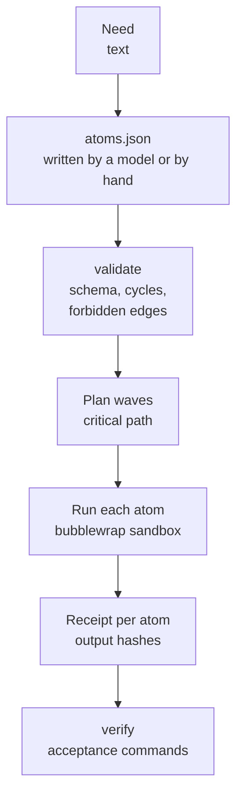

# Atomizer

The atomizer splits one piece of software work into small atoms and runs them as a dependency graph, many at once.
Each atom is one job for one worker (a Claude Code or Codex agent, or a fixed script) with a written contract,
declared inputs and outputs, and its own bubblewrap sandbox. The scheduler checks every output against a receipt and
writes every step to an append-only ledger.

## Why it exists

A single agent asked to "build X" writes the tests, writes the code, reviews it and decides it is done, so every check
comes from the same reading of the request. The atomizer makes the roles separate atoms and refuses graphs that leak
between them: the agent writing a kernel never sees the frozen tests, the test writer never sees the kernel, and
reviewers judge the result through its interface, never its source. Independent atoms also run in parallel, so wall
time follows the critical path instead of the sum of the work.

Two words recur below. A **kernel** is the application logic of a candidate: a pure WebAssembly module (state and
event in, next state and effects out as data) plus `glue.json` describing its interface. **Frozen** tests are hashed
and recorded before any code exists, so no later atom can change them to make its code pass. The **compose** atom
assembles the other atoms' outputs into the result; a **receipt** records the SHA-256 of every output an atom wrote.
The atomizer needs bubblewrap (`bwrap`) on Linux.

## How it works



1. **Plan.** `atoms.json` (`endoforge/atoms/1`) holds the need, acceptance checks written from the need, and the atoms.
   `atomize.mjs` asks a model to write it and repairs it once if invalid; you can also write it yourself.
2. **Validate.** `lib/validate.mjs` refuses bad ids, missing contracts, absolute or `..` output paths, unknown inputs,
   cycles, oversized atoms and the forbidden edges in [policy.json](policy.json). There must be exactly one `compose`
   atom, or a single `direct` atom.
3. **Run.** Atoms run in waves as their inputs finish, up to `--concurrency`. Each attempt stages the atom's inputs
   read-only at `/in`, gives it an empty `/out` and `/work`, a fresh private home and only the toolchains its kind
   needs, then runs the worker under `bwrap` with PID, IPC and UTS namespaces unshared. A failed attempt is retried
   (`--retries`, default 1).
4. **Record.** `receipt/atoms/<id>.json` records every attempt and the SHA-256 of every output; `trace.jsonl` records
   timing spans (never prompts, environments or credential contents); the ledger records run, atom and attempt events.
   The run summary carries `lessons`: failed launches, retries (a preflight attempt is not a retry), account
   failovers, the slowest atom and queue waits (from ready to started, which concurrency or a throttle causes).
5. **Verify.** `verify.mjs` checks every atom finished, every output still matches its receipt, and runs each
   `command` acceptance check inside a sandbox.

Atom kinds include `contract`, `tests`, `kernel`, `glue`, `compose`, `review`, `repair`, `direct`, `asset` (Blender
builds on the CPU) and `other`. For kernel work, policy gives each kind a fixed procedure: the `compose` atom
assembles the parts, freezes `CONTRACT.md` and `tests.json` before any code, and runs [gate](../gate/README.md) G1 to
G9. A model compose atom's declared outputs are set to the fixed files the compose helper writes, and references to
anything else are remapped. With `policy.repairStage` on (unless `--no-augment`), the scheduler adds a fixed repair
stage after compose: a draft compose, one repair atom that sees only the failing tests (its preflight,
`repair-noop.mjs`, skips the model when none failed), then the final compose, before any review.

### The capability block

The freeze refuses a `CONTRACT.md` that does not end with a valid ```capability block (exports, argument kinds,
units, ranges, precision, codes and traps; see [gate](../gate/README.md)), and G7 refuses glue that disagrees with it.
So every path that writes `CONTRACT.md` asks for the block in the same words the candidate loop's specification
prompts use (`capabilityRule` in [core/runtime/x1/generator.mjs](../../core/runtime/x1/generator.mjs)):

- `atomize.mjs` tells the planning model that the contract atom must end `CONTRACT.md` with the block and its worker
  prompt must say so;
- the `contract` kind procedure in [policy.json](policy.json) appends the rule to every contract atom's prompt;
- `plan-template.mjs`'s contract atom asks for it, and its glue atom reads the contract so it can match the block;
- the `direct` procedure asks for it before the worker freezes.

The `glue` procedure tells a glue atom that sees `CONTRACT.md` to declare exactly what the block declares.
`compose-kernel.mjs` checks the contract atom's `CONTRACT.md` before it merges anything: with no block, or a block that
is not JSON, it exits 3 and names the atom, so nothing is frozen or compiled. A block that is JSON but disagrees with
the tests is refused by the gate's `freeze` (exit 4 from `compose-kernel.mjs`).

Until round 7 no atomizer prompt asked for the block, so every real atomizer run after round 6 failed at the freeze or
at G7; the tests did not show it because they use script workers.

### Toolchains

`policy.toolchain` maps a name to a host path, and `policy.kindToolchain` lists the names each kind gets, mounted
read-only. `node` has no policy entry: it defaults to the install prefix of the Node running the atomizer, so atoms work on hosts
without a system Node. `ENDOFORGE_TOOLCHAIN_NODE` overrides it, and a node home with no `bin/node` is refused before any
sandbox starts. The atoms that run the gate (`compose`, `compose-draft`, `repair` and `direct`) get `gate` (`tools/gate`),
`gate-core` (`core`, which the gate imports), `gate-asc` (`tools/asc`, the pinned compiler) and `gate-asc-trust`
(`experiments/assemblyscript-toolchain.mjs`, which the pin checks against), plus `asc` (`tools/asc/node_modules`).
Kernel atoms get `node` and `asc`. `ENDOFORGE_TOOLCHAIN_<NAME>` overrides a path.

## Use it

| Script | What it does | Calls a model |
|---|---|---|
| `bin/schedule.mjs run <atoms.json> --run-dir <dir>` | Validates, plans and runs every atom. Options: `--concurrency` (8; 3 with the Codex backend), `--retries` (1), `--timeout-ms` (900000), `--policy`, `--force`, `--no-augment`. A model atom refused by the subscription guard fails with exit 78 and its reason, without a retry, and the run still writes its receipts. | Only model atoms |
| `bin/verify.mjs <run-dir> [--policy file]` | Checks a finished run against its receipts and acceptance commands. Its usage text lists `--policy`, but it always loads the `policy.json` next to the tool and ignores the flag. | No |
| `bin/report.mjs <run-dir>` | Markdown timeline, tokens and realized speedup. | No |
| `bin/speed.mjs <run-dir or fanout-dir>... [--out SPEED.md] [--json speed.json]` | Wall time broken down by stage. | No |
| `bin/fanout.mjs <atoms.json...> --out-dir <dir> [--parallel-runs 4] [--per-run-concurrency 4]` | Several DAGs as one pool, then verify and report on each. A graph the scheduler refuses is recorded in `fanout.json` and the others still run; exit 1 when any request fails verification. | Only model atoms |
| `bin/atomize.mjs <need.md> --out <dir> [--model sonnet\|opus\|codex] [--fixture atoms.json]` | A model writes `atoms.json`; the script validates, repairs once and plans. `--fixture` skips the model. A model call the subscription guard refuses ends the attempt loop with `valid: false`. | Yes, unless `--fixture` |
| `bin/plan-template.mjs <need.md> --out <dir> [--model sonnet] [--effort low] [--reviews 2] [--deliberate] [--codex-effort minimal] [--thinking <tokens>] [--no-test-check] [--fixture <interface-lines.txt>]` | One model call writes the interface; the fixed kernel template is expanded around it. `--fixture` reads the interface lines from a file instead of a model. Prints its usage and exits 2 without `<need.md>` or `--out`. | Yes, unless `--fixture` |
| `bin/direct.mjs <need.md> --out <atoms.json> [--model sonnet\|opus] [--effort low\|medium\|high]` | Writes a one-atom `direct` DAG (one worker does everything). | No (running it does) |
| `bin/cutover.mjs <ladder.json> --out-dir <dir> [--cases id,id] [--rep 1] [--parallel-cases 2] [--dag-concurrency 6] [--arms direct,atomized,templated]` | Paired arms (default direct and atomized) on the same gates. Exits 2 on missing arguments or an unknown arm. | Yes |
| `bin/compose-kernel.mjs --id <need> --in /in --out /out --work /work --gate <gate.mjs> [--preflight]` | Merges kernel parts, freezes, runs the gates. Runs inside a compose atom. Exits 2 with its usage when an option is missing, 3 when an input is missing or the contract atom's `CONTRACT.md` has no valid capability block, and 4 when the freeze fails. Test arrays are merged as text, so `1e999` (Infinity) survives. `--preflight` exits 10 unless G2 (compiles) passed. | No |
| `bin/testcheck.mjs strip <tests> <cases>` or `merge <tests> <computed> <out> <report>` | Blind-test expectation check (S-09), used inside atoms: `strip` writes the test inputs without expected values; `merge` keeps a test the independent computation agrees with (within the larger of `tol` and 0.2% of the value), drops one it disagrees with, keeps and flags one it gave no answer for, and widens `tol` when they agree but differ by more than it. Prints its usage and exits 2 when the arguments are missing. | No |
| `bin/repair-noop.mjs --failures /in/<draft>/failures.json --map '<json [{"from","to"}]>'` | Preflight of the repair atom: when the draft's `failures.json` is an empty list, copies every kernel part to its declared output unchanged, writes `repair-notes.md` and exits 0; otherwise (or when the file cannot be read) exits 10 so the model repair runs. | No |
| `bin/isolate-exec.mjs` | Host trampoline for Codex workers: runs the sandbox command from `ENDOFORGE_ISOLATE_SPEC` with `CODEX_HOME` bound at its own path. It checks only that `CODEX_HOME` is a directory, never its contents. | No |
| `bin/ledger-export.mjs [--out dir]` | Flattens the ledger ([LEDGER.md](LEDGER.md)) into the derived, regenerable tables `attempts.csv`, `atoms.csv`, `runs.csv`, `pools.csv`, `atomizations.csv` and `reviews.csv`. `--out` defaults to `tables/` in the ledger directory. | No |
| `bin/backfill.mjs`, `bin/bench.mjs [--atoms f] [--n N]` | `backfill.mjs` rebuilds ledger events from run directories and atomization receipts made before the ledger existed; every event it writes carries `backfilled: true` and its source paths, and a run already in the ledger is skipped. `bench.mjs` is a scheduler benchmark: `--atoms` defaults to [examples/example.json](examples/example.json); a missing file is refused with exit 2. `--stub --replay <run>` uses a stub Codex. | Only for model atoms |

## Example

[test/fixtures/synthetic-fanout.json](test/fixtures/synthetic-fanout.json) is a ten-atom graph of script workers
(one seed, eight parts, one composition, each sleeping one second), so it runs without a model:

```console
$ DEMO=$(mktemp -d)
$ export ATOMIZER_LEDGER_DIR=$DEMO/ledger ENDOFORGE_CLAUDE_ACCOUNTS=$DEMO/none
$ node tools/atomizer/bin/schedule.mjs run tools/atomizer/test/fixtures/synthetic-fanout.json --run-dir $DEMO/run
done   src (1007 ms, attempts 1)
done   w1 (1009 ms, attempts 1)
...
done   w8 (1007 ms, attempts 1)
done   compose (1007 ms, attempts 1)
{"allDone":true,"wallMs":3038,"sumAtomWallMs":10070,"realizedSpeedup":3.31,"speedupBound":3.33,...}
$ node tools/atomizer/bin/verify.mjs $DEMO/run
{"ok":true,"fails":[],"acceptance":[{"id":"A1","ok":true},{"id":"A2","ok":true}]}
```

Ten seconds of work finished in three, the length of the critical path (`src`, then a part, then `compose`);
`speedupBound` is total work divided by that path. Both
acceptance commands ran inside a sandbox against the composed output.

A graph where a test atom feeds a kernel atom is refused before anything runs (exit 3). `DEC-72` and `L-16` in the
message are the project's internal decision and lesson ids for that rule:

```console
$ node tools/atomizer/bin/schedule.mjs run tools/atomizer/test/fixtures/synthetic-forbidden.json --run-dir $DEMO/run2
{
 "ok": false,
 "errors": [
  "w1 (tests) -> w2 (kernel) is forbidden: the generator never sees the frozen tests (DEC-72, L-16)"
 ],
 "warnings": []
}
```

[examples/example.json](examples/example.json) is the smallest valid file to copy from.

## atoms.json

The main rules `lib/validate.mjs` applies:

- `schema` is `endoforge/atoms/1`. `need` has `id` and `text`. `acceptance` is a non-empty list of
  `{id, statement, check}` with `check.kind` one of `command`, `oracle` or `manual`.
- `atoms` has at most `policy.maxAtoms` (64) entries. Each has an `id` (a letter, then up to 31 letters, digits, `_`
  or `-`), a `kind`, a `contract` of at least 20 characters, one or more `outputs` with relative paths, a `verify`
  field and a `worker`.
- `worker.model` is `sonnet`, `opus`, `codex` or `script`. A script worker needs `command` (an array); a model worker
  needs `prompt`. `worker.binds` may mount extra trees (an asset checkout, a reference pack) into the sandbox. Binds
  are always read-only, the host path must be under `policy.bindRoots`, and the guest path must be absolute and may not
  sit under `/in`, `/out`, `/work` or a system path. `worker.timeoutSec` sets the atom's own timeout, capped at
  `policy.maxAtomTimeoutSec`; without it the run's `--timeout-ms` applies.
- `size.work` and `size.interface` are a 1 to 5 estimate of the atom's work and of how much interface it shares with
  others; `size.work` may not exceed `policy.singleShotMaxWork` (3), so an atom stays small enough for one shot.
- Inputs name an earlier atom or `need`. Cycles and `policy.forbiddenEdges` are refused.

## Environment

| Variable | Default | Effect |
|---|---|---|
| `ATOMIZER_LEDGER_DIR` | `tools/atomizer/ledger` | Ledger directory (`events.jsonl`, `archive/`; schema in [LEDGER.md](LEDGER.md)). Set it outside the source tree. |
| `ENDOFORGE_WORKER` | `policy.workerBackend`, else `native` | `codex` turns every model atom into a Codex atom. |
| `ENDOFORGE_CODEX_CONCURRENCY` | 3 | Default concurrency with the Codex backend. |
| `ENDOFORGE_CODEX_POOL` | `core/runtime/agent-pool.mjs` | Codex pool launcher. |
| `CODEX_POOL_STATE_DIR` | `.codex-pool` in the home directory | Where the scheduler reads the pool log. |
| `ENDOFORGE_TOOLCHAIN_<NAME>` | `policy.toolchain.<name>` | Host path of a toolchain, for example `ENDOFORGE_TOOLCHAIN_CODEX`. |
| `ENDOFORGE_TRACE` | on | `0` turns off `trace.jsonl`. |
| `ENDOFORGE_CLAUDE_ACCOUNTS` | `.claude-accts` in the home directory | One Claude config directory per login, each with `.credentials.json`; each `claude` launch mounts the next one read-write at its own path and sets `CLAUDE_CONFIG_DIR` to it, so a token refresh lands in the pool folder. A credential copied into a throwaway home could rotate the original's refresh token away. The subscription guard reads the credential's metadata, never its tokens. |
| `ENDOFORGE_CREDENTIAL_HOME` | unset | With no logins above, a home template whose credential files are copied into the sandbox home. |

The launcher never copies the current user's credentials implicitly, and every `claude` launch passes the
subscription guard first.

## Limits

- The sandbox shares the host network (model workers need it) and is a separation of files and processes, not a
  hardened security boundary.
- The fixed procedures in [policy.json](policy.json) are written for WebAssembly kernels plus glue; other kinds of work
  use `other`, `data` or `asset` atoms with prompts you write.

## Tests

`make atomizer-test` runs `test/run.mjs` (scheduler, isolation, cycles, forbidden edges, routing and lessons) and the
other `test/*.test.mjs` files, with stubs instead of models. `test/tools-gaps.test.mjs` checks that
[LEDGER.md](LEDGER.md) lists exactly the events the code emits, that a bare `bench.mjs` run completes on its default
atoms, and that `testcheck.mjs` prints its usage when arguments are missing. `test/commands.test.mjs` drives `atomize`
(with `--fixture`), `direct`, `fanout`, `report` and `cutover` end to end on script-worker fixtures
([test/fixtures/synthetic-pair.json](test/fixtures/synthetic-pair.json)); model arms run with no login, so the
subscription guard refuses them and the test checks the recorded refusal (REQ-ATOM-005). The same file checks the
rendered prompts of `atomize`, a planned contract atom, the `direct` worker and the templated planner for the
capability rule and the gate labels G1 to G9, checks that `compose-kernel.mjs` refuses a contract without a valid
block before freezing, and runs the compose helper inside a real sandbox with the policy's compose toolchain until the
kernel is promotable (REQ-ATOM-006).

Engineering record: component C-22, requirements REQ-ATOM-001 to REQ-ATOM-006.
