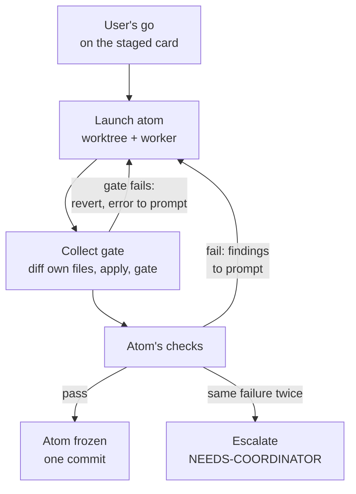

# Conductor

The conductor runs coding agents on a real repository until a job is done. It takes a confirmed
[job](../job/README.md), launches one Codex or Claude Code worker per atom in its own git worktree, checks every
change the moment it lands, and either commits it or relaunches the agent with the exact error. It is a resumable
daemon: all of its state is on disk, so a crash or reboot picks up where it stopped.

## Why it exists

Many agents editing one repository at once break each other's work, and a long run outlives the session that started
it. The conductor gives each atom its own files and its own worktree, lets only one writer touch the integration
branch at a time, and keeps judgment out of the loop: mechanism (launch, collect, check, freeze, relaunch) is code,
and when it cannot decide it writes a compact packet for a coordinating model (`NEEDS-COORDINATOR`) or asks the user
(`NEEDS-YOU`) for anything that needs their authority.

The words it uses: the **card** is the one-page summary of the job the user confirmed, identified by its SHA-256; the
**go** is the user's own confirmation of that card; a **smoke** is one tiny launch per engine before the wide launch; a
**taste lock** is the user accepting one atom as it stands; the **coordinator** is a coordinating agent (a model
session, or a person) that reads escalation packets and answers with a patch.

## How it works



Phases run as a state machine: `staged`, `go`, `smoke`, `fired`, `streaming`, `gates`, `locks`, then `finals` and
`compose` when the job declares them, then `done`. Every tick (5 seconds by default) the daemon reloads the manifest and
`<jobdir>/conductor/state.json`, honours stop and pause, and runs the handler for the current phase.

In `streaming` there is no barrier between atoms. For each atom whose worker has exited:

1. **Collect.** Under an exclusive lock on the integration repository (a file `endoforge-collect` in its real git
   directory, from `git rev-parse --absolute-git-dir`, so a repository that is itself a git worktree works), take the
   diff of only the atom's own files from its worktree, apply it, run the collect gate (`conductor.gate` or the atom's `gate`), and commit. If the apply
   or the gate fails, revert only that atom's files and write the error to `conductor/gates/<atom>-i<n>.gate.json`.
   Edits outside the atom's files are reported as stray and never applied.
2. **Check.** Run the atom's checks: the `conductor.checks` entries that name it (or name no atoms); if there are none,
   the runnable acceptance checks (`check.run`, not `human`) of the criteria the atom lists, so an atom is never frozen
   with its own checks unrun. A check is judged by exit status, a JSON result with judged items, or a
   measured number against a target and tolerance. The first time a check returns a list of judged items, that list
   is saved and every later run must score the same items; a check that changes its list, or disagrees with itself
   between two runs, is marked unstable and not acted on.
3. **Decide.** Pass freezes the atom. Fail relaunches it with the findings and a keep-list of items that passed
   before; a change that only regresses passing items is reverted. The same failure twice, or running out of
   iterations, escalates instead.

Exit codes are typed (see [lib](../lib/README.md)): 75 from a gate or check means busy, wait and retry; 78 stops the
job. A check that cannot run is "not scored", never a pass or a fail.

## Use it

`node tools/conductor/bin/conduct.mjs <command> <job.json> ...`. The same commands work as
`node tools/job/bin/job.mjs <command> <job.json>`.

| Command | Effect |
|---|---|
| `go --sha <card sha> --by <user> --words "<words>"` | Records the user's go on the staged card. A wrong or stale SHA is refused. |
| `run [--tick S] [--max-ticks N]` | The daemon in the foreground. |
| `unit [--dry-run]` | Starts `run` as a systemd user service in the `heavy.slice` cgroup that restarts on failure; `--dry-run` prints the `systemd-run` command. |
| `status` | Phase, budget, atoms and the event timeline. |
| `lock <atom> --by <user> --words "<words>"` | A taste lock on one atom (the user accepts it as it is). |
| `pause [--why text]`, `resume` | Pause and resume launches. |
| `budget [--launches N] [--iterations N] [--by ... --words ...]` | Shows or raises the budget. Raising it needs the user's words. |
| `stop [--by who] [--why text]` | Stops the lanes and ends the job. |
| `patch <patch.json>` | The coordinator's reply to an escalation, applied through the same gates. A patch that changes the confirmed card holds launches until the user's new go. |
| `adopt <new job.json> --map <map.json> ...` | Converts a job running on older scripts into a manifest and state. The old layout is data in the map; [examples/](examples/README.md) has a map with a matching old manifest and loop state. |

`run` and `unit` launch real workers. The `conductor` block of the manifest sets `launcher` (`systemd` by default, or
`local` for a detached child), `maxIterations` (3), `maxLaunches` (200), `atomTimeoutSec` (2400), `gate`, `checks`,
`slice`, `checkConcurrency` (4), `worktrees`, `links`, `codexPool`, `claudeBin`, `codexModel`, `claudeModel` (default
`opus`), `claudeTools`, `busyBaseSec` (2) and `busyWaitSec` (900).

Workers get the compiled prompt from the job tool. Codex runs as `exec --sandbox workspace-write` in the worktree;
Claude Code runs as `claude -p` with `acceptEdits` and the tool list `conductor.claudeTools`, by default
`Read Edit Write Glob Grep Bash(node:*) Bash(npm:*) Bash(make:*) Bash(python3:*) Bash(git diff:*) Bash(git status:*)
Bash(ls:*)` so a worker can run its own tests, after the subscription guard
(`core/runtime/subscription-guard.mjs`) confirms the login is a subscription account and strips API-key billing
variables.

## Example

[demo.sh](demo.sh) builds a two-atom job in a new directory with a stub worker script in place of Codex and Claude
Code, so no model is called. The stub writes a Python file with a syntax error on its first try and fixes it only when
its prompt carries the collect gate's error. Everything else is the real conductor.

```console
$ tools/conductor/demo.sh /tmp/ef-demo/job
phase go
phase done
conductor: demo — phase done
budget: 4/200 launches, 2 iterations per atom
atoms: 2 frozen
  ADD        frozen            iter 2  passed T1
  MUL        frozen            iter 2  passed T1

demo (code): 6 events
04:07:56    STAGED    demo: card ready for your go (91704ad428cb)
04:07:56    SMOKE     codex ok, claude ok
04:07:56  * FIRED     demo fired: 2 atoms; 1 codex, 1 claude across 2 logins
04:07:57  * GATE      MUL frozen at iteration 2: passed T1
04:07:57  * GATE      ADD frozen at iteration 2: passed T1
04:07:58  * DONE      demo done

state: DONE; 2 atoms fired at 04:07:56
(* = pushed to phone hooks)
6e4d365 demo MUL i2 (claude:a1)
413e3b2 demo ADD i2 (codex:default)
92fc91b seed
```

`SMOKE` only reports the smoke receipt the manifest already holds; the demo writes a placeholder and launches no
engine. Each atom's first change was reverted at the collect gate and never reached the integration branch. The record of
that, and the error the agent got in its second prompt:

```console
$ python3 -c "import json; print(json.load(open('/tmp/ef-demo/job/conductor/gates/MUL-i1.gate.json'))['error'])"
  File "src/mul.py", line 1
    def mul(a, b) return a * b
                  ^^^^^^
SyntaxError: expected ':'
$ cat /tmp/ef-demo/job/repo/src/mul.py
def mul(a, b): return a * b
```

The whole run takes about 2.5 seconds; times are UTC and commit hashes differ per run. Events marked `*` also go to
the push hooks (`ENDOFORGE_PUSH_HOOKS`), none here. The directory must not exist yet; the script overrides `HOME` inside itself so
login discovery sees only its fake logins.

## Environment

| Variable | Default | Effect |
|---|---|---|
| `CODEX_POOL_BIN` | `codex` on `PATH` | Passed to Codex lanes. |
| `ENDOFORGE_SYSTEMCTL` | `systemctl` | Used to see whether a lane's unit has ended. |
| `WORKER_STATE_DIR` | `$XDG_STATE_HOME/workers` | Holds the capacity dial (`CAPACITY`, a percentage) and `DRAIN`. |

The job tool's event variables (`ENDOFORGE_NOTIFY` and the hook lists) apply too.

## Limits

- The conductor trusts the gate and checks in the manifest. A check that cannot fail lets anything through; job's
  Decide gate refuses uncalibrated proxy checks, but not a weak command.
- Workers run as ordinary processes (a systemd unit or a detached child). The worktree separates their files; it is
  not a security sandbox.
- The default model for Claude Code lanes is `opus` unless `conductor.claudeModel` says otherwise.

## Tests

`make lib-test` runs `test/failopen.test.mjs`, `test/principles.test.mjs` and `test/stream.test.mjs`, which use a
stub worker and fake logins like the demo, `test/adopt-example.test.mjs`, which adopts the example old job with
the example map, and `test/conductor-gaps.test.mjs` (checks derived from criteria, the collect lock in a worktree
repository, the worker tool list).

Engineering record: component C-23, requirements REQ-COND-001 and REQ-COND-002.
