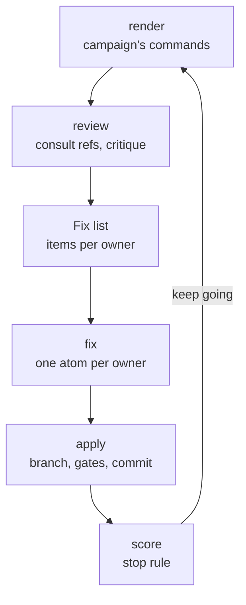

# Hill-climb

Hill-climb improves a project round after round against a stated goal. Each round renders or evaluates the current
state, has coding agents critique it into a fix list, has one agent per owner fix its own part, applies and scores the
result, and stops when the target is met, the round limit is reached or the score stops improving. Every round leaves
a `LESSONS.md`, and a lesson stays open until a tool or PR change is recorded for it.

## Why it exists

Some work has no single test that says "done": a page layout, a 3D asset, a game level. Hill-climb turns it into
measured rounds. Critics and fixers are separate agents, each owner may only patch its own paths, a change that makes
things worse is reverted, and lessons from one round are carried into the next instead of being rediscovered.

## How it works



A campaign file (`endoforge/hillclimb/1`) names the goal, what to render, references, the critique settings, the
owners and their scopes, and the stop rule. There are two modes:

- `compete` (the default): render, review (consult references, then critique into a fix list), fix (one atom per owner,
  optionally competing variants judged by an atom), apply and score. Review and fix atoms are validated with the
  [atomizer](../atomizer/README.md) rules, then run through `campaign.runner`.
- `fanout`: run evals, re-atomize, smoke one atom per engine, launch every piece on the available logins under the
  capacity dial, collect owned diffs (one commit per piece) and revert any piece that raised its own failure count.

The score weights open items (blocker 5, major 2, minor 1). The run stops when `stop.targetOpen` is met with no
blockers, at `stop.maxRounds`, or after `stop.patience` (default 2) rounds without improvement. Rounds live in
`<workdir>/rounds/rNN`; the lessons ledger is `<workdir>/lessons.json`.

## Use it

`node tools/hillclimb/bin/hillclimb.mjs <command> <campaign.json> [--round N]`. With no arguments it prints its usage
and exits 2.

| Command | Effect |
|---|---|
| `check` | Validates the campaign and prints `{"ok":...,"errors":[...]}`. Exit 1 when invalid. |
| `score` | Round history from `scoreboard.json` and the stop decision. |
| `lessons [--add KEY --stage S --text T] [--close KEY --by "PR #n"]` | Lists, adds or closes lessons. |
| `round [--pr]` | One full round; stops early when the stop rule says so. |
| `render [--profile fast\|final]`, `plan-review`, `review`, `refs [--fetch id,id\|all]`, `plan-fix [--owners A,B]`, `fix [--owners A,B]`, `apply`, `judge`, `pr` | The stages of a compete round. `plan-*` writes atoms without running them. `render` runs the profile's render jobs (`fast`, real time, by default; `final` for the high-end check). `--owners` limits the fix lanes to those owners, for example when other lanes already own the rest. |
| `atomize`, `prove-split`, `logins`, `smoke`, `evals [--phase pre\|post]`, `status`, `collect` | Fan-out stages (`lib/fanout-run.mjs`). |
| `compose-review`, `compose-fix`, `compose-judge` | Run inside atoms. |

`review`, `fix`, `judge`, `round`, `smoke` and fan-out launches start model workers. `render` runs the campaign's
commands. `pr` pushes and opens pull requests.

Scripts used by atoms and stages:

- `scripts/pixel-diff.py <before-dir> <after-dir> [--tolerance N]` compares two image trees by decoded pixels (PNG
  files differ byte for byte between identical renders). One JSON line; exit 0 when identical, 1 when not, 2 on usage
  errors. Needs Pillow.
- `scripts/sheets.py <stills_dir> <out_dir> [--per 4] [--brighten a,b]` makes labelled contact sheets and an
  `index.json` for critics to look at.
- `scripts/hc-patch.sh init <repo> <scope>...` and `hc-patch.sh diff <repo> <out.diff>` copy an owner's scope out of a
  read-only repository and turn the edits into a git patch. They work in `$HC_WORK`, default `/work`.

## Example

A compete campaign with one owner and a render command that does nothing, run from the repository root:

```console
$ cat /tmp/hc-demo/campaign.json
{"schema":"endoforge/hillclimb/1","id":"demo","goal":"Make the landing page easier to read at phone width.","workdir":"/tmp/hc-demo/work",
 "render":[{"id":"page","command":["true"]}],
 "owners":{"CSS":{"describe":"the stylesheet","scope":["site/style.css"]}},
 "critique":{"count":10},"stop":{"maxRounds":3}}
$ node tools/hillclimb/bin/hillclimb.mjs check /tmp/hc-demo/campaign.json
{"ok":true,"errors":[]}
$ node tools/hillclimb/bin/hillclimb.mjs score /tmp/hc-demo/campaign.json
{"stop":false,"why":"no rounds yet"}
$ node tools/hillclimb/bin/hillclimb.mjs lessons /tmp/hc-demo/campaign.json --add contrast --stage review --text "the critic never measured contrast; add a contrast check"
contrast	review	r0-r0 x1	the critic never measured contrast; add a contrast check
$ node tools/hillclimb/bin/hillclimb.mjs lessons /tmp/hc-demo/campaign.json
contrast	review	r0-r0 x1	the critic never measured contrast; add a contrast check
$ node tools/hillclimb/bin/hillclimb.mjs lessons /tmp/hc-demo/campaign.json --close contrast --by "PR #1"
$ node tools/hillclimb/bin/hillclimb.mjs lessons /tmp/hc-demo/campaign.json
```

After `--close` the lesson stays in `lessons.json` with `"tool": "PR #1"` and no longer prints as open.

`pixel-diff.py` on three one-image trees, where `changed` differs from `before` by 2 in every channel (run in a
scratch directory, with `$REPO` the repository root):

```console
$ python3 -c "from PIL import Image; import os; [os.makedirs(d, exist_ok=True) or Image.new('RGB', (4, 4), (v, v, v)).save(f'{d}/a.png') for d, v in (('before', 10), ('after', 10), ('changed', 12))]"
$ python3 -I $REPO/tools/hillclimb/scripts/pixel-diff.py before after
{"ok": true, "compared": 1, "tolerance": 0, "missing": [], "differ": []}
$ python3 -I $REPO/tools/hillclimb/scripts/pixel-diff.py before changed
{"ok": false, "compared": 1, "tolerance": 0, "missing": [], "differ": [{"still": "a.png", "maxDiff": 2, "pixels": 16}]}
$ python3 -I $REPO/tools/hillclimb/scripts/pixel-diff.py before changed --tolerance 2
{"ok": true, "compared": 1, "tolerance": 2, "missing": [], "differ": []}
```

## Inside a round

**Who does what.** Models come from `campaign.models` (default `opus` and `codex`). With mixing on (the default,
`campaign.mix` not `false`) they rotate by round and slot, so no model always fixes or always judges: what one model
fixes this round, another critiques and fixes next round. Review runs one critic per model and a merge atom that
removes duplicates into the round's fix list; in `compete` every model fixes each lane and a judge atom picks one
variant per owner after a fast render of each. With mixing off, every slot uses one backend per stage, from
`campaign.workers.<stage>` or `campaign.worker`. Fix lanes are named `fix-<owner>`, or `fix-<owner>--<model>` when
variants compete; `pr` ships only a competing lane's winner.

**What an atom sees.** Review and fix atoms mount the round directory read-only at `/hc` (`stills/`, `sheets/`,
`previous.fixlist.json`), this tool read-only at `/hc-tool`, and the campaign repository read-only at `/repo`; a fix
atom copies its owner's scope out with `hc-patch.sh`. The script `compose-*` atoms mount only the round directory at
`/hc` and the files `bin/hillclimb.mjs` statically imports, at their repository paths under `/hc-src` (this tool at
`/hc-src/tools/hillclimb`, plus `tools/lib/lock.mjs` and `core/runtime/subscription-guard.mjs`), so its relative
imports resolve inside the sandbox. `lib/runner.mjs` computes that import closure when it plans the atoms and adds the
same files to the stage policy's `bindRoots`. The `compose-*` commands do not need the atomizer; the host stages
validate the atoms with it. `test/compose-mounts.test.mjs` runs each compose command under bubblewrap in that layout.

**Fix lists** (`endoforge/hillclimb-fixlist/1`) hold the critics' numbered problems, each owned by one fix lane. A list
is refused when it has more than `critique.count` items, an id is not a unique positive integer, an item lacks its
image (`still`), a problem of at least 12 characters or a known severity, an owner does not exist, or a carried item
names an id that is not in the previous list.

**Lessons.** Each lesson has a stable key, so a recurrence counts up instead of adding a row, and a closed lesson that
recurs reopens. A round's `LESSONS.md` lists the measurements first, then this round's lessons, then every open lesson
that still has no tool change.

**A fan-out round** (`mode: "fanout"`) runs: evals first, re-atomize, smoke one atom per engine (so a broken login,
pool or flag fails once, not once per lane), then launch every piece. Each lane gets a worktree from the integration
`HEAD` and starts as a detached systemd user unit in `heavy.slice` (or a plain child with `fanout.launcher: "local"`),
in waves the capacity dial sizes; a wrapper writes `logs/<lane>.exit` when the worker ends, so the status never
depends on systemd keeping the unit. A campaign backed by a job manifest gets compiled prompts (goal verbatim,
governing inputs first, checks, lessons) and must pass the job's gates up to Orchestrate before anything launches,
so nothing fires on an unconfirmed card (I1, I11); the round then emits `FIRED`. A refused round leaves no round
directory. Recombine applies each piece's diff restricted to its own files, one commit per piece; of a piece's
variants, the first to apply cleanly and pass the piece's check wins. Post-evals reuse the previous round's when the
integration `HEAD` has not moved. Errors are typed ([lib](../lib/README.md)): a busy guard or queue (75) waits and
retries with backoff, 78 stops the job, and evals that could not run are reported as "not scored": no pass, no number,
no revert and no baseline change.

## Campaign rules

`lib/campaign.mjs` requires an `id` slug, a `goal` of at least 20 characters, a `workdir`, at least one `render` job
with an `id` and a `command` array (not wrapped in `systemd-run --scope`, which would escape the round's cgroup), and
`stop.maxRounds` of at least 1. In `compete` mode it also needs `owners` (uppercase keys, each with `describe` and
`scope`) and `critique.count` from 1 to 500. `fanout` mode needs at least two pieces with disjoint `files`, a brief of
at least 20 characters each, and an engine of `codex` or `claude` where one is named (`lib/fanout.mjs`).

## Environment

| Variable | Default | Effect |
|---|---|---|
| `ENDOFORGE_CLAUDE_ACCOUNTS` | `.claude-accts` in the home directory | Claude logins for fan-out. |
| `CODEX_POOL_PRIMARY`, `CODEX_POOL_ACCOUNTS_DIR` | `.codex`, `.codex-accounts` in the home directory | Codex logins for fan-out. |
| `CODEX_POOL_BIN` | `codex` on `PATH` | Passed to Codex lanes. |
| `WORKER_STATE_DIR` | `$XDG_STATE_HOME/workers`, else `.local/state/workers` | Worker capacity state. |

The runner gets `ENDOFORGE_WORKER` set to `native`, or to the stage's worker when `campaign.mix` is `false`.

The default `campaign.runner` is [bin/run-atoms.mjs](bin/run-atoms.mjs), which runs
`<atoms.json> --out <dir> --concurrency N --timeout S --policy <stage>.policy.json` on the atomizer scheduler
(`schedule.mjs run`, run directory `<dir>/run`). A campaign's own `runner` gets the same arguments, `--policy`
included.

Each atom stage writes `<stage>.policy.json` next to `<stage>.atoms.json`: the atomizer policy with the campaign's
`workdir`, this tool and the campaign `repo` added to `bindRoots`. The stage validates its atoms against that policy
and passes it to the runner (default or the campaign's own) with `--policy`, so `plan-review` and the other stages
work from any directory. Binds stay read-only; any other bind (such as `references.binds`) must still be under the
atomizer's own `bindRoots`.

## Limits

- The round stages that launch model atoms (`review`, `fix`, `judge`, `round`) are run with a model only by use. The
  tests check the atoms they build, the runner contract, planning, scoring and the patch helper, with no model.

## Tests

`make lib-test` runs `test/lessons.test.mjs` and `test/runner.test.mjs` (the default runner is in the repository and
maps onto the scheduler, `plan-review` works from an unrelated directory, `review` hands a campaign's own runner the
stage policy, `scripts/hc-patch.sh` prints its usage
without arguments and still produces a repo-relative patch) and `test/fanout-plan-scoreboard.test.mjs` (ownership
overlaps, lane assignment, wave sizing by the capacity dial, review, fix and judge atoms, the ratchet, re-atomizing,
round scoring and the stop rule, all without a model) and `test/compose-mounts.test.mjs` (each compose atom binds
what `hillclimb.mjs` imports, model atoms see only `/hc-tool`, and under `bwrap` the compose commands load and
compose-review writes `FIXLIST.md` and `score.json`; the two `bwrap` cases skip where it cannot start). The fan-out library (`lib/fanout.mjs`: logins, lanes, worker commands,
the capacity dial) is also used by [job](../job/README.md), the [conductor](../conductor/README.md) and the
[project scheduler](../project-scheduler/README.md).

Engineering record: component C-24, requirements REQ-HILL-001 to REQ-HILL-003.
