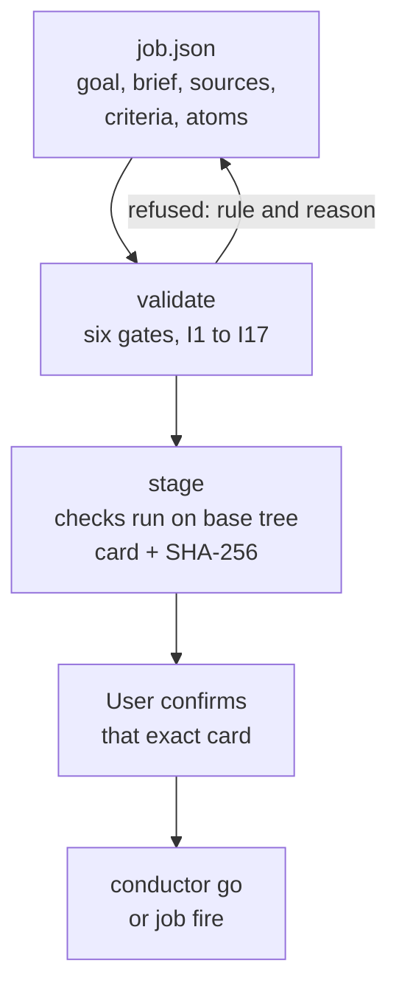

# Job

`job` turns a request into a checked plan that coding agents can build from, and refuses to start until the person
who asked has confirmed exactly that plan. It is the front of EndoForge's whole-job layer: a job manifest goes in,
gets checked against six intake gates and seventeen invariants, becomes a card the user confirms by its SHA-256, and is
then handed to the [conductor](../conductor/README.md), which runs the coding agents.

## Why it exists

Agent runs fail most often before any code is written: the goal is paraphrased instead of quoted, a reference never
reaches the agent that needs it, two agents edit the same file, or a check cannot actually fail. `job` makes each of
those a refusal with a named rule. The model can draft the manifest, but it cannot start the work: only the user's
own words on the current card do that, and a relayed approval is refused.

## How it works



A manifest (`endoforge/job/1`) holds the user's goal verbatim, a brief (objective, acceptance, scope, authority, and
stated versus inferred assumptions), the primary sources and references with what each governs, acceptance criteria
with runnable checks, and atoms: pieces of work that each own a set of files.

The gates run in order, and validating a gate runs every gate before it. The table lists the main rules and the
invariants they cite:

| Gate | What must be true | Invariants |
|---|---|---|
| Pontificate | The verbatim goal and who said it, a primary source, a complete brief and a running notes file | I1, I14 |
| Observe | Every source and reference names what it governs and sits on durable disk (absolute paths, not `/tmp`) | I2, I4, I7 |
| Orient | Atoms own disjoint files and get every input that governs their work; each atom has a local check; each criterion names the atoms that satisfy it; a critical path, the strongest rival plan and a deadline are named | I2, I5, I6, I13, I15 |
| Decide | Every check can fail (proxy checks are calibrated on a known-good and a known-bad case), a ratchet baseline is set, every engine has a smoke receipt, earlier lessons were retrieved, no collect gate or check runs a records check, every check ran once on the base tree and is not broken, and the user confirmed this card | I1, I3, I9, I10, I11, I14, I16, I17 |
| Orchestrate | Launches go under the capacity dial and a named throttle (GPU atoms through the GPU queue), and the machine health check passes | I8 |
| Loop | Every recorded round has a receipt and a `LESSONS.md` on disk | I10, I12, I14 |

`node tools/job/bin/job.mjs invariants` prints all seventeen rules (listed under [Invariants](#invariants)). The card's hash covers the goal, brief, sources,
references, truth, criteria, atoms, contracts, seams, gates, critical path, rival and deadline, so changing any of them
after confirmation voids it. The POODO stage names (Pontificate, Observe, Orient, Decide, Orchestrate, Loop) come from
POODO, a reasoning discipline for agents; here each stage is code that refuses.

Some words the gates use: the **truth package** is the ground truth a job measures against (survey data, reference
measurements) with tolerances; a **seam** is a boundary between two atoms' files that needs an owner or a contract;
the **rival** is the strongest other way to do the job; the **ratchet** is the baseline no change may make worse; a
**smoke** is one tiny launch per engine before the wide launch; a **proxy check** measures something that stands in for
the real outcome (a model's critique, an eval score), so it must be shown to pass a known-good case and fail a
known-bad one; the **capacity dial** and **throttle** limit how many workers start at once.

Job kinds are data in [kinds/](kinds/): `code`, `doc`, `generic`, `campus`, `model3d` and `video`. A kind adds checks: a `code` job needs a `tests`
criterion, and a `campus` job (a site model) must include survey evidence in its truth package.

## Use it

`node tools/job/bin/job.mjs <command> <job.json> ...`. With no arguments it prints its usage and exits 2.

| Command | Effect |
|---|---|
| `gates`, `invariants` | Lists the gates and the invariants. |
| `validate <job.json> [--gate G] [--offline] [--json]` | Runs every rule up to gate G (default `orchestrate`). Exits 1 when a gate refuses. At `orchestrate` it runs the health check. |
| `card <job.json> [--out card.md]` | Retrieves open lessons from earlier jobs of the same kind and renders the card; prints its SHA-256 on stderr. |
| `stage <job.json>` | Decide, minus the user's go, must pass. Then runs every criterion check once on the base commit in a throwaway worktree, records the outcomes as `proofs.baseline` and refuses a broken check (I17). Writes `JOB-<id>.md` and emits `STAGED`. |
| `confirm <job.json> --sha <sha> --by <user> --words "<words>" [--via direct\|relayed]` | Records the user's confirmation of the staged card. A relayed one is recorded and refused at Decide. |
| `compile <job.json> [--out dir] [--offline]` | Writes each atom's prompt and a `manifest.json` of hashes. |
| `fire <job.json> [-- <launch command>]` | After the go: Orchestrate gates (which also need a current baseline for every check), compiled prompts, a `FIRED` event, then the launch command with `ENDOFORGE_JOB` and `ENDOFORGE_PROMPTS` set. |
| `smoke <job.json>` | One tiny model call per engine on a discovered login. |
| `calibrate <job.json> [--criterion ID]` | Runs each proxy check on its known-good and known-bad case. |
| `prove-split <job.json> --from <path> ...` | Proves a split changed nothing: a pixel diff within the noise floor, or tests passing. |
| `lessons <job.json>` | Open lessons from earlier jobs and the atoms they reach. A lesson is an open row in an earlier job's `NOTES.md` mistakes table, `LESSONS.md` or hillclimb ledger; it closes when its fix cites a PR. |
| `event <job.json> <KIND> <summary> [--detail md] [--data json]` | Records an event (`FIRED` and `STAGED` only come from `fire` and `stage`). |
| `knowledge <job.json> add --text ... --source ... [--tags a,b]` | Records a fact found during the run; later prompts include it. |
| `status`, `go`, `lock`, `pause`, `resume`, `budget`, `stop`, `patch` | Passed to the conductor. |

`smoke` and `fire` (through its launch command) start model workers. `calibrate` and `prove-split --tests` run the
commands in the manifest. Proofs go in `<job>.proofs.json` beside the manifest; events go to `events.jsonl` and
`EVENTS.md`.

Each compiled prompt carries, in order: the goal verbatim, the brief, the references and sources that govern the atom
(source excerpts read from disk), the truth package, its checks, the files it alone may edit, the criteria it helps
satisfy, knowledge and lessons that bear on it, and a fixed reply format.

## Example

[tools/conductor/demo.sh](../conductor/demo.sh) builds a two-atom `code` job with a stub worker (no model), stages
it, gives the go and runs it. Its `job.json` is the smallest manifest that passes every gate, a good one to copy.
`$REPO` below is the repository root. Afterwards, on that job:

```console
$ tools/conductor/demo.sh /tmp/ef-demo/job > /dev/null
baseline T1	passed	exited 0 in 49 ms
$ cd /tmp/ef-demo/job
$ export HOME=$PWD/home ENDOFORGE_NOTIFY=none ENDOFORGE_JOBS=$PWD/none ENDOFORGE_VOLATILE=/nonexistent-volatile
$ node $REPO/tools/job/bin/job.mjs validate job.json
Pontificate  passed  (I1)
Observe      passed  (I2, I4, I7)
Orient       passed  (I5, I6, I13, I15)
Decide       passed  (I3, I9, I11, I16, I17)
Orchestrate  passed  (I8)
Loop         not checked  (I10, I12, I14)
warning decide I17: criterion T1: its check passes on the base tree before any change; make sure it can fail on the work it measures
I1 holds  I2 holds  I3 holds  I4 holds  I5 holds  I6 holds  I7 holds  I8 holds  I9 holds  I10 pending  I11 holds  I12 pending  I13 holds  I14 pending  I15 holds  I16 holds  I17 partial
```

The `baseline` line is `stage` running the demo's one check on the seed commit (on standard error). The demo's check
only compiles `src/*.py`, which the seed already passes, so validate warns that it cannot tell the work apart from no
work.

Change one word of the goal after the user confirmed it, and Decide refuses:

```console
$ sed -i 's/Add add() and mul() to src."/Add add(), mul() and div() to src."/' job.json
$ node $REPO/tools/job/bin/job.mjs validate job.json --gate decide
...
Decide       refused  (I3, I9, I11, I16, I17)
...
REFUSED decide I1: the job changed after the user confirmed its card; show the new card and confirm again
```

`compile` writes the prompt each agent gets. The start of atom `ADD`'s prompt:

```console
$ node $REPO/tools/job/bin/job.mjs compile job.json --out prompts
2 prompts in prompts; manifest 2f2c7da08209
$ head -3 prompts/ADD.prompt
You are atom ADD of job "demo" (code), one of 2 atoms working at once. Each atom owns different files.

THE GOAL, in operator's own words (this, not any summary, is what you build):
```

The `HOME` override points login discovery at the demo's fake logins.

## Manifest details

**Kinds.** A kind file in [kinds/](kinds/) (or a directory in `ENDOFORGE_JOB_KINDS`) is data. The engine reads only
these rule shapes from it:

| Rule | Meaning |
|---|---|
| `proxyCheckKinds` | Check kinds that measure a proxy; they must be labelled and calibrated (I3) |
| `splitByTests` | A split is proven by tests passing before and after it (I6) |
| `requireCheckKinds` `[{kind, inv, why}]` | At least one criterion has a check of this kind |
| `requireAnyCheckKind` `[{kinds, inv, why}]` | At least one criterion has a check of one of these kinds |
| `measureReferencesGoverning` `{aspects, checkKind, inv, why}` | Each reference that governs one of these aspects needs a check of `checkKind` against it |
| `requireCheckField` `[{kind, field, inv, why}]` | Some check of this kind sets this field |
| `requiresTruth` `{inv, pattern?, why}` | There is a truth package, with an entry matching `pattern` if one is given |

Kind rules only add checks; the gates and invariants are the same for every kind.

**Interfaces and facts.** `interfaces: [{id, file, start, end?, what?}]` names an excerpt of a contract file: `start`
and `end` are line numbers or regular expressions, the excerpt runs from the first line matching `start` to the first
later line matching `end` (which may be the start line itself), and without `end` it stops at a line that is only `}`
or at the end of the file. An atom gets the interfaces it lists in `atom.interfaces`, and also any interface whose
file it reads or imports. Every declared interface must resolve, and an atom whose files import a contract file must
be given that file's interface (P-C). `facts: [{id, source, select?, values?}]` gives a fact's values inline or
selects them from a JSON source with a path such as `items[*].start`; the source is the only place the fact lives,
and a value copied from it into an owned file is a warning: derive it instead (P-A). Each criterion names the atoms
that satisfy it and what it requires, and each of those atoms declares what its contract can express (I15).

**Prompts.** A source excerpt is set by `excerpt.lines` (`"a-b"`) or by `excerpt.match` (a regular expression, with
`context` lines around each match, default 3); without either the whole file is used. Any excerpt is cut at 6000
characters. A `knowledge` entry reaches an atom when one of its tags is the atom's id, one of its aspects or
capabilities, or `*`. Lessons come from earlier jobs of the same kind under `ENDOFORGE_JOBS` (their `notes` file and
their rounds' `LESSONS.md`) and from the job's own `lessonsFrom` list (`NOTES.md`, `LESSONS.md` or a hillclimb
`lessons.json`); an atom's prompt carries the lessons that match it.

**Baseline calibration (I17).** `stage` runs every criterion check that has a `run` command and is not `human` once,
before the user's go, on the base commit (`stage.base`, default `HEAD`) in a throwaway detached worktree. The tree is
reset and cleaned before each check, the `conductor.links` symlinks are added, and each check has `stage.checkTimeoutSec`
seconds (default 1800). The outcome goes to `proofs.baseline` in the proofs file: `base` (the commit), `at`, and per
criterion `run`, `status`, `exit`, `why` and `ms`. `status` is `passed`, `failed`, or `broken` when the output names a
missing Python or JavaScript module, `Could not find`, `ENOENT`, `No rule to make target` or `can't open file`, or the
command exits 126 or 127. A timeout is `failed`, with `why` `timed out after N ms`. Any Decide validation refuses a
broken check; guard a file an atom will create with `test -f`. `stage` and `fire` also refuse a check with no baseline
or whose command changed since; plain `validate` (and the conductor's `go` and `patch`) only warns. A check that
already passes on the base tree gets a warning, because it may not be able to fail on the work it measures. `stage`
runs the other Decide rules first, so a refused card runs no check.

**The card and the go.** The card hash leaves out proofs, receipts and gate approvals, because those arrive after the
user confirms. The user's go must come after the latest `STAGED` event for the current card.

**Events.**

| Kind | Meaning |
|---|---|
| `STAGED` | The card is ready for the user's go |
| `FIRED` | Atoms launched, with who runs what, the prompt hash, predictions, gates, ETA and how to stop |
| `SMOKE` | The one-atom-per-engine smoke result |
| `SCORED` | A round's score deltas |
| `GATE` | A gate passed or failed |
| `NEEDS-YOU` | A decision that only the user's authority can make blocks the critical path: the card go, taste locks, spend, outward actions |
| `NEEDS-COORDINATOR` | Judgment the conductor cannot make (an atom still failing after its iterations, a contract that cannot express a criterion, a check at odds with its calibration, a new failure); it goes to the coordinating model |
| `DONE` | The job finished |

The conductor's `TRACE-NEEDED` notice (an atom froze with new test files) is a `NEEDS-COORDINATOR` event whose
`data.event` is `TRACE-NEEDED`; there is no separate kind (see the [conductor](../conductor/README.md#rules-and-formats)).

Every event goes to `events.jsonl` and `EVENTS.md` (in `events.dir`, default the manifest's directory), to
`notify-send` unless `ENDOFORGE_NOTIFY=none`, and to the `events.hooks` commands. `events.push` hooks get only
`FIRED`, `GATE`, `NEEDS-YOU` and `DONE`, so a phone does not buzz for routine progress; `events.coordinator` hooks get
only `NEEDS-COORDINATOR`. Each hook gets the event as JSON on standard input.

`loadJob` and the health check live in `lib/` so the conductor and the hillclimb fan-out can import them without the
command-line tool.

## Invariants

`job.mjs invariants` prints these. Each refusal names the one it breaks.

| ID | Name | Rule |
|---|---|---|
| I1 | Intent fidelity | The goal is the user's words plus the primary sources, never a summary; the brief is shown back before any spend |
| I2 | Reference primacy | Every defining reference is named, says what it governs, sits on durable disk and reaches every atom it governs |
| I3 | Measurable acceptance | Every criterion maps to a check that can fail, calibrated on known-good and known-bad cases; proxies are labelled |
| I4 | Truth before polish | Ground truth and tolerances come before building |
| I5 | One writer | Every file has exactly one owner at a time; seams have owners or contracts |
| I6 | Independent atoms | Atoms are locally checkable; splits are proven no-op against a measured noise floor |
| I7 | Durability | Briefs, references, state and notes on durable disk, never `/tmp` |
| I8 | Bounded execution | Owner-bound, throttled, under the capacity dial; nothing outlives its owner; guards never bypassed |
| I9 | Smoke before scale | One atom per engine or path first, then ramp while measuring |
| I10 | Monotonic progress | A ratchet: no change raises hard failures; a regression reverts per atom |
| I11 | Explicit authority | Human gates listed, batched, off the critical path, reused by id; a relayed approval never counts |
| I12 | Honest state | Delivered is not verified, a proxy is not the outcome; report only what ran |
| I13 | Constraint focus | Name the binding constraint; duplicates only there; stream instead of barriers |
| I14 | Learning loop | Every mistake logged with its cost; every lesson becomes a tool change or a tracked gap and reaches the next job |
| I15 | Contract capability | Each criterion names the atoms that satisfy it, and their contracts can express what it requires |
| I16 | Records after freeze | No collect gate or atom check runs a records check (trace rows, the matrix); the coordinator writes records after the atoms freeze |
| I17 | Calibrated before staging | Every check runs once on the base tree before staging, its outcome recorded with why; a check broken by an import, module or path error is refused |

I16 and I17 were added in round 10, from coordinator mistakes. I16 looks for `check_trace` or `test_*trace*` in
`conductor.gate`, each atom's `gate` (a string or an argv list) and each criterion's `check.run`. When the command
runs `make`, it follows the named targets (or the first target) through the job repository's `Makefile`, recipes and
prerequisites, so `make check` and `make test`, which reach `tools/check_trace.py`, are refused, while `make lib-test`
and `make sums` are not. The message says records are written after freeze: the coordinator adds trace rows in its
records pass, after the atoms freeze, so a records check before then fails every atom. I17 is described under
[Baseline calibration](#manifest-details).

## Environment

| Variable | Default | Effect |
|---|---|---|
| `ENDOFORGE_JOBS` | `./jobs` | Colon-separated roots searched for earlier jobs' lessons. |
| `ENDOFORGE_JOB_KINDS` | none | Extra colon-separated directories of kind files. |
| `ENDOFORGE_VOLATILE` | `/tmp`, `/var/tmp`, `/dev/shm`, `/run/user` | Colon-separated roots treated as volatile (not durable disk). |
| `ENDOFORGE_NOTIFY` | on | `none` turns off desktop notifications (`notify-send`). |
| `ENDOFORGE_EVENT_HOOKS`, `ENDOFORGE_PUSH_HOOKS`, `ENDOFORGE_COORDINATOR_HOOKS` | none | Extra hooks for every event, pushed events and `NEEDS-COORDINATOR`. |

The health check is `resources.health` in the manifest, a command that exits 0 when the machine may take the launch.
Without it, Orchestrate runs `.local/bin/system-safety-status` in the home directory, a machine-specific script, and
refuses if that is missing, so set `resources.health` (the demo uses `["true"]`).

## Limits

- The gates check the plan's shape, not whether the plan is right. A manifest can pass every gate and still ask for
  the wrong thing; that is what the user's confirmation is for.
- `validate` without `--offline` checks that every named path exists; with `--offline` it skips disk checks and
  source excerpts.

## Tests

`make lib-test` runs `test/failopen.test.mjs` (a torn or unreadable event log never reads as "not staged") and
`test/references.test.mjs` (the job, conductor, atomizer and hillclimb sources cite only repository files that exist) and
`test/kinds-compile-sources.test.mjs` (every kind file and its rules, `ENDOFORGE_JOB_KINDS`, prompt compilation and
hashing, interfaces, the card hash and its confirmation, and loading a job with its proofs file) and
`test/invariants-gates.test.mjs` (I16 on collect gates, atom gates, checks and Makefile targets, including the real
`Makefile`; I17's baseline classes, `calibrateBase` in temporary git repositories, and `stage` refusing and staging).
The conductor tests in the same target drive `stage` and `go`.

Engineering record: component C-23, requirements REQ-JOB-001 to REQ-JOB-004.
