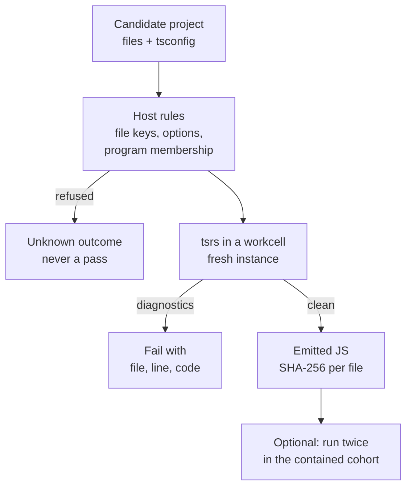

# TypeScript checker

`tscheck` type checks TypeScript inside EndoForge's V8 workcells. It runs `tsrs`, a Rust port of the TypeScript 7
compiler built as WebAssembly (`0.22.0-ts7.1.0-beta`), pinned by hash, so a coding agent's TypeScript can be checked in memory, many projects
at once, without starting a compiler process per check. It is the checker for the TypeScript compatibility lane: code
that does not fit the WebAssembly kernel form, such as imported TypeScript, goes through this lane instead.

## How it works



- `checker.mjs` verifies the module and core digests in [pin.mjs](pin.mjs), then gives every check a fresh compiler
  instance over in-memory files. With `emit`, only a check with no diagnostics returns an artifact, with a SHA-256 per
  file.
- `port.mjs` wraps a caller's host port for an `IsolatePool` and adds the `typescript` invariant. List `typescript` in
  the frozen evaluator's `invariants`. With `emit: true` in `portOptions`, each clean emit's per-file SHA-256 and the
  compiler identity go into the receipt under `evidence.typescript`, which the ledger's hash chain covers. The artifact
  itself is not stored.
- `contained-route.mjs` runs what a clean check emits, twice, in a [contained cohort](../../core/runtime/README.md#contained-javascript)
  (a hardened Node process whose guests run in stripped `vm` contexts) and compares the results and the candidate's
  tests. It is off unless a caller passes it to `runNeed`, and its report does not change a promotion.
- A hash mismatch, a missing compiler, a trap or a refused project throws, so the evaluator records an unknown
  outcome, never a pass.

## Use it

```sh
make tscheck-setup     # installs the pinned @tsrs/wasm without install scripts
make tscheck-test
```

Directly, outside a pool:

```js
import { typecheck } from './tools/tscheck/checker.mjs';
const report = await typecheck({ root: '/proj', files: { '/proj/a.ts': source }, tsconfig }, { emit: true });
```

In a pool of workcells:

```js
import { IsolatePool } from './core/runtime/isolate-pool.mjs';
import { WORKCELL } from './tools/tscheck/pin.mjs';

const pool = new IsolatePool({ hostPort: 'tools/tscheck/port.mjs', size: 8, jobTimeoutMs: 120000, ...WORKCELL });
const result = await pool.run({ reference, candidates, receipts, portOptions: { basePort, projects } });
```

`projects` maps each candidate to `{root, files, tsconfig}`. `WORKCELL` holds the cell limits (1024 MiB WebAssembly,
512 MiB old generation, 256 MiB stack) and the `trustedWasmModules` entry; without it the WASM guard stops the
compiler. Pass `warm: {}` to the pool to load the checker in every cell during `ready()`.

## Example

Saved as `tscheck-demo.mjs` in the repository root after `make tscheck-setup`:

```js
import { typecheck } from './tools/tscheck/checker.mjs';
const project = (source) => ({ root: '/proj', files: { '/proj/cart.ts': source },
  tsconfig: { compilerOptions: { strict: true, target: 'es2022', lib: ['es2022'], module: 'esnext',
    moduleResolution: 'bundler', types: [], outDir: './out' }, files: ['./cart.ts'] } });
const ok = await typecheck(project('export const total = (prices: number[]): number => prices.reduce((a, b) => a + b, 0);\n'), { emit: true });
console.log({ diagnostics: ok.diagnostics, files: Object.keys(ok.artifact?.files ?? {}), wallMs: ok.wallMs, compileMs: ok.compileMs });
const bad = await typecheck(project('export const total = (prices: number[]): string => prices.reduce((a, b) => a + b, 0);\n'), { emit: true });
console.log({ diagnostics: bad.diagnostics, artifact: bad.artifact });
```

```console
$ node tscheck-demo.mjs
{
  diagnostics: [],
  files: [ '/proj/out/cart.js' ],
  wallMs: 82,
  compileMs: 9
}
{
  diagnostics: [
    {
      file: '/proj/cart.ts',
      line: 1,
      column: 52,
      code: 2322,
      text: "Type 'number' is not assignable to type 'string'."
    }
  ],
  artifact: null
}
```

The failing project gets no artifact: only a clean check emits.

## What a pass means

A pass means the checker read the project's TypeScript. The host decides four things and refuses rather than
repairs:

- **File keys.** Every key must be canonical and under a canonical `root`: `/`-separated segments with no empty, `.`,
  `..` or padded segment, no backslash, no control, format or separator character, no lone surrogate, in Unicode NFC.
  Keys that match once case and compatibility forms are folded, and a key below another key, are refused, so the file
  system cannot read one file under two names.
- **Names.** A name whose folded form ends in a compiler extension must carry that extension exactly, so `a.D.ts`,
  `a.TS`, `a.tſ` and fullwidth forms are refused. The rest is classified as the compiler does, case-sensitively:
  `.d.ts`, `.d.mts`, `.d.cts` and `.d.<anything>.ts` are declarations, `.ts`, `.tsx`, `.mts` and `.cts` are sources,
  and anything else is data.
- **Options.** `noCheck`, `noResolve` and `incremental` are set on the command line, so a tsconfig or anything it
  extends cannot switch them.
- **Program.** Membership comes from the `fileNames` list in the build info the compiler writes to a host-owned path;
  stdout is not read. A clean result needs every source in `files` to be in that list, and at least one. That refuses
  `exclude`, `include` or `files` that leave a source out, an empty `files`, and `references`. `@ts-nocheck` anywhere
  in a checked source and any `.tsbuildinfo` input are refused too, so a string containing that text is refused as
  well. A caller whose project legitimately leaves sources out should leave them out of `files`. `composite` stays the
  project's, as in plain `tsc`.

With `emit`, a clean check that writes nothing (for example `noEmit` in its tsconfig) throws rather than returning an
empty artifact.

### Stated limits

These still pass:

- `// @ts-ignore` and `// @ts-expect-error`, any `strict` family setting the project chose, `skipLibCheck` or
  `@ts-nocheck` on a declaration file, and JavaScript without `checkJs`. A project of only JavaScript has no
  TypeScript source and is refused.
- Type lies in declarations and `any`, which are ordinary TypeScript. A `paths` entry can map an import to a
  declaration file that lies.
- A source under `<root>/node_modules/` that nothing imports is not checked: the compiler leaves it out by default and
  it cannot affect the program, but it can hold anything. A `node_modules` directory deeper than the root gets no such
  exemption, so `src/node_modules/app/main.ts` must be in the program or is refused.
- Data files are not scanned; naming one in a `/// <reference>` is a diagnostic.

Refusal has a cost: a real project with a decomposed Unicode name, an upper-case extension, or two names differing
only by case has to rename them. These rules cover what this compiler reads from `files`, and they trust its
`fileNames`.

## Speed and placement

- Sharing the compiled module across thread cells: 56% less peak RSS at 8 cells ([P-45](../../experiments/P-45-shared-module/RESULT.md)).
  A process cell compiles its own.
- Pre-warming in `ready()`: first job 82% faster, at the cost of a slower `ready()` and the same total
  ([P-46](../../experiments/P-46-prewarm/RESULT.md)).
- `typecheck(project, {buildInfo})` feeds the previous check's build info into the next one (`null` to start). A
  one-file edit was 65–80% faster with no diagnostic difference in 220 comparisons; an edit to a widely imported type
  was 18–33% slower ([P-49](../../experiments/P-49-incremental/RESULT.md)). Build info decides which diagnostics are
  reused, so it must come from the caller's own previous check, never from a candidate: a forged file can hide an
  error. `port.mjs` does not use it and a project cannot supply it, so pool verdicts remain full checks.
- Throughput was flat by 8 cells, and 256 MiB of old generation ran out of memory on a healthy job, so do not lower
  `maxOldGenerationSizeMb` below the pin ([P-43](../../experiments/P-43-tsrs-workcell/RESULT.md)). On this stack the
  compiler is not the limit; the evaluator's frozen check is the likely one ([P-48](../../experiments/P-48-width/RESULT.md)).
- Always set `jobTimeoutMs`: a check cannot stop itself.

### In the contained cohort

By default (`check: 'fused'`) the type check and emit run inside the cohort, in the guest's own Worker; `'sibling'`
uses a checker pool in the same cohort, and `'supervisor'` checks on the calling thread (the default for
`layout: 'process-per-cell'`). The cohort placements reached 6–8× the accepted attempts per second at width 16 for
1.08–1.35× the CPU; they missed their precommitted bars, and the maintainer chose `fused` as the default anyway
([P-58](../../experiments/P-58-cohort-typecheck/RESULT.md)). `check-core.mjs` holds the check itself, shared by both
placements; `cohort-check.mjs` prepares what a cohort needs on the supervisor and checks `core.js` against its pin;
`cohort-preparer.mjs` runs inside the cohort Worker. The cohort imports it, `check-core.mjs` and the pinned tsrs
`core.js` from text and passes in the compiler module it compiled once from the pinned bytes, so nothing in the
preparer reads a file. The check has the candidate's trust and failure budget, so it shares the candidate's cohort:
both placements are one job in and one result out per attempt.

In the cohort placements each check is also cheaper by default (`checker: { reuse: true, incremental: true }`):
`tsrs-reuse.mjs` keeps one tsrs instance per Worker and restores its post-instantiation memory image before each
check, discarding it after a trap, an exit, 1,000 runs or 16 MiB of growth, and each check is seeded with build info
from a clean host-owned check of the route's own project (`BASELINE`), so the default library's diagnostics are reused
unless the candidate changes the global scope. That measured 649–702 accepted attempts per second at width 16 against
443–510 for fresh checks, at 23.6 ms CPU per accepted attempt, with no verdict or emit difference; it missed its 700
per second and 49.1 MiB bars ([P-60](../../experiments/P-60-tscheck-snapshot/RESULT.md)).
`checker: { reuse: false, incremental: false }` gives fresh full checks. `skipDefaultLibCheck` is not a substitute: a
global-scope candidate can have its only diagnostic inside the library.

Thread workcells are not an operating-system sandbox; the contained cohort is the hardened place to run emitted code.

## Requalify after a version bump

Update [pin.mjs](pin.mjs), then run `make tscheck-requalify WORK=<dir> TSC=<path to tsc>`. It reruns P-43's parity arm
against the native TypeScript compiler and exits nonzero on any difference. A workload directory holds
`<group>/<name>/proj/tsconfig.json`; inputs are not committed, so `pin.mjs` holds the digest of the workload tree and of
the oracle (its launcher, package file and native compiler, per platform). Only `linux-x64` is pinned. Nonzero means
any of:

- A location, first-line message or exit code that differs from the oracle's.
- A job that does not complete, including a compiler that does not match its pin and a project the checker refuses
  (`not-completed`).
- An oracle or workload whose digest is not the pinned one, or an oracle whose version is not the one in
  `TSRS_VERSION`.
- A workload with fewer than 20 projects, or anything in it that is not a project or a group's `manifest.json`.
- A workload without variety: fewer than 20 distinct projects by source, 3 clean, 3 with a diagnostic located in a
  source file, or 5 distinct codes among those. A configuration error does not count.
- `host-option-effect`: the oracle also runs plain, without the host's options, in a copy of the project, and must
  agree with its hosted run.

## Tests

`make tscheck-test` runs `test/*.test.mjs`: the checker and its refusals, the pool port and receipts, build-info
reuse, the contained route, cohort checks, instance reuse, requalification and the dump-list hook.

Engineering record: component C-16, requirements REQ-TSC-001 to REQ-TSC-006.
